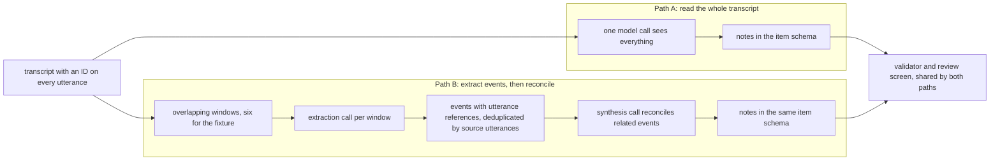
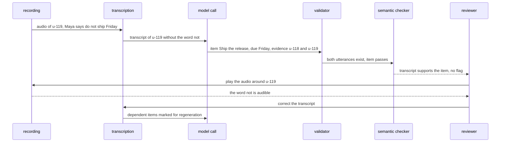

# Chapter 1. Meeting notes that match the recording

Status: draft.

[Introduction](../introduction.md) · [Table of contents](../table-of-contents.md) · [Next: Chapter 2](./02-a-brief-from-documents-that-disagree.md)

**New in this chapter:** output schemas with validation and a repair loop; grounding to source spans; content state vs review state; answer-key evaluation. The chapter also names the first recurring comparison, **Read Everything vs Intermediate Record**.

**Assumes:** one uploaded recording at a time, already transcribed; one generation worker; one reviewer; notes are shared only inside the workspace; nothing leaves the application. Later chapters remove these assumptions: parallel workers and late results in chapter 3, deletion of derived copies in chapter 4, streaming output in chapter 15, duplicate uploads and safe retries in chapter 17, and live capture in chapter 24.

**Reuses:** nothing yet. This is the first case.

> **About the examples.** The release meeting, its people, the workload, and every price in this chapter are fictional. Numbers are illustrative unless labeled *measured*. Company references support specific lessons and link to reviewed sources.

## A summary that reversed a decision

The meeting ends. Within a minute, a polished summary appears:

“Maya will ship the release on Friday.”

Maya had said the opposite: “Do not ship Friday. I can review the rollback plan on Thursday.”

The application recognized the people, the project, and the dates. It produced a clean sentence. It also turned a prohibition into a commitment, and the polish makes the error harder to spot.

Our first application is a meeting workspace for a product team. A user uploads a recording, receives proposed decisions and action items, checks disputed statements against the recording, and shares a reviewed version with the team.

AI is central here because the job is interpretation. Turning an hour of conversation into commitments means tracking who proposed something, who agreed, what was qualified, and what was later withdrawn. A keyword search finds every mention of “Friday.” Knowing whether Friday is still the plan requires reading the whole exchange and following it to the end.

The central interaction is reviewing a work product the AI has assembled. Selecting an action item should reveal who said what, when, and whether later discussion changed it. We define done for a meeting like this:

> An authorized reviewer has accepted a version whose important statements are inspectable, whose uncertainties are visible, and whose audience is allowed to see its evidence.

The application stops at proposed notes that a person accepts. It sends no follow-up messages, creates no tasks in other systems, and makes no guesses about who attended based on voices.

## What the first release has to do

### One recording, three kinds of notes

The first release accepts uploaded audio up to 90 minutes long in one supported language. Longer recordings and other languages get an “unsupported” response until they have been evaluated.

It returns three sections: decisions, action items, and open questions. An item may have no owner, and it may have an uncertain date. An item may never have an invented owner or a confidently invented date.

The **baseline** is a transcript viewer with audio playback, timestamps, and a blank note template, where a person writes the same notes by hand. Comparing against it isolates what note generation adds beyond transcription. If AI notes save writing time but create more checking time, the product is worse than the baseline.

| Requirement | Illustrative first-release target |
| --- | --- |
| Volume | 1,000 meetings per day, averaging 45 minutes |
| Processing time | Proposed notes within 5 minutes of upload, at p95 (95% of meetings) |
| Output | Decisions, actions, open questions, each with source references |
| Sharing | Only after review, and only to people allowed to see the evidence |
| Retention | Raw audio for 30 days, about 324 GB at 32 kbit/s; notes under a separate policy |
| Incomplete input | A damaged or partial recording stays labeled as partial; missing speech is never generated |

A 45-minute meeting at about 160 spoken words per minute contains roughly 7,200 words. At a planning ratio of 1.35 tokens per word, that is about 9,720 transcript tokens, which fits comfortably in a single model call. Count real tokens before admitting a meeting, because the ratio is only a planning estimate.

### Five moments from the release meeting

Every chapter in this book uses a small, hand-checkable example. This chapter's is five moments from the release meeting. Times are offsets into the recording.

| Utterance | Time | Speaker and statement |
| --- | --- | --- |
| u-118 | 02:10 | Leon: “Could Maya ship the release Friday?” |
| u-119 | 02:19 | Maya: “Do not ship Friday. I can review the rollback plan on Thursday.” |
| u-472 | 18:02 | Leon: “Let's make the review Wednesday instead.” |
| u-473 | 18:13 | Maya: “Wednesday works for me, provided the test report arrives first.” |
| u-981 | 41:10 | Maya: “The report is delayed. Leave the review date open; I still own the review.” |

The **answer key** for this fixture lists what correct notes must contain and what they must never contain. It requires one action: review the rollback plan, owned by Maya, with no current date, a prerequisite that the test report arrives first, and evidence from all three exchanges (u-119, u-472 and u-473, u-981). It forbids any accepted action to ship on Friday and any current review date, since Thursday and Wednesday were both superseded.

To match this key, the system has to follow the conversation as it changes. A tool that pulled out names and dates would produce a Thursday review, or a Wednesday one.

### The naive version loses to the baseline

Start with the naive approach. Send the transcript to a model with “Summarize this meeting: decisions, action items, open questions,” and show whatever comes back. At 9,720 tokens, the input fits in one ordinary call.

The output is fluent Markdown. For the release meeting it contains “Maya will ship the release on Friday.” Nothing in it says where a sentence came from, and nothing separates an action item from the model's commentary. To check any item, the reviewer has to replay the whole meeting, so this version costs at least as much review time as the baseline and adds errors the baseline does not have.

The bottleneck is that the reviewer cannot see where any sentence came from. The natural fix is to have the model return separate items, each citing the utterances behind it. Citing requires an identifier on every utterance and a call that can see the utterances it cites. For a 45-minute meeting, one call sees everything. At the 90-minute limit the transcript is about 19,440 tokens, still within a current model's context window, and the open question is whether one call reads that much accurately.

## Two ways to turn a transcript into notes

Cited items work with either of two designs. Both share transcription, the review screen, and the item format. They differ in how much of the meeting one model call sees.



Figure 1.1. The two paths from one transcript to notes. Path A gives one call the whole transcript; Path B extracts events per window and reconciles them, and both feed the same validator and review screen.

### Path A: read the whole transcript

One model call receives the entire transcript, with an identifier on every utterance, and returns the notes in the required schema with references to those identifiers.

Because the model sees everything at once, it can connect a proposal at minute 2 with a retraction at minute 41. No intermediate step exists that could drop a qualification.

The weakness is concentration. A single call has to catch every change in an hour of conversation. A transcript can fit in the model's **context window** (the maximum input it accepts in one call) and still be read inaccurately, and a failed call repeats all the work.

### Path B: extract events, then reconcile them

Split the transcript into overlapping windows. An extraction call on each window returns events: a suggestion, an objection, an acceptance, a commitment, or a retraction, each with its utterance references. A synthesis call then reconciles related events into the same note schema as Path A.

Overlap reduces the chance of cutting a sentence in half, but it creates duplicate events, so deduplicate by source utterances. Two similar sentences can describe two different tasks, and merging them by wording would lose one.

Overlap does nothing for a reversal 40 minutes later. The synthesis step must receive every event about the same subject. If extraction missed the retraction entirely, synthesis cannot recover it.

### What each path costs

| Dimension | A: whole transcript | B: segment and reconcile |
| --- | --- | --- |
| Quality | Sees global context; may overlook a distant qualification | Makes local evidence explicit; depends on extraction and reconciliation |
| Latency | One large call | Parallel extraction, then a required synthesis call |
| Cost | About 10,120 input tokens for the fixture meeting | About 15,020 input tokens, roughly 48% more |
| Privacy | One request sees the whole transcript | Each extractor sees less, but synthesis and stored events still hold everything |
| Operations | One stage to diagnose | More stages, partial failures, and stored intermediate records |
| Recovery | Retry the call | Retry failed windows; recompute synthesis |

The cost row comes from simple arithmetic. Path A sends the 9,720-token transcript plus about 400 tokens of instructions. Path B uses 2,000-token windows with 200 tokens of overlap, which needs six windows. Their combined transcript payload is 10,720 tokens, and six copies of the instructions add 2,400. Synthesis then reads about 1,500 tokens of extracted events plus its own 400 tokens of instructions. The total is about 15,020 input tokens. Output tokens and repairs come on top for both paths.

We start with Path A for bounded meetings. Both paths share the schema, validator, grounding, and review screen, so nothing built for A is lost if B is needed later. Move to Path B when you measure a problem that intermediate events solve: very long recordings, many late corrections, or the need to recompute only part of a meeting after a fix.

This comparison is the first instance of a pattern the book returns to often. We call it **Read Everything vs Intermediate Record**. One option gives the model all the evidence at once. The other builds an explicit intermediate record (events, claims, retrieved passages) that later steps work from. The intermediate record adds inspectability and reuse. It also adds a new place to lose meaning, because downstream steps can only use what the record captured. Chapter 2 meets the pattern again with a claim ledger, and chapter 3 with retrieval.

## What the model sees and returns

This section specifies Path A's input and output.

### Instructions and transcript

The transcript is sent as numbered utterances, each with its identifier, timestamp, and speaker label. The label is an acoustic cluster such as `S2`; a name is attached only after a person has confirmed it. The input also carries the meeting date and timezone, which the model needs to interpret words like “Thursday.” A compact version of the instructions:

```text
You extract decisions, action items, and open questions from a meeting transcript.

Rules:
- Use only the transcript. Every item must cite the utterance IDs that support it.
- Later statements can change earlier ones. Report what currently holds and cite every utterance involved.
- Leave owner or date empty when the transcript does not settle them. Never guess.
- If speech is marked [inaudible] or a gap, do not fill it in.
- If the meeting contains no decisions, actions, or questions, return an empty list.

Meeting date: 2026-09-14 (Monday), timezone America/New_York.

Transcript:
[u-118 02:10 S1=Leon] Could Maya ship the release Friday?
[u-119 02:19 S2=Maya] Do not ship Friday. I can review the rollback plan on Thursday.
...
```

### The item schema

The model returns a list of items. A first version of the schema has five fields. For the fixture, the correct action looks like this:

```json
{
  "type": "action",
  "text": "Review the rollback plan",
  "owner": "Maya",
  "due": null,
  "evidence": ["u-119", "u-472", "u-473", "u-981"]
}
```

The application adds the fields the model must not control: the meeting and transcript identifiers and the speaker-map version. For a meeting with no decisions, the correct response is an empty list; the evaluation later in the chapter rewards that, so the prompt has to allow it.

This schema makes an item checkable. It records that the date is open and nothing about how it became open, and it has no field for the reviewer's decision. Both gaps are filled after validation and grounding are in place.

### Cost and latency

Path A is one call per meeting, dominated by transcript tokens; the output is small. The instructions are identical for every meeting, so a provider's prompt caching can reduce the cost of that repeated prefix where it is supported. Chapter 3 treats caching and batching properly. Start with a capable model, and try a smaller one after the [answer-key evaluation](#scoring-notes-against-an-answer-key) shows it holds up on the hard cases: negations, retractions, and dates that change late.

### Who judges the output

Code can check that a response has the right shape and cites real utterances. Whether a cited passage supports an item is a judgment. In this design a second model reads each item beside its utterances and flags contradictions, and a person decides. [Scoring notes against an answer key](#scoring-notes-against-an-answer-key) measures the result, and the lab compares the checker's flags with reviewer decisions.

## Make every response checkable

A schema stated in the prompt describes the expected output; nothing enforces it. A response can parse as JSON and still omit the evidence field, use a `type` outside the three allowed values, or cite an utterance that does not exist, such as `u-999`. Any of these breaks the review screen. Wrap every model call in a validator that checks three things:

1. Every required field is present, and each value has the right type and an allowed value (`type` must be `decision`, `action`, or `question`).
2. Every cited utterance exists in this meeting's current transcript.
3. The item is internally consistent: an action with a date must cite the utterance where the date was set, and an owner must be a confirmed name or empty.

Many model APIs can also constrain a response to a supplied JSON schema or to a tool's input schema. Use that where your provider offers it, because it prevents most shape errors. Keep the validator anyway, because a perfectly shaped response can still cite an utterance that doesn't exist.

If validation fails, send the response back once with the specific errors (“`u-999` is not in the transcript”) and ask for a corrected version. If the second response also fails, mark the generation failed and show the reviewer the transcript with an explanation. A partly parsed result is never displayed as if it were complete.

Keep this repair loop small and specific. It fixes format problems such as a missing field or an unknown utterance ID. Regenerating until the model produces an answer you like would hide disagreements about meaning, and those belong to the reviewer.

```text
Figure 1.2. One generation, end to end.

transcript ──► model call ──► validator ──► proposed notes ──► review workspace
                   ▲              │
                   └── repair ◄───┘  (once, with the specific errors)
                                  │
                                  └──► failed: show transcript + reason
```

Validate every response in code, repair format errors once, and send questions about meaning to a person.

## A real citation can still be wrong

The validator checks that every cited utterance exists. This item passes it:

```json
{"type": "action", "text": "Ship the release", "owner": "Maya", "due": "Friday", "evidence": ["u-118", "u-119"]}
```

Every check in the validator passes. The schema is valid, and both utterances exist in the transcript. Yet the item is the opposite of what Maya said, because u-119 begins with “Do not.”

Grounding has two layers, and each catches a different error. The first, **reference validity**, asks whether each cited utterance exists, belongs to this meeting, and comes from the current transcript version. Code answers that exactly. The second, **semantic support**, asks whether the cited passage actually supports the item as written. That is a judgment. A second model can compare item and passage and flag contradictions, and the flag moves the item to the top of the reviewer's queue. The reviewer makes the call.

The review screen makes that call fast. Selecting an item highlights its utterances and plays the surrounding audio, a few seconds before and after, so a cut boundary can't hide a qualifying word.

```text
Figure 1.3. The review workspace.

┌─ Proposed notes ───────────────────────┐  ┌─ Evidence ────────────────────────────┐
│ ACTION  Review the rollback plan        │  │ 02:19 Maya  “Do not ship Friday. I can │
│   owner: Maya     date: (open)          │  │       review the rollback plan on      │
│   needs: test report                    │  │       Thursday.”               ▶ play  │
│   [accept] [edit] [mark open] [reject]  │  │ 18:13 Maya  “Wednesday works for me,   │
│                                         │  │       provided the test report…” ▶     │
│ ⚠ checker: no support for “ship Friday” │  │ 41:10 Maya  “Leave the review date     │
│                                         │  │       open; I still own the review.” ▶ │
└─────────────────────────────────────────┘  └────────────────────────────────────────┘
```

The tricky part is that the transcript is evidence too, and it can be wrong. If transcription dropped the word “not,” the transcript itself supports “ship Friday,” and every check against the transcript passes. Only the audio reveals the error. That is why the reviewer can always play the recording, and why the [failure drill](#two-places-the-friday-error-can-enter) tests the transcript separately from the notes.

Speaker names have the same weakness. Transcription reports `S2`, and a person decides that `S2` is Maya. The reviewer maps labels to names, with an *unknown* option, and that mapping is stored separately so a correction leaves the transcript untouched.

A source link tells the reviewer where to look. Check references in code, check support with a person (helped by a model), and keep the original audio one click away.

## Who confirmed it, Maya or the reviewer?

The review screen has accept, edit, and reject buttons, and the item schema has no field to record which one was pressed. The obvious addition is a boolean: `confirmed: true/false`. Two situations break it. Maya clearly committed to the review in the meeting, but no reviewer has looked at the notes yet. Or a reviewer has checked the notes and accepted that the date was left open. One boolean cannot express either, because nobody can tell whether Maya or the reviewer did the confirming.

Keep two separate states on every item, each changed by a different party. The **discourse state** records what happened in the conversation: `proposed`, `accepted`, `qualified`, or `retracted`. The model proposes it from the transcript. The **review state** records what the reviewer did: `pending`, `accepted`, `edited`, or `rejected`. Only the reviewer changes it.

With both, “the date remains unresolved” becomes a valid, reviewed result: discourse state `qualified`, review state `accepted`.

The discourse state describes the commitment. Dates keep their own history, so the schema gains two more fields: `earlier_dates`, for dates the conversation set and then replaced, and `prerequisites`. A task that stays accepted while its date is withdrawn is therefore `qualified` with `due: null`. The prompt gains a matching rule ("For each item, record what the conversation did: proposed, accepted, qualified, or retracted"), and the validator gains a check that `discourse_state` is one of the four values. The complete item for the fixture:

```json
{
  "type": "action",
  "text": "Review the rollback plan",
  "owner": "Maya",
  "due": null,
  "earlier_dates": ["Thursday", "Wednesday"],
  "prerequisites": ["Test report arrives"],
  "discourse_state": "qualified",
  "evidence": ["u-119", "u-472", "u-473", "u-981"],
  "review_state": "pending"
}
```

`review_state` is written by the application, never by the model.

For the fixture, the conversation moves through four steps. Path B stores them as events. Path A stores no events, but its item must still cite all four moments.

```text
Figure 1.4. How the rollback-review commitment changes.

e1  02:19  Maya offers a Thursday review           → proposed
e2  18:02  Leon suggests Wednesday                 → proposed change
e3  18:13  Maya accepts Wednesday, if report first → accepted, qualified
e4  41:10  Maya withdraws the date, keeps the task → date retracted
                                   │
current item: owner Maya · date open · prerequisite: test report
```

Separating the states also settles two everyday situations.

- The reviewer edits an item, and the notes are then regenerated after a speaker-name correction. The new output appears as a proposal beside the reviewed version, and the reviewer merges it. The worker owns its computation, and the reviewer owns the accepted notes. Chapter 3 handles the harder case where several workers run at once, and chapter 8 handles several people editing.
- The reviewer changes the date to Friday because of a decision made after the meeting. Record the change as a reviewer addition with the reviewer's name. Citing 41:10 for it would attribute to the meeting words nobody spoke.

## Scoring notes against an answer key

None of the mechanisms so far measures how often the notes are correct. That requires a fixed set of test meetings with known answers. The tempting evaluation, which misses the chapter's central error, is to read some outputs and judge whether they “look good,” or to score them by word overlap with a reference summary. Both reward fluent notes. Neither notices that “Maya will ship Friday” and “Maya will not ship Friday” differ by one word and mean opposite things.

Evaluate against an answer key instead, written for each test meeting by independent reviewers before any system runs. It contains:

- required items, each with subject, owner, current date state, and qualifications;
- forbidden items that must never appear as accepted, such as the Friday shipment;
- permitted unknowns, fields that may correctly be left empty;
- evidence intervals that a correct item should cite.

A returned item counts as correct only if its subject, owner, date state, and qualifications all match a required item. Then report three numbers:

- Precision is correct items divided by items returned. Low precision means the reviewer wades through noise.
- Recall is required items found divided by required items. Low recall means commitments go missing.
- Forbidden count is the number of forbidden items returned. Any nonzero count on a critical fixture fails the release, whatever the averages say.

For example, suppose a test meeting's key has 10 required items. The system returns 12: 8 match required items, 1 is the forbidden Friday shipment, and 3 are unsupported extras. Precision is 8/12 ≈ 67%, recall is 8/10 = 80%, and the forbidden count of 1 fails the gate.

Report precision and recall separately, because each can be gamed alone. A system that returns one safe item has high precision and useless recall. A system that returns every possible action has high recall and assigns work nobody accepted. Include meetings with no decisions at all, so refusing to invent activity is rewarded.

Two habits make the numbers trustworthy. First, report hard cases separately as **slices**: overlapping speech, similar names, tentative commitments, late date changes. A good average can hide a failing slice. Second, repeat runs. Model outputs vary, so run each held-out meeting (one kept out of development and tuning) several times and report how often each result occurs. Reporting only the best run overstates reliability.

## Two places the Friday error can enter

The drill injects each failure discussed above, plus several others, into the complete design, and the answer key defines the expected outcome of each. The Friday error appears twice because it can enter at two places.

1. Wrong notes, correct transcript. The transcript contains “Do not ship Friday,” but a generated item says Maya will ship Friday. The reference check passes because the utterances exist. The semantic checker should flag the contradiction, and the reviewer should reject the item.
2. Correct notes, wrong transcript. Transcription drops the word “not,” while the audio is intact. Now the notes match the transcript, and every transcript-based check passes. Only listening to the audio reveals the error. The reviewer corrects the transcript, which marks the items that depend on it for regeneration.

The second case shows why checking each stage only against the stage before it lets an error through: every check downstream of transcription agreed with the wrong transcript.



Figure 1.5. The second drill case. Transcription drops the word not, every check against the transcript passes, and only the reviewer's playback of the audio reveals the error.

| Injected condition | How it is detected | Required outcome |
| --- | --- | --- |
| Note contradicts its cited utterance | Semantic checker flag; reviewer playback | Item rejected; faulty output kept for debugging |
| Transcript drops “not” | Reviewer listens to audio | Transcript corrected; dependent items regenerated |
| Model cites `u-999` | Reference validation | One repair attempt; then visible failure |
| Response fails validation twice | Validator | Generation marked failed; reviewer sees transcript |
| Retraction falls across a Path B window boundary | Answer-key test | Final date open; both commitment and retraction cited |
| Silence transcribed as speech | Audio fixture; reviewer | No action created from the invented utterance |
| Reviewer edits an item while regeneration runs | Proposal shown beside edit | Reviewer's edit survives; new output is a proposal |
| Partial recording uploaded | Recording marked partial | Notes say which intervals are missing; no “nothing else was decided” claims |

The last row reflects a broader point: missing input is an ingestion problem, and better summarization cannot recover speech that was never captured.

> **Source finding.** Circleback's [account of rebuilding its recording engine](https://circleback.ai/blog/how-we-rebuilt-our-electron-recording-engine-in-swift) makes the same point from the capture side. The company reported moving capture out of its Electron renderer into native engines and saving recording fragments locally while uploading them. The failures it designed against, including renderer pauses, drifting clocks, crashes, and interrupted uploads, all lose input before any model runs.

The drill passes when:

1. No accepted note says a Friday shipment was committed.
2. The rollback review keeps its owner, open date, prerequisite, and evidence.
3. A reviewer's edits survive regeneration.
4. Missing audio stays labeled and is never filled in.
5. Nothing is sent outside the workspace.

These drills specify intended behavior. They have not yet been run against an implementation.

## Which path to ship first

Path A was the provisional choice above. This section describes the evidence that would confirm it or overturn it, and the gates a release has to pass.

### A 24-meeting lab

Write 24 scripted meetings and record them with consenting participants:

- six straightforward;
- six with tentative commitments and retractions;
- six with similar names or ambiguous dates;
- six with noise, silence, overlap, or gaps.

Independent reviewers write each meeting's answer key before any system runs. Use 8 meetings for development and hold 16 out. Keep every version of a script (alternate transcripts, noisy copies) in the same split, because copies of one meeting are not independent examples. The recordings and keys do not exist yet.

Evaluate in three views, because each isolates a different failure source:

1. Human-corrected transcripts isolate note-generation errors.
2. Real transcription output tests the combined pipeline.
3. Audio fault fixtures test what happens when the evidence itself is unreliable.

Run both paths three times on each held-out meeting with the same model settings and comparable budgets. Measure precision, recall, forbidden items, owner accuracy, retraction handling, and evidence localization, and compare the semantic checker's flags with the reviewers' decisions. Also measure review time, separating active correction and audio playback from idle time, and randomize the order in which reviewers see meetings so they don't learn the answers.

> **Source finding.** Abridge [describes](https://tech.abridge.com/blog/ai-evaluation-at-abridge) offline expert review, staged release, and automated judges checked against clinician annotations. That supports validating an evaluation method before trusting it. Our meeting rubric needs the same validation of its own.

### Cost per accepted meeting

The cost that matters includes the person:

```text
cost per accepted meeting =
  (transcription + generation + storage + retries + review time × rate)
  ÷ accepted meetings
```

> **Illustrative.** If a reviewer costs $60 per hour, cutting review from 6 minutes to 3 saves $3 per meeting. Path B's extra 4,900 input tokens are worth paying for only if they buy measurably better recall or shorter review.

### Release gates, and when to switch paths

Before release:

- the critical negation and retraction fixtures produce no accepted false commitments;
- validation and repair behave as specified;
- quality meets an agreed floor on every slice as well as on average;
- processing time and review time are measured on real workloads.

The suite covers the cases in it, so add a fixture each time a new failure appears in use.

Change paths when the experiment shows a problem the other path solves:

| What the experiment shows | What to try |
| --- | --- |
| Negations are already wrong in the transcript | Improve transcription and audio review first |
| The transcript is right, but distant retractions are missed | Compare Path B's events against the same labeled retractions |
| Notes are right, but review is slower than the manual baseline | Improve the review screen and evidence highlighting |
| Corrections keep forcing full regeneration | Measure Path B's partial recomputation |

Switch for a measured reason. If the missing “not” comes from the audio, extra summarization stages fix the wrong problem.

## Key ideas

- Add a mechanism only for a failure you can name and test.
- The product is a reviewed work product. Define “done” as accepted by a reviewer, with inspectable evidence.
- Compare against a realistic baseline, such as a transcript viewer with a blank template.
- Define the output schema first; validate every response in code and repair format errors at most once.
- Grounding has two layers: code checks that references exist, and a person, helped by a model, checks that they support the claim.
- The transcript can be wrong, so keep the audio one click away.
- Track what the conversation did and what the reviewer did as separate states.
- Evaluate against an answer key with required and forbidden items. Report precision, recall, and forbidden count separately, by slice, over repeated runs.
- Read Everything vs Intermediate Record: start by giving the model everything, and add an intermediate record when measurement shows it helps.

Chapter 2 keeps the same discipline and moves from one conversation to a packet of documents with different authority, where a citation can be real and still leave the question open.

## Exercises

1. Write the answer key. A different meeting contains the utterances below. Write the required item, including its discourse state, and list the forbidden items.

   | Utterance | Time | Statement |
   | --- | --- | --- |
   | u-12 | 04:05 | Lin: “Kofi, can you send the pricing page to legal by Monday?” |
   | u-13 | 04:13 | Kofi: “I'll send it, but Monday is too soon. Wednesday.” |
   | u-87 | 33:40 | Lin: “Hold off until the new prices are approved. No date for now; it's still yours, Kofi.” |

2. Find the check that catches it. A response contains `{"type": "action", "text": "Ship the release", "owner": "Maya", "due": "Friday", "evidence": ["u-118", "u-119"]}`. Which of these passes: schema validation, reference validation, semantic support? Who or what should catch the error? What changes if the transcript had dropped the word “not”?

3. Score two runs. A test meeting's answer key has 6 required items and 2 forbidden items. Run 1 returns 7 items: 4 match required items, 1 is a forbidden item, and 2 are unsupported. Run 2 returns 2 items, both correct. Compute precision, recall, and forbidden count for each run. Does either pass?

<details>
<summary>Answers</summary>

1. Required: the action “send the pricing page to legal,” owned by Kofi (u-13, reaffirmed in u-87), with no current date, the prerequisite “new prices approved,” discourse state `qualified`, and evidence u-12, u-13, and u-87. Monday was proposed and declined; Wednesday was offered and then withdrawn. Forbidden: Kofi sends it by Monday; Kofi sends it by Wednesday.

2. Schema validation passes, and so does reference validation, because both utterances exist in this meeting. Semantic support fails: u-119 says “Do not ship Friday.” The semantic checker should flag the item for priority review, and the reviewer rejects it after reading or playing u-119. In evaluation, it also counts as a forbidden item. If the transcript had dropped “not,” the passage would appear to support the item, and the semantic check against the transcript would pass too. Only listening to the audio would catch it.

3. Run 1: precision 4/7 ≈ 57%, recall 4/6 ≈ 67%, forbidden count 1. It fails the gate because a forbidden item appeared. Run 2: precision 2/2 = 100%, recall 2/6 ≈ 33%, forbidden count 0. It is safe and misses most commitments, so it fails any reasonable recall floor. Neither passes, which is why the three numbers are reported separately.

</details>

## Sources

Sources used here, linked to the original articles:

- [Circleback capture engineering](https://circleback.ai/blog/how-we-rebuilt-our-electron-recording-engine-in-swift)
- [Abridge evaluation lifecycle](https://tech.abridge.com/blog/ai-evaluation-at-abridge)

