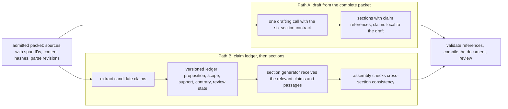
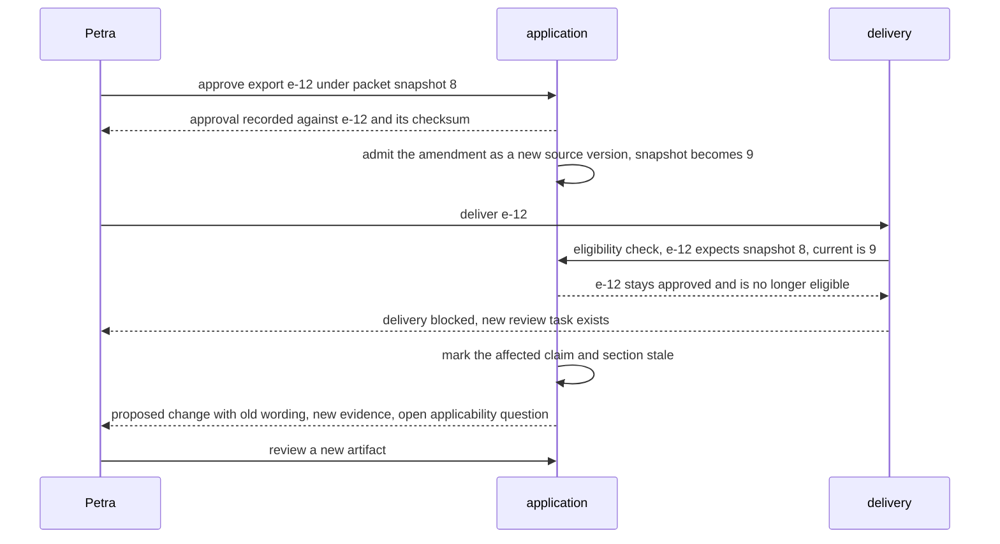

# Chapter 2. A brief from documents that disagree

Status: draft.

[Previous: Chapter 1](./01-meeting-notes-that-match-the-recording.md) · [Table of contents](../table-of-contents.md) · [Next: Chapter 3](./03-investigating-a-thousand-documents-when-some-wont-parse.md)

**New in this chapter:** **the four checks** on a citation (exists, supports, applies, covers); the claim ledger; **positive vs scope dependencies**; approving an exact revision.

**Assumes:** one packet, admitted once and read in full; one analyst; one model call per draft or section; no concurrent editing (chapter 8); no deletion of derived copies (chapter 4); no caches or queues shared across packets (chapter 3). Documents in the packet are untrusted text and nothing in them can grant the application a capability.

**Reuses:** output schemas with a repair loop and grounding to source spans (chapter 1); answer-key evaluation (chapter 1); Read Everything vs Intermediate Record (chapter 1).

> **About the examples.** The supplier, the packet, Petra's team, the workload, and every price in this chapter are fictional. Numbers are illustrative unless labeled *measured*. Company references support specific lessons and link to reviewed sources.

## A citation that is real and no longer governs

Petra, an operations analyst, needs a supplier-renewal brief before tomorrow's review. The packet holds an agreement, an amendment, a pricing schedule, service reports, and email correspondence. The brief should explain the current arrangement, summarize service issues, flag conflicting evidence, and list the decisions the team still has to make.

The first generated draft is convincing. It cites the agreement for a sixty-day notice period.

An amendment in the same packet changes the relevant period to thirty days.

The citation is real. The quoted sentence exists on the page it names. The conclusion is still wrong for the brief, because the system never asked which document governs the statement. This is a different failure from inventing a source, and the checks that catch invented sources do not catch it.

Our application turns an approved packet into a structured, editable briefing document. Petra inspects each material claim, changes wording, resolves conflicts, and approves an exact revision for an internal audience. The application does not negotiate, renew, terminate, send a notice, or decide the legal effect of an ambiguous clause.

Chapter 1 followed one conversation through time. Here the evidence arrives in several files with different roles. An email expresses an intention. A service report describes an observation. An amendment changes a term that an earlier document established. Fluent drafting flattens those differences, and flattening them changes the meaning of the work.

## What the brief has to contain

### Six sections and a baseline

The deliverable is a two-to-four-page internal brief:

1. Scope, supplier identity, and the packet's "as of" date.
2. Current commercial terms, with unresolved interpretations flagged.
3. Service performance during a stated reporting period.
4. Reported incidents and open remediation work.
5. Conflicts, missing evidence, and assumptions requiring confirmation.
6. Questions and options for the review meeting.

The model may organize and express evidence. It may not fill a missing performance figure from general knowledge, and it may not turn an analyst's suggestion into an agreed commitment. A recommendation, where requested, is labeled as analysis and kept apart from sourced facts.

The first release uses the admitted packet and nothing else. There is no web search, no inbox access, and no retrieval across customers. A missing source becomes a request for evidence.

The baseline is Petra reading the same packet and filling the same template with manually attached references. The comparison measures final document quality and review effort, which includes the time spent checking the draft.

| Requirement | Illustrative first-release target |
| --- | --- |
| Volume | 200 new packets per day |
| Typical packet | 12 files, about 60 text-equivalent pages |
| Revisions | An initial draft plus up to three analyst-requested revisions |
| Processing | A reviewable first draft within 10 minutes of successful ingestion, at p95 |
| Evidence | Every material factual claim resolves to a source version and location |
| Authority | An authorized person approves an exact document for an authorized audience |
| Incomplete input | Missing pages, unresolved amendments, and failed parses stay visible |

Sixty pages at 420 words per page and 1.35 tokens per word is about 34,020 text tokens per packet, so 200 packets are 6.804 million tokens a day before instructions, output, retries, and revisions. Tables and scanned pages make the estimate unreliable; the parsed payload is what gets counted.

### A packet with one controlled contradiction

The fixture supplier provides two services, hosted and on-site support. Five sources carry the chapter.

| Fixture source | Relevant statement | What the brief may assert |
| --- | --- | --- |
| Agreement, section 8 | Nonrenewal notice for both services is sixty days | The base document states sixty days; applicability still depends on modifications |
| Amendment, section 2 | Effective July 1, hosted-service nonrenewal notice becomes thirty days; other terms unchanged | Thirty days for the hosted service after July 1 |
| Account email | A salesperson expects the new period to cover all services | An attributed expectation that conflicts with the amendment's scope |
| Service report | Availability was 99.9% in August under the report's own method | A reported August figure, with its author and denominator |
| September incident log | One remediation item remains open | "All incidents resolved" is forbidden for a brief covering September |

The answer key for this packet: hosted service thirty days from July 1, on-site support sixty days, both with distinct sources; the email's expectation recorded as a conflict; availability attributed to the supplier's report; one open incident. A schema with a single `notice_days` field cannot express the first two facts, and that is the point of the fixture.

### The naive version cites the wrong clause correctly

Start with the obvious design: parse the twelve files, place them in one model call with the six-section template, and ask for a brief with citations.

The draft is fluent and every citation resolves. Section 2 says sixty days and cites agreement section 8, page 7. That citation passes any check that asks whether the passage exists and whether it says what the brief says it says. Petra, reading the brief, has no signal that another document changed the term. To find out, she reads the packet.

The limitation is that the draft records where a sentence came from and nothing about whether that source still governs. The fix requires three things the naive version lacks: a way for the model to cite at the level of a passage, a record of each claim with its scope, and a check that asks the applicability question. Before building them, the chapter has to decide whether claims become a durable record or stay inside each draft.

## Two ways to draft from a packet

Both paths parse the packet into sources with stable identifiers and produce the same six-section document with claim-level citations. They differ in whether claims live only inside a draft or become a record that revisions and later briefs reuse.



Figure 2.1. The two ways to draft from a packet. Path A drafts every section from the whole packet in one call; Path B extracts claims into a versioned ledger first and generates sections from them, and both end in the same compiled document for review.

### Path A: draft from the complete packet

Place the admitted packet in the model's context with the document contract and ask for structured sections, each sentence carrying its evidence references. Validate the references, compile the document, and present it for review.

A complete packet gives the writer every qualification that a narrow extraction schema might drop, and it lets a small team ship without maintaining a fact database. The risks show up on revision: the model can overlook an amendment, mix reporting periods, or regenerate a previously correct section differently. Every revision rereads the packet, and a changed source makes the whole draft potentially stale.

### Path B: build a claim ledger, then assemble sections

Extract candidate claims into a versioned ledger first. Each entry states one proposition, its subject, time period, scope, supporting and conflicting passages, and review state. A section generator receives the claims relevant to its section and the passages behind them; an assembly step checks cross-section consistency and compiles the same deliverable.

This path fits repeated deliverables, amendment-heavy packets, and claim-by-claim review. Its hazard is durability in the wrong place: a mistaken extraction, once in the ledger, spreads into every document built from it.

> **Source finding.** EvenUp [argued](https://www.evenuplaw.com/blog/document-ai/) for a persistent, source-linked record, including provenance for visual evidence and retained corrections, in place of treating each question as a fresh read of the documents. The article combines architecture already built with directions still planned.

This is Read Everything vs Intermediate Record from chapter 1 with a different motive. Chapter 1's intermediate record (events) existed to reconcile distant parts of one conversation. Here the record (claims) exists for reuse across revisions and briefs, and its cost is justified by how often the same packet is drafted from.

### What each path costs

| Dimension | Path A: full packet | Path B: claim ledger |
| --- | --- | --- |
| Quality | Full context; omissions and inconsistent rereading possible | Explicit qualifications and reuse; extraction errors can propagate |
| Latency | Shorter pipeline for a bounded packet | Up-front extraction and reconciliation; later edits reuse work |
| Cost | Low setup; full reread per revision | Schema and extraction overhead; pays off with reuse |
| Privacy | Whole packet on every draft request | Narrower section contexts plus one more sensitive store |
| Safety | Coarse invalidation, whole-document review | Fine-grained review where dependency tracking is trustworthy |
| Operations | Few artifacts and stages | Claim versions, dependency edges, schema migrations, conflict queues |
| Recovery | Keep the prior draft; regenerate from the packet | Recompute affected claims and sections; never replace approved content silently |

The cost comparison has a clean form. Let F be the processing cost of one full-packet draft, E the initial extraction and reconciliation cost, S the cost of a section-based draft, and r the number of drafts of the same packet:

```text
Path A = r × F
Path B = E + r × S
Path B is cheaper on processing alone when r × (F − S) > E
```

With an illustrative F of $1.20, E of $2.40, and S of $0.40, the paths tie at three drafts; at four drafts, A costs $4.80 and B costs $4.00. Review labor, schema maintenance, failed work, and correctness are on top of these numbers, and the review line usually dominates.

We start with Path A for one-off briefs, with the source metadata and document structure that Path B would need already in place, so a move to the ledger wastes nothing. Switch when repeated drafting or expensive claim-by-claim review shows the ledger paying for itself.

Under either path, a sentence in the draft has to arrive attached to a passage in the packet. How that attachment is made is the first design decision inside the model call.

## What the model sees and returns

### Sources with addresses

Each file in the packet gets a stable source ID and a content hash. Parsing produces a parse revision that maps extracted spans back to page, region, table cell, or text range in the original bytes. A page number alone is a weak address, since replacing a PDF can move a clause to another page; the span address names the source version and the parse revision too.

The model receives the packet as sources with span identifiers, the six-section contract, and the "as of" date. A compact version of the drafting instructions, for Path A:

```text
You draft an internal supplier brief from the provided packet.

Rules:
- Use only the provided sources. Every material claim cites one or more span IDs.
- State the scope of each term: which service, which period, which document.
- When two sources state different values for the same term, report both with their scopes and mark the conflict. Never choose by upload order.
- Attribute reported figures to their author ("the supplier's August report states").
- If a referenced document is absent from the packet, say so in section 5.

As of: 2026-09-30.
Sources:
[agreement-v1/parse-1] (14 pages) ...
[amendment-v1/parse-2] (3 pages) ...
```

### Sections made of claims

The response is a document tree, each paragraph a list of text runs with claim references:

```json
{
  "section": 2,
  "paragraphs": [
    {"text": "Nonrenewal notice for the hosted service is thirty days, effective July 1, 2026.",
     "claims": ["c-57"]},
    {"text": "Nonrenewal notice for on-site support remains sixty days.",
     "claims": ["c-41"]}
  ],
  "claims": [
    {"id": "c-57", "subject": "supplier-a/hosted-service", "predicate": "stated_nonrenewal_notice",
     "value": {"amount": 30, "unit": "days"}, "effective_from": "2026-07-01",
     "support": ["amendment-v1/parse-2/span-14"], "contrary": ["agreement-v1/parse-1/span-82"]}
  ]
}
```

The compiler owns section order, numbering, and footnotes; the model never guesses that the amendment will become footnote 7. Validation and a single repair attempt follow chapter 1's loop.

### Three ways to attach a citation

The attachment can be made three ways, and each fails differently.

With span IDs in the prompt, as above, the model writes the identifier itself. It can invent an ID that does not exist (caught by validation) or cite a real span that is broader than the claim.

With a native citation feature, where the provider accepts source documents and returns located quotes with each sentence, the location is produced by the provider from the text it actually used. It can still cite a passage that supports the words and not the scope.

With post-hoc attribution, a second call matches a finished sentence to the best passage. It is cheapest and least trustworthy, because the match is made after the fact and can find a passage the writer never read.

> **Source finding.** Harvey [reported](https://www.harvey.ai/blog/rebuilding-harveys-review-algorithm) redesigning its review tables toward statement-level references and revising cell output so answers are easier to check, evaluating citation quality alongside preference, latency, and successful responses. Provenance and the review surface were designed together.

The first two mechanisms produce real citations. The fixture's wrong draft, sixty days citing section 8, has a real citation under either of them.

## A citation can exist, support, and still not apply

Section 8 exists, belongs to the packet, and says sixty days. The sentence "notice is sixty days" is supported by it. The sentence is still wrong for the hosted service, because the amendment applies and section 8 no longer does.

A citation answers four questions, and a draft needs all four answered:

- **Existence.** Does the cited location exist, and does it belong to this packet?
- **Support.** Does the passage support the proposition as written?
- **Applicability.** Is it the relevant version, subject, and period?
- **Coverage.** Did the admitted packet contain the evidence this conclusion needs?

Code answers the first exactly. A model can grade the second. The third and fourth are judgments that need the claim's scope and the packet's manifest, and they are the ones the naive version never asked. The four checks are named here because every later chapter that cites evidence (3, 6, 19, 21, 22, 29) applies them under the same names.

The fixture exercises each. "Sixty days" passes existence and support and fails applicability for the hosted service. "99.9% availability" passes all four as "the supplier reported 99.9% availability" and fails support as "the service achieved 99.9% availability," because the only passage is the supplier's own report. "All incidents resolved" passes existence and support against the August report and fails coverage, because the September log is in the packet and says otherwise.

Passing the four checks for one claim requires the claim to carry its scope, which the draft's prose does not.

## One claim, its scope, and what supersedes it

The ledger, whether durable (Path B) or draft-local (Path A), stores claims as propositions with scope. Two candidates for the fixture:

```text
c-41: stated_nonrenewal_notice = 60 days
      subject: supplier-a (both services); evidence agreement-v1/parse-1/span-82
c-57: stated_nonrenewal_notice = 30 days
      subject: supplier-a/hosted-service; effective 2026-07-01
      evidence amendment-v1/parse-2/span-14
```

Reconciliation asks whether the two concern the same supplier, service, period, and clause. For the hosted service they do, and the amendment supersedes under the fixture's rule, which an authorized reviewer confirms. For on-site support they do not, and c-41 stands.

```text
agreement-v1/parse-1/span-82 ──support──► c-41  stated_nonrenewal_notice = 60 days   subject: supplier-a (both services)
                                             │
                                             │ supersession (hosted service only; effective 2026-07-01; confirmed by reviewer)
                                             ▼
amendment-v1/parse-2/span-14 ──support──► c-57  stated_nonrenewal_notice = 30 days   subject: supplier-a/hosted-service
                                             ▲
                                             │ contradiction (scope: "all services")
account-email-v1/span-3 ──────support──► c-63  expectation: new period covers all services   author: salesperson

on-site support: c-41 stands (no superseding claim in scope)
```

Figure 2.2. The fixture's claims and their edges. Support ties a claim to a passage; contradiction ties two claims that disagree about one scope; supersession ties a later governing term to the one it replaced, and only within the scope the amendment names.

Three kinds of edge are kept apart. Support connects a claim to its passage. Contradiction connects two claims that disagree about the same scope, as the email's expectation disagrees with the amendment. Supersession connects a later governing term to the one it replaced. Deleting c-41 after supersession would make the earlier brief unexplainable; keeping it without its disposition would let a later generator revive it. The record keeps both the claim and its fate.

Identity is never a sentence. Two phrasings describe one scoped assertion; two identical phrases can describe different services. Stable subject IDs and explicit predicates reduce accidental merges, and a merge that touches a reviewed term needs an inspectable determination and a way to reverse it.

"Unsupported" also carries a reason. No passage, an unreadable schedule, and a genuine conflict need different repairs, and an unavailable source is never evidence that a proposition is false.

The ledger now explains every sentence that cites something. The fixture's last forbidden sentence cites nothing.

## Claims about what the packet does not contain

"No unresolved incidents appear in the packet" is a claim about absence. It depends on every incident report the packet holds, including ones the model never cited, and on the packet's manifest, which says what was admitted. Adding the September log invalidates the sentence without touching any citation.

Two kinds of dependency are recorded. **Positive dependencies** connect a paragraph to the claims and sources it cites: this paragraph relies on c-41, which relies on agreement-v1. A replacement of that source marks the claim and the paragraph for reconsideration. **Scope dependencies** connect a claim of absence or completeness to the packet snapshot it was made against. Adding, removing, or replacing any source changes the snapshot and marks every scope-dependent claim stale, whether or not a citation points at the new file.

A first implementation marks the whole draft stale whenever the packet changes. That is coarse, and it is correct. Selective invalidation is an optimization added after dependency tracking has been tested against added, changed, and removed sources, and chapter 3 reuses this coarse-first rule for its collection snapshot.

Petra now reads a draft whose claims are scoped, checked, and tied to the packet they came from. What she approves has to be as exact as what she read.

## Approve the exact bytes

Approval attaches to an artifact, never to "whatever the document becomes." An export is built from a document revision, a template version, and a renderer version; it carries a checksum and a manifest of the source versions and claim revisions it depends on. The approval command names that export's identity and checksum, the expected packet snapshot, the intended audience, and an idempotency key, and the application records the approval against exactly that artifact.

Two states are kept apart. Approval is a historical event: Petra approved export e-12 under packet snapshot 8. Delivery eligibility is a current decision: after a material amendment creates snapshot 9, e-12 remains approved and is no longer eligible, and a new review task exists. The old bytes are never rewritten.

Delivery rechecks the audience against every included source. A correct brief can still disclose a restricted pricing schedule, so the permitted audience is the intersection across evidence, and a mixed audience gets a separately reviewed redacted version instead of hidden citation buttons.

Rendering is checked on the rendered page, because a correctly sourced amount under a wrapped header can land in the wrong column, and a footnote can drop in export while the editor's link still works. A renderer crash leaves the document revision intact and the export failed; the same revision is rendered again, and the prose is never regenerated to repair a layout.

Concurrent generation, where a shortening request started on snapshot 8 returns after snapshot 9 exists, needs an expected-version check at publication. Chapter 8 owns that mechanism; here, the rule is that a result built on an obsolete snapshot cannot become the current draft.

## An amendment arrives after approval

The drill starts from a brief generated from agreement-v1 and approved as export e-12, then injects the chapter's failures into the complete design.

1. Admit the amendment as a new source version; the packet snapshot becomes 9.
2. Attempt delivery of e-12. The eligibility check finds an obsolete snapshot and blocks it.
3. The affected claim and section are marked stale, or the whole document is, where dependency coverage is uncertain.
4. A proposed change shows the old wording, the new evidence, and the unresolved applicability question.
5. Petra reviews a new artifact before the updated brief is released.



Figure 2.3. The drill's first injection. An amendment admitted after approval moves the packet to snapshot 9, the delivery check finds e-12 bound to snapshot 8, and the approval survives while eligibility does not.

Then add a previously unknown incident report. "All incidents resolved" becomes stale with no change to any positive citation.

| Injected condition | How it is detected | Required outcome |
| --- | --- | --- |
| Amendment admitted after approval | Snapshot generation mismatch | e-12 stays approved and ineligible; new review task |
| New incident report, no prior citation | Scope dependency | Absence claim marked stale |
| Citation exists but applies to another service | Applicability check | Conflict preserved; claim rejected or scoped |
| OCR drops a column heading | Parser readiness | Flagged representation; no unqualified number in the terms table |
| Analyst changes a material number | Support recheck | Old citation does not survive the edit unexamined |
| Export drops the final footnote | Rendered-page check | Export failed; no approval |
| Approval response lost | Approval idempotency key | Same approval record on retry |
| Shorten-this-paragraph result built on snapshot 8 returns under snapshot 9 | Expected-version check (chapter 8) | Result retained as a candidate, never current |
| Reader loses access during rendering | Delivery authorization | Export withheld for that reader |

The drill inspects stored claims, dependencies, exports, and eligibility, never the draft's wording alone. These drills specify intended behavior. They have not yet been run against an implementation.

## Which path to ship first

Path A was the provisional choice above. This section describes the evidence that would confirm it or overturn it, and the gates a release has to pass.

### A lab with controlled revisions

Author twenty fictional packet families, each with a base packet and one controlled revision: a scoped amendment, a reporting-period change, a newly discovered incident, or a presentation-only change with identical bytes. Add scanned tables and incomplete attachments across the categories. Use eight families for development and twelve held out, keeping every version of a family in one split. Independent reviewers label required claims, forbidden assertions, applicability decisions, permissible unresolved fields, and evidence coordinates before either path runs. The packets do not exist yet.

Run initial drafting and three identical edit requests for both paths: clarify attribution, shorten a named section, incorporate the controlled update. Keep the model, output contract, permitted evidence, and review interface equal, and record cold and warm processing separately so Path B's extraction setup is visible and Path A's parse reuse is credited.

Grade against the answer key: supported material claims over material claims asserted; required facts represented, including explicit treatment of missing evidence; citation location accuracy and passage support separately; applicability errors; contradictions within and across sections; stale-output escapes during source changes; export fidelity. A correct thirty-day answer with an invented effective date fails its claim.

> **Source finding.** Harvey [described](https://www.harvey.ai/blog/scaling-ai-evaluation-through-expertise) expert-curated retrieval tests, blinded answer comparisons, and versioned evaluation datasets, keeping evidence retrieval and answer assessment as separate measurements. The brief's evaluation keeps that separation.

### Capacity and the reuse threshold

Two hundred packets at sixty pages is 12,000 pages of parsing a day; if half need OCR at an assumed five pages per worker-minute, that is 1,200 worker-minutes. A burst of twenty packets in one minute is 680,400 text tokens, and a fictional provider allowance of 200,000 input tokens per minute makes 3.402 minutes a lower bound for one full read before generation, output, or queueing. The ten-minute target starts after successful ingestion, so upload-to-ready time is reported beside it.

The three-draft tie in the cost section omits people. Add review minutes at a labor rate and the frequency of ledger corrections that invalidate several sections. A ledger saves money when actual reuse and acceptable quality repay both extraction and maintenance; a one-off packet with an unusual schema may never reach that point.

### Release gates, and when to move to the ledger

Before release:

- the provenance, authorization, stale-approval, and export suite passes;
- the amendment and incident fixtures are independently reviewed;
- factuality, coverage, review-time, and latency floors, agreed with the product owner, hold on every revision category.

A factuality score cannot compensate for delivering to an unauthorized reader. A rollback selects an earlier generator for new candidates and retires faulty exports from delivery; it does not erase historical approvals, and an old compiler that cannot read new scope fields is an unsafe rollback target.

Move to Path B when measured reuse, revision frequency, and claim-level review cost cross the threshold the lab establishes. For amendment-heavy recurring briefs, the balance may favor the ledger from the start.

## Key ideas

- A real citation can fail to govern the question; the four checks (existence, support, applicability, coverage) are separate questions with separate owners.
- A claim is a scoped proposition with support, contradiction, and supersession edges; a superseded claim keeps its disposition.
- Claims of absence depend on the packet snapshot, so a new source can stale them without touching any citation.
- Mark the whole draft stale on any packet change first; make invalidation selective only after it is tested.
- Approval binds to an exact export and snapshot; delivery eligibility is a separate, current decision.
- Three ways to attach a citation (IDs in the prompt, a native citation feature, post-hoc attribution) fail in three different ways; none answers applicability.
- Read Everything vs Intermediate Record, motivated by reuse: Path B pays off when r × (F − S) exceeds E, with review labor included.

Chapter 3 keeps the snapshot and the four checks and removes the assumption that the packet fits in one call, with a thousand documents and a hundred that will not parse.

## Exercises

1. Run the four checks. For each fixture statement below, say which of existence, support, applicability, and coverage it passes as written for a brief about the hosted service as of September 30: (a) "Notice is sixty days (agreement §8)"; (b) "Notice is thirty days (amendment §2)"; (c) "The service achieved 99.9% availability in August (service report)"; (d) "All incidents are resolved (August report)"; (e) "The new period covers all services (account email)".

2. Find the stale paragraphs. A brief has four paragraphs: P1 cites c-57 (thirty days, hosted); P2 cites c-41 (sixty days, on-site); P3 says "no open incidents in the packet" and cites the August report; P4 cites the pricing schedule. A new September incident log is admitted. Under positive dependencies alone, which paragraphs are marked stale? Under positive plus scope dependencies?

3. Recompute the break-even. F = $2.00, E = $5.00, S = $0.50. At how many drafts do the paths tie? If each ledger correction invalidates two sections at $0.50 each and one correction happens per packet on average, at how many drafts do they tie?

<details>
<summary>Answers</summary>

1. (a) Existence and support pass; applicability fails for the hosted service after July 1. (b) All four pass. (c) Existence passes; support fails, because the passage supports "the supplier reported 99.9%" and nothing about achievement; applicability and coverage are moot once support fails. (d) Existence and support pass against the August report; coverage fails, because the September log in the packet shows an open item. (e) Existence and support pass as an attributed expectation; applicability fails as a statement of the governing term, since the amendment scopes the change to the hosted service.

2. Positive only: none, because no paragraph cites the new log. Positive plus scope: P3, because its absence claim depends on the packet snapshot, which changed.

3. Tie when r × (F − S) = E, so r × 1.50 = 5.00 and r ≈ 3.33, meaning B is cheaper from the fourth draft. With one correction per packet costing 2 × $0.50 = $1.00, B's cost is E + 1.00 + r × S, so r × 1.50 = 6.00 and r = 4; B is cheaper from the fifth draft.

</details>

## Sources

Sources used here, linked to the original articles:

- [Harvey review-table redesign](https://www.harvey.ai/blog/rebuilding-harveys-review-algorithm)
- [Harvey evaluation infrastructure](https://www.harvey.ai/blog/scaling-ai-evaluation-through-expertise)
- [EvenUp durable document record](https://www.evenuplaw.com/blog/document-ai/)
- [OpenEvidence evidence-strength pipeline](https://www.openevidence.com/blog/introducing-evidencegrade-grading-the-strength-of-medical-evidence-in-real-time), background on separating support from applicability

