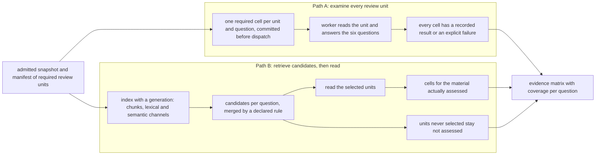
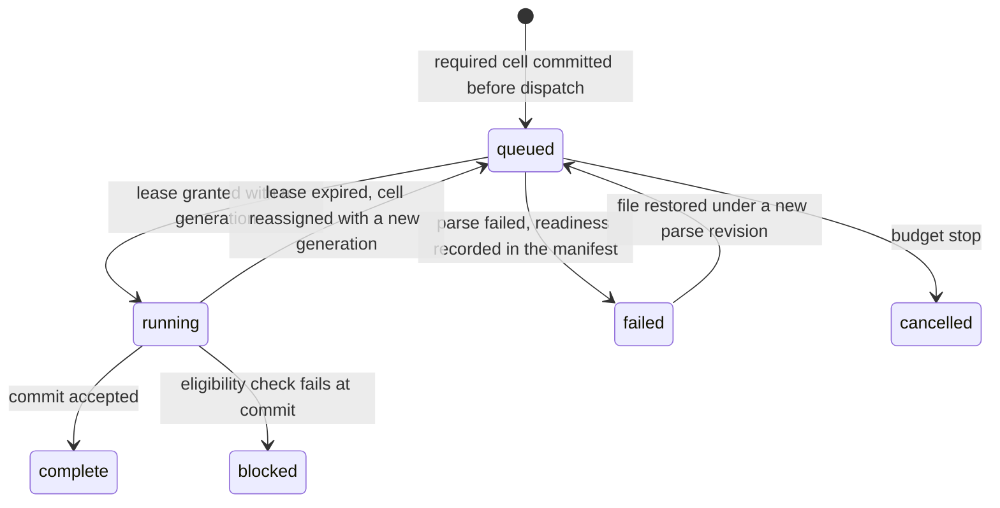

# Chapter 3. Investigating a thousand documents when some won't parse

Status: draft.

[Previous: Chapter 2](./02-a-brief-from-documents-that-disagree.md) · [Table of contents](../table-of-contents.md) · [Next: Chapter 4](./04-a-team-wiki-that-keeps-up-with-its-sources.md)

**New in this chapter:** chunking and hybrid retrieval; the **scope certificate** for negative claims; recall × accuracy decomposition; batching and prompt caching; **leases and fenced publish** for parallel workers.

**Assumes:** a fixed collection admitted as one snapshot; six questions agreed before the run; no source changes during the investigation; permissions checked before any read. Chapter 4 removes the frozen snapshot, chapter 5 adds video, and chapter 6 lets the model choose what to search next.

**Reuses:** the four checks and claim scope (chapter 2); output schemas with a repair loop and answer-key evaluation (chapter 1); Read Everything vs Intermediate Record (chapter 1).

> **About the examples.** The supplier portfolio, its documents, the workload, and every price in this chapter are fictional. Numbers are illustrative unless labeled *measured*. Company references support specific lessons and link to reviewed sources.

## A clean table that hides a hundred failures

The supplier brief from chapter 2 was useful. The operations team now wants the same questions answered for the whole portfolio: which agreements need attention before the next review, with the stated notice periods, the relevant dates, and the supporting passages.

The application returns a clear table. Every populated row has a citation. The summary says no additional exceptions were found.

Behind the table, a hundred scanned PDFs failed parsing. Nothing in the table says so.

This is an accounting error before it is a writing error. The system has confused the scope of its answer with the scope of the request. Improving the prose would make the mistake more persuasive.

Our application is an investigation workspace. Tomas, an operations analyst, chooses a collection and defines a fixed set of questions. The product produces an evidence matrix: review units as rows, questions as columns, and inspectable answers in the cells. It also shows which inputs were examined, which remain uncertain, and which were never examined at all.

AI is central because each cell needs a reading, and a thousand readings is more than any analyst will do by hand. The job of this chapter is to make sure a thousand model readings add up to a statement Tomas can sign: completeness has a scope, and the system must state what it examined before it states what it found.

The application reads an admitted snapshot and writes nothing anywhere else. It does not absorb new files mid-run, treat any contract as legally settled, or act on the dates it extracts.

## What a review unit is and what the matrix must say

### Six questions, agreed before the run

Tomas approves six questions. Each has a definition, an expected answer type, and a policy for missing or conflicting evidence:

- Which supplier and service does this review unit concern?
- What notice period is explicitly stated, and for what action?
- What renewal or expiration date is explicitly stated?
- Does the packet contain an amendment relevant to those fields?
- Which required schedules are referenced but missing?
- Which answers need a reviewer because the evidence conflicts?

"Notice period" alone is too loose to extract. Notice of an incident, of nonrenewal, and of termination are different obligations, and a column that merges them would sort nicely and mislead. The question contract carries the action.

A **review unit** is the smallest set of sources needed to answer a row responsibly. It may be one report, or an agreement together with its amendments and schedules. File boundaries and answer boundaries are different things.

The baseline is manual review with the same manifest and the same six spreadsheet columns. A simpler software baseline adds full-text search and filters. Both paths are compared against these on coverage, correctness, and verification effort.

| Requirement | Illustrative design assumption |
| --- | --- |
| Collection | 1,000 review units, each with one or more source files |
| Questions | Six fixed questions, so 6,000 logical cells |
| Typical unit | 5,000 parsed tokens; larger units are partitioned or handled separately |
| Interaction | Partial results appear as they commit; completion status stays explicit |
| Result | Answers, evidence, uncertainties, and coverage for the same snapshot |
| Isolation | Permission checked before model input, evidence display, and export |
| Limits | Per-workspace budgets for tokens, concurrency, parsing, and retries |

### Three suppliers that break a simple plan

The fixture has three review units. Supplier A has a readable agreement and a readable amendment that changes only its hosted-service notice period. Supplier B has an agreement that refers to a schedule nobody uploaded. Supplier C has two nearly identical amendments with different effective dates.

A plan that assigns one file to each supplier gets all three wrong. For A, both files are needed to answer the notice question. For B, the missing schedule is part of the required input even though its bytes are absent. For C, a file-deduplication pass that compares most of the text would erase the one date that matters.

Grouping uses stable supplier and service identifiers where they exist, explicit cross-references where they don't, and a reviewer's confirmation for ambiguous matches. The model may propose a bundle. The manifest, which names every required unit, its source versions, their readiness, and the grouping, belongs to the application.

### The naive version answers the wrong question

Start with the obvious design. For each supplier, concatenate its files, send them to the model with the six questions, and write the answers into the table.

Supplier A comes back right. Supplier C comes back with a single amendment, because the two near-duplicates were merged before the model saw them. Supplier B's row reads "no schedule referenced," because the schedule's absence never reached the model as a fact. And the hundred suppliers whose PDFs produced no text get a row that says "no relevant provision," since an empty document contains no provisions.

The table has a thousand rows and a citation in every populated cell. It has no way to say that 100 of those rows were never read. The bottleneck is that the matrix records answers and nothing else. The natural fix is to record, for every required cell, whether it was examined at all, and only then what it said.

## Reading everything or retrieving candidates

Two designs can produce cited cells with coverage. Both share parsing, the manifest, the cell contract, and the review screen. They differ in which units the model reads.



Figure 3.1. The two paths from an admitted snapshot to the evidence matrix. Path A attempts every required cell; Path B reads only the units retrieval selects, and the units it never selected remain not assessed.

### Path A: examine every review unit

For each admitted unit, read the relevant documents and answer the six questions. Aggregate only after every cell has a recorded result or an explicit failure.

Several questions can share one model call when the input and output fit. Logical cells are the product's unit of accountability; they do not have to map one-to-one onto calls.

This path fits a portfolio-wide review with a fixed question set. It makes the accounting clear and retries local. "Examine every unit" promises an attempt per unit; parsers can still lose a table, and a model can still miss an exception inside a unit it read.

### Path B: retrieve candidates, then read selectively

Build a searchable representation of the collection. For each question, retrieve the passages most likely to answer it, read those candidates, and produce cells for the material actually assessed.

This path fits exploratory questions, or sparse findings in a collection too large to read fully per request. It can cut inference work substantially, provided retrieval finds the evidence that matters. The units it never selected stay `not assessed`; a hundred strong positive findings say nothing about the other nine hundred units.

This is Read Everything vs Intermediate Record from chapter 1 again, with the intermediate record now an index. The index adds reuse across questions and runs, and it adds a place to lose evidence: a clause that retrieval never surfaces is as absent as a clause the parser dropped.

### What each path costs

| Dimension | Path A: every unit | Path B: retrieve, then read |
| --- | --- | --- |
| Quality | Every unit attempted; parsing and extraction misses remain | Context focused on likely evidence; a retrieval miss hides a whole unit |
| Latency | More total work, predictable parallelism | Fast first findings; indexing and repeated searches can dominate |
| Cost | Scales with admitted input and questions | Index cost plus reads; depends on candidate breadth and fallback rate |
| Privacy | More source material reaches the model | Stored derivatives; filtering must happen before model input |
| Safety | Explicit completion accounting | Partial-scope language required for any negative claim |
| Operations | Durable cell state, stragglers | All of that plus index versions, ranking, search provenance |
| Recovery | Retry missing cells without rereading successes | Repair retrieval, then schedule newly eligible units explicitly |

The input arithmetic for Path A, with 5,000 tokens per unit and 600 tokens of instructions and schema:

```text
one call per unit and question:  1,000 × 6 × (5,000 + 600) = 33.6 million input tokens
one six-question call per unit:  1,000 × (5,000 + 600)     =  5.6 million input tokens
```

Path B's arithmetic has a tail. Reading 80 targeted units costs 80 × 5,600 = 448,000 input tokens. If Tomas then asks for the remaining 920 units, those reads add 5,152,000 tokens, and the total is the same 5.6 million as Path A plus the cost of building and searching the index. Early findings have value; a full-review inference saving is not among Path B's benefits.

We start with Path A for the fixed-question portfolio review, because coverage is part of the promise. Path B is offered for exploratory questions with a visibly partial result, or to show early findings while the exhaustive run continues. Both paths need the same cell contract, so the comparison in the evaluation section measures retrieval, and only retrieval.

A thousand units do not run in one process, so the next question is what one worker's call looks like and what happens when there are a hundred workers.

## What the model sees and returns

### One unit, six questions

A worker receives one bounded unit: its documents parsed into sections with stable span identifiers, the six question definitions, the extraction schema, and the inspected scope (which files, which pages, which parser revision). A compact version of the instructions:

```text
You answer six fixed questions about one supplier review unit.

Rules:
- Answer only from the provided documents. Cite span IDs for every value.
- For each question return exactly one of: supported, not_found, ambiguous.
- "not_found" means no responsive passage in the provided documents. It is not a statement about documents you were not given.
- Keep the action in notice periods (nonrenewal, termination, incident). Never merge them.
- If two passages conflict, return "ambiguous" and cite both.
- If a schedule is referenced and absent from the provided documents, say so under question 5.

Unit: supplier-204-v3 (agreement-204-v1 pages 1–14, amendment-204-v1 pages 1–3)
Documents follow.
```

The response is one envelope with one entry per question, so a missing field can never default to "not found":

```json
{
  "unit": "supplier-204-v3",
  "answers": [
    {"question": "notice-nonrenewal-v2", "state": "supported",
     "value": {"days": 30, "action": "nonrenewal"},
     "qualifiers": ["applies to the hosted service"],
     "evidence": ["amendment-204-v1:page-2:span-14"]},
    {"question": "renewal-date-v1", "state": "not_found", "evidence": []}
  ]
}
```

The application adds what the model must not control: the run, the snapshot, the lease, the execution state, and the review state.

### One call or six

Six questions per call reads the unit once and costs 5.6 million tokens for the run; one question per call costs six times that. The six-question envelope is the default, with two conditions. First, a longer combined output can lower reliability on any one question, so the answer-key evaluation compares the two batchings on the same oracle before the choice is final. Second, when a unit is too long for one call, the worker falls back to per-question calls with the unit's evidence partitioned by section.

### Caching and batching change the arithmetic

Two provider features change the cost rows without changing the design.

With **prompt caching**, a provider stores a prefix of the input (here, the parsed unit) and charges cached reads at a lower rate than fresh input. In the one-question-per-call variant, the unit is the same prefix six times, so five of the six reads can be cached, and the 33.6-million-token figure falls toward the single-call figure. Whether it falls far enough depends on the provider's cached-read price, so the cost row is measured with caching on and off.

With **batch inference**, a provider accepts a file of requests and returns results within hours at a discount. A thousand-unit portfolio run that Tomas expects tomorrow morning is the textbook case. The interactive path (a reviewer rereading one unit) stays on the normal endpoint.

Neither feature helps a worker that returns after its unit was reassigned.

## Work that survives the worker

One hundred workers, each holding a unit for about twelve seconds, finish a thousand units in a few minutes. One of them stalls.

Suppose worker 1 takes cell (supplier-204, notice-nonrenewal), then pauses for ninety seconds under memory pressure. The scheduler, seeing no heartbeat, gives the cell to worker 2, which reads the unit and commits "30 days, hosted service." Worker 1 then wakes, finishes its own read, and commits "60 days," because its parse revision predates the amendment's admission. Worker 1's write lands last, so the matrix shows 60 days.

Every step was locally correct. The missing mechanism is a rule for which worker's write counts.

```text
Figure 3.2. Two workers, one cell, and the write that must lose.

time  worker 1                      scheduler                   worker 2
----  ---------------------------   -------------------------   ------------------------
t0    lease cell, generation 1
t1    (stalls)
t2                                  lease expired; reassign
t3                                                              lease cell, generation 2
t4                                                              read unit, commit "30 days"
                                                                  with generation 2  ✓ accepted
t5    read unit, commit "60 days"
        with generation 1                                       ✗ rejected: generation 1 < 2
```

Three records make the rejection at t5 possible. A **required cell** exists before any worker runs: the run commits its snapshot, question versions, budget, and one result slot per (unit version, question version) with a uniqueness constraint, and dispatch follows that commit. A **lease** gives a worker the slot for a bounded interval and carries a generation number that increases on every reassignment. A **commit** is a transaction that checks the slot's current generation, the unchanged input versions, the run's lifecycle, and the source's current eligibility, then writes the candidate result and the stage progress together. Worker 1's commit fails the generation check and becomes a retained attempt, visible in history and never selected.

The pattern has a name in this book: **fenced publish**. A late writer is fenced out by a generation it no longer holds, at the moment it writes. Asking the old worker to stop is never enough on its own, because a partitioned worker cannot hear the request and still holds a database connection.

Two consequences follow from doing the check at commit time. A worker that dies after committing but before acknowledging its queue message does no harm; the replacement finds the result and moves on. A worker that dies before committing is retried under the budget policy. What fencing does not prevent is a duplicate charge at the provider: worker 1 and worker 2 both paid for a read. Internal identity protects stored state; it does not make a remote call free to repeat.

The matrix now records exactly one accepted result per cell, and the result for supplier B says "not found."

## Not found within what was read

Supplier B's agreement refers to a schedule that was never uploaded. The worker read the agreement, found no renewal date, and returned `not_found`. That answer is true of the pages it read and false as a statement about the supplier.

The cell needs three states, and they belong to different owners:

| Situation | Execution state | Answer state | What Tomas may conclude |
| --- | --- | --- | --- |
| Worker has not run | queued | unassessed | Nothing yet |
| Parse failed | failed | unassessed | The input could not be examined |
| Evidence supports a value | complete | supported | A candidate value with its stated scope |
| Reading found no responsive passage | complete | not found in reviewed material | A bounded negative result |
| Passages conflict | complete | ambiguous | Review is required |
| Access revoked | blocked | withheld | Unavailable under current authorization |

Review state (unreviewed, accepted, corrected) is a fourth dimension, changed only by a person.



Figure 3.3. Execution states of one required cell. The cell exists before any worker runs, a lease moves it to running, and the commit transaction decides whether it completes or is blocked.

A negative answer carries a **scope certificate**: the sources, pages or sections inspected, the parser readiness of each, the question version, and the extraction outcome. It does not certify that the model noticed every passage. It permits the sentence "not found in these reviewed materials" and lets a reviewer see the risk that remains. For supplier B, the certificate lists the agreement's fourteen pages and the referenced schedule as required and absent, so the row reads "renewal date not found; schedule S-2 referenced, not in packet."

Coverage is reported per question, from a partition that application code maintains:

```text
Figure 3.4. The coverage partition for one question.

required = queued + running + complete + failed + blocked + cancelled
complete = supported + bounded_not_found + ambiguous

example, notice question, 1,000 required units:
  900 complete (820 supported, 50 bounded not found, 30 ambiguous)
  100 failed (parser)
  "90 percent complete" says nothing about the 100
```

The overview sentence Tomas sees is built from this partition: "900 of 1,000 required units assessed for the notice question; 100 unreadable; 820 supported values, 50 bounded not-found results, 30 conflicts." The final prose writer receives these aggregates and their scope, and application code checks that its numbers match them. "No exceptions among 900 assessed units" cannot become "no supplier requires attention."

Operators may need counts of blocked units. Readers who are not allowed to know a unit exists must not learn its name from the progress display. The coverage contract respects the audience's metadata permissions as well as its document permissions.

Path A's certificate lists what each worker read. Path B's certificate has a harder job, because retrieval decides what gets read.

## Retrieval as a recorded selection

For the nonrenewal question, a lexical query searches for nonrenewal, renewal, and notice within the supplier's bundle, where exact part numbers and defined terms matter. A semantic query over embeddings catches paraphrases such as "inform the provider before the term ends." Neither may silently replace an exact service name with a nearby one.

Chunking is a retrieval choice, and it happens before any query. Boundaries follow sections and tables, each chunk points at its parent section and review unit, and a table value is never split from its header. A hit in a clause brings its parent section, any referenced schedule, and any associated amendment into the reader's context. If that expansion exceeds the input budget, the planner schedules an additional read with an explicit reconciliation, instead of truncating after the base clause and dropping the amendment.

Candidates come from both channels and are merged by a declared rule. A simple fusion sums `1 / (c + rank)` across channels with a trial constant such as 60; it orders candidates and claims nothing about confidence. The run records the query, the filters, the index generation, the ranking configuration, the candidate list, and the units expanded and read.

> **Source finding.** Hebbia [described](https://www.hebbia.com/blog/inside-hebbias-deeper-research-agent) retrieval specialized by source type, focused research branches, compressed results passed between stages, and a scheduling layer that allocates provider capacity. The article does not specify retry or revocation guarantees for a matrix like this one.

The index itself has a generation. A build manifest names the sources, parser, chunker, embedding model, and access metadata; a new generation is built in staging and published after readiness checks; queries pin one generation. Old vectors and a new text encoder are not interchangeable because their dimensions happen to match.

With all of that recorded, a Path B run over 1,000 indexed units that selects and reads 80 is an 80-unit assessment. A budget stop at that point is `finished_partial`. Tomas can accept partial exploration, or request explicit fallback reads over the remaining 920 units at the full-read price.

What the record still cannot show is how often retrieval missed a unit that mattered. That needs labels.

## Three numbers for one pipeline

Suppose a held-out fixture has 25 units that contain a decisive clause. Candidate selection finds 22 of them. Extraction answers 20 of those 22 correctly.

```text
candidate recall                 22 / 25 = 88%
extraction accuracy, conditional 20 / 22 = 91%
end-to-end decisive-unit success 20 / 25 = 80%
```

A report that shows only 20/22 hides three units that were never read. A report that shows only 20/25 cannot say whether the problem is search or reading. Report all three, and report passage recall beside unit recall: a unit can be retrieved without its decisive amendment, and a passage can be retrieved without enough neighboring context to interpret it.

Parser success needs the same care. "Text returned" is a weak oracle. Check that the decisive clause survived with its original coordinates; a missing header or a missing page produces non-empty, unusable text.

Negative answers are evaluated with counterexamples. Add a rare decisive clause to a previously clean collection, change its wording, move it into a table, and place it in a scan. The pipeline should either find it or report that it did not assess the affected input.

## A hundred PDFs that fail, then one that is restored

The drill injects the chapter's failures into the complete design and checks the stored state, never the progress bar.

Construct 1,000 review units with one PDF each. Make 100 of them fail parsing and place the decisive exception in one of those 100. A broken implementation skips the errors, runs the rest, and summarizes a clean result. Ours keeps all 6,000 required cells in the accounting, marks 600 of them failed, and refuses to mark the investigation complete or to issue an unqualified "no exceptions."

Then restore one failed file under a new parse revision. Only its six cells are scheduled. Existing accepted cells and reviewer corrections stay as they are. The decisive clause changes the findings, and the history still shows what had been assessed before.

| Injected condition | How it is detected | Required outcome |
| --- | --- | --- |
| 100 parsers fail | Readiness states in the manifest | 600 cells failed and counted; no negative answer by default |
| One failed file restored | New parse revision | Only eligible missing cells scheduled; corrections intact |
| Access revoked after a read begins | Eligibility check at commit | Result withheld; no revoked evidence in any cell |
| Expired lease returns after replacement | Generation check at commit | Late write rejected and retained as an attempt |
| Missing schedule never uploaded | Manifest and scope certificate | Row cannot claim complete terms |
| Near-duplicate amendments | Deduplication by bytes, then review | Both versions survive; the date is reconciled |
| Index migration halfway done | Index generation readiness | Queries use a ready generation or disclose unavailable scope |
| Retrieval returns a clause without its amendment | Expansion rule | Amendment read, or scope marked unresolved |
| Worker commits, queue acknowledgement lost | Replay finds the slot | Same result; no duplicate slot |
| Budget expires with 10 units unassessed | Terminal state `finished_partial` | 10 units stay in the denominator |
| Reviewer narrows a question mid-run | New question version | New work plan; old cells keep their meaning |
| Aggregation ignores blocked rows | Aggregate check before publish | Publication fails |

Run the drill first with recorded worker outputs, so a protocol fault cannot hide behind model variation, then with real parsing and generation. These drills specify intended behavior. They have not yet been run against an implementation.

## Which path to ship first

Path A was the provisional choice above. This section describes the evidence that would confirm it or overturn it, and the gates a release has to pass.

### A lab that separates scale from difficulty

Author sixty small supplier-bundle families with clean text, scanned clauses, tables, missing references, scoped amendments, and duplicate-looking revisions. Use 20 for development and hold 40 out, keeping every version of a family in one split. Independent reviewers label source readiness, unit membership, relevant passages, normalized values, ambiguity, and forbidden conclusions before either path runs. The fixtures and labels do not exist yet.

Run both paths against the same accessible snapshot and the same six question contracts, with the same reader model and validation policy, varying only selection. Sweep candidate breadth on the development set, then freeze it. Report unit recall, decisive-passage recall, answer quality, assessed coverage, wall time, and resource use per held-out question. If Path B cannot meet the exhaustive contract within budget, that is the result; a partial run is not compared with a completed one as if they were equivalent.

A separate 1,000-unit synthetic run, built by repeating the forty semantic bundles 25 times, stresses queueing and the lease protocol with injected failures. It cannot manufacture a thousand independent quality examples, and the two denominators are reported separately.

Compare one question per call with six per call under the same oracle, with caching on and off, and with the batch endpoint for the offline run. An input-token saving that drops the only important exception is a loss.

> **Source finding.** Decisional [described](https://www.decisional.com/blog/workflow-automation-should-be-code-managed-by-agents) code-backed workflows with explicit node types and published versions, separating repeated execution from the agent that maintains the workflow. Our matrix planner follows that separation: required cells and their accounting are explicit application state.

### Capacity, in the units that bind

Under the batched design, 1,000 calls at an illustrative 100-worker limit and twelve seconds each give a two-minute concurrency floor. An assumed provider allowance of 500,000 input tokens per minute makes 5.6 million tokens an 11.2-minute floor. A 600-request-per-minute allowance gives 1.67 minutes. The binding limit decides; more workers cannot beat the token allowance. Parsing and inference run on separate queues with per-workspace quotas, so one portfolio cannot starve a reviewer's reread.

A reservation of estimated tokens precedes each dispatch, and the reservation is reconciled with actual usage on completion; a timed-out call keeps its reservation until its outcome is classified. Without that, a hundred concurrent workers each see the same remaining budget and overspend it. Chapter 18 generalizes this reservation; here it only needs to exist.

### Release gates, and when to move work to retrieval

Before release:

- the deterministic manifest, fencing, permission, cancellation, and aggregation suite passes with no known invariant failure;
- the parser-failure fixture blocks any unqualified collection-wide conclusion;
- the decisive-clause fixtures are reviewed independently;
- recall, support, and review-time floors are met per slice, including scans and amendments.

Shadow a new parser or retriever against the same snapshots without selecting its results; compare coverage and decisive evidence; then canary new runs under explicit configuration versions. A rollback restores compatible readers and configurations and leaves existing attempts inspectable. A rollback never deletes failed cells from the denominator or switches an exhaustive run to targeted mode without the analyst's accepted scope.

Move work to retrieval when measured recall, fallback cost, and the analyst's accepted scope support it. The question Tomas asked was "review the collection," and a faster architecture may not change its meaning.

## Key ideas

- Completeness has a scope: state what was examined before stating what was found.
- A review unit is an evidence boundary, and the manifest that names required units belongs to the application.
- Required cells exist before dispatch; a lease with a generation fences late writers at commit time.
- Execution state, answer state, and review state are three dimensions; "not found" carries a scope certificate.
- Retrieval is a recorded selection with an index generation, and a budget stop is a partial result.
- Report unit recall, conditional extraction accuracy, and end-to-end success separately.
- Six questions per call, prompt caching, and batch inference change the cost rows; measure them against the same oracle.
- Read Everything vs Intermediate Record returns with an index as the intermediate record; targeted reading plus fallback costs the full read plus the index.

Chapter 4 keeps the frozen collection's discipline and removes the freeze: the sources keep changing after the first answer, and so do the readers' permissions.

## Exercises

1. Fill the partition. A run has 1,000 required units for the renewal-date question. 870 cells completed (790 supported, 60 bounded not found, 20 ambiguous), 110 failed in parsing, 15 were blocked by a revocation, and 5 were cancelled at the budget stop. Write the partition, say whether the investigation can be marked complete, and write the one-sentence overview Tomas should see.

2. Decompose the pipeline. In a held-out set, 40 units contain a decisive clause. Retrieval selects 31 of them, and extraction answers 28 of those 31 correctly. Compute unit recall, conditional extraction accuracy, and end-to-end success. Which number would a team improve first, and what would they change?

3. Write the cell. Supplier D's packet contains a password-protected PDF that the parser could not open and a readable cover letter that refers to it. Write the cell record for the notice question: execution state, answer state, evidence, and the scope certificate's required-and-absent entry.

<details>
<summary>Answers</summary>

1. required 1,000 = complete 870 + failed 110 + blocked 15 + cancelled 5; complete 870 = supported 790 + bounded not found 60 + ambiguous 20. The investigation ends with incomplete coverage and cannot be marked complete; 130 required units were never assessed. Overview: "870 of 1,000 required units assessed for the renewal-date question; 110 unreadable, 15 withheld under current access, 5 unassessed at budget stop; 790 supported values, 60 bounded not-found results, 20 conflicts."

2. Unit recall 31/40 = 77.5%; conditional accuracy 28/31 ≈ 90%; end-to-end 28/40 = 70%. Retrieval loses nine units and extraction loses three, so retrieval is the larger loss. Candidates to change: candidate breadth, expansion to amendments and schedules, chunk boundaries that keep tables with their headers, or an exhaustive fallback for the question.

3. Execution state `failed` for the protected file and `complete` for the cover letter, recorded per source; answer state `unassessed` for the unit as a whole, because the required source could not be read. Evidence: none. Scope certificate: cover-letter-D-v1 pages 1–1 inspected; agreement-D-v1 required, present, unreadable (password-protected). The row cannot claim a notice period and cannot claim that none exists.

</details>

## Sources

Sources used here, linked to the original articles:

- [Hebbia research orchestration](https://www.hebbia.com/blog/inside-hebbias-deeper-research-agent)
- [Decisional code-owned workflows](https://www.decisional.com/blog/workflow-automation-should-be-code-managed-by-agents)
- [Google Drive incremental ingestion](https://developers.google.com/workspace/drive/api/guides/manage-changes), background for the transition to chapter 4

