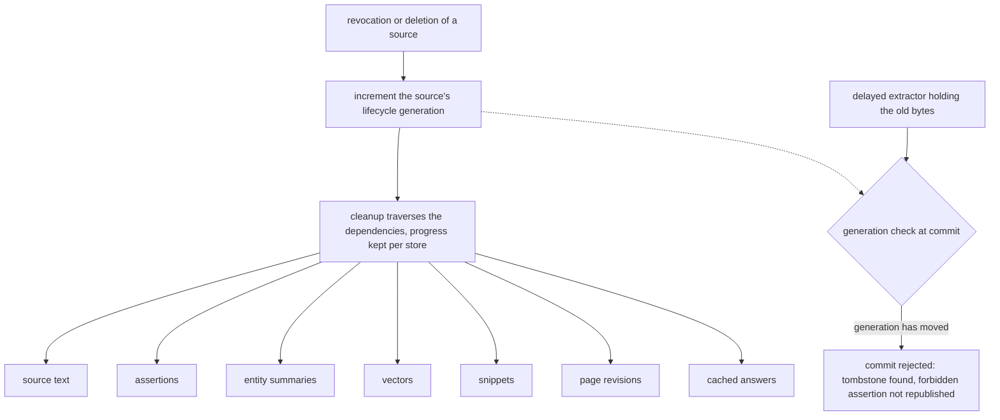
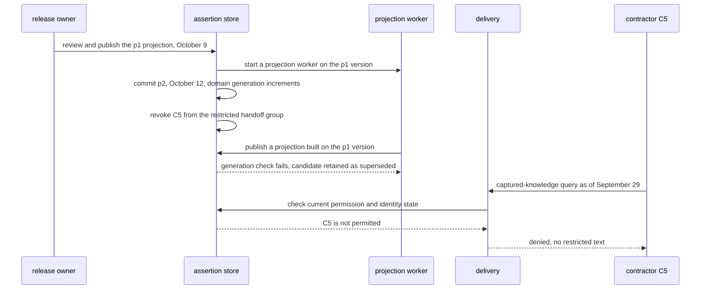

# Chapter 4. A team wiki that keeps up with its sources

Status: draft.

[Previous: Chapter 3](./03-investigating-a-thousand-documents-when-some-wont-parse.md) · [Table of contents](../table-of-contents.md) · [Next: Chapter 5](./05-finding-a-short-event-in-hours-of-video.md)

**New in this chapter:** incremental ingestion and change cursors; **effective time vs knowledge time**; permission-aware delivery and revocation freshness; **lifecycle tombstones** for deleting derived copies.

**Assumes:** one team's sources through one or two connectors; a designated reviewer for consequential changes; text sources (video and media time are chapter 5's); a single writer per page section at a time (concurrent human edits are chapter 8's).

**Reuses:** scope dependencies (chapter 2); fenced publish and the collection snapshot (chapter 3); answer-key evaluation (chapter 1).

> **About the examples.** The team, sources, release timeline, workloads, schemas, and policies in this chapter are fictional design fixtures. Numbers are illustrative unless labeled *measured*. Company references support specific mechanisms and link to reviewed sources; none of them discloses a wiki product's architecture.

## Three sentences that were each reasonable

Ingrid opens the release-handoff wiki before a planning meeting. It says the release launches October 9 and Alex owns rollout. The source link goes to a project document from two days ago.

Yesterday, the release owner corrected the date to October 12. A meeting note uses "Alex" for someone on a different team. A contractor who lost access yesterday afternoon can still read the old generated page through a cached answer.

Each sentence on the page was reasonable when it was written. Together they are the application problem. A wiki that is generated from sources has to decide which assertions concern the same thing, which are current, what earlier readers could have known, and who may receive the resulting text. Chapter 3 froze a collection for one investigation. Here the collection keeps changing after the first answer, and the durable product is a versioned body of knowledge with projections of it, with each assertion carrying its evidence and the time it was known.

Our application maintains a release-handoff workspace from selected project documents and meeting notes. It proposes changes to launch dates, owners, prerequisites, and unresolved questions. Readers ask "what is the plan now?" or inspect what the workspace had captured before a correction. A designated release owner reviews consequential changes. The application has no authority to change the release plan or send announcements.

## What the wiki has to answer

### Three question families and a baseline

The first release supports one team's handoff sources, a defined set of entity types, and three question families: the current plan, the plan as captured at an earlier time, and an explanation of a change. It excludes organization-wide fact discovery, private-message ingestion, and action execution.

The output is a page with source-linked sections and a change view. A new date or owner is a proposal until the designated reviewer approves it. Low-consequence formatting updates may publish automatically after validation. Detecting a conflict never authorizes resolving it.

The baseline is an owner-maintained page with links to the project documents and a scheduled review. It is slow and incomplete, and it makes ownership understandable. A second baseline is source search with no synthesized page. A wiki that saves readers a search and spreads one incorrect shared fact can be worse than either.

| Requirement | Illustrative planning assumption |
| --- | --- |
| Sources | 10,000 documents across 100 team domains |
| Change volume | 500 distinct content changes per day |
| Typical changed source | 2,000 extracted tokens |
| Read workload | 20,000 page or question reads per day |
| Snapshot path | Refresh each domain every six hours |
| Incremental target | Eligible changes visible as proposals within ten minutes at p95 after connector observation |
| Review boundary | Date, owner, and prerequisite changes require a review event |
| Permission policy | Current access decisions; uncertain grants withhold affected content |
| Retention | Source versions and assertion history for 90 days, subject to deletion |

The incremental clock starts when the connector observes a change. Source-change-to-observation delay is measured separately, or a connector that polls once a day appears to meet a ten-minute target.

Content freshness and permission freshness have different consequences. A stale date misleads a meeting. A stale grant discloses a restricted decision. Refreshing both every six hours because they share a connector is a policy for the first and no policy at all for the second.

### The authored release timeline

Observation times are UTC; release plans are calendar dates. "What was known" means what the application had captured, which is less than what every employee privately knew.

| Captured at | Fixture evidence | Assertion or operation |
| --- | --- | --- |
| September 28, 10:00 | Project plan p1, approved by release owner | Launch October 9; rollout owner Alex Rivera, staff ID E17 |
| September 29, 09:00 | Design meeting m1 | A tentative October 10 suggestion; Alex Moreau, staff ID E88, offers documentation help |
| September 30, 14:00 | Project correction p2 | Launch October 12; the correction says the October 9 plan was invalid from September 28 |
| September 30, 14:05 | Wiki review R2 | The reviewer accepts the p2 projection; October 12 becomes the approved wiki plan |
| September 30, 15:00 | Permission update | Contractor C5 loses the restricted handoff group |
| October 1, 08:00 | Late delivery of an older meeting note | Repeats October 9; cannot supersede the approved correction |

The answer key for the fixture: after R2, the current plan is October 12 with Alex Rivera as owner; between p2's capture and R2, the page distinguishes the approved October 9 plan from a pending correction; a captured-knowledge query as of September 29 says October 9, with the tentative October 10 visible where relevant; after 15:00 on September 30, C5 receives no restricted text from any read path, including the historical query; Alex Rivera and Alex Moreau stay two people.

The authority rule is part of the fixture: the release owner can approve the plan, a meeting suggestion is tentative, and a later authorized correction supersedes the earlier assertion it names. Another team might let an approved change ticket govern. The model never infers organizational authority from writing style.

### The naive version regenerates the page every six hours

Start with the obvious design: every six hours, read the current contents of the team folder, ask the model to write the handoff page with citations, and replace the old page.

Run against the fixture, it fails three ways. The September 29 view is gone, because the page is regenerated from current files and nothing records what the earlier page said or when; "what did we know before the correction?" has no answer. The two Alexes merge, because the meeting note's "Alex" and the plan's "Alex" arrive in one prompt and the model resolves them by name. C5 keeps reading, because the cached answer was built under a service account that still has access, and nothing between the cache and the reader asks who is reading.

The limitation is that the regenerated page has no record of time, identity, or audience; it is a string produced from whatever the folder contained at the last run. The rest of the chapter adds those records, and the first decision is whether the page is rebuilt from snapshots or maintained from increments.

## Snapshots or increments

Both paths use the same assertion schema, authority policy, review interface, and delivery rules. They differ in how source changes reach the page.

### Path A: scheduled snapshot synthesis

On a schedule, acquire a source manifest for a domain, parse changed content, and synthesize a proposed page from the captured snapshot. Compare it with the current page and present material differences for review. "Snapshot" means recomputing the domain's projection from a declared input set; unchanged files reuse their parses and extracted assertions.

This fits small domains whose content may be several hours old and whose reviewers prefer a batch of changes. Its risks are coarse recomputation and staleness between cycles. A source can change twice before a snapshot while the connector exposes only its latest state, so the intermediate plan is lost unless the application captured it.

### Path B: incremental assertions and page projections

A connector reader saves changed-source receipts. Extraction produces source-local assertions. Resolution relates them to canonical entities and existing assertions. A projection worker rebuilds affected page sections and sends consequential changes to review.

This fits rapidly changing domains when source feeds, inventory reconciliation, and permission updates are dependable. It avoids rewriting unrelated sections and adds ordering, entity matching, dependency tracking, and more partial states. Notifications are duplicated, missed, and delayed, so the incremental system still reconciles periodically; a feed cursor measures progress through a connector contract and proves nothing about the page.

| Dimension | Scheduled snapshot | Incremental assertions |
| --- | --- | --- |
| Quality | Broad context reveals contradictions; a full rewrite can lose reviewed nuance | Explicit changes and dependencies; a mistaken merge or invalidation spreads |
| Latency | Schedule wait plus processing and review | Connector delay plus local processing and review |
| Cost | Repeated projection input; simpler maintenance | Change processing, reconciliation, entity work, dependency maintenance |
| Privacy | Captured source set and page history | Those plus assertion history and intermediate copies |
| Safety | Coarse invalidation is understandable; access checks cannot wait for the next cycle | Faster updates need fencing against stale content and stale permission state |
| Operations | Snapshot manifests, jobs, review queue, delivery checks | Those plus cursors, version ordering, dependency fan-out, identity progress |
| Recovery | Rebuild a domain from a captured snapshot | Replay receipts idempotently; reconcile and rebuild affected projections |

```text
A: schedule → captured source manifest → candidate assertions
                                      → domain proposal → review → page version

B: feed reader → durable receipts → source assertions → entity and conflict resolution
                                                   → affected sections → review
permission and identity updates ──────────────────────→ delivery eligibility
```

The arrows are responsibilities. One application service, object storage, a relational store, and workers cover both paths at this scale; a graph store or event infrastructure is added when measured relationships or workload justify it.

We start with Path A for domains where six-hour content freshness is acceptable, with permission checks enforced independently of the schedule, and with source versions, assertions, and projection dependencies recorded from the first day so Path B can be adopted without a migration.

Either path hands the model a correction that says the October 9 plan "was invalid from September 28." What the model returns for that sentence decides whether the two-clock record below can be built at all.

## What the model sees and returns

### The assertion schema

The model's job is extraction: turn a source into assertions with subject, predicate, value, qualifiers, source spans, and two time intervals. It does not decide authority, resolve identities, or publish.

```json
{
  "assertion_id": "launch-date-2",
  "entity_ref": {"type": "release", "source_label": "R7"},
  "predicate": "approved_launch_date",
  "value": "2026-10-12",
  "effective_from": "2026-09-28",
  "known_from": "2026-09-30T14:00:00Z",
  "source_version": "project-p2",
  "source_spans": ["paragraph-12"],
  "claimed_supersedes": "the October 9 plan",
  "authority_signal": "document states release-owner approval",
  "review_state": "pending"
}
```

Two fields are deliberately weak. `entity_ref` names what the source calls the entity; resolution to a stable ID happens later. `authority_signal` quotes what the document says about its own standing; the authority table decides what that is worth.

A compact version of the extraction instructions:

```text
Extract assertions from one source version. For each assertion give:
- subject as the source names it, predicate, value
- effective_from / effective_to: the period the assertion says the value holds
- known_from: the source's observation time (provided)
- spans that support it
- if the source says it corrects or replaces an earlier statement, quote that statement
Do not merge people with the same first name. Do not rank sources by tone.
Source: project-p2, observed 2026-09-30T14:00:00Z
...
```

### Known error modes and where each is caught

Temporal extraction fails in three repeatable ways. The model sets `effective_from` to the observation date when the source says the change applies retroactively; a validation rule compares the two fields and flags any assertion whose effective date equals its known date when the span contains a different date. The model misses the correction target, producing a new launch date with no `claimed_supersedes`; conflict detection, below, catches two current values for one predicate. The model infers authority from tone, labeling a confident meeting note "approved"; `authority_signal` is advisory, and the authority table ignores it.

Contradiction detection is a second call. It receives candidate assertions for one entity and predicate and returns proposed conflicts with the spans that support each side. It proposes; the review queue disposes. Repeating the call until it picks the desired date resolves nothing.

> **Source finding.** Zep's Graphiti [described](https://arxiv.org/abs/2501.13956) extracting entities and facts with explicit validity intervals, invalidating earlier facts when a later one contradicts them, and keeping the invalidated fact with its interval instead of deleting it. The paper is a vendor's own description of its v1 architecture and internal evaluation; it establishes the two-interval pattern and nothing about authority or access.

After extraction, the store holds two assertions about one launch date: October 9 from p1 and October 12 from p2. Which is true depends on which question is being asked.

## Two clocks on every fact

Effective time is when an assertion says something holds. Knowledge time is when the application captured or accepted it. The correction learned September 30 changes the plan from September 28 without changing the record of what the application knew on September 29.

```text
                 Sep 28        Sep 29        Sep 30 14:00   14:05        Oct 1
                 10:00         09:00         p2 captured    R2 review    late note
effective
  launch-date-1  ├────── Oct 9 ───────────────────┤ (ended by p2, retroactive to Sep 28)
  launch-date-2                                   ├────── Oct 12 ──────────────────→
  m1 tentative                 ├─ Oct 10 (tentative, never approved) ─┤

known
  launch-date-1  ├─────────────────────────────────┤ superseded at 14:05
  launch-date-2                                   ├──────┤ pending → approved at 14:05 ──→
  late note                                                            ├─ evidence only ─→
```

Figure 4.1. The fixture's launch-date assertions with effective intervals (top) and knowledge intervals (bottom) drawn separately. The correction's effective interval begins before its knowledge interval does.

Two query modes read this record. The current-plan query selects the assertion whose effective interval contains the asked date and whose review state is approved, as of now: October 12. The captured-knowledge query selects what was known and approved as of a cutoff: as of September 29, October 9, with October 10 visible as tentative. A third question, "why did the date change?", reads across both clocks and reports that p2, captured September 30, says the earlier plan was invalid from September 28.

The authority table is part of the record and is small on purpose:

| Source or event | Authority for the release plan |
| --- | --- |
| Approved project plan | Governs its named release and period |
| Authorized explicit correction | Supersedes the assertions it names, within its stated scope |
| Meeting proposal | Tentative until accepted under the team's rule |
| Imported older note | Evidence of earlier discussion; arrival time grants no precedence |
| Wiki reviewer addition | A labeled application determination with reviewer identity and rationale |

Conflict handling compares subject, predicate, effective interval, and scope. "Tentative October 10" and "approved October 9" coexist without a contradiction about the approved plan. The late October 9 note is historical evidence and never current. A fluent correction is no more authoritative because its embedding sits near the project plan; source quality, organizational authority, textual support, and current applicability are separate fields.

The two-clock record needs a `known_from` for each source version, which means the application needs to know when a source changed. Connectors report that a change happened and rarely report the edit history behind it.

## Receiving a change before trusting it

> **Source finding.** Google Drive's changes API [returns](https://developers.google.com/workspace/drive/api/guides/manage-changes) pages of changes with continuation tokens and a final start token for the next poll; push notifications wake a reader and do not carry the changed content. Microsoft Graph's driveItem delta [exposes](https://learn.microsoft.com/en-us/graph/api/driveitem-delta?view=graph-rest-1.0) synchronized item state with opaque continuations, repeated items, and a documented resynchronization when a token expires. Neither is a journal of every intermediate edit.

The connector protocol persists each returned page's receipts and its continuation token in one database transaction. A receipt holds the scope, the stable item ID, the returned version information, the observation time, and the content and permission work still required. A dispatch row in the same transaction makes the work discoverable, so a crash after the commit loses nothing and a crash before it repeats a page the receipts deduplicate.

If the source exposes stable version identifiers, a receipt refers to one and the bytes can be fetched later. If the source exposes only mutable current content, fetching after the receipt may return a newer version than the one that triggered it; the receipt records the version actually acquired and its observation interval and never labels it as the earlier edit. Captured bytes are written immutably, then the verified object reference is committed. A crash can leave an orphan object and cannot leave a falsely ready source.

Bootstrap has an ordering rule. Listing the folder and then asking for a change token misses edits between the two operations. For Drive, save the start token first, capture the inventory with receipts, then consume changes from that token so the overlap is reconciled by stable identity and acquired version. For Graph, use its initial delta enumeration. Both adapters produce the same receipt schema and keep their own initialization and resync protocols.

Three more rules follow from the connector contracts. Feed positions are opaque and scoped; they are never compared as numbers or shared across accounts. Stable item identity differs from a pathname, so a folder rename does not create a second copy of every child. Reconciliation builds an inventory under a new scan epoch and checks removals only after the scan's declared coverage is complete; a failed page cannot make unseen sources look deleted.

Progress is four counters, never one. The connector may have durably received 500 changes while 100 remain unparsed, 40 extracted assertions await projection, and 12 proposals await review. A cursor that has advanced says the wiki received the changes and nothing about whether the page reflects them.

Entity resolution sits between extraction and the page. A source-local assertion is preserved before it is assigned to a canonical entity. Remote staff IDs, project IDs, and explicit aliases come first; lexical and semantic candidate search runs only when those are missing, and a consequential uncertain match goes to review. For the two Alexes, source context nominates E17 or E88 and cannot authorize merging them. The resolution decision is stored with its evidence and revision, and a mistaken merge is reversed by a split that reassigns assertions and invalidates dependent projections. A rename is the opposite test: a team's display name changes while its stable ID stays, and the history stays with it.

Content can now be current, versioned, and correctly attributed, and C5 can still read it. The connector read the sources under a service account; who is reading the page is a different question.

## The reader's permission decides delivery

A background connector reads under a service identity. A person reads under their own. The service account's access is never the page audience's access, so before evidence enters a reader-specific prompt or response, the reader's allowed source scope is evaluated.

> **Source finding.** Glean's indexing documentation [combines](https://developers.glean.com/libraries/indexing-sdk/permissions) document ACLs with synchronized identities and group membership, and calls for verifying restricted users' results as well as checking transformed ACLs. The documentation describes a connector authorization model; it does not establish that indexed permission metadata makes every generated-page read safe.

Content, document-permission, and identity progress are recorded separately. A document unchanged for a month can lose half its readers today. A group intersection stays an intersection through connector normalization.

```text
reader → authorize domain and evidence scope
       → select an eligible projection, or reconstruct for this reader
       → check current permission and identity state
       → return text, source links, and a freshness statement
```

A projection containing several assertions requires permission for every included evidence dependency. If another permitted source independently supports the same assertion, a new projection can use that source; the old paragraph does not become safe because an accessible source contains similar words, since it may still carry qualifications obtained privately. A cache hit repeats the authorization: the key includes tenant, projection version, query mode and cutoff, policy identity, and dependencies, and a semantic match between "current plan" and "plan before correction" never reuses an answer.

What a local check can promise depends on who owns the grants.

> **Source finding.** Google's Zanzibar paper [describes](https://research.google/pubs/zanzibar-googles-consistent-global-authorization-system/) binding content to an authorization consistency token so a newer document version is never combined with an older grant. The mechanism works because the authorization service issues the token and honors its meaning.

A local `acl_epoch` field cannot invent that guarantee for a remote connector. For sources controlled by the fixture authority, content versions and permission changes share a transaction order, delivery checks current state at its decision boundary, and a test can assert that a revocation committed before the check denies the read. For external sources, the contract is whichever one the interface actually provides: indexed grants within a measured freshness bound, an authoritative check per read, or delayed publication until a permission snapshot is verified. A successful remote check can still race a revocation that follows it.

On unknown grants the policy fails closed. This costs availability and makes permission-provider latency part of the read budget, and both are measured. The observable exposure interval runs from the authority's revocation time to the last read that should have been denied, with clock uncertainty recorded; detection, local invalidation, and cache retirement contribute separately. Text already delivered to a browser cannot be recalled. The product controls future reads and managed copies.

A revocation changes who may read. A deletion changes what exists, in every store that holds a copy, and an extractor that started before the deletion is about to write one more.

## Deleting from every copy

Three operations look alike at the connector and differ everywhere else. Drive's `removed` state can mean the file was deleted or that the connector lost access; the first response is loss of eligible support within that scope, and reconciliation decides which it was. A revoked reader loses future access while other readers keep theirs. A revoked connector stops supplying evidence. A deletion under policy schedules removal of every managed source and derived copy. Each needs its own audit reason and cleanup scope.

The mechanism is a lifecycle generation. Revocation or deletion increments the generation for the affected source before any background cleanup begins, and every worker checks the generation at commit, the way chapter 3's workers check their lease. A delayed extractor holding the old bytes finds the tombstone at commit and cannot republish the forbidden assertion. Cleanup then traverses the dependencies: source text, assertions, entity summaries, vectors, snippets, page revisions, cached answers. Progress is kept per store, because a successful vector delete means nothing while a generated summary still contains the private date.



Figure 4.2. The lifecycle generation. Revocation or deletion increments the generation before cleanup begins, a late extractor fails the check at commit, and cleanup progress is recorded for each store that holds a copy.

If a fact keeps authorized independent support, its projection is rebuilt from that support with new lineage. Backups and provider copies are handled explicitly; local lineage enumerates copies and cannot prove external erasure.

Chapter 1 deferred deletion of derived copies to this chapter. This is the section that mechanism lives in: a generation that is checked at commit, and per-store cleanup progress, for every chapter that derives copies from a source.

## A correction and a revocation while a worker runs

Replay the authored timeline through both paths against the complete design. Publish p1 after its review. Start a projection worker on that version. Commit p2 and revoke C5 before the old worker returns.

The expected end state: an immutable historical p1 projection; a current proposal or reviewed page naming October 12; no new readable restricted derivative for C5. The returning worker fails its generation check. The historical-query endpoint denies C5 too; selecting September 29 does not restore September 29 permissions.



Figure 4.3. The drill replayed against the complete design. The worker started on p1 fails its generation check after p2 commits, and C5's historical query is denied because the permission check uses current state.

Then drop a change notification. Polling or reconciliation discovers p2 without inventing an intermediate revision, and the receipt, extraction, and page states explain the delay.

| Injected condition | Detection and owner | End-state assertion |
| --- | --- | --- |
| Old worker returns after p2 | Domain generation at publish | Superseded candidate retained; October 9 never current |
| Duplicate change page | Receipt identity | One logical update; no duplicate assertion or review request |
| Late older source state | Version reconciliation | Cannot supersede p2; labeled as history |
| Folder rename | Stable-ID inventory | Sources keep identity and parent relationships |
| Expired delta token | Connector resync | Converges; uncaptured history explicitly marked |
| Wrong Alex merge | Entity review fixture | Split repairs attribution and invalidates dependent sections |
| Group removal with unchanged content | Identity progress and delivery check | Text, snippets, and cached answers denied |
| New restricted text under a stale grant | Permission and content race test | No publication under an unproven grant |
| Deletion during extraction | Lifecycle generation at commit | Late completion cannot restore deleted bodies |
| One of two supporting sources removed | Dependency resolution | Only independently supported, deliverable assertions remain |
| New prerequisite source | Scope dependency (chapter 2) | "No open prerequisites" becomes stale with no cited document changed |

A deterministic local authority asserts exact read ordering. A connector adapter with injected lag measures exposure under its declared contract. Zero forbidden reads in the local test says nothing about how quickly an external provider reports a revocation.

The owners are the connector, the assertion store, the resolution service, the projection publisher, and delivery authorization. No single "verify wiki" prompt demonstrates their combined behavior. These drills are planned; the connector replay, fixture files, and revocation measurements have not been run.

## Which path to ship first

Path A was the provisional choice above. This section gives the arithmetic behind it and the evidence that would change it.

### Capacity and staleness arithmetic

At 10,000 documents and 2,000 tokens each, the source payload is 20 million tokens. Four snapshot cycles a day are 80 million source tokens if every cycle rereads everything, and far less when unchanged extractions are reused. At 500 changes a day, incremental extraction reads about one million source tokens before prompts, outputs, reconciliation, and projection input. The eighty-fold ratio is a payload comparison; Path B can recompute a large domain after one central fact changes, so neither number is a cost.

If each changed source touches three page sections, 500 changes nominate 1,500 section updates before deduplication. One source reused in 300 sections hides inside that mean, so the fan-out distribution is recorded.

Under a six-hour schedule with uniformly timed changes, the mean wait for the next cycle is three hours and the maximum approaches six. Changes cluster, so the distribution is measured. Extraction and review add their own delay, and incremental publication cannot outrun a slow connector or a slow reviewer.

Review capacity is the bottleneck that ingestion speed cannot fix. If the system proposes 200 material changes a day and reviewers handle 100, faster ingestion grows the backlog. Automatic publication needs a narrowly tested policy.

### The stage that is actually stale

| Signal | Definition | What it establishes |
| --- | --- | --- |
| Observation lag | Source modification to connector observation | Remote detection delay, where source clocks are trustworthy |
| Receipt backlog age | Age of the oldest receipt awaiting processing | Local ingestion backlog, independent of cursor movement |
| Projection lag | Eligible assertion change to candidate projection | Synthesis and dependency delay |
| Review lag | Candidate material change to review event | The human bottleneck and still-approved stale content |
| Permission detection lag | Authority revocation to local observation | The connector and identity exposure boundary |
| Local denial lag | Known revocation to denial across read paths | Delivery and cache propagation |
| Historical coverage gap | Requested period without captured versions | A knowledge limit, which is a different thing from latency |

A delayed launch-date answer is traced to its stage before anything is retried. If the projection is waiting on the release owner, another model request adds cost and advances nothing. If identity sync is stale, refreshing content repairs nothing.

### An organizational oracle, and two diagnostics in their lane

Author the planned twenty-source timeline with five users and three groups. Freeze source bytes, event order, IDs, authority rules, expected merges and splits, and permissions. Include the release fixture plus homonyms, renames, scoped corrections, missing events, inherited ACL changes, and alternate support. The oracle defines expected assertions by reader, knowledge cutoff, and effective period, and stays outside model access; a future correction cannot leak into a historical input because the evaluator knows it.

Run both paths against the same timeline and model policy. Measure assertion support, current-date correctness, conflict retention, incorrect invalidation, merge and split errors, and historical answerability, scoring required facts against the oracle independently of what the model chose to assert. Permission tests count forbidden outcomes across pages, questions, citations, snippets, and caches; zero is the fixture's acceptance condition, and legitimate reads that fail under unknown permission state are counted beside it.

> **Source finding.** LongMemEval's cleaned v1 release [contains](https://arxiv.org/abs/2410.10813) 500 questions including temporal reasoning and knowledge updates, with oracle evidence sessions supplied. Glen's [replay](https://www.tryglen.com/blog/replaying-100-prs) of 100 pull requests withheld memory that postdated each decision point.

Both are useful within their scope. LongMemEval diagnoses reading and dated-answer behavior when evidence is given; its grader is tolerant of elapsed-time phrasing and cannot establish that October 12 was served under the right ACL. Glen's replay illustrates withholding future knowledge from a historical question. Neither labels two Alexes, source authority, or derivative deletion.

### Gates and the move to increments

Before release: the replay, temporal, entity, publication-race, and permission suites pass; every critical date and owner change in the held-out fixture is reviewed; quality, maintenance-time, and update-lag floors are set before the comparison. Permission results are evaluated on their own; better fact recall cannot offset a forbidden read.

Move to Path B when measured staleness matters to readers, change volume is sparse enough to benefit, and connector and identity semantics support reliable incremental operation. Add an entity graph when relationship questions justify its resolution and maintenance burden.

## Key ideas

- Every assertion carries two clocks: effective time (when it holds) and knowledge time (when the application learned it). Current-plan and captured-knowledge queries read the same record differently.
- A connector reports that something changed; the application records the version it actually acquired, under a receipt committed with the cursor, and never labels it as an edit it did not see.
- Progress is four counters (received, extracted, projected, reviewed). A moved cursor proves nothing about the page.
- The service account's access is never the reader's. Permission is checked at delivery, cache hits included, and unknown grants fail closed.
- What a local check can promise depends on who issues the grants; a local epoch does not borrow Zanzibar's guarantee.
- Removal, revocation, and deletion are three operations. A lifecycle generation checked at commit stops a late worker from re-creating a deleted fact; cleanup progress is kept per store.
- Entity identity comes from stable IDs and reviewed resolutions, never from a shared first name; merges are reversible.

Chapter 5 keeps source versions and the two clocks and removes the assumption that evidence is text: a few seconds inside hours of video, where the address of a fact is a time in a media file.

## Exercises

1. Three cutoffs, three modes. Using the fixture timeline, give the current-plan answer, the captured-knowledge answer, and the change-explanation answer as of (a) September 29, 12:00; (b) September 30, 14:02; (c) October 1, 09:00.

2. Exposure interval. The authority revokes C5 at 15:00:00. The connector observes the change at 15:04:30. Local invalidation completes at 15:04:45. The last cache hit served to C5 is at 15:03:50. Compute the observable exposure interval and say which stage owns each part of it. What changes if the clocks of the authority and the connector may differ by up to 20 seconds?

3. Which of these five proposed changes need the designated reviewer? (a) A heading is reformatted; (b) the launch date moves from October 9 to October 12 on p2; (c) the extractor proposes merging E17 and E88; (d) a late note repeats October 9; (e) the team's display name changes while its ID stays.

<details>
<summary>Answers</summary>

1. (a) Current: October 9, owner Alex Rivera; captured: the same, with October 10 visible as tentative; explanation: no change yet. (b) Current: approved plan October 9 with a pending correction to October 12, since R2 has not happened; captured as of that moment: October 9 approved, p2 captured and pending; explanation: p2 says October 9 was invalid from September 28, awaiting review. (c) Current: October 12; captured as of October 1: October 12, approved at R2; explanation: p2 superseded p1 at 14:05 on September 30, and the late note is evidence of earlier discussion with no precedence.

2. Exposure runs from 15:00:00 to 15:03:50, the last read that should have been denied: 3 minutes 50 seconds. Detection (authority to connector observation, 15:00:00 to 15:04:30) owns all of it here, since the last bad read preceded observation; local denial lag (15:04:30 to 15:04:45) is 15 seconds and caused no exposure in this run. With 20 seconds of clock uncertainty, the exposure is reported as 3:30 to 4:10, and the detection lag as 4:10 to 4:50.

3. (b) and (c) need review: a date change and an entity merge are consequential. (a) publishes automatically after validation. (d) needs no review because the late note cannot supersede the approved correction; it is stored as history. (e) is a rename that resolution handles by stable ID; it needs review only if the display-name change would alter a published attribution.

</details>

## Sources

Sources used here, linked to the original articles:

- [Google Drive incremental ingestion](https://developers.google.com/workspace/drive/api/guides/manage-changes) and [Microsoft Graph delta and permission state](https://learn.microsoft.com/en-us/graph/api/driveitem-delta?view=graph-rest-1.0)
- [Glean indexed permissions and identity](https://developers.glean.com/libraries/indexing-sdk/permissions)
- [Zanzibar causal authorization](https://research.google/pubs/zanzibar-googles-consistent-global-authorization-system/)
- [Zep temporal entity and fact updates](https://arxiv.org/abs/2501.13956)
- [LongMemEval temporal memory fixtures](https://arxiv.org/abs/2410.10813) and [Glen temporal replay](https://www.tryglen.com/blog/replaying-100-prs)

