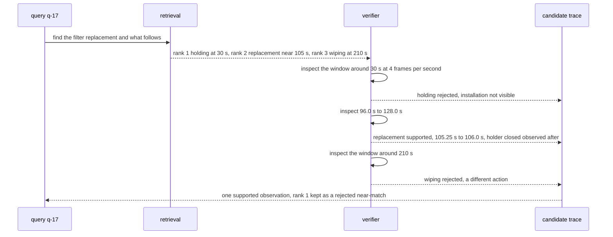

# Chapter 5. Finding a short event in hours of video

Status: draft.

[Previous: Chapter 4](./04-a-team-wiki-that-keeps-up-with-its-sources.md) · [Table of contents](../table-of-contents.md) · [Next: Chapter 6](./06-a-research-agent-that-knows-when-to-stop.md)

**New in this chapter:** multimodal retrieval and sampling budgets; media timebases; **candidate vs verified observation**; isolating sampling from verification in evaluation.

**Assumes:** a fixed archive of owned or permitted recordings; one query at a time per analyst; a small declared action vocabulary; the search stops after a bounded candidate budget (adaptive search is chapter 6's).

**Reuses:** the scope certificate and retrieval as a recorded selection (chapter 3); lifecycle tombstones (chapter 4); fenced publish (chapter 3).

> **About the examples.** The operator, recordings, event definitions, workloads, and prices in this chapter are fictional design fixtures. Numbers are illustrative unless labeled *measured*. Twelve Labs, Coactive, and FFmpeg provide pipeline and interface examples that link to reviewed sources; none is evidence that a company's system implements these paths.

## The right frame and the wrong clock

Rasmus, an analyst, searches a team's training-video archive: "find the moment the operator replaces the filter, and show what happens immediately afterward."

The first result is a sharp image of an operator holding a filter. It has a high retrieval rank, a timestamp, and a confident description. Playback shows the operator displaying the spare part. The replacement itself takes less than a second and falls between two indexed frames.

A second result contains the right action, and its timestamp was measured in a trimmed proxy. Opening that time in the original recording shows an unrelated procedure.

These are two independent defects. The system found the wrong event, and it failed to connect its evidence to the original media clock. A better caption repairs neither. Chapters 2 through 4 addressed evidence as text with a page or span address. Here the address of a fact is a time in a media file, the evidence is a few frames out of hundreds of thousands, and the thing being searched for may never have been sampled at all.

Our application is a video investigation workspace for owned or permitted training recordings. Analysts locate candidate events, inspect clips, and save a supported observation with its interval and uncertainty. The first release supports a small declared action vocabulary and ordinary natural-language queries around it. It does not identify people across archives, monitor employees, determine compliance, or infer physical causation. An accepted answer opens the inspected original-media interval, separates observation from inference, and states the searched scope and the evidence that was missing.

## What the event is before searching for it

### The replacement, the ten seconds after it, and a baseline

The query has two parts: a replacement action and an immediately following event. For the fixture, replacement means the existing filter is removed and another installed in the same holder. Holding, pointing at, or wiping a filter are negative near-matches.

"Immediately afterward" is bounded for this task: inspect the next ten seconds after the replacement interval, report the first clearly observable relevant action, and preserve gaps or occlusion. The ten-second window is a product rule for this query contract; a question about a later operational consequence needs a different one.

The answer includes asset and version identity, the candidate interval, the inspected interval, accepted event boundaries, evidence modalities, the observation, qualifications, and playable source access. The following observation has its own evidence interval. Order in time does not establish that the first event caused the second.

The baseline is transcript keyword search followed by manual playback. It works when narration describes the action accurately and fails on silent visual action, imprecise narration, and footage in which "replace" is spoken while another activity is shown. The comparison uses the same analyst task and media, and search speed counts only when the analyst confirms the event with less work at an acceptable miss rate.

| Requirement | Illustrative design assumption |
| --- | --- |
| Archive | 10,000 assets averaging twelve minutes: 2,000 media hours |
| Daily ingestion | Fifty new media hours |
| Query traffic | 500 investigations per day; admitted peak of five queries per second |
| Modalities | Video plus audio when present; missing audio explicitly represented |
| Candidate policy | Retrieve up to twelve intervals, inspect up to four within the initial budget |
| First-result target | Candidate list within two seconds at p95 on a ready index |
| Answer target | An inspected answer or explicit partial result within ten seconds at p95 |
| Default fixed sampling | One selected frame every two seconds, subject to experiment |
| Retention | Originals for 180 days; derivatives follow source deletion and access |

Candidate time and verification time run on different clocks. Queueing, seek and decode, model work, and evidence persistence all belong inside the ten-second target. Upload-to-searchable delay is reported beside it.

### Three intervals in one recording

The authored footage has a visible clock and three intervals: the operator holds a spare at 30 seconds, performs the replacement in a quarter second around 105 seconds, and wipes the installed filter at 210 seconds. A variable-frame-rate version and a trimmed proxy with a nonzero origin exist for the same footage.

The answer key: replacement supported at about 105.25 to 106.0 seconds in original asset time, with the holder closing as the following event; holding at 30 seconds rejected as a near-match; wiping at 210 seconds rejected as a different action; the same intervals returned whichever encoding or proxy the search ran against.

### The naive version returns a confident description of the wrong frame

Start with the obvious design: decode a frame every two seconds, caption each frame with a vision model, embed the captions, and at query time return the frame whose caption is nearest the query, with its timestamp.

Against the fixture, the top result is the holding frame at 30 seconds, captioned "operator holds a replacement filter." The caption is accurate and the ranking is reasonable, since the query mentions a filter and a replacement. The real event at 105 seconds was never captioned, because a quarter-second action between samples two seconds apart is sampled with probability near one in eight. If the proxy was indexed, the timestamp is 20 seconds too early as well.

The limitation is twofold, and the chapter takes the two halves in turn. A rank over captions nominates a frame and judges nothing, so the design needs a step that reads the footage and decides. And a frame's timestamp is meaningless without the clock it was measured on. Before either, the design has to choose how frames are selected, because the verifier can only inspect an event that retrieval nominated.

## Sample on a schedule or on activity

Both paths produce the same searchable records linked to original media time, and both hand candidates to the same verifier. They differ in which instants get a frame.

### Path A: fixed-interval indexing with a common verifier

Select frames at a declared interval, transcribe audio where present, compute compatible text and visual representations, and build searchable records. Retrieval proposes intervals around matching frames or transcript spans. A verifier reads a denser candidate window and its neighbors under a fixed policy and accepts, rejects, or leaves the event unresolved.

Fixed sampling is reproducible and gives a predictable selected-frame budget. Its weakness is candidate recall: the verifier cannot inspect an event that retrieval never nominated, and an empty search is never converted into a no-event result. The product allows wider inspection, a declared full-pass mode, or an unverified outcome.

### Path B: content-aware indexing with the same verifier

Use scene or activity signals to choose additional frames and windows, with a maximum-gap periodic floor. Quiet footage receives fewer selected frames; likely transitions receive more. The candidate reader and verifier stay identical to A, so the comparison isolates whether content-aware selection improves the candidate evidence. If B also received a stronger verifier, an observed gain could not be attributed to sampling.

B fits archives with heterogeneous activity and consequential short-event misses. It adds detector versions, thresholds, variable work, and the possibility that its detector misses the very transition it should emphasize. A scene cut is an editing boundary, and the operator can replace the filter in one continuous shot; a cut between holding the old filter and holding a new one may omit the replacement entirely.

| Dimension | Fixed interval plus verification | Content-aware selection plus the same verification |
| --- | --- | --- |
| Quality | Predictable temporal opportunities; brief events may never become candidates | Concentrates evidence on activity; detector errors and continuous-shot events remain |
| Latency | Stable selected-frame work; verification adds seek and reading | Variable ingestion cost; query verification unchanged |
| Cost | Easy selected-frame estimate; decode can still dominate | Extra activity analysis; savings depend on actual selection and decode |
| Privacy | Frames, transcript, vectors, clips under lifecycle controls | Adds activity and scene derivatives under the same policy |
| Safety | Rank never authorizes an event claim | Activity score never authorizes an event claim |
| Operations | Decoder, alignment, index, verifier versions | Those plus detector policies and variable queues |
| Recovery | Rebuild a failed modality or window; replay stage receipts | Rebuild failed analysis and invalidate dependent selections |

Under a two-second interval, an event shorter than the interval, with instantaneous samples and uniformly random phase, is sampled with probability about equal to its duration divided by the interval: 0.25/2 = 12.5 percent for the fixture's replacement, 50 percent for a one-second event. The figure is geometry; one frame inside the event still may not show a transition, so it bounds candidate opportunity and says nothing about recognition.

A managed video index is an alternative implementation of candidate retrieval for either path. It trades hosting work for provider rate limits, version transitions, data-location decisions, and an external lifecycle, and it removes none of the time-mapping, verification, or audience obligations below.

```text
original asset → probe and time manifest → decode and modality extraction
                                      ├→ fixed sampling ────────┐
                                      └→ content-aware sampling ┤
audio → aligned transcript ─────────────────────────────────────┤
                                                              ↓
                                                    ready index generation
query → authorized candidate retrieval → the same interval verifier
                                       → observation + original playback
```

We start with Path A and the common verifier, because its budget is predictable and its misses are measurable, and add content-aware selection where measured short-event misses justify it. Whichever path nominates candidates, the verifier receives a handful of frames and has to judge an action from them.

## What the model sees and returns

### Ordered frames with timestamps and a stated sampling rate

The verifier receives frames from a declared candidate window in time order, each labeled with its original-asset timestamp and a frame ID, plus the relevant transcript span and the sampling rate it is looking at. It is told which frames exist so it can only cite those.

```text
You are inspecting original footage for one candidate interval.
Frames are in time order at 4 per second from 96.0 s to 128.0 s (asset seconds).
Frame IDs: frame-6240 (96.00 s) ... frame-6368 (128.00 s).
Transcript in this window: "...now we swap it out..." (102.5–104.0 s)

Event to assess: filter_replacement = the existing filter is removed and another
is installed in the same holder. Holding, pointing at, or wiping is not replacement.
Report separately: the first observable action in the 10 s after the event.

For each event, give disposition (supported / rejected / uncertain), the interval,
and the frame IDs that show it. Cite only frame IDs listed above. If hands or the
camera angle hide the holder, say "uncertain" and name the frames that are occluded.
```

What a vision model gets wrong over sparse frames is predictable. It infers a transition from a before state and an after state when the transition itself was never shown; the instructions ask for the removal and installation frames, and an answer with only before and after frames is marked uncertain by rule. It reads the transcript's "swap it out" as proof of the visual action; the transcript span is labeled as speech and the disposition requires visual frames. It cites a frame ID it never received; validation rejects any ID outside the listed set.

### An observation with two dispositions

```json
{
  "asset_version": "training-42-v1",
  "index_generation": "visual-8",
  "query_id": "q-17",
  "candidate_interval": [98.0, 118.0],
  "inspected_interval": [96.0, 128.0],
  "time_units": "original_asset_seconds",
  "event": {
    "type": "filter_replacement",
    "interval": [105.25, 106.0],
    "disposition": "supported",
    "evidence_ids": ["frame-6315", "frame-6336", "frame-6360"]
  },
  "following_event": {
    "type": "holder_closed",
    "interval": [107.0, 108.0],
    "relation": "observed_after",
    "disposition": "supported",
    "evidence_ids": ["frame-6420", "frame-6480"]
  },
  "review_state": "unreviewed"
}
```

Each event has its own disposition and evidence. Support for the replacement does not establish the following action, and a corrupt five seconds after the replacement leaves `following_event` at `uncertain` while `event` stays `supported`. Evidence IDs must resolve to inspected records; a well-formed response containing them is not self-validating.

A third option belongs in the lab beside the two sampling paths: a model that accepts long video directly and returns timestamps. It replaces sampling and verification with one call, carries its own cost line in input tokens per media minute, and its timestamps are claims to be checked against the same clock below.

A verifier can return a correct observation at a time that is wrong in the original recording. The frames it saw were real; their timestamps were measured in the wrong clock.

## Three clocks for one frame

A frame has a presentation timestamp in its stream's units, a position in the asset after the stream's origin is subtracted, and a position in whatever proxy it was decoded from. The three agree only by accident.

```text
original stream time   = PTS × time_base
asset-relative time    = original stream time − declared origin
original playback time = proxy time + trim offset   (simple trim only)
```

With a timebase of 1/90,000, PTS 9,900,000 is 110 seconds of stream time. If the stream's origin is ten seconds, the asset-relative point is 100 seconds. If a proxy starts at asset-relative 80 seconds, its 20-second mark is that same point. The second result in the opening was reported at proxy time 20 and opened at asset time 20. The arithmetic is a worked clock example; the probe that would produce the real numbers has not run.

```text
stream time (PTS × 1/90,000)   0 s ──── 10 s ──────────── 40 s ───────────────── 115 s ───────── 120 s ──── 220 s
                                       │ origin                                    │                 │
asset-relative time                    0 s ────────────── 30 s ──────────────── 105 s ───────── 110 s ──── 210 s
                                                          holding                replacement        wiping
proxy time (trim at asset 80 s)                                        0 s ───── 25 s ─────────── 30 s ──── 130 s
                                                                                  │
                                                        "proxy 25 s" opened at asset 25 s lands in silence, 80 s early
```

Figure 5.1. The same three events on the stream clock, the asset clock, and a trimmed proxy's clock. The replacement is at PTS 10,372,500, asset 105.25 seconds, and proxy 25.25 seconds; a timestamp without its clock is wrong on two of the three.

> **Source finding.** FFmpeg's documentation [describes](https://ffmpeg.org/ffprobe.html) presentation timestamps in rational timebase units per stream and notes that a requested seek position can differ from the first decoded frame actually returned. The manual is a tool reference; it reports nothing about any application's alignment accuracy.

Frame number divided by nominal frames per second is the tempting shortcut and it fails on variable frame rate, where the nominal rate is a label and the real inter-frame gaps vary. The index stores observed timestamps, the frame and stream identity, the selected-image hash, and the mapping version. Audio and video can start at different offsets, so a transcript span measured against an extracted audio file carries that extraction transform; "the operator says remove it at 00:20" resolves to the same original timeline as the frames. The last line of the mapping applies to a simple trim only; resampling, discontinuities, speed changes, and multiple edits need a piecewise mapping with validation.

> **Source finding.** Coactive [described](https://www.coactive.ai/blog/optimized-video-ingestion-pipeline) connecting asset metadata, selected frames, transcription, and embeddings in one ingestion pipeline so that every derivative resolves to the same asset and time. The article describes a pipeline; it reports no controlled event-recall comparison.

A time manifest, with streams, origins, timestamps, and transforms, is recorded at probe time, and every derivative names the manifest version it was mapped through. A new proxy has a new transform identity even when its filename is unchanged.

With the clocks aligned, an asset can still be only partly searchable: visual features ready to eight minutes, decoding failed after that, transcript ready throughout.

## Ready per modality, per interval

An asset may have a complete transcript and no usable visual index, complete visual features and missing audio, or a corrupt interval in both. Readiness is stored per modality and per interval, and an "indexed" boolean cannot hold those states.

| Record | Identity and responsibility |
| --- | --- |
| Asset version | Original bytes and hash, tenant, policy, lifecycle |
| Time manifest | Streams, origins, timestamps, transforms, probe configuration |
| Modality stage | Expected intervals, completed intervals, failures, worker lease |
| Frame or transcript record | Evidence with original-media mapping and extraction version |
| Index generation | Asset and modality manifest, encoder pair, chunking, readiness |
| Candidate | Query, ranking data, raw provider interval, normalized interval |
| Verification attempt | Candidate, inspected frames and audio, model policy, disposition |
| Observation | Accepted events, evidence intervals, uncertainty, review state |

```mermaid
flowchart LR
    AV["asset version: original bytes, hash, lifecycle"]
    TM["time manifest: streams, origins, timestamps, transforms"]
    MS["modality stage: expected and completed intervals, failures, lease"]
    FR["frame or transcript record with its original-media mapping"]
    IG["index generation: encoder pair, chunking, readiness"]
    CA["candidate: query, ranking data, raw and normalized interval"]
    VA["verification attempt: inspected frames and audio, disposition"]
    OB["observation: accepted events, uncertainty, review state"]
    AV --> TM --> MS --> FR --> IG --> CA --> VA --> OB
```



Figure 5.2. The records between an asset version and an accepted observation, in the order each depends on the one before it.

Expected stages are persisted before dispatch, so a decoder crash does not make its interval disappear from readiness, and a stage result commits only against the current asset and lifecycle generation. A new encoder pair is a new index generation; a query pins one, and old image vectors are never mixed with a new text encoder because the dimensions happen to match.

Readiness is query-dependent. A spoken-only query can use a transcript-ready asset. The replacement query needs visual evidence. The following-event answer needs footage after the action. The answer carries the scope statement chapter 3 introduced: "visual search ready for 00:00 to 08:00; decoding failed after 08:00; transcript ready throughout." An archive-wide negative cannot be produced from that state.

Retrieval under this scope is a recorded selection. The query is interpreted as a contract first: subject, target action, ordered relation, selected archive, permitted answer scope, with the original wording kept beside any rewrite so "replace filter" does not become "filter." Retrieval runs across transcript, visual, and permitted metadata channels, keeps channel-specific ranks and the fusion policy, and expands a frame hit into an interval around it, since the event boundaries are unknown. Twelve candidates are retrieved and four inspected within the initial budget; the answer says which four, and the other eight stay visible as uninspected, so a negative answer cannot treat them as rejected.

> **Source finding.** Twelve Labs' v1.3 search reference [returns](https://docs.twelvelabs.io/api-reference/any-to-video-search/make-search-request) a video ID, start and end times, and a rank per result, with grouping and pagination options. The interface establishes the shape of a candidate and nothing about whether the interval contains the event.

The application-generated filter is validated against the caller's allowed assets; a model cannot widen the archive by suggesting another index ID. The adapter retains raw results before normalizing them, and pagination is part of the searched scope, because reading one page or grouping by whole video hides distinct events.

The top candidate on the fixture is the holding frame at 30 seconds. It scored first and it is wrong.

## A candidate is not an observation

The verifier reads a denser window around the candidate at four frames per second, plus neighbors on each side, and the relevant transcript. For replacement it looks for the visible old state, the removal, the installation, and the resulting state, each with frames. If hands occlude the holder, the disposition is "uncertain," and before-and-after images are never treated as proof of an unseen action.

The inspected interval is stored separately from the accepted event boundaries. A thirty-two-second read supports a three-quarter-second event; the citation opens the event with contextual padding and gives access to the full inspected interval. The following action is its own observation, with its own interval, relation, and continuity check. If a cut omits the next five seconds, "immediately afterward" stays unresolved while the replacement stands.

Three checks run on each attempt, with different owners. Deterministic code verifies interval bounds, asset identity, that every evidence ID resolves to an inspected frame, the timestamp mapping, and current access. Semantic grading asks whether the observed transition supports the event. Human playback adjudicates hard cases. The retrieval rank replaces none of them.

Following the fixture query through: retrieval ranks holding first, replacement second, wiping third. The verifier rejects holding because installation is not visible, supports replacement after inspecting old filter, transition, and installed state, and rejects wiping as a different action. Rank one stays in the candidate trace as a rejected near-match; the retrieval history is never rewritten to make the first result look right. Had the second candidate never been retrieved, rejecting the first and third would establish nothing about absence.



Figure 5.3. The fixture query through retrieval and the verifier. Retrieval ranks the holding frame first, the verifier rejects it and supports the replacement at 105.25 to 106.0 seconds, and the trace keeps the rejected first result.

A failed verifier is not a rejected event. A rejected candidate means this inspected interval does not establish the action. Neither says anything about the rest of the asset. Wording follows: "no verified match among four inspected candidates" is valid; "the operator never replaced the filter" requires a full coverage policy and enough evidence, and even full-frame decoding still depends on a fallible recognizer.

An analyst can accept, reject, or refine an observation, and a refined boundary is a new revision that a model retry cannot overwrite. A source replacement invalidates every observation tied to the old media version. Playback goes through an authorized request for the current asset, never an indefinitely valid thumbnail URL, and if the player seeks to an earlier keyframe it decodes through to the display point or shows where it actually started. The lab records actual playback alignment, because a correct JSON interval does not show that the browser opens the right action.

Verification at four frames per second over thirty-two seconds is 128 images per candidate. That number, multiplied out, is where the chapter's cost goes.

## Where the money goes

At one selected frame every two seconds, each media hour contributes 1,800 images. Fifty new hours a day are 90,000 ingestion images; the 2,000-hour archive is 3.6 million.

For queries, four candidates at four frames per second over twenty-second windows are 320 verifier images per query. At 500 queries a day, that is 160,000 images, more than the day's ingestion sample. Seek and decode touch more frames still, because some codecs decode intervening frames to reach a selected one. Optimizing ingestion alone misses the dominant visual-model cost.

```text
one media hour at 4 Mbit/s = 4,000,000 × 3,600 ÷ 8 = 1.8 GB
fifty new hours/day        = 90 GB/day
2,000-hour initial archive = 3.6 TB
80 KB stored image × 90,000/day = 7.2 GB/day
768-float32 vector = 3,072 bytes × 90,000/day = 276.48 MB/day
```

Original payload, derivative payload, and model input are three budgets. A rolling 180 days at that arrival rate holds 16.2 TB of originals before replication; it is reported beside, never added to, the initial archive, since retention depends on source ages and deletion.

Decode supply is the usual bottleneck. At fifty hours over an eight-hour ingestion window, arrival is 6.25 media hours per wall-clock hour; if a trial worker sustains two media hours per hour on the real codec mix, four workers nominally exceed the average and leave nothing for bursts, queries, or failures. The five-query-per-second peak under the four-candidate, twenty-second policy requests 400 seconds of footage per second and up to 1,600 verifier images per second, a different workload from the daily mean.

> **Source finding.** Twelve Labs [described](https://www.twelvelabs.io/blog/indexing-3-0-part-2) separating application, execution, and infrastructure responsibilities in its indexing pipeline after observing CPU decode starving GPU inference. The article motivates measuring decode supply and model input separately; it supplies no throughput number this design inherits.

Queues are bounded by requested media seconds and estimated model input, and query verification has reserved capacity so bulk ingestion cannot consume the decode fleet. Admission may reduce candidates per query under the partial-scope policy, queue a larger investigation, or reject excess work with a retryable outcome. It cannot skip verification and keep the accepted-answer label.

| Signal | Unit and interpretation |
| --- | --- |
| Ingestion backlog | Pending media seconds and oldest-asset age |
| Decode supply | Decoded frames per second and CPU residence by codec and transform |
| Selected evidence | Images per media hour and maximum timestamp gap |
| Feature inference | Model input and queue age against decode availability |
| Verification backlog | Candidate-window seconds, image budget, query age |
| Usable evidence | Supported observations with authorized, aligned playback |

Work keys include asset, stage, interval, transform, and configuration versions, so a new sampling policy does not retranscribe unchanged audio and a changed audio clock does redo dependent alignment. Verification evidence commits before the observation is selected, so a crash after persistence resumes from the images. A model reference to a frame outside the inspected window is rejected, and widening the window is a new recorded task with its own budget. Cancelling a query stops new dispatch and fences late observations under chapter 3's publish rule; it cannot invalidate the shared index other readers are using.

Lifecycle follows chapter 4. A replacement asset is a new source version, old intervals are never served against new bytes, and dependent observations are retired or reverified. Deletion marks the lifecycle generation first and then traverses frames, extracted audio, transcripts, scene metadata, vectors, descriptions, cached previews, temporary verification clips, and saved observations, with an owner per store.

## A quarter-second event between two samples

The drill runs the fixture through both paths with the same verifier. The fixed path may fail to nominate the true event; that is a measured miss and never a reason to assert absence. The content-aware path has to show its actual candidate and verification evidence.

Then corrupt the five seconds after the replacement. The replacement stays supported; the following-event answer becomes unresolved; nothing is filled in from expectation.

| Injected condition | Detection and owner | Required result |
| --- | --- | --- |
| Event between indexed frames | Independent event labels | Miss recorded; no unqualified absence statement |
| Similar object, different action | Common verifier and human playback | Candidate rejected or unresolved; no accepted replacement |
| No scene cut at the event | Sampling diagnostics | Candidate recall tested independently of scene boundaries |
| Variable frame rate | Time manifest and mapping checks | Interval uses observed timestamps; no frame ÷ fps arithmetic |
| Trimmed proxy with wrong offset | Playback clock fixture | Alignment check fails before playable evidence is accepted |
| Requested seek starts earlier | Decoder and player trace | Actual display point accounted for |
| Audio missing | Modality readiness | Visual answer proceeds; no invented narration |
| Corrupt following interval | Coverage map | Replacement kept; relation unresolved |
| Query during partial ingestion | Index-generation readiness | Ready scope explicit; missing assets not negatives |
| Asset revoked with cached thumbnail | Delivery policy (chapter 4) | Future preview, text, and clip reads denied |
| Delete during verification | Lifecycle generation (chapter 4) | Late result cannot recreate an observation |
| Managed pagination interrupted | Adapter state | Partial searched scope preserved; bounded retry |

The drill inspects original playback, stage manifests, candidate records, and observation dependencies. A playable clip can show the wrong event; a correct observation can leak an unauthorized preview. Those are separate assertions. The media and sampling drills remain unrun; no recall, throughput, or alignment figure is reported here.

## Which path to ship first

Path A with the common verifier was the provisional choice. The lab that confirms or overturns it has to answer one question cleanly: when the content-aware path finds more events, is that the sampling or the verifier?

### Four arms, and equal budgets

| Arm | Sampling | Verification | Interpretation |
| --- | --- | --- | --- |
| A1 | Fixed | Common verifier | Accepted-answer candidate path |
| B1 | Content-aware | Common verifier | Changed sampling under common verification |
| A0 | Fixed | Disabled | Diagnostic retrieval only |
| B0 | Content-aware | Disabled | Diagnostic retrieval only |

The unverified arms never count as accepted answers; they show whether a gain came from candidate selection or from inspection. Comparisons run at equal resource budgets as well as default policies: a detector that wins by selecting ten times as many images may be worth having, and its advantage is reported with that cost. The long-video model enters the same table as a fifth arm with its own cost line.

Localization uses temporal IoU, intersection duration over union: a reference of [10, 14] and a prediction of [11, 15] give 3/5 = 0.6. IoU says nothing about action identity, so event presence is graded first, then recall@k at declared IoU thresholds and boundary error among supported matches. Verified-event precision, short-event recall, false accepted near-matches, following-event accuracy, no-event false claims, and scope-correct abstention are reported per event-duration and modality slice. A long-event average must not hide every subsecond miss.

### The oracle and a dataset in its lane

The direct application oracle is owned footage with positive events of 0.25, 1, 3, and 8 seconds, phase-shifted against the sampling grid, plus similar-object negatives, continuous-shot actions, occlusion, absent events, and annotated following actions. Timestamp and corruption variants stay attached to their base clip. Two reviewers define presence and boundaries, inspect whole clips for no-event labels, and adjudicate before testing. An initial set of twenty-four base clips, twelve positive and twelve negative, develops on eight and holds sixteen out. A full-frame inspection baseline exposes selection losses, and its recognizer is graded too. The clips and labels do not exist yet.

> **Source finding.** QVHighlights [provides](https://arxiv.org/abs/2107.09609) query-linked moment windows and saliency annotations; the inspected release has 7,218 training, 1,550 validation, and 1,542 test queries, labeled windows of at least two seconds, and a positive interval for every labeled query.

It supports moment-retrieval experiments and does not label quarter-second events, no-event queries, the following-event relation, timestamp transforms, or access changes. The proposed pilot uses 100 training queries for development and a seeded, duration-stratified 200-query validation subset, with IDs and hashes saved before any path runs; the manifest has not been created, and the media has not been acquired. CLEVRER-Humans contributes a method for reviewing event descriptions; its payloads were inaccessible in review and it is a method candidate only.

### Gates

Before release: time-mapping, lifecycle, authorization, partial-readiness, and candidate-state checks pass; critical event and near-match fixtures are independently inspected; recall, precision, alignment, review-time, and latency floors are declared before measurement. Ingestion and queries are measured concurrently, with cost per correctly verified event including failed work. Canary encoder, sampling, and verifier changes under separate versions; a rollback selects an earlier compatible index and verifier and cannot restore a deleted source or make a wrong transform valid.

If brief actions dominate the application, Path A can fail the product requirement while its average ranking looks good, and that is the measurement that would move the first release to content-aware selection or denser fallback.

## Key ideas

- A retrieval rank nominates a candidate. A verified observation is a separate record with its own disposition, inspected interval, and evidence IDs that resolve to frames the model saw.
- Sampling bounds opportunity: an event shorter than the interval is sampled with probability about duration ÷ interval, and one frame inside it may still show no transition.
- A frame has three clocks (stream PTS × timebase, asset-relative, proxy). Observed timestamps and a versioned mapping replace frame ÷ fps.
- Readiness is per modality and per interval, and it is query-dependent; the answer states the searched scope and the uninspected candidates.
- "Immediately afterward" is its own observation with its own evidence; a corrupt following interval leaves the first event supported.
- Query-time verification can cost more images than ingestion; decode supply, model input, and original payload are separate budgets.
- Isolate sampling from verification with four arms at equal budgets before crediting either.

Chapter 6 keeps candidate vs verified and the scope statement and removes the assumption that the search stops after a fixed budget: a research agent decides what evidence to seek next, and has to know when to stop.

## Exercises

1. Sampling probability. At one frame every two seconds, what is the approximate probability that a 0.5-second event is sampled at least once? At one frame per second? What assumption makes the formula approximate, and what does a sampled frame fail to guarantee?

2. Clock mapping. A proxy was cut from asset-relative 80 seconds with a simple trim. The stream timebase is 1/90,000 and the stream origin is 10 seconds. A verifier reports an event at proxy time 25.25 seconds. Give the asset-relative time and the stream PTS. What breaks the arithmetic if the proxy was also resampled?

3. Four arms. In the diagnostic, B1 verifies 9 of 12 positives and A1 verifies 6. B0 retrieves 11 of 12 true intervals in its top four; A0 retrieves 7. Which comparison isolates the sampling gain, and what does the B1 vs A1 difference include that the B0 vs A0 difference does not?

<details>
<summary>Answers</summary>

1. 0.5/2 = 25 percent; 0.5/1 = 50 percent. The formula assumes instantaneous samples, uniformly random phase, and an event shorter than the interval. A sampled frame guarantees that one instant inside the event was imaged, and nothing about whether that instant shows the transition the event definition requires.

2. Asset-relative time is 80 + 25.25 = 105.25 seconds. Stream time is 105.25 + 10 = 115.25 seconds; PTS = 115.25 × 90,000 = 10,372,500. Resampling changes the proxy's clock rate, so the single trim offset no longer holds and a piecewise mapping has to be built and validated.

3. B0 vs A0 isolates the sampling gain, because both arms have verification disabled and differ only in selection: 11 vs 7 candidates nominated. The B1 vs A1 difference (9 vs 6) includes the verifier's success rate on each arm's candidates, so part of it is sampling and part is which candidates the verifier could confirm within the four-inspection budget.

</details>

## Sources

Sources used here, linked to the original articles:

- [Twelve Labs indexing execution boundaries](https://www.twelvelabs.io/blog/indexing-3-0-part-2) and [search interval contract](https://docs.twelvelabs.io/api-reference/any-to-video-search/make-search-request)
- [Coactive video ingestion alignment](https://www.coactive.ai/blog/optimized-video-ingestion-pipeline)
- [FFmpeg timebase and seeking](https://ffmpeg.org/ffprobe.html)
- [QVHighlights temporal query annotations](https://arxiv.org/abs/2107.09609) and [CLEVRER-Humans event-judgment diagnostic](https://proceedings.neurips.cc/paper_files/paper/2022/file/32fea358f4811ec6d703e8c17028ce1d-Paper-Datasets_and_Benchmarks.pdf)

