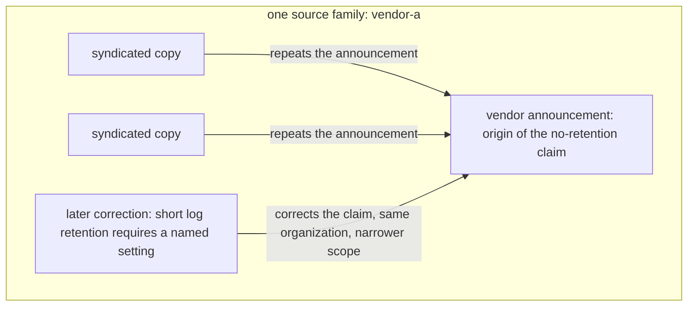
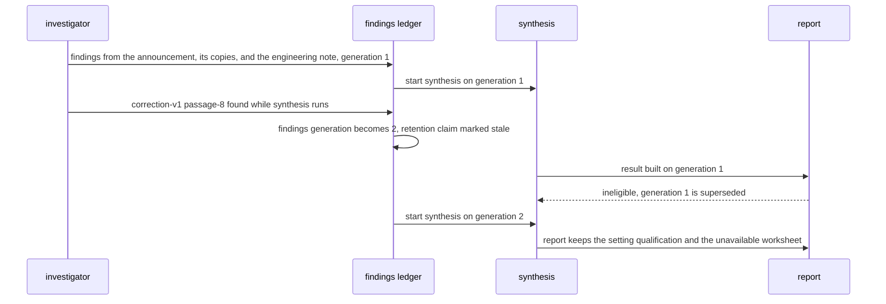

# Chapter 6. A research agent that knows when to stop

Status: draft.

[Previous: Chapter 5](./05-finding-a-short-event-in-hours-of-video.md) · [Table of contents](../table-of-contents.md) · [Next: Chapter 7](./07-data-analysis-over-chat-without-double-counting.md)

**New in this chapter:** the agent loop and tool contracts; budgets with uncertain spend and stopping rules; context compaction; **source independence**; the book's names for **Workflow vs Agent**.

**Assumes:** read-only tools (search, fetch, read); one analyst approving the brief; a frozen corpus for the comparison; no action on the world (chapter 17 onward); no concurrent human editing of the report (chapter 8).

**Reuses:** the four checks on a citation and the claim ledger (chapter 2); fenced publish and recorded selection (chapter 3); candidate vs verified (chapter 5).

> **About the examples.** The platform dossier, the team, Yusuf's brief, the budgets, and the state contracts in this chapter are fictional fixtures. Numbers are illustrative unless labeled *measured*. Named companies support particular published architecture or interface findings and link to reviewed sources; none of their private planners is reconstructed here.

## Five sources that are one source

Yusuf, an engineer, asks the team's AI workspace for a decision brief about adopting a document-search platform. The brief has to compare deployment options, connector permissions, source retention, operating cost, and unresolved limitations.

The workspace finds five articles saying the platform retains no data and calls the claim "independently corroborated." All five trace back to one vendor announcement.

An original technical page distinguishes uploaded files from diagnostic logs. A later correction changes the retention description again. Neither appears in the report. The system stopped when it had enough fluent material to fill the requested sections.

Chapters 2 through 5 knew their collection and their questions before execution began. Here a source can reveal a new question ("does no retention mean original files, prompts, diagnostic logs, or all of them?"), and the system has to decide what to read next, when contrary evidence changes the plan, how much repetition the budget tolerates, and what to do when a critical question stays unanswered at the deadline. For the first time in the book, the model proposes the next step instead of code deciding every step.

Our application produces a sourced, reviewable internal decision brief. It can search, fetch, read, compare, and synthesize permitted evidence. The first release uses read-only tools. It cannot contact vendors, submit forms, run downloaded code, create accounts, or act on instructions contained in a source. The report states the disposition of each required question, links material claims to inspected evidence, preserves consequential disagreement, and says why the investigation stopped. A completed provider request is an execution outcome; a sufficient report is an evidence outcome; the application represents both.

## What the brief has to answer

### Five areas, critical facts, and permitted unknowns

Yusuf approves five areas before a run begins:

1. Deployment choices and the operational responsibility each requires.
2. Supported connectors, permission enforcement, and identity-update limits.
3. Retention by artifact type, including logs and derived indexes.
4. Cost drivers under a stated illustrative workload, with unknown prices identified.
5. Missing evidence, contradictions, and follow-up questions.

Each area has required facts, a criticality, evidence expectations, and permitted unresolved outcomes. A scope field names the platform, the product version or date, source languages, allowed repositories, exclusions, and the truth date. For the fixture, retention and connector permission behavior are critical: a report cannot pass by marking both unresolved and completing the outline. An undisclosed internal staffing number may stay unknown if the dossier cannot answer it.

A partial brief at the deadline is useful work with an explicit limitation. Yusuf can supply evidence or authorize another bounded run.

The baseline is Yusuf's own search log and a manually sourced brief under the same deadline. A second baseline executes a fixed checklist and drafts from the selected passages. The comparison measures required-fact coverage, unsupported additions, source quality, review effort, and total cost.

| Requirement | Illustrative first-release assumption |
| --- | --- |
| Volume | 100 briefs per day |
| Peak active runs | Twenty admitted runs |
| Required areas | Five, with two initial questions each |
| Tool cap per run | Thirty searches and sixty source reads |
| Model cap per run | 160,000 input tokens and 12,000 output tokens across all stages |
| Deadline | Fifteen minutes from admitted run to report or explicit partial result |
| Worker policy | At most four independent branches active per run |
| Evidence retention | Permitted source snapshots and run records for 30 days |
| Output | Reviewable report, evidence ledger, question dispositions, stop reason |
| Authority | Search and read only; scope changes require application authorization |

The model cap covers planning, reading, verification, synthesis, and repair, and failed requests count. The table has an arithmetic problem that is worth catching before any design: sixty reads at 2,500 model-input tokens each are 150,000 tokens, which leaves 10,000 of the 160,000 for everything else. A cap is meaningful only if a plan can fit inside it, so the read cap is revised to bounded excerpts of at most 1,500 tokens per read (90,000 for sixty reads), leaving 70,000 for planning, verification, synthesis, and retries. The split those 160,000 tokens follow is a design question taken up below.

### The dossier

The authored dossier has sources with deliberately different roles.

| Fixture source | Evidence role | Expected use |
| --- | --- | --- |
| Vendor announcement | Broad deployment and "no retention" claims | Attribute the claims; investigate their scope |
| Two syndicated copies | The same announcement | Discovery aids; no independent corroboration |
| Original engineering note | Hosted and self-managed paths; diagnostic-log policy | Supports scoped implementation findings |
| Connector reference | Indexed permissions and identity synchronization | Supports the documented interface; nothing about revocation delay |
| Later correction | The short diagnostic-log retention requires a named setting | Reopens the earlier retention conclusion |
| Unavailable attachment | Referenced cost worksheet | Marked unavailable; no invented numbers |
| Misleading near-match | A similarly named product | Excluded after identity checking |
| Injected instruction in a source | Asks for secret disclosure or wider scope | Source content; grants no capability |

The answer key: retention resolved per artifact type with the setting qualification; connector permissions supported from the reference with revocation delay marked unknown; the five-article claim counted as one origin; the cost worksheet marked unavailable; the near-match excluded; the staffing figure a permitted unknown. The dossier files and the full grading oracle remain to be authored.

One URL can hold several materially different versions over time, so the application keeps retrieved bytes or a permitted snapshot with hash, retrieval time, publication time where established, and content version. A hash identifies bytes; it does not keep a mutable page available.

### The naive version fills every section

Start with the obvious design: run ten searches, one per initial question, read the top three results of each, and ask the model to write the five sections with citations.

The output fills every section. Retention says "no data is retained," cited to three of the five articles, with a sentence noting that multiple independent sources confirm it. The engineering note, ranked below the syndicated copies on the retention query, was never read, so the distinction between uploaded files and diagnostic logs is absent, and the correction, which postdates the announcement and uses different wording, was never found. The report looks finished because the outline is full.

The limitation is that the plan was fixed before anything was read, and nothing read could change it. Three URLs became three votes. The chapter's first decision is whether to make the fixed plan better or to let the evidence steer it.

## A fixed plan or a bounded investigator

### Path A: fixed search, read, and synthesize

Compile the ten initial questions into a predetermined plan. For each, run bounded query templates, select candidate sources, read relevant passages, record findings, and run a common verification step. Then assemble the five sections.

A fixed plan can carry rules: find a retention source, look for corrections, distinguish originals from copies, check connector documentation. It need not be the naive list. This path fits recurring briefs whose evidence needs are known and whose omissions can be covered by explicit rules; its maximum work and its missing steps are easy to inspect. Its weakness is a distinction the checklist does not represent. A retention question that asks only about uploaded files has no slot for diagnostic logs, and the brief is incomplete after every step ran correctly.

### Path B: bounded adaptive investigation

The investigator starts from the same required questions and proposes the next search or read from the recorded evidence. A contradictory source can create a child question, change query terms, or request a targeted original document. Application code validates each proposed step against scope, budget, and available capabilities; the model owns a proposal, never execution authority or the truth of its findings.

This path fits briefs whose next useful search depends on what was just read. Its risks are repeated discovery, unnecessary branches, plausible but unsupported questions, and premature satisfaction. A single iterative investigator is the credible first implementation; parallel workers are optional for independent questions and add a shared-budget and deduplication problem.

| Dimension | Fixed workflow | Bounded adaptive investigation |
| --- | --- | --- |
| Quality | Repeatable coverage of known requirements; unexpected distinctions missed | Follows corrections and new entities; may drift or overinterpret |
| Latency | Predictable stage graph; some questions in parallel | Variable searches and replanning; parallelism depends on independence |
| Cost | Bounded templates and reads; predictable waste | Adaptive focus can save work or spend it all on repetition |
| Privacy | Known evidence scope and artifacts | The same plus expanded traces and intermediate findings |
| Safety | Explicit plan and read-only tools | The same boundary; every proposed step validated |
| Operations | Step state, retries, snapshots, grading | Those plus question revisions, stop policy, branch ownership, budget arbitration |
| Recovery | Resume missing steps from durable receipts | Resume accepted plan and findings; never replay an obsolete question blindly |

```text
A: brief → fixed question graph → search/read tasks → findings ledger
                                                     → checks → report

B: brief → current question state → proposed next task → scope/budget gate
                  ↑                                      ↓
                  └──────── durable evidence/findings ← search/read
                                  ↓
                       sufficiency or explicit stop → report
```

### Workflow vs Agent

The book uses these two names from here on. A **workflow** is a system where code decides the sequence of steps and the model fills in steps. An **agent** is a system where the model proposes the next step and code validates it. Path A is a workflow; Path B is an agent.

> **Source finding.** Anthropic [drew](https://www.anthropic.com/engineering/building-effective-agents) the same line, describing workflows as systems where models and tools are orchestrated through predefined code paths and agents as systems where the model directs its own process, and recommended the simplest composition that meets the task. The article is design guidance from one vendor's experience.

A workflow wins when the required steps are known, when their omissions can be enumerated as rules, and when inspectability of maximum work matters more than adaptation. An agent wins when the relevant distinction is unforeseen and adaptation reliably discovers it under acceptable spend. The two are compared fairly only under the same tools, model, verifier, output contract, budget, and oracle; a stronger verifier or better formatting on the agent side is a hidden explanation for its gain. And an agent's discoveries are promoted into the workflow: when B reliably finds that retention varies by artifact type, that becomes a rule in A's checklist, and the question is asked again on the next unforeseen distinction.

> **Source finding.** Hebbia [described](https://www.hebbia.com/blog/inside-hebbias-deeper-research-agent) specialist branches, source-aware retrieval, compressed findings, and a scheduling layer. Anthropic [described](https://www.anthropic.com/engineering/multi-agent-research-system) a lead researcher dispatching worker batches with citation processing afterward, and reported an internal gain that used different model mixtures and more computation than the single-agent comparison. Both are conditional architecture examples from vendors; neither is an equal-budget result for this case.

We start with Path A for recurring platform briefs, with the question tree, evidence ledger, and budget ledger built so that B can run on them. What B's one step looks like decides whether that is possible.

## What the model sees and returns

### The planner's turn

Each planner call receives the required questions with their current dispositions, the findings so far as compact notes with passage IDs, the budget remaining in each category, and the list of tools. It returns one proposed task, or a proposal to stop with a reason.

```text
Required questions (disposition):
  retention/original-files: supported [note-4]
  retention/diagnostic-logs: insufficient evidence
  connectors/permission-model: supported [note-7]
  connectors/revocation-delay: insufficient evidence
  ...
Findings so far: 9 notes (IDs note-1..note-9), 4 source families
Budget remaining: discovery 38,000 input tokens, 11 reads, 14 searches; 6 min
Propose exactly one of:
  search{query, scope, limit}  read{source_id, region}  stop{reason}
Tie the proposal to a required question ID.
```

The planner's output is a proposal. Code checks that the question ID exists, the scope is permitted, the budget covers the reservation, and the source is not a copy already in the ledger, before anything executes.

### Two tool contracts

```json
{"tool": "search",
 "args": {"query": "diagnostic log retention setting", "scope": ["docs.platform-a.example"],
          "date_after": "2026-01-01", "limit": 5},
 "returns": {"candidates": [{"source_id": "...", "title": "...", "snippet": "...", "published": "..."}],
             "state": "ok | empty | error", "scope_searched": "..."}}

{"tool": "read",
 "args": {"source_id": "correction-v1", "region": "section:retention", "max_tokens": 1500},
 "returns": {"content": "...", "snapshot_hash": "...", "retrieved_at": "...",
             "passages": [{"id": "correction-v1/passage-8", "offset": [1204, 1611]}],
             "state": "ok | unavailable | access_denied | unsupported_format | timeout | partial"}}
```

A snippet is a discovery aid until its source is read. A read returns passage coordinates so a finding can cite one. The result states are distinct because the planner treats them differently: `empty` says the search found nothing in that scope, `unavailable` says the source could not be fetched, and neither says the source says nothing. The fetch gateway enforces network and tenant scope, validates redirects, and keeps credentials out of model-visible text; a public page that redirects to a private address is not an authorized read, and a documentation paragraph cannot widen the scope.

### Compacting sixty reads

Sixty reads at 1,500 tokens are 90,000 tokens, and the planner cannot carry them all. After each read, a compaction step turns the excerpt into a working note: the proposition it supports or contradicts, the passage IDs, the source family, and any qualifier. Notes are a view over durable findings, which commit first. Compaction may shrink what the planner sees; it cannot delete the only evidence or drop a qualifier, because the finding record holds both.

> **Source finding.** Anthropic's context-engineering article [recommended](https://www.anthropic.com/engineering/effective-context-engineering-for-ai-agents) compacting long agent trajectories into summaries that preserve decisions and unresolved items while writing durable notes outside the context window. It is vendor guidance, with no measurement for this case.

The finding record:

```json
{
  "finding_id": "retention-log-3",
  "requirement_id": "retention/diagnostic-logs",
  "subject": "platform-a/diagnostic-logs",
  "proposition": "The stated short retention applies only with the named setting.",
  "support": ["correction-v1/passage-8"],
  "contrary_or_superseded": ["announcement-v1/passage-2"],
  "source_families": ["vendor-a"],
  "truth_date": "2026-09-30",
  "disposition": "supported-with-qualification",
  "review_state": "unreviewed"
}
```

The `source_families` field is what the opening failure lacked. After the retention search, the ledger holds three URLs with three snippets that say the same thing.

## Five URLs, one origin

Canonical URLs identify repeated retrieval of one page. Content hashes and similarity identify copies. Neither establishes independence, because two differently worded articles can both be rewrites of one press release.

A source family is a relationship recorded from attribution, quoted material, publication context, and original evidence origin. If a newspaper and two blogs repeat the vendor announcement, the announcement is the origin for that claim. The articles may add independently reported material elsewhere, so independence is judged per proposition, never assigned to a domain. For the no-retention claim, five articles are one vendor-origin assertion. The correction belongs to the same organization with a different version and narrower scope; it corrects the claim without adding an independent observation.



Figure 6.1. The dossier's retention sources as one family. The two syndicated copies repeat the announcement and the correction narrows it, so none of them is independent corroboration of the claim.

Family assignment is made three ways with different reliability. Exact and near-duplicate hashing catches copies and nothing else. Citation and attribution parsing ("according to the vendor's announcement") catches declared derivation. Model judgment catches undeclared rewrites and is wrong sometimes, so a family assigned by judgment is marked as such, and the oracle scores independent-origin errors as their own metric. "Original" means original among the evidence found and inspected; when provenance is unclear, the family is unresolved, and unresolved never counts as independent.

Disagreement is kept by subject and period. A correction about diagnostic logs does not contradict a statement about original files, and broadening "uploaded files are not retained" to "no data is retained" is an unsupported addition even though the cited sentence is real. The ledger therefore carries chapter 2's four checks (existence, support, applicability, coverage) plus one more field: independence.

Two planner branches, retention and deployment, now each want the last 20,000 tokens of discovery budget.

## Spending a finite budget

Before dispatch, the branch reserves allowance in the run's budget ledger in one transaction: estimated input, maximum output, tool quota, and time. Concurrent branches cannot each spend the same remaining amount, because the second reservation fails. Completion reconciles actual use and releases the difference.

The ledger has four columns: reserved, known consumed, released, and uncertain. Suppose the run has a 160,000-token allowance with 110,000 known consumed, 20,000 reserved for active tasks, and 10,000 possibly consumed by a request that timed out. Available for new dispatch under a conservative policy is 20,000; ignoring the uncertain request would expose 30,000. Uncertain spend is reconciled when the provider reports usage, and otherwise kept as a bounded estimate and stated as a limitation. A cost figure built only from successful responses excludes the failures that were paid for.

The split starts at 60 percent discovery, 20 percent verification, 20 percent synthesis, as a trial policy. The verification and synthesis reserve is unavailable to discovery until the application deliberately reallocates it, so the planner cannot search until nothing is left and then report that no allowance remained to check anything.

A read counts as progress if it changes a required fact's disposition, adds independent support, reveals a consequential contradiction, or narrows a known uncertainty. This is recorded after analysis, by code reading the finding against the ledger, since the planner has an interest in calling its own reads useful. Reading another copy of the announcement is not progress. The proposed diminishing-return trigger is three consecutive search batches with no progress; it ends discovery with the actual partial coverage. It is a hypothesis, because a decisive source can appear after several unproductive searches, and the budget curve in the evaluation is how it gets tested.

Hard deadlines and tool caps stop work too. Every stop stores its reason, the unresolved requirements, the exhausted allowance, and which checks remain incomplete. A run that stops has not thereby succeeded.

## Stopping without claiming success

Execution state (queued, running, stopping, completed, cancelled, failed) and report state (candidate, partial, eligible for review, accepted, superseded) are separate records. Investigation can end when every required question has a disposition and the evidence checks finish. Product acceptance additionally requires the predefined critical facts and support criteria, and a permitted unknown passes only where the contract allows it. Marking every critical question "insufficient evidence" ends the investigation and fails acceptance.

```text
if cancelled or hard deadline/cap reached:
    stop new discovery; preserve partial coverage and reason
else if all required questions have dispositions and checks finish:
    end investigation
else if diminishing-return policy triggers:
    end discovery with unresolved requirements
else:
    dispatch next authorized, budgeted task

then evaluate report eligibility against required-fact and support criteria
```

The eligibility step uses independently defined requirements. The planner's own "done" is never the oracle.

```text
adoption brief (truth date 2026-09-30)
├─ deployment
│  ├─ hosted vs self-managed paths ............ supported [eng-note/p3]
│  └─ operational responsibility per path ..... supported [eng-note/p5]
├─ connectors
│  ├─ permission model ........................ supported [connector-ref/p2]
│  └─ revocation delay ........................ insufficient evidence (critical)
├─ retention (critical)
│  ├─ original files .......................... supported [eng-note/p7]
│  ├─ prompts ................................. insufficient evidence
│  └─ diagnostic logs ......................... supported-with-qualification [correction/p8]
│                                              supersedes [announcement/p2], family vendor-a
├─ cost
│  ├─ price drivers ........................... supported [announcement/p4]
│  └─ worksheet figures ....................... unavailable source
└─ unknowns
   └─ internal staffing ....................... permitted unknown
stop reason: all required questions have dispositions; 1 critical insufficient → report PARTIAL
```

Figure 6.2. The question tree after the fixture run, with derived children under retention and the disposition of each leaf. One critical question without evidence makes the report partial regardless of how full the sections are.

Counterevidence reopens a conclusion. Before acceptance, a correction that arrives during synthesis increments the findings generation, marks affected claims stale, and makes a report built from the prior generation ineligible; the stop transition and the generation selection are serialized in the state store so either ordering yields one recorded outcome. After acceptance, the historical report stays and a new reviewable revision is created. A deadline report may expose a contradiction it could not resolve, and that limited outcome is preserved instead of squeezing the disagreement out to make the text read confidently.

Branches, when used, take independent questions only: retention and deployment can run apart, while a permission conclusion that depends on a discovered connector mode waits for that finding. A worker contract names the question, allowed sources, output schema, budget, and owner, and a worker cannot publish the report or alter another worker's findings. Batch coordination comes first because it is inspectable; fully asynchronous updates need rules for stale plan revisions and concurrent evidence changes, added when measured waiting justifies them. Resumption after a lost worker follows chapter 3's leases and durable receipts.

Everything above assumes the application runs the loop. A hosted provider offers to run it instead.

## Buying the investigator

A hosted research provider can implement discovery behind an adapter. The adapter persists submission intent, the response identity when known, observed status, a progress cursor, the locally saved result, and the task's acceptance state.

> **Source finding.** Perplexity's background-mode documentation [distinguishes](https://docs.perplexity.ai/docs/agent-api/background-mode) queued and in-progress work from the terminal outcomes completed, failed, cancelled, and incomplete, returns an intermediate cancelling state, and requires a snapshot retrieval when a reconnect window expires. It documents a public lifecycle and nothing about the provider's planner, replay window, or retention.

The adapter handles every terminal outcome, and `incomplete` is a result to record, never a state to poll forever. A transport disconnect retrieves the known response instead of submitting another run to restore the display. If submission succeeds remotely but its identity is lost before local storage, the outcome is uncertain: the adapter uses a provider reconciliation or idempotency contract where one exists and otherwise exposes the uncertainty and makes any replacement explicit. Chapter 17 owns that boundary in full.

A hosted result still passes through the report checks, and the provider's searches and spend are recorded where exposed, with the observability gap recorded where they are not. A polished final report does not reveal a planner.

## The correction that arrives during synthesis

Run the dossier with the correction initially unavailable. The investigator finds the announcement and its copies; the ledger records their shared origin even where search ranking makes them look diverse. Retrieve the engineering note and kill the worker after the snapshot commits and before the finding commits; a replacement analyzes the saved note. Introduce the correction while synthesis runs; the findings generation increments, the old synthesis result is superseded, and the new report keeps the setting qualification and the unavailable worksheet.



Figure 6.3. The correction that arrives during synthesis. The findings generation increments, the synthesis built on generation 1 cannot become the report, and the rerun carries the setting qualification.

| Injected condition | Responsible boundary | Required assertion |
| --- | --- | --- |
| Several copies of one announcement | Source-family resolution | One origin; no independent-corroboration label |
| Near-match product page | Identity and applicability check | Excluded from the target's findings |
| Source contains an instruction to disclose data | Fetch and tool authority | No scope expansion or unauthorized call |
| Fetch saved, finding worker dies | Durable stage records (chapter 3) | Analysis resumes from the snapshot |
| Source changes during a retry | Versioned acquisition | New bytes are a new observation |
| Critical attachment unavailable | Question disposition | Insufficient evidence kept; no invented numbers |
| Correction arrives during synthesis | Generation check | Old report cannot publish as current |
| Two branches reserve the last allowance | Budget transaction | At most the permitted work dispatched |
| Three unproductive batches | Stop policy | Partial stop reason; no sufficient-research status |
| Provider returns incomplete | Hosted adapter | Terminal outcome and explicit report limitation |
| Cancel races with provider completion | Run and adapter reconciliation | One recorded outcome; upstream status separate |
| Private source access revoked mid-run | Evidence eligibility (chapter 4) | Late findings withheld for the affected audience |

The drill inspects snapshots, task states, reservations, findings, and report inputs. A readable brief establishes none of them. The drills are specified; no run has been performed.

## Which path to ship first

Path A was the provisional choice. The evidence that would confirm or overturn it comes from a frozen corpus, and the metric that decides it is one the naive version never saw.

### A frozen corpus and twelve dossiers

Author the dossier with required facts, forbidden claims, source-family relationships, exact support and contradiction passages, known unavailable sources, and permitted unknowns, and keep the answer key outside the corpus. Create twelve variants: four straightforward, four with corrections or scope conflicts, four with unavailable evidence, near-matches, or injected instructions. Develop on four and hold eight out, with related versions in one split. Both paths read the same corpus through the same interfaces under comparable model, context policy, verification, output contract, and budget, and each held-out task runs three times with every report, failed run, and stop reason retained. A later live-web trial is a separate environment, reported separately.

### Required-fact recall is separate from supported-claim precision

The oracle lists critical and noncritical required facts, and report claims are matched to them. A report with eighteen supported claims out of twenty asserted has 90 percent supported-claim precision; if it covers six of ten required facts, its required-fact recall is 60 percent. The naive version scores well on the first and badly on the second, and omitting a hard requirement leaves it in the denominator. Unsupported additions, retained contradictions, independent-origin errors, source failures, and permitted unknowns are counted separately. Automated judges are calibrated on supported claims, real-but-wrong passages, contradictions, missing sources, unsupported additions, and correctly unanswerable requirements, and chapter 16 tests the grader itself.

> **Source finding.** Anthropic's agent-evaluation article [recommended](https://www.anthropic.com/engineering/demystifying-evals-for-ai-agents) isolated repeated trials and calibrated outcome graders in place of trusting an agent's own completion message. Here the outcome oracle is the report plus its evidence and question dispositions.

Three public datasets supply bounded diagnostics. DeepResearch Bench [provides](https://arxiv.org/abs/2506.11763) 100 tasks across 22 topics, half English and half Chinese, with report-quality and statement-source dimensions; a ten-task English pilot (IDs 51/52, 58/59, 66/67, 71/72, 83/84 in the inspected revision) covers five topic labels. BrowseComp's 1,266 tasks diagnose hard short-answer discovery. The inspected FreshQA export, dated April 21, 2026, holds 600 questions with changing facts and false premises, and its April answers are not October truth. None labels independent corroboration or this dossier's required facts, and no scores have been generated.

### Budget curves

At the caps, 100 daily runs consume at most sixteen million input tokens and 1.2 million output tokens, a ceiling. Twenty active runs with four branches are eighty competing tasks, a concurrency ceiling that says nothing about provider admission. An eighty-read plan under twelve-second calls and four workers has a four-minute lower bound and exceeds the sixty-read cap, so it is rejected or reauthorized before dispatch; a plausible time estimate never overrides the work contract.

Progress is plotted against cumulative spend: new dispositions and independent evidence per search batch, with contradictions and failures retained. The curve tests the three-batch trigger and the 60/20/20 split. If both paths keep rereading one source family, the fix is deduplication. If the fixed path resolves known questions and misses newly exposed artifacts, adaptive planning has a specific hypothesis. If both retrieve the correction and omit its qualification, the bottleneck is reading or synthesis.

Results are reported per task and per trial before any aggregate. With eight held-out dossiers, one failure moves an average. Best-of-three is never reported as reliability; if the product retries, the actual retry policy and its accumulated cost are what get evaluated. Analyst correction time is in the comparison, since a longer report with twice as many shallow claims can raise verification effort without raising coverage.

### Gates and the move to the agent

Release requires the scope, budget, recovery, version, cancellation, and permission tests to pass and independently reviewed critical-fact performance on the held-out dossiers, with support, coverage, contradiction, review-time, and latency floors set beforehand. Move to Path B when held-out failures show that observation-dependent questions, such as retention scope and corrections, improve coverage under acceptable spend. Use one bounded investigator before parallel workers, and add workers when measured critical-path gains repay duplicate discovery and coordination. A rollback restores earlier policies for new tasks; it does not reinterpret accepted reports, and a discovered source-family defect marks affected reports for re-review.

## Key ideas

- Workflow: code decides the steps. Agent: the model proposes the step and code validates it. Compare them under equal tools, model, verifier, budget, and oracle, and promote an agent's reliable discoveries into the workflow's rules.
- A planner call returns one proposal tied to a required question; scope, budget, and deduplication checks run before it executes.
- Tool results have distinct states (`empty`, `unavailable`, `partial`) because the planner must treat them differently; none of them is evidence that a source says nothing.
- Compaction shrinks what the model sees; findings commit first, so a note can never be the only copy of a qualifier.
- Independence is judged per proposition from source families; five URLs can be one origin, and "unresolved" never counts as independent.
- A budget ledger has reserved, consumed, released, and uncertain columns; the verification reserve is walled off from discovery; progress is judged by code after the read.
- Stopping and succeeding are different records. The planner's "done" is a proposal; eligibility is evaluated against predefined critical facts.

Chapter 7 keeps the proposal-then-validate loop and gives the model a tool that computes: an analysis over chat, where the result has to be checked against the question that was asked.

## Exercises

1. Origin families. Six sources on the platform's retention: (a) the vendor's announcement; (b) a trade-press article quoting the announcement; (c) a blog post that paraphrases the trade-press article; (d) the vendor's engineering note; (e) a customer's conference talk describing their own deployment's log retention; (f) the vendor's correction. Group them into families for the proposition "diagnostic logs are retained for a short period," and say which, if any, is independent of the vendor.

2. Does the plan fit? A proposed plan has 24 searches, 52 reads at the 1,500-token excerpt cap, 14 planner calls averaging 3,000 input tokens, and synthesis estimated at 20,000 input tokens. The run allowance is 160,000 input tokens with a 60/20/20 split. Does discovery fit its share? Does the whole plan fit?

3. Stop or continue. The progress log shows: batch 7, two reads, one changed disposition (connectors/permission-model → supported); batch 8, three reads, all copies of known families; batch 9, two reads, one narrowed uncertainty on prompt retention; batch 10, three reads, no change; batch 11, two reads, no change. Discovery budget remaining: 9,000 tokens. Under the three-batch trigger, does the run stop after batch 11? What would the planner have to show for one more batch to be authorized?

<details>
<summary>Answers</summary>

1. Family vendor-a: (a), (b), (c), (d), (f). (b) and (c) derive from (a); (d) and (f) are the same organization in different versions and scopes, and (f) supersedes the broad claim in (a) for diagnostic logs. (e) is an independent origin for that proposition, limited to what one customer observed under their own configuration; it supports the proposition for that deployment and does not establish the vendor's general policy.

2. Discovery's share is 96,000 tokens. Reads: 52 × 1,500 = 78,000. Planner calls: 14 × 3,000 = 42,000. Discovery total 120,000, which exceeds 96,000, so discovery does not fit its share. The whole plan: 120,000 + 20,000 synthesis = 140,000 before verification, leaving 20,000 for the 32,000-token verification share. The plan is rejected or reauthorized; fewer reads, smaller excerpts, or a higher approved allowance are the options.

3. Batches 10 and 11 had no progress; batch 9 did (a narrowed uncertainty counts). That is two consecutive unproductive batches, so the trigger has not fired and discovery may continue if budget allows. One more batch is authorized only if its reservation fits in 9,000 tokens and it is tied to an unresolved required question; if batch 12 shows no progress, the trigger fires and discovery ends with the partial coverage recorded.

</details>

## Sources

Sources used here, linked to the original articles:

- [Anthropic composable agent patterns](https://www.anthropic.com/engineering/building-effective-agents), [multi-agent research architecture](https://www.anthropic.com/engineering/multi-agent-research-system), [context engineering methods](https://www.anthropic.com/engineering/effective-context-engineering-for-ai-agents), and [agent evaluation method](https://www.anthropic.com/engineering/demystifying-evals-for-ai-agents)
- [Hebbia deeper research orchestration](https://www.hebbia.com/blog/inside-hebbias-deeper-research-agent)
- [Perplexity background research contract](https://docs.perplexity.ai/docs/agent-api/background-mode)
- [DeepResearch Bench](https://arxiv.org/abs/2506.11763), [BrowseComp](https://openai.com/index/browsecomp/), and [FreshQA](https://arxiv.org/abs/2310.03214)

