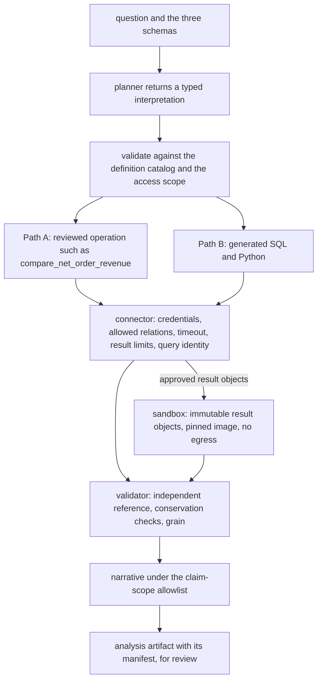
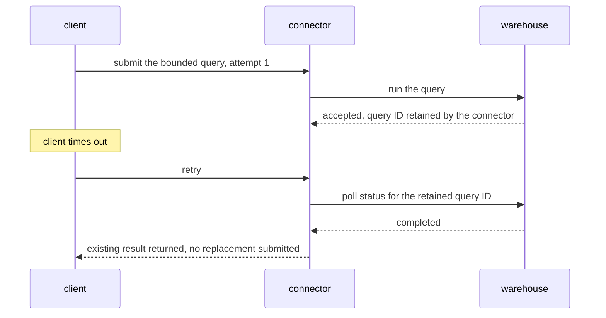

# Chapter 7. Data analysis over chat without double counting

Status: draft.

[Previous: Chapter 6](./06-a-research-agent-that-knows-when-to-stop.md) · [Table of contents](../table-of-contents.md) · [Next: Chapter 8](./08-editing-a-financial-model-others-are-also-editing.md)

**New in this chapter:** code-generating tools and sandboxes; numerical oracles and reconciliation; **claim scope** (descriptive, associative, causal); the book's names for **Curated vs Generated**.

**Assumes:** immutable exports or permission-scoped warehouse snapshots; one analyst per question; no writes to source tables; no external delivery of results; generated code has no network access.

**Reuses:** output schemas with a repair loop (chapter 1); answer-key evaluation (chapter 1); Workflow vs Agent (chapter 6) as a contrast.

> **About the examples.** Mina's retailer, the three files, the fixture orders, the workload, and every price in this chapter are fictional. Numbers are illustrative unless labeled *measured*. Company references support specific mechanisms and link to reviewed sources; none establishes this retailer's system or validates the design.

## A chart that doubles revenue

Mina runs operations at a subscription retailer. On Monday she asks the team's AI workspace, "Why did net order revenue fall last week, and was the spring campaign responsible?" She attaches three files: an orders export, a refunds export, and a campaign-membership list.

Each file is valid. Together they are hazardous. An order can carry several campaign labels. Refunds arrive after purchase. The export timestamps are UTC while the business reports weeks in Los Angeles.

The first answer comes back with a chart. Net revenue for the spring cohort is 25,000 cents on the fixture below, where the correct figure is 14,000. The SQL behind it is syntactically valid and ran without error. The chart has axis labels and a title and looks like something a finance team would publish.

Chapter 6's agent proposed a search or a read, and the worst a bad proposal could do was waste budget. Here the model proposes code, the code runs, and its output is a number that will be believed. The question also contains two jobs. "Why did revenue fall" asks for a descriptive decomposition. "Was the campaign responsible" asks for a causal claim, and comparing tagged orders with the rest establishes nothing about impact when targeting, seasonality, and customer mix differ. The application may compute the association and say what it does and does not show.

Our application is a conversational analyst over immutable exports and permission-scoped warehouse snapshots. It discovers relevant columns, translates the question, executes calculations, and explains a decomposition, producing an inspectable analysis: the definition it used, the records it counted, what changed, and the evidence for the explanation. It cannot modify source tables, send reports outside the workspace, install dependencies, or reach the network from generated code. An analyst owns the accepted metric definition and any decision.

## What an analysis has to carry

### The metric, the artifact, and a baseline

"Net order revenue" for this case is paid order subtotal after discounts, less refunds attributed to those orders and recorded by the snapshot cutoff, excluding tax and shipping, in integer cents of one currency, over local calendar weeks, excluding cancelled and unpaid orders. These are the retailer's rules, chosen for the fixture.

A completed analysis carries its interpretation, data and definition versions, the executable calculation, result tables, a validation report, and a narrative in which every number links to a result cell or a labeled calculation. An unsupportable question ends with a precise limitation or a clarifying question.

The baseline is a versioned SQL query plus a spreadsheet reviewed by a second analyst: refunds aggregated to orders, campaign membership as a filter, totals reconciled against known order counts. It takes effort and exposes its semantics. Both paths are compared against its accepted result and total review time.

| Requirement | Proposed contract | Evidence needed before release |
| --- | --- | --- |
| Meaning | Record metric, period, timezone, cohort, refund cutoff, exclusions, comparison | Expert labels for ambiguous questions |
| Calculation | Exact cents for deterministic sums; declared tolerances for floating-point statistics | Independent reference calculations |
| Authority | Authorize data before schema discovery and again before execution and export | Cross-role and revocation fixtures |
| Reproduction | Rerun pinned inputs and environment to matching tables | Clean-environment replay |
| Explanation | Separate decomposition, association, and causal evidence | Analyst review of claim support |
| Resources | Cap scans, result size, runtime, retries, total task spend | Measured workload and burst trials |

Illustrative demand: 400 requests per working day over 10 million warehouse rows, with bursts of 20 in a minute; the interpreted question shown promptly and ordinary analyses returned within a minute. Upload retention, result retention, and shared-artifact retention are separate policies, and deleting a dataset invalidates every derived table and chart that reveals it.

### Three orders, two labels, one refund each

| Order | Paid subtotal | Campaign labels | Refunds by cutoff |
| --- | ---: | --- | ---: |
| A | 10,000 | spring, email | 2,000 |
| B | 6,000 | spring | 0 |
| C | 4,000 | email | 1,000 |

Gross subtotal is 20,000 cents, refunds 3,000, net 17,000. Orders tagged spring contribute 14,000 net: A's 8,000 and B's 6,000. Those are the answer key.

### The naive version joins orders to labels and says 25,000

Start with the obvious design: hand the model the three schemas and the question, ask for SQL, run it, chart the result.

```sql
SELECT SUM(o.subtotal_cents) - SUM(o.refund_cents) AS net
FROM orders o
JOIN campaign_labels l ON l.order_id = o.order_id
WHERE l.campaign = 'spring';
```

Order A matches two label rows, so it appears twice. Gross becomes 30,000 with both labels, or 16,000 for spring alone with A counted once per spring label; with A's refund repeated as well, the all-label net is 25,000. The query is valid SQL and the warehouse returns a number.

```text
orders            campaign_labels           joined rows
A 10,000  ──┬──→  A spring   ──→  A 10,000 spring
            └──→  A email    ──→  A 10,000 email      ← A counted twice
B  6,000  ─────→  B spring   ──→  B  6,000 spring
C  4,000  ─────→  C email    ──→  C  4,000 email
                                  ─────────────────
                                  sum 30,000 (correct gross: 20,000)
```

Figure 7.1. The join fan-out on the three fixture orders. Each label row duplicates its order's subtotal.

The limitation is that the model's output was executed with nothing between it and the warehouse: no declared grain, no check on the join, no independent number to compare against, and no distinction between what the model wrote and what the business had approved. The chapter's first decision is whether the model should be writing the query at all.

## Governed operations or generated code

Both paths answer the same question and produce the same artifact contract.



Figure 7.2. Both paths behind one artifact contract. The typed interpretation is validated first, the connector executes every read and holds the credentials, generated code runs in a sandbox on immutable results, and the validator and claim-scope check run before the narrative.

### Path A: curated analysis operations

The model proposes a metric ID, parameters, and a supported decomposition. Application code executes a reviewed operation such as `compare_net_order_revenue`, which owns its joins, aggregation order, date boundaries, and reconciliation. A dimension the catalog does not support is rejected explicitly.

This path is strong for covered metrics and has a small execution surface. Its failure is mis-mapping a novel question onto a familiar operation, and its cost is maintaining definitions and migrating their versions.

### Path B: generated SQL and Python in an isolated executor

The model constructs an analysis plan and code against permitted schemas. A connector executes bounded read queries; a separate runtime transforms the returned data and produces tables and charts. Static restrictions, execution limits, and independent checks constrain the process, and code that runs without error has established that an execution completed.

This path handles unfamiliar schemas and transformations. Its risks are wrong grain, wrong units, wrong methodology, and a larger exposure surface: schema samples, code, traces, and intermediate tables.

| Dimension | Curated operations | Generated code |
| --- | --- | --- |
| Quality | Strong for covered metrics; can mis-map a novel question | Handles unfamiliar schemas; greater risk of wrong grain, units, methodology |
| Latency | One planning step and a known query | Several planning, execution, and correction rounds |
| Cost | Definition maintenance plus predictable compute | More inference, sandbox time, exploratory scans, review |
| Privacy | Narrow parameter and aggregate exposure | Schema samples, code, traces, intermediate tables |
| Safety | Small execution surface; business rules still need authorization | Isolation, query controls, package policy, egress enforcement |
| Operations | Governed metric ownership and version migration | Plus runtime images, admission control, cleanup, reproducibility |
| Recovery | Retry known reads or repair parameters on the same snapshot | Identify query outcomes; separate semantic repair from transient retry |

### Curated vs Generated

The book uses these names from here on. **Curated** means the application executes a reviewed artifact (an operation, a template, a definition) and the model chooses among them and fills parameters. **Generated** means the model produces the artifact (SQL, code, a plan) and the application validates and executes it. Chapter 6's Workflow vs Agent was about who sequences the steps; this is about who authors the thing that runs.

Curated wins when the question space is known, correctness has consequences, and review burden has to stay low. Generated wins when the question is outside the catalog and the alternative is no answer. The two are connected by a promotion rule: a generated calculation that recurs is reviewed for its semantics, given regression fixtures, and promoted into the catalog, and an operation whose meaning cannot be maintained is removed. The route for a given question depends on expressibility and validated task performance, never on how confident the model sounds.

> **Source finding.** Julius [described](https://julius.ai/articles/julius-slack-agent) a data-analysis agent built from schema context, generated SQL and Python, an isolated connection sidecar that holds credentials, bounded iteration, and asynchronous workspace learning. The account supports the execution boundary; it reports no controlled accuracy result.

We start with Path A for the recurring weekly metrics and offer Path B for questions outside the catalog, with both paths stopping when the data cannot support the requested causal conclusion. Under Path B, the question is how a generated query becomes correct.

## What the model sees and returns

### Schema linking, pruning, and examples

The planner needs column types, relationships, approved metric definitions, and a few examples; it does not need every customer record. A permission-scoped schema bundle is retrieved for the tables the question plausibly touches, pruned to the relevant columns, and accompanied by an aggregate profile (null rates, distinct counts, min and max) with representative values included only when allowed. Rare identities never enter the prompt.

Curated example queries, each tied to an approved definition, are retrieved by similarity to the question. "Net revenue by week for a cohort" retrieves the reviewed query that aggregates refunds to order grain first. The examples teach the join shape the catalog already trusts. Query history is not an example source, because yesterday's unnoticed mistake would become tomorrow's trusted pattern.

### The typed interpretation

Before any calculation, the planner returns an interpretation that the application validates against the definition catalog and the user's access scope:

```json
{
  "analysis_id": "analysis_204",
  "metric": {"id": "net_order_revenue", "version": 3},
  "grain": "paid_order",
  "currency": "USD",
  "timezone": "America/Los_Angeles",
  "periods": [
    {"start": "2026-09-14", "end_exclusive": "2026-09-21"},
    {"start": "2026-09-21", "end_exclusive": "2026-09-28"}
  ],
  "refund_cutoff": "snapshot_2026-09-28T12:00:00Z",
  "campaign_filter": "spring_2026",
  "claim_scope": "descriptive_association",
  "definition_snapshot": "definitions_18"
}
```

The server resolves dataset IDs, access scope, and credential handles. The model cannot name a different tenant or an unrestricted connection. Date-only local boundaries are converted by deterministic timezone code with the timezone database version recorded.

### The generated query and its repair loop

Under Path B, the planner then writes the query against the pruned schema, with the interpretation and the retrieved example in context:

```sql
WITH refunds_by_order AS (
  SELECT order_id, SUM(amount_cents) AS refund_cents
  FROM refunds
  WHERE recorded_at <= :refund_cutoff
  GROUP BY order_id
)
SELECT SUM(o.subtotal_cents) - COALESCE(SUM(r.refund_cents), 0) AS net_cents,
       COUNT(*) AS order_count
FROM orders o
LEFT JOIN refunds_by_order r ON r.order_id = o.order_id
WHERE o.status = 'paid'
  AND o.paid_at >= :period_start_utc AND o.paid_at < :period_end_utc
  AND EXISTS (SELECT 1 FROM campaign_labels l
              WHERE l.order_id = o.order_id AND l.campaign = 'spring_2026');
```

Repair is driven by execution. When the warehouse returns an error (an unknown column, a type mismatch, a timeout), the message goes back to the planner with the failed query for one bounded correction. When the query succeeds and a validation check fails (the grain check below, a reconciliation mismatch), the structured diagnostic goes back the same way. The loop is chapter 1's schema repair with the database as the validator, and it has the same single-attempt bound per class of error.

Definitions carry provenance. If the approved campaign dimension describes acquisition while the uploaded file describes current promotional eligibility, the interpretation explains the mismatch or declines the split. And when "last week" could mean a rolling seven days or the completed reporting week and no workspace convention exists, the task enters `needs_definition` and asks before spending a warehouse query. A manufactured default is never later described as Mina's instruction.

A correct interpretation can still produce a query whose grain is wrong.

## Make the grain visible

Every intermediate relation carries grain metadata: expected key, uniqueness, row count, and allowed multiplicity. The annotations are proposals until verified against the data, because a table's friendly name proves nothing about uniqueness; if duplicate order IDs occur in the source, the system diagnoses source grain or rejects the assumed key before using it.

Path A's reviewed operation aggregates refunds to order grain first and uses a semijoin for campaign membership. Path B declares the expected grain in its interpretation and runs cardinality checks around every join: the row count after joining `orders` to `refunds_by_order` must equal the row count before it. For a membership filter, `EXISTS` keeps one row per eligible order whatever the number of labels. If a question genuinely asks for revenue allocated across campaigns, the calculation needs an explicit allocation rule, since giving every label full credit cannot reconcile to the total.

The fixture's first refund trap is the join; its second is two legitimate refunds on one order. Aggregating refunds before the order join counts both exactly once. Joining refunds row by row and then summing subtotals repeats the order.

A query with the right grain can still run under credentials it should never have had.

## The connector holds the password

The connector accepts a bounded query under the current user and task and owns credentials, allowed relations, row policies, timeout, result limits, and the warehouse's query identity. The sandbox that runs generated Python receives immutable, approved result objects; it never receives a database password.

Read-only credentials are insufficient on their own. Some engines expose functions, external access, costly cross joins, or metadata beyond the intended tables, so the connector enforces supported query forms and database-specific controls, and the database's own privileges and limits are the final enforcement. Parser checks are one layer.

The runtime has a pinned image, no general egress, read-only inputs, a bounded scratch area, CPU and memory limits, and a wall-clock deadline. Packages come from the reviewed image, and a generated request to download code is rejected. Output goes to a task-scoped location, and the host validates type and size before publishing.

Spreadsheet cells, logs, and chart labels are untrusted text. A cell can contain an instruction to reveal credentials or run a shell command; it stays data, and a notebook gains no tool by printing a persuasive sentence.

A query admitted through the connector can now time out, and the client has to decide what that means.

## An empty result is not a timeout

A client can time out after the warehouse accepted the query. The connector retains the warehouse query ID and polls its status before submitting a replacement; a read is logically safe to repeat, and repeating it can still consume substantial resources or return a different snapshot. A replacement, when needed, has a new attempt ID, and the record states whether the old query was cancelled, completed, or unknown. Only an explicit successful result with zero rows is an empty answer. An error, a missing file, and an expired result are none of them zero-row datasets.



Figure 7.3. A query that completes after the client times out. The connector keeps the warehouse query ID, polls its status before submitting anything, and returns the existing result.

Snapshots are recorded as what they are. A pinned upload is simple. A warehouse may offer a transaction snapshot, a time-travel reference, or a best-effort read at query time, and the artifact records which. If dependent queries cannot share a consistent view, the artifact says so, or permitted inputs are materialized first.

A task runs under one budget. An illustrative exploratory task permits three query attempts, two sandbox attempts, 5 GB scanned, 100,000 returned rows, and 90 seconds; per-step limits fit inside the remaining task budget and never reset it.

```text
specified → admitted → executing → validating → ready_for_review → accepted
                 ↘ needs_definition        ↘ failed
                 ↘ cancel_requested → cancelled
```

A failed numerical check returns a diagnostic for one semantic repair. A resource or permission failure authorizes neither a different database nor a dropped check. Cancellation stops new work, asks running dependencies to stop, discards late outputs, and reports "cancellation requested" while the warehouse's outcome is unknown.

Two calculations can now run cleanly, agree with each other, and both be wrong.

## Reconcile, then say only what the numbers support

The validator verifies the accepted specification, permitted sources, grain, units, counts, and calculation lineage, and computes an independent reference that the candidate cannot modify: for the fixture, orders and refunds summed with no label join. Reconciliation adds conservation equations: the cohort total plus its complement equals the all-order total under the same definition. Integer-cent sums reconcile exactly. Ratios need denominator checks, and displayed rounding may differ from full precision. A tolerance is justified by the calculation before the run, never chosen after seeing a mismatch.

Two independent calculations can share one wrong definition, so the semantic oracle is an analyst-approved fixture specification separate from the planner. For production questions with no independent answer, the artifact reports which checks passed and which conclusion still needs review, and "verified correct" is never inferred from reconciled totals.

The narrative is constrained by claim scope. The explanation generator receives validated tables and an allowlist of supportable claims, built from the interpretation's `claim_scope` and the checks that passed. Three scopes:

- **Descriptive.** "Net revenue fell 10,000 cents; the spring cohort accounts for 6,000 of that fall."
- **Associative.** "Orders in the spring cohort fell more than other orders over the same period."
- **Causal.** "The spring campaign caused 60 percent of the decline." Not supportable from a cohort comparison; a validator rejects the sentence even though 6,000 ÷ 10,000 is 60 percent.

The allowlist is built by the definition owners, since deciding which claim types a cohort comparison supports is a methodological judgment, and the validator is a pattern-and-schema check against it. A sentence that changes claim type is regenerated with the limitation stated.

The artifact a reviewer accepts has a manifest: input hashes or snapshot references, definition and specification versions, query text and code hash, runtime image and package versions, locale and timezone settings, seeds where relevant, query IDs, output object hashes, checks, and the review decision. Charts reference result columns explicitly, so a net-revenue chart cannot quietly plot a gross table with a changed label. Downloading triggers a fresh authorization check. A conversational edit ("exclude enterprise customers") is a new specification with new validations, with the result differences shown against the old one. A rerun on current data is a new analysis; a replay of retained inputs is a reproduction attempt, and a late refund changing last week's figure keeps both records.

## The join, injected on both paths

The primary drill injects the many-to-many join into Path B and a deliberately wrong join into a candidate Path A operation version, with the reference calculation and validator unchanged. Neither candidate reaches `ready_for_review` reporting 25,000.

| Injection | Detection and state | Recovery owner | End-state assertion |
| --- | --- | --- | --- |
| Duplicate campaign rows | Cardinality and reconciliation checks fail | Planner proposes semijoin; one bounded rerun | Net 17,000 overall, 14,000 for spring |
| Two legitimate refunds per order | One-row-per-order check after refund aggregation | Refunds summed at order grain | Both refunds counted once; no subtotal repeated |
| Query completes after client timeout | Query identity shows completed work | Connector retrieves existing result | One accepted result; duplicate work accounted for |
| One period uses UTC midnight | Boundary fixture detects wrong cohort | Specification compiler corrects conversion | Exact expected order IDs in both periods |
| Instruction embedded in a cell | Tool and egress policy deny escalation | Coordinator records violation, stops plan | No secret or network access |
| Access revoked during execution | Final authorization fails | Artifact service withholds and cleans derivatives | No unauthorized retrieval |
| Input deleted before replay | Manifest resolves a missing retained input | Workspace reports replay unavailable | No fabricated matching result |
| Cohort comparison narrated as causal | Claim-scope check fails | Explanation regenerated with limitation | Descriptive conclusion only |

The failed code, diagnostics, and repaired attempt are retained as a trace. A recovery passes when final tables, claims, authority, and budget satisfy the contract; the second query returning successfully is not the assertion. These drills are specified and have not been run.

## Which path to ship first

Path A for recurring metrics, Path B outside the catalog, was the provisional choice. The lab that tests it has to grade numbers, interpretations, and claim scope with three different instruments.

### A synthetic retailer and 120 tasks

Build a retailer with internally consistent orders, refunds, memberships, currencies, and versioned definitions, including dirty schemas, duplicate identifiers, daylight-saving boundaries, late refunds, zero denominators, missing fields, and unanswerable causal questions. A reference implementation and analyst-reviewed specifications define expected outcomes. The first suite has 120 tasks: 40 recurring metric questions, 30 unfamiliar transformations, 20 ambiguity or insufficient-evidence cases, 20 numerical traps, 10 permission and adversarial cases, with whole schema families and business-rule variants held out. Paired trials run both paths from identical snapshots and access contexts in clean sandboxes, repeating generative cases five times initially.

> **Source finding.** Hex [described](https://hex.tech/blog/evaluate-data-agents/) a lab that compares whole-system variants in paired trials over a synthetic business with realistic data debt. The approach informs this evaluation; Hex's private corpus establishes nothing about this analyst.

Deterministic graders check exact sums, cohort membership, lineage, allowed reads, and resource limits. Domain reviewers grade interpretation and methodological validity. A calibrated model judge may triage explanation clarity and cannot replace the numerical oracle or decide causality from fluent prose. The graders are tested with known wrong joins, swapped units, unsupported causal claims, and superficially correct final numbers; chapter 16 makes that practice its own subject. A public text-to-SQL suite is a bounded diagnostic of query-writing skill on unfamiliar schemas; it does not label grain, refunds, timezone boundaries, or claim scope.

Reported: accepted-task rate, semantic accuracy, numerical correctness, reproducibility, unsafe attempts, unauthorized disclosures, review corrections; latency split into queueing, planning, warehouse, sandbox, validation, review; cost per accepted analysis per slice, since an average hides poor performance on unfamiliar uploads.

### Compute and review, sized together

With 400 requests, 75 percent on Path A at one warehouse call and 25 percent on Path B at three, expected calls are 400 × (0.75 × 1 + 0.25 × 3) = 600 a day. At 0.2 GB scanned per call that is 120 GB a day; an unbounded 20 GB scan per call would be 12,000 GB. Partition pruning, admission checks, and aggregate tables matter more here than prompt-token savings.

At 20 arrivals a minute and a 30-second active service time, average active demand is about ten tasks, and two execution slots queue during the burst. Two model calls at 4,000 input and 800 output tokens, at $2 and $8 per million, cost $0.0288 per task before retries. Three minutes of review at $60 an hour costs $3. Accepted-analysis cost divides total spend, including abandoned tasks, by accepted analyses, which discourages fast unusable answers. Caches key on specification, data version, definition version, runtime or operation version, and access scope; revocation invalidates cached results and derivatives.

### Gates, and the promotion rule in practice

The release rule: no critical authority or isolation failures, all deterministic trap fixtures passing, and non-inferior expert-approved results for covered metrics under the agreed cost and latency budget, with statistical thresholds set after a pilot estimates variance. Canary recurring metrics before exploratory workloads.

Keep Path A when common questions are covered and its lower review burden survives measurement. Expand Path B where held-out coverage improves without exceeding error or operating budgets. Promote a recurring generated calculation into the catalog after independent semantic review and regression fixtures; retire an operation whose meaning cannot be maintained. Rollback restores operation, planner, definition bundle, and runtime image together, and withdraws affected artifacts with their consumers identified, since a new model version corrects nothing someone already downloaded.

Two readings on schema pruning and curated example retrieval are pending in this chapter's checklist and have not been incorporated.

## Key ideas

- Curated: the model picks a reviewed artifact and fills parameters. Generated: the model writes the artifact and the application validates it. Promote recurring generated calculations after review; retire operations that cannot be maintained.
- A typed interpretation (metric version, grain, timezone, periods, claim scope) is validated before any query runs; "last week" without a convention is `needs_definition`.
- Grain is declared on every intermediate relation and checked with row counts around each join; membership uses `EXISTS`; allocation needs an explicit rule.
- The connector holds the credentials and the query identity; the sandbox gets immutable results, a pinned image, and no egress; cells and logs are data.
- Only an explicit zero-row success is an empty result; a timeout keeps the warehouse query ID and polls before replacing.
- An independent reference plus conservation checks catch the join; a shared wrong definition is caught only by the analyst-approved oracle.
- Claim scope is an allowlist built by definition owners; descriptive and associative sentences pass, and "caused 60 percent" is rejected with correct arithmetic.

Chapter 8 keeps the versioned artifact and the reconciliation checks and removes the assumption that one analyst works alone: a financial model that others are editing while the model proposes changes to it.

## Exercises

1. Write the `EXISTS` query. Using tables `orders(order_id, subtotal_cents, status, paid_at)`, `refunds(order_id, amount_cents, recorded_at)`, and `campaign_labels(order_id, campaign)`, write a query returning net cents and order count for paid orders tagged `email`, with refunds aggregated to order grain first. What does the fixture return?

2. Reconcile. The spring cohort reports net 14,000 cents. The complement (orders with no spring label) reports 4,000. The all-order reference reports 17,000. Does the conservation check pass? What single fixture error would produce these three numbers?

3. Classify by claim scope. (a) "Net revenue fell 10,000 cents week over week." (b) "Spring-cohort orders fell 6,000 cents while other orders fell 4,000." (c) "The spring campaign drove most of the decline." (d) "Customers acquired through the spring campaign refunded at a higher rate than others in the same period." Which pass the allowlist for a cohort comparison, and what would (c) need?

<details>
<summary>Answers</summary>

1.
```sql
WITH refunds_by_order AS (
  SELECT order_id, SUM(amount_cents) AS refund_cents FROM refunds GROUP BY order_id
)
SELECT SUM(o.subtotal_cents) - COALESCE(SUM(r.refund_cents), 0) AS net_cents, COUNT(*) AS order_count
FROM orders o LEFT JOIN refunds_by_order r ON r.order_id = o.order_id
WHERE o.status = 'paid'
  AND EXISTS (SELECT 1 FROM campaign_labels l WHERE l.order_id = o.order_id AND l.campaign = 'email');
```
   Orders A and C are tagged email: (10,000 − 2,000) + (4,000 − 1,000) = 11,000 net cents, 2 orders. Order A is counted once although it also carries the spring label.

2. 14,000 + 4,000 = 18,000, which differs from 17,000, so the check fails. Order C is the only order outside the spring cohort and its net is 3,000; a complement of 4,000 means C's 1,000 refund was omitted from the complement calculation, most likely because refunds were filtered on the cohort instead of being aggregated to order grain for every order.

3. (a) descriptive, passes. (b) descriptive decomposition, passes. (c) causal, rejected; it would need a design that supports causal inference (a holdout or randomized exposure, with the comparison group defined before the campaign) and a `claim_scope` of `causal` approved for that analysis. (d) associative, passes as stated, since it compares rates within a period without attributing cause.

</details>

## Sources

Sources used here, linked to the original articles:

- [Julius analysis execution boundary](https://julius.ai/articles/julius-slack-agent)
- [Hex whole-system evaluation lab](https://hex.tech/blog/evaluate-data-agents/)
- [Deepnote context maintenance](https://deepnote.com/blog/how-data-teams-build-context-layer) and [Beacon normalization boundaries](https://beacon.security/resources/a-generalist-ai-wont-fix-your-raw-logs-mess), background on keeping definitions near analytical work and on normalizing before querying

