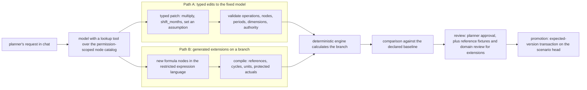
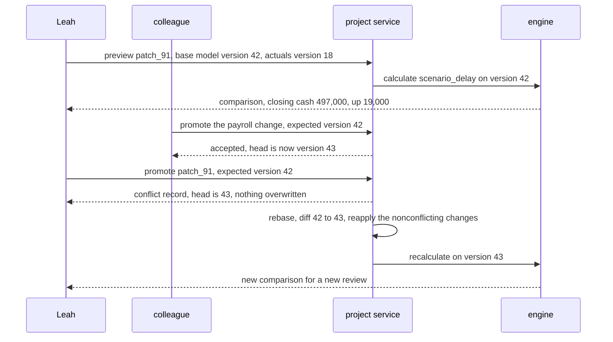

# Chapter 8. Editing a financial model others are also editing

Status: draft.

[Previous: Chapter 7](./07-data-analysis-over-chat-without-double-counting.md) · [Table of contents](../table-of-contents.md) · [Next: Chapter 9](./09-an-image-studio-that-keeps-the-logo-exact.md)

**New in this chapter:** typed patches to a calculation graph; constrained generation for an expression language; **expected-version updates** and rebase.

**Assumes:** a deterministic calculation engine owns evaluation; actuals arrive through a separate import with its own provenance; one planner reviews each scenario (multi-party approval is chapter 17's); no execution of business transactions.

**Reuses:** Curated vs Generated (chapter 7); numerical oracles and reconciliation (chapter 7); approving an exact revision (chapter 2).

> **About the examples.** Leah's company, its model, the one-month fixture, the workload, and the review-time estimates in this chapter are fictional. Numbers are illustrative unless labeled *measured*. Company references support specific mechanisms and link to reviewed sources; none establishes this planning system or validates the design.

## Two planners, one model

Leah leads planning at a software company whose monthly model connects customers, subscriptions, hiring, payroll, and cash. She asks the workspace: "Delay the four support hires by two months, lower new sales by 10 percent, and show whether cash stays above our operating reserve."

While she reviews the answer, a colleague promotes a payroll change to the same model. Leah's scenario was computed against the version before it. A second request arrives later: "Add annual prepayment with a discount." The model represents monthly billing only, so this changes structure.

Chapter 7's analysis read a snapshot that nobody else was changing. Here the model's patch lands on shared state that a colleague is editing at the same time, and the useful answer is a scenario Leah can inspect and revise: which hiring dates moved, what "new sales" means in this model, which periods change, how cash is calculated, and against which version of the model all of that was computed. A believable runway number without those records has not completed the task.

Our application is a planning workspace in which the model is the interface between business intent and model changes, while deterministic software owns calculation and change validation. Scenarios are hypotheses. Actuals are protected. An authorized planner reviews assumptions and extensions before promotion, and the workspace cannot initiate hiring, payments, or any transaction.

## What a scenario has to record

### Four versioned inputs and a baseline

A scenario has four separately versioned inputs: actuals, model structure, assumptions, and dimension membership. Its output includes calculated values, the change set, downstream impact, validation results, and an approval. "Cash improves" resolves to a specific comparison, period, and definition.

| Requirement | Proposed application contract |
| --- | --- |
| Assumption fidelity | Preserve requested scope, amount, unit, timing, and whether a change is relative or absolute |
| Formula validity | Check references, dimensions, dependency order, units, protected actuals |
| Comparison | Calculate both scenarios against a declared common baseline |
| Concurrency | Promote only against the exact reviewed base version |
| Reproduction | Pin model, inputs, engine, rounding rules, export mapping |
| Privacy | Restrict compensation and regional detail at read, calculation, result, and export |

The baseline is a controlled workbook: a planner copies the approved model, edits assumptions, recalculates, reconciles totals, and compares with the original, and a second reviewer checks the formula changes. The workspace keeps that discipline and makes scenario creation cheaper.

The illustrative model has 24 monthly periods, 12 departments, 8 regions, and 250 formula definitions expanded across their applicable dimensions (not every formula spans every dimension). Thirty planners run 100 scenario previews a day with bursts after an actuals refresh. A preview shows its patch promptly and calculates an ordinary scenario within 10 seconds; large extensions become background jobs. Time to a reviewed scenario and reviewer effort matter more than inference latency.

### One month, hand-checkable

| Input or calculation | Baseline |
| --- | ---: |
| Opening cash | $500,000 |
| Opening customers | 1,000 |
| Monthly customer churn | 2% |
| New customers added at month start | 100 |
| Closing and billable customers under the fixture's convention | 1,080 |
| Monthly price per customer | $100 |
| Cash collections | $108,000 |
| Existing payroll | $80,000 |
| Four new hires at $5,000 a month each | $20,000 |
| Other spending | $30,000 |
| Closing cash | $478,000 |

The recurrence is `customers[t] = customers[t-1] × (1 − churn[t]) + new_customers[t]`, and all closing customers are billed in the month. Lowering new customers by 10 percent gives 90 new, 1,070 customers, $107,000 collections. Delaying the hires removes $20,000 of payroll. Closing cash becomes $497,000, up $19,000. Against a $490,000 reserve tested at month end, the baseline is $12,000 below and the edited scenario is $7,000 above. That answers October; the 24-month question needs a headroom series `closing_cash[t] − reserve[t]` with its minimum and breach periods, and an unknown month leaves the all-period conclusion unresolved.

### The naive version lets the model edit the spreadsheet

Start with the obvious design: give the model the workbook and the request, let it edit cells, recalculate, and report closing cash.

Against the fixture, three things go wrong. The model finds a churn assumption written as "12% annual" in a note and types 0.12 into the monthly churn cell; the recurrence now loses 12 percent of customers every month, and nothing flags it, because the cell accepts any number. The model's edited workbook is saved over the shared file, and the colleague's payroll promotion, made in the meantime, is gone. And "lower new sales by 10 percent" was applied to a revenue cell, since "sales" matched that label, while the acquisition input stayed at 100.

The limitation is that a spreadsheet cell has no type, no version, and no owner. The fix is to make edits typed objects against a versioned calculation graph, and the first decision is whether those edits are chosen from a catalog or written by the model.

## Typed edits or generated extensions

This is chapter 7's Curated vs Generated applied to a calculation graph. What is new is that both paths write to shared state.



Figure 8.1. Typed edits and generated extensions on one calculation graph. Both paths pass validation before the deterministic engine calculates a branch, and both promote through the same expected-version transaction.

### Path A: typed edits to a fixed planning model

The model proposes typed parameter edits and supported operations (multiply an input over named periods, shift a hiring batch, set an assumption) against a reviewed model whose formulas nobody edits through chat. A deterministic engine calculates the approved graph. A request the catalog cannot express is rejected or routed to a modeler.

### Path B: generated extensions on an isolated branch

The model proposes new formula nodes, dimensions, or dependencies in a restricted expression language. The application validates and calculates the branch, compares it with independent reference examples, and requires domain review before promotion.

| Dimension | Typed edits | Generated extensions |
| --- | --- | --- |
| Fit and quality | Established scenarios with well-defined knobs; intent may map to the wrong knob | New billing or cost structures; flawed logic can produce plausible values |
| Latency and cost | Small patch, bounded recalculation, modest review | More planning, validation, calculation, domain review |
| Privacy | Permitted assumptions and aggregated outputs | New formulas can combine sensitive dimensions |
| Safety | Limited edit surface; scope and semantics still matter | Cycle, dimensional, dependency, and formula-injection risks |
| Operations | Stable definitions and approved operations | Plus expression compiler, migration rules, fixtures, extension review |
| Recovery | Discard the branch or correct the patch | Preserve the failed extension; repair on a branch; revalidate dependents |

Leah's first request fits Path A once "new sales" and the hiring schedule are resolved to nodes. Annual prepayment needs Path B or a human modeler. Neither path generates a fresh spreadsheet detached from the shared baseline because that would be easier for the model.

> **Source finding.** Pigment [described](https://www.pigment.com/blog/best-place-for-an-llm-is-pigment) an agent operating on shared planning state through branched model changes with testing, deployment, and rollback. The account supports a change-control lens; it reports nothing about the correctness of generated formulas or forecasts.

We start with Path A, with Path B available for structural changes under separate gates. Under either, the model's first job is to find `acquisition.new_customers` among 250 formulas.

## What the model sees and returns

### The node catalog

The model does not see the workbook. It sees a catalog of nodes it may reference, each with a stable ID, a description, a semantic type, a time basis, dimensions, and whether it is an actual, an assumption, or a formula, and it has a lookup tool that searches the catalog by text.

```text
lookup("new sales") →
  acquisition.new_customers   count/month   assumption   dims: region   "New customers added at month start"
  revenue.recognized          USD/month     formula      dims: region   "Recognized subscription revenue"
  bookings.gross              USD/month     formula      dims: region   "Contracted value signed in period"
```

The three candidates mean three different things, and the planner has to pick one or ask. The catalog is permission-scoped: compensation nodes are absent for a planner without that access, and a node ID the model invents fails validation.

### The patch

```json
{
  "patch_id": "patch_91",
  "base_model_version": 42,
  "base_actuals_version": 18,
  "scenario_id": "scenario_delay",
  "changes": [
    {"node": "acquisition.new_customers", "period": "2026-10", "operation": "multiply", "value": 0.9},
    {"node": "hiring.support_batch_4.start", "operation": "shift_months", "value": 2}
  ],
  "required_checks": ["units", "dependencies", "cash_reconciliation"]
}
```

The server supplies identity, branch ownership, and allowed node scope; the model supplies changes. Validation covers allowed operations, node existence, periods, dimension scope, and authority. A patch is immutable after review, and the approval binds to a hash of the exact patch, the base versions, the calculated comparison, and the validation policy, as in chapter 2. A request that covers more periods names them in the patch; "all hires" cannot silently include an engineering batch when the user asked about support.

### Constrained generation for the expression language

Under Path B the model writes formulas, and the expression language has a grammar:

```text
expr    := term (("+" | "-") term)*
term    := factor (("*" | "/") factor)*
factor  := number | ref | func "(" args ")" | "(" expr ")"
ref     := node_id ("[" offset "]")?          # e.g. customers[-1]
func    := "sum" | "shift" | "lookup" | "min" | "max" | "to_monthly_rate"
```

Decoding is constrained to the grammar, so the model can only emit syntactically valid expressions over `ref` tokens drawn from the catalog. That guarantees the expression parses. It guarantees nothing about meaning: a well-formed expression can still add a monthly rate to an annual one or reference a protected actual on the left-hand side. Those are the validator's job.

### Validator feedback

When a patch or expression is rejected, the planner receives the structured reason and may propose once more:

```json
{"rejected": "patch_92", "errors": [
  {"change": 0, "code": "rate_basis_mismatch",
   "detail": "churn.monthly expects a monthly rate; value 0.12 is tagged annual. Use to_monthly_rate(0.12, convention)."}
]}
```

This is chapter 1's repair loop with the compiler as the validator. A patch can pass every check and still apply to a model version that no longer exists.

## A patch against an expected version

Every patch names the base model version and base actuals version it was computed against. Promotion is a transaction that checks the expected versions and the planner's authority, stores the accepted patch, advances the scenario head, and writes a deployment receipt. If the head has moved, the transaction fails with a conflict record, and nothing is overwritten.

Leah's scenario is based on model version 42 and actuals version 18. Her colleague promotes a payroll change, making version 43. Leah's promotion is rejected. A rebase then identifies what changed between 42 and 43, reapplies the nonconflicting parts of Leah's patch, recalculates, and presents a new comparison for a new review. Her intent is preserved; her approval is not, because the numbers she approved are no longer the numbers.



Figure 8.2. Two planners on one model. Leah's promotion names version 42, the colleague's payroll change moved the head to 43, and the rebase reapplies her intent for a fresh review without carrying her approval.

The conflict test is dependency intersection. Two edits on different nodes conflict when their downstream closures meet in a node whose value the reviewer saw.

```text
          price.monthly ─────────┐
                                 ▼
  acquisition.new_customers → customers.closing → revenue.collections → cash.closing
                                                        ▲                    ▲
  hiring.support_batch_4.start → payroll.total ─────────┘ (via spending) ────┘

  patch_91 (Leah):      acquisition.new_customers ×0.9, hiring shift +2
  patch_95 (colleague): payroll.rate_table v7
  intersection:         payroll.total → cash.closing  ← both patches change it
```

Figure 8.3. The fixture's dependency graph with two patches. They touch different input nodes and intersect at `payroll.total` and `cash.closing`, so the second promotion conflicts with the first.

An actuals refresh is the same situation from the other side. The original preview stays as a historical scenario; a new branch is created against the refreshed actuals, and "approve the same scenario" is refused because the baseline changed. If the client disconnects during promotion, it queries by patch ID before retrying, so one patch promotes once. Previews that finish out of order publish only for the current patch hash; an older result stays as an attributable attempt and cannot overwrite the current preview.

This mechanism, a write that names the version it expects and fails if the version moved, is reused wherever two writers share state: chapter 15's turn command and chapter 17's workflow steps both carry an expected version.

Version checks catch a stale base. They do not catch a planner typing 12 percent a year into a monthly cell.

## Rates have a basis

Each node declares a semantic type (currency amount, customer count, duration, percentage) together with a time basis and dimensions. A monthly rate and an annual rate are both dimensionless and are not interchangeable in a recurrence.

With 12 percent annual churn under a constant-monthly-retention convention, the monthly churn is `1 − (1 − 0.12)^(1/12)`, about 1.06 percent. Dividing by 12 gives 1 percent, a different convention. Using 12 percent every month leaves `0.88^12`, about 21.6 percent, of the opening cohort after a year, where the assumption meant 88 percent. The compiler requires an explicit conversion with a named convention, and `to_monthly_rate(0.12, "constant_retention")` is the only way to move the number across the basis boundary.

The same rule prevents adding USD and EUR without an exchange-rate node and snapshot, and joining department-level payroll to region-level revenue without a declared alignment node. Missing data is typed too: an unknown exchange rate, an absent assignment, and zero spending are three states, and replacing an unknown with zero can manufacture a favorable cash result.

Static validity cannot judge plausibility. A well-typed 90 percent churn assumption may be a deliberate stress test or a mistake; it is flagged for review and left as the hypothesis it is.

Typed nodes and conversions make the fixed model safe to edit. They do not make it able to express annual prepayment.

## Extending without disguising a structural change

Annual prepayment needs explicit nodes for eligible customers, billing anniversaries, discounted collections, and recognized revenue under the chosen convention. A single formula that multiplies monthly revenue by twelve double-counts the following months while the monthly collection rule stays active.

Path B's expression language allows arithmetic, aggregation, time shifts, and lookups. There is no shell, no network, no external workbook macro, and an extension cannot write to actuals or protected nodes. The compiler builds the dependency graph, verifies references, and detects cycles before any evaluation; a model that needs simultaneous equations gets a reviewed solver with a convergence contract, never an implicit iteration because a generated formula happened to close a loop.

The extension preview shows added and removed dependencies as well as changed values. Reference fixtures carry the review: a customer who prepays once and stays the full term, one who renews at the boundary, and one with a different refund assumption, each with hand-computed collections and recognized revenue. Domain review decides whether the convention is suitable. Compiler success decides nothing about that.

A reviewed scenario leaves the system as a workbook, and comes back changed.

## Round trips and disclosures

An exported workbook carries semantic node IDs, input and model versions, formulas or reconciled values, and a manifest. Reimport maps IDs and compares formulas against the approved model; unknown cells or altered identifiers become an untrusted import proposal, handled as a Path B extension with review. A spreadsheet that opens successfully has not demonstrated equivalent calculation.

Disclosure rules apply to derived outputs. A department payroll total plus an individual's exclusion reveals a salary by subtraction, so authorized calculation does not authorize every comparison or export, and withheld values that make a result unavailable are named as such.

Explanations link changes to the graph: delayed hires reduce October payroll by $20,000, lower acquisition reduces collections by $1,000, the model yields a $19,000 net increase. That describes the model's behavior under the scenario and claims nothing about what the strategy will produce. Sensitivities perturb approved assumptions against a declared baseline, and one-at-a-time sensitivity misses interactions, so a grid or simulation records its ranges, correlations, seeds, and distribution sources, with invented distributions labeled as scenario assumptions.

## An annual rate and a stale base, together

Inject an annual rate into the monthly recurrence, then attempt promotion after an actuals refresh. Two separate rejections are expected: a rate-basis error before calculation and a stale-base conflict before promotion.

| Failure | Detection and state | Recovery | Assertion |
| --- | --- | --- | --- |
| Annual rate used monthly | Rate-basis validation fails | Explicit conversion on a new branch | Convention matches reference values |
| Circular cash and interest formula | Cycle path shown by compiler | Reviewed solver or acyclic extension | No unbounded calculation |
| Hiring delay edits historical payroll | Protected-actuals rule rejects patch | Change limited to future schedule | Historical values unchanged |
| Concurrent promotion | Expected-base check fails | Rebase and review the new comparison | Neither change silently lost |
| Client timeout after promotion | Receipt lookup by patch ID | Existing receipt returned | One promotion of the exact patch |
| Old preview arrives last | Patch hash differs from head | Attempt retained, unpublished | Current preview stays current |
| Missing exchange rate | Required-input check fails | Approved snapshot supplied or unknown reported | No zero-filled cash result |
| One required cash period unavailable | Reserve coverage incomplete | Inputs supplied or horizon unresolved | No all-period pass from October alone |
| Export alters a formula on reimport | Manifest comparison flags change | Treated as an extension proposal | No automatic trusted round trip |

Every branch, rejection, calculation, and approval is recorded. Recovery requires an exact reconciled result at the intended scope; a cash number after a retry is not the assertion. These drills are specified and have not been run.

## Which path to ship first

Path A first, Path B for structural changes under separate gates, was the provisional choice. The evidence comes from a lab and from one arithmetic fact about review.

### Ninety tasks

Build a bounded sample model with expert-reviewed assumptions and a separate calculation implementation. The suite has 90 tasks: 35 parameter changes, 20 structural extensions, 15 ambiguous requests, 10 numerical and unit traps, 10 concurrency or permission cases, with formula structures and dimension layouts held out. Both paths run on the tasks they can express, with the unsupported-task rate recorded for Path A instead of forcing it to fabricate an extension. Repeated generative trials run against identical inputs in clean environments. Independent graders assess patch fidelity, graph correctness, numerical results, authority, and reproduction; domain reviewers assess whether the assumptions fit the requested scenario.

Sensitivity-direction checks apply only where their premises hold: delaying a cost improves immediate cash in the fixture, and a model with productivity effects can reverse that later, so the check tests declared model logic and never business intuition. Backtesting, if added, freezes information at the forecast date.

### Review time

If 100 daily previews include 20 structural extensions at 15 minutes of review and 80 parameter patches at 2 minutes, review is 20 × 15 + 80 × 2 = 460 minutes a day, about 7.7 hours. A generator that is twice as fast changes nothing in that sum. Concurrent previews are limited and pending approvals are tracked.

On the calculation side, a 100,000-node expansion with a local change touching 8 percent is 8,000 nodes; at 20 microseconds a node that is 0.16 seconds, against 2 seconds for the full graph, before compilation, data access, serialization, and queueing. Cost per accepted change includes rejected branches, engine resources, retained artifacts, and reviewer time, and dimension cross products can overwhelm the engine with a short prompt.

### Gates per formula family

Release parameter editing when the authority, unit, actuals-protection, and stale-base fixtures pass and reviewer-approved task quality meets the baseline. Gate structural extensions separately by formula family: billing extensions when their fixtures and domain review pass, and no generated extensions for a family whose semantics cannot be validated affordably. A candidate cannot compensate for touching protected actuals with a higher explanation score. Pilot results set the non-inferiority margins and repeat counts.

Promote recurring extensions into the governed model after fixtures and domain review, under chapter 7's promotion rule. Rollback restores a prior model version and recalculates dependent scenarios; it cannot reverse a hiring or financing decision made after an export, so affected artifacts are recorded and corrections issued with their consequences.

## Key ideas

- A spreadsheet cell has no type, version, or owner. A patch is a typed object against a versioned graph, approved by hash.
- The model sees a permission-scoped node catalog and a lookup tool; "sales" resolves to one of three nodes or to a question.
- Grammar-constrained decoding guarantees an expression parses; the validator decides whether it means anything.
- Promotion names the expected base versions and fails if they moved. Rebase reapplies intent; it never carries the approval. Conflicts are dependency intersections, so two edits on different cells can conflict.
- Rates carry a time basis; crossing it requires a named conversion. Unknown is a value; zero is a different one.
- A structural change gets explicit nodes, cycle detection, reference fixtures, and domain review. A workbook that comes back changed is an extension proposal.
- Review minutes bound throughput, whatever the token count: 460 minutes a day on the fixture workload.

Chapter 9 keeps approval by exact hash and moves from numbers to pixels: an image studio where the one thing that cannot change is the logo.

## Exercises

1. Convert 18 percent annual churn to a monthly rate under the constant-retention convention. What does dividing by 12 give instead, and what fraction of the opening cohort remains after a year if 18 percent is applied every month?

2. Write the patch for "raise the price 5 percent from January 2027 onward" against model version 43 and actuals version 19, for a 24-month model that runs through December 2027.

3. Two planners edit different nodes: one multiplies `price.monthly` by 1.05, the other multiplies `acquisition.new_customers` by 0.9. Using the fixture's graph, name the first node where their changes meet. Does the second promotion conflict with the first? What does the rebase have to show the second planner?

<details>
<summary>Answers</summary>

1. Monthly churn = 1 − (1 − 0.18)^(1/12) = 1 − 0.82^(1/12) ≈ 1 − 0.98359 ≈ 1.64 percent. Dividing by 12 gives 1.5 percent, a different convention. Applying 18 percent monthly leaves 0.82^12 ≈ 9.2 percent of the cohort after a year, where the assumption meant 82 percent.

2.
```json
{"base_model_version": 43, "base_actuals_version": 19,
 "changes": [{"node": "price.monthly", "periods": {"from": "2027-01", "to": "2027-12"},
              "operation": "multiply", "value": 1.05}],
 "required_checks": ["units", "dependencies", "cash_reconciliation"]}
```
   The periods are named explicitly; "onward" is resolved to the model's horizon in the patch, where a reviewer can see it.

3. `price.monthly` feeds `revenue.collections`; `acquisition.new_customers` feeds `customers.closing`, which also feeds `revenue.collections`. They meet at `revenue.collections`, and both change `cash.closing` downstream. Yes, the second promotion conflicts, because the first promotion changed a node the second planner's reviewed comparison depended on. The rebase recalculates the second patch against the new head and shows a new comparison in which collections reflect both the price increase and the lower acquisition, for a fresh approval.

</details>

## Sources

Sources used here, linked to the original articles:

- [Pigment model change control](https://www.pigment.com/blog/best-place-for-an-llm-is-pigment)
- [Hex whole-system evaluation lab](https://hex.tech/blog/evaluate-data-agents/) and [Julius analysis execution boundary](https://julius.ai/articles/julius-slack-agent), carried from chapter 7 as evaluation and isolation methods

