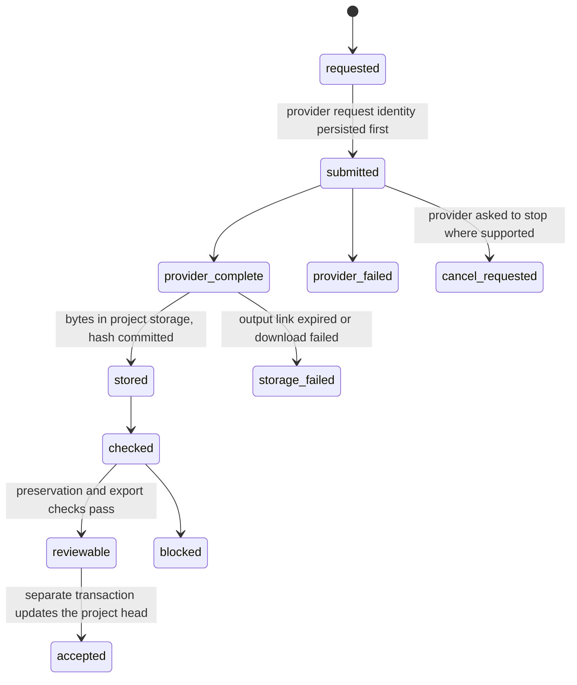
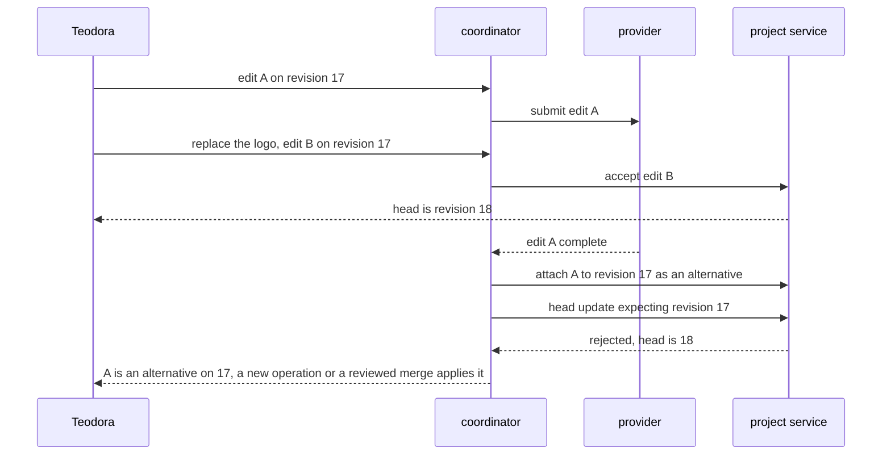

# Chapter 9. An image studio that keeps the logo exact

Status: draft.

[Previous: Chapter 8](./08-editing-a-financial-model-others-are-also-editing.md) · [Table of contents](../table-of-contents.md) · [Next: Chapter 10](./10-dubbing-that-keeps-both-timing-and-meaning.md)

**New in this chapter:** candidates and selection; asynchronous provider jobs; deterministic vs generative edits; protected regions; the book's names for **Holistic vs Assembly**.

**Assumes:** licensed source assets with recorded permission; one designer per project; a hosted image model behind an adapter; publication is a separate authorized action outside this chapter.

**Reuses:** approving an exact revision (chapter 2); expected-version updates (chapter 8); lifecycle tombstones (chapter 4).

> **About the examples.** Teodora's coffee brand, the brief, the fixture assets, the workload, and every price in this chapter are fictional. Numbers are illustrative unless labeled *measured*. Provider documentation supports specific interface contracts and links to reviewed sources; none establishes a product's backend or validates the design.

## A better background and a different package

Teodora designs an advertisement for a coffee brand. The project holds a licensed product photograph, an approved logo, the exact headline "A slower morning," and a square social format. She asks for a warm kitchen scene, picks a candidate, then says: "Make the background blue and move the headline up."

The second result has a better background. It also has a different coffee bag. The label text is slightly off, the logo is a touch wider, and the generator has rendered a package that resembles the original without being it.

Chapters 1 through 8 produced text and numbers, where a model call returned in seconds and the same input gave the same output often enough to test. Image generation is slow, costs real money per attempt, and gives a different picture every time, so the application works with candidates, selects among them, and has to protect the pixels that are not allowed to change. Four milestones that one request used to collapse into are separate here: the provider finished, the designer can see it, the bytes are saved, and the design is accepted.

Our application is an image studio for owned or licensed assets. It produces candidates and exports from an editable project with a history. Source assets need recorded permission for their intended use, and a provider safety flag establishes no legal clearance. The studio does not publish; a campaign launch is a separate authorized action.

## What the studio has to preserve

### The brief is a contract

The brief names the canvas, the channel, approved assets, exact text, editable regions, style references, exclusions, and the acceptance owner. "Keep the product" identifies an asset or a region; it never relies on the model's sense of resemblance.

| Requirement | Proposed check |
| --- | --- |
| Exact brand assets | Approved logo and text are controlled layers |
| Product fidelity | Label, shape, color, and material inspected against the source |
| Local editing | Changes outside permitted regions are rejected or explicitly reviewed |
| Durability | A project-owned file exists and its hash is recorded before "saved" |
| Revision integrity | Late candidates cannot replace newer accepted work |
| Export correctness | Decoded dimensions, alpha, color profile, layout, and final text checked |

The baseline is a designer with a stock background, a product cutout, a layout tool, and manual color correction. It preserves exact text and branding and takes effort to produce scene alternatives. Both AI paths deliver the same export dimensions and protected assets and are compared on total time to acceptance.

Illustrative workload: 200 projects a day, four candidates per initial brief, two revision rounds on average. Private launch material may need a storage region and provider retention terms that are checked before a provider is chosen. Discarded candidates can have a short lifetime, and their request metadata can still carry launch details, so deletion covers thumbnails, cached previews, and derivatives.

### One photo, one logo, one headline

The fixture is a product photograph with a legible label, a logo in vector form, the headline as text, and a square canvas. The answer key for "make the background blue and move the headline up": the background changes, the headline's position changes, and the product label, the logo's proportions, and the headline's spelling are byte-identical to the accepted revision.

### The naive version sends the whole composition back to the generator

Start with the obvious design: flatten the accepted composition to one image, send it with the instruction to an instruction-following edit model, and show the result.

The background turns blue. The label changes, because the model regenerated every pixel and the label is small text it can approximate and cannot copy. The headline moved, and its kerning is different, because the model re-rendered it. Nothing in the pipeline knows which pixels were protected, and a second edit on the result drifts further from the original than the first.

The limitation is that the generator was handed authority over the whole image. The first decision is whether to keep that authority and constrain it, or to divide the image into parts the generator may touch and parts it may not.

## Regenerate the whole image or compose protected layers

### Path A: direct reference-conditioned generation

Send a reference image and the instruction to the generator and select among its outputs. Reference weighting steers resemblance. This fits exploratory composition, where integrated lighting and a coherent scene matter and exact details may drift.

### Path B: generated components over protected layers

Generate the background or a named component, then assemble it with the preserved product, logo, and text layers. Local generative edits are restricted to declared masks, and protected layers are restored from their originals after generation. This fits exact branding and repeated revisions.

| Dimension | Direct generation | Components over protected layers |
| --- | --- | --- |
| Quality | Integrated lighting and composition; details drift | Exact assets kept; edges, shadows, perspective need integration |
| Latency | Few application steps; whole-image retries | More preparation and compositing; fewer regenerations per local edit |
| Cost | Low integration cost; many discarded outputs | More engineering; selective regeneration reduces attempts |
| Privacy | Reference and whole scene sent to the provider | Provider input limited to selected components, where the API allows |
| Safety | Output review and source permissions | Plus masks, compositing order, derivative permissions |
| Operations | Job and asset lifecycle | Plus layer graph, transforms, compositor versions, merge rules |
| Recovery | Keep alternatives and the last accepted image | Restore layers or rerender only the failed component |

### Holistic vs Assembly

The book uses these names for the media chapters. **Holistic** generation produces the whole artifact in one model output, so every part is consistent with every other and no part is guaranteed. **Assembly** generates or renders components under separate control and composes them, so protected parts are exact and the seams are the engineering problem. Chapter 10 meets the same choice in dubbing and chapter 11 in music.

Holistic wins when coherence matters more than any single element and the brief can tolerate variation. Assembly wins when some elements have an exact specification, which is what a logo, a label, and a headline are. A project can use both: Holistic to propose backgrounds, Assembly to build the accepted design.

> **Source finding.** Ideogram's remix endpoint [documents](https://developer.ideogram.ai/api-reference/edit-images/remix-v4) an image-to-image operation with an input-preservation weight, rendering modes, an output safety field, and outputs returned at temporary URLs. The weight is a steering control; the documentation makes no claim that any pixel is preserved unchanged.

We start with Path B for Teodora's advertisement, because the label and headline are exact requirements, and keep Path A for mood exploration and early scene selection. Each path depends on a specific set of generative techniques, and what each technique guarantees decides how the compositor is built.

## What the model sees and returns

### Five techniques and what each guarantees

Inpainting takes an image and a mask and regenerates inside the mask conditioned on the outside. It keeps the outside's pixels in principle, and most implementations blend at the boundary, so a few pixels along the mask edge change. Reference conditioning takes a reference image and a weight and steers the output toward resemblance; it guarantees nothing exact. Relighting and harmonization adjust a composited element's color, shadow, and contrast to its new scene, and they alter the element's pixels by design, which matters for a product whose color is part of the brief. Segmentation produces a cutout mask from a photograph, and it is a candidate mask until a person checks the edge. Instruction-edit models take an image and a sentence and return an edited image; each pass regenerates everything, so repeated edits drift, and the fifth edit of a label rarely matches the first.

### The edit operation

```json
{
  "operation_id": "edit_38",
  "base_revision": 17,
  "instruction": "Make the background blue",
  "editable_layers": ["background"],
  "protected_assets": ["product_photo_v3", "logo_v2", "headline_text_v1"],
  "mask_asset": "mask_background_v17",
  "output_profile": "social_square_v4",
  "provider_controls": {"seed": 4411, "reference_weight": 0.35}
}
```

The server validates that the mask and layers belong to revision 17 and that the model has not declared the logo editable to make generation easier. The planner that parses "make the background blue" into this operation fills `instruction`, `editable_layers`, and `provider_controls`; the server supplies identities and protections. Prompt rewriting by the adapter is recorded beside the original instruction as part of provenance. A seed makes a provider's output repeatable only on the same model version with the same inputs, and is recorded for that purpose.

### A request the model should not answer

"Make the background blue and move the headline up" is two requests. The first is generative. The second is a layout change to a text layer, and sending it to an image model is how the headline gets re-rendered with different kerning.

## Not every edit is generative

The planner classifies each requested change before anything is generated. Moving, scaling, recoloring a flat layer, changing text content, swapping an approved asset for another approved asset, and reordering layers are deterministic transforms on the layer graph, executed by ordinary code, exact by construction, and free. Changing a scene, inventing a texture, extending a background, and removing an object are generative and go to the model with a mask.

The rule for the boundary: when a transform expresses the requested change precisely, it owns the change; the model parses intent and invents pixels, and it owns no pixel it can be kept away from. "Move the headline up" is a translation of the text layer. "Make the kitchen brighter" is generative. "Make the logo bigger" is a scale transform on a protected layer, with a check that it stays inside the brand's safe margins.

The deterministic path has its own failure. A mask drawn on the product photograph in source-image pixels, applied to the canvas without the product layer's crop and scale, protects the wrong region while every file involved is valid.

## Masks, layers, and the coordinate they live in

The project is an editable layer graph: source assets, masks, layer order, transforms, text and font settings, blending, output profiles. A product layer references an approved cutout and a transform; a shadow layer may be rendered separately; originals are immutable.

```text
canvas 1080×1080 (social_square_v4)
├─ background         [editable]   generated, revision 17 → edit_38 regenerates inside mask_background_v17
├─ product_shadow     [rendered]   from product transform; re-rendered deterministically
├─ product_photo_v3   [protected]  cutout; transform: crop (120,80,900,1100) → scale 0.62 → place (210,330)
├─ logo_v2            [protected]  vector; place (60,60); scale locked to brand ratio
└─ headline_text_v1   [protected]  "A slower morning"; font, size; position y: 940 → 880 (edit: move up)

mask_background_v17 = canvas − (product ⊕ logo ⊕ headline), dilated 0 px, in canvas coordinates
```

Figure 9.1. The fixture's layer graph. Only the background is editable; the mask is defined in canvas coordinates as the complement of the protected layers.

A mask has a declared coordinate space. A mask drawn in source-image pixels is transformed through the same crop, scale, and placement as the layer before it meets the canvas, and the operation records canvas size, orientation, transform, and mask convention. After generation, the compositor restores protected layers from their originals, with explicit occlusion and blending rules, which is what turns inpainting's near-preservation into exact preservation.

Restoration has a cost. A product pasted onto a new scene keeps its branding and can look lit from the wrong side. Deterministic shadow and color adjustments help; altering the product's color may itself violate the brief; the final composition is reviewed, never only the generated background.

Checks are layered. For a flattened local edit, change outside the mask is computed after deterministic alignment: pixel equality for copied regions in a lossless pipeline, perceptual thresholds for transformed or recompressed regions. Perceptual thresholds miss a single changed letter, so text and logo have their own assertions, and the headline's exact string comes from the stored text layer, with its rendering checked for clipping, contrast, and placement. OCR is a diagnostic that can confidently read malformed lettering.

With masks and layers correct, the generation itself is a call to a provider that may take a minute, return a link, and let the link expire.

## A job is not an asset

An operation moves through `requested → submitted → provider_complete → stored → checked → reviewable`, with branches `provider_failed`, `storage_failed`, `blocked`, and `cancel_requested`. Acceptance changes the project head in a separate transaction.



Figure 9.2. The states of one edit operation. Saved means the hash is committed after the download, and acceptance is a separate transaction on the project head.

The provider request identity is persisted before any completion is interpreted. For a synchronous endpoint, a network timeout leaves an unknown outcome; result lookup is used only where the API supports it, and otherwise the uncertainty is retained and a separately identified replacement attempt is created under the task budget, with no idempotency claimed that the provider has not documented. Chapter 17 makes the unknown outcome its own subject.

> **Source finding.** OpenAI's webhook documentation [describes](https://developers.openai.com/api/docs/guides/webhooks) signed event delivery for asynchronous completions, with the guidance that handlers verify the signature, respond quickly, and tolerate redelivery of the same event. The contract is that provider's; the studio assumes nothing about other image APIs from it.

Asynchronous completion goes through authenticated durable intake and deduplication before processing. A completion event triggers retrieval and reconciliation; it never accepts an image directly.

Output links expire. The worker transfers permitted output into project-owned storage, validates decoding, computes a content hash, and records storage completion, and only after that record commits is the asset "saved." If the download fails after a preview was visible, the candidate is shown as unsaved; a regeneration with the same prompt and seed may produce different pixels, and recovery never describes it as retrieving the original. Provider-returned locations pass an adapter allowlist before a privileged downloader fetches them, with file size and decoding resources bounded.

A saved candidate can arrive after the designer accepted something else.

## Late candidates attach to their base

Edit A starts on revision 17. Teodora replaces the logo and accepts edit B as revision 18. A finishes later. The coordinator attaches A to revision 17 as an alternative, and the project service rejects any head update that expects 17 when the head is 18, under chapter 8's expected-version rule.



Figure 9.3. A late candidate. Edit A finishes after edit B became revision 18, so it attaches to revision 17 as an alternative and the expected-version rule rejects any head update built on 17.

Applying A to current work is a new operation or an explicit reviewed merge. A background-only component may be reusable when its dependencies are compatible; a flattened image with the old logo is not. The merge decision is recorded and the preservation and export checks rerun.

Cancellation stops new attempts and asks the provider to stop where supported. A result the provider already generated cannot be recalled, so late outputs from cancelled operations are retained briefly for reconciliation and never become accepted automatically, and wasted work after cancellation is measured.

A preview and a final are two candidates. An accepted low-resolution preview may differ from a high-quality regeneration: upscaling invents texture, and a different model profile can move objects or change lettering. A new final is a new candidate requiring checks, and approval never transfers to pixels the reviewer has not seen. Deterministic export from accepted layers pins fonts, compositor, dimensions, color profile, and asset versions, and the decoded file is checked, since a square preview says nothing about whether a wide export keeps the logo inside its margins.

Permission follows derivatives. A provider's content check is one input; project policy, reference permissions, and user authority are enforced by the application, and a safe-looking image can still depict an unapproved likeness. Permission scope and expiry are recorded with sources and propagated to derivatives, exporting a final may require permission distinct from viewing a draft, and private prompts and reference embeddings never cross projects through a cache.

## A changed label and a late result

Start from an accepted product and label revision. Request a background change, deliberately return a candidate with a changed label, and make another accepted edit before the first job finishes.

| Injection | Detection and state | Recovery owner | Final assertion |
| --- | --- | --- | --- |
| Label altered outside mask | Preservation check and visual review fail | Compositor restores source product, or designer rejects | Approved label exact |
| Old result arrives late | Base revision conflict | Project service creates an alternative branch | Accepted head unchanged |
| Provider URL expires before storage | Persistence fails | Coordinator records unsaved candidate and replacement | No false "saved" |
| Mask in the wrong coordinate space | Transform fixture mismatch | Operation corrected against the original revision | Only the intended region editable |
| Duplicate completion event | Event identity already recorded | Coordinator returns existing outcome | One candidate record |
| Premium rerender changes the logo | Final checks fail | Accepted preview kept; final revised | No approval transfer to altered pixels |
| Deleted reference still in a thumbnail cache | Derivative deletion audit fails | Asset service purges referenced objects (chapter 4) | Retrieval denied across derivatives |
| VLM judge passes a changed letter | Calibration set with single-letter edits | Text assertion from the stored layer catches it | Judge false negative recorded; approval blocked |

The drill passes when project state, actual bytes, and export match the accepted contract. A provider success response is insufficient. These drills are specified and have not been run.

## Which path to ship first

Path B for exact branding, Path A for exploration, was the provisional choice. The lab needs deterministic checks for what can be checked, blinded humans for what cannot, and a calibrated judge in between.

### Sixty briefs

Create a permitted asset set with exact text and logos, transparent cutouts, difficult edges, alternate layouts, and protected-region edits, plus ambiguous style requests and incompatible references. Coverage is 60 briefs with three edits each, plus concurrency, persistence, and permission cases. Both paths run from identical briefs and sources under declared attempt and spend budgets, across several seeds and profiles, with all discarded work retained.

Deterministic checks grade dimensions, protected-layer hashes, stored-object integrity, text inputs, revision lineage, and export bounds. Blinded reviewers receive the brief and the source with candidates in random order and score requirement compliance separately from aesthetic preference. A vision-language judge is asked a narrow question:

```text
You are comparing two renderings of the same protected region.
Image 1 is the approved source. Image 2 is a candidate.
Answer: is any text, logo proportion, or label detail different? List each difference
with its location. If you cannot see the region clearly, say so.
```

Its calibration set contains pairs with a single changed letter, a 3 percent logo stretch, a shifted label, and identical pairs, and its recall on those pairs is reported before it is used. It flags; the text layer assertion and the human decide.

> **Source finding.** Anthropic's agent-evaluation article [recommended](https://www.anthropic.com/engineering/demystifying-evals-for-ai-agents) calibrating any model grader against a labeled set before relying on it and keeping deterministic checks for anything that can be checked deterministically. The guidance is general, and chapter 16 tests the grader as its own subject.

Reported: accepted-project rate, candidates and manual repairs per acceptance, protected-region violations, export defects, time to accepted revision, storage failures, total cost, sliced by text-heavy designs, small labels, unusual aspect ratios, and edge complexity. Mean aesthetic preference can hide branding drift.

### Cost per accepted asset

Four initial generations plus two rounds of two candidates are eight attempts per project, 1,600 a day. At $0.04 per attempt, generation is $64 a day before edits, storage, moderation, and review. If 100 projects yield accepted assets, generation alone is $0.64 per accepted asset, with abandoned attempts in the numerator and provider charges for uncertain or cancelled jobs counted as incurred.

At a 12-second service time, one serial worker handles five attempts a minute. A burst of 100 attempts a minute needs about 20 active slots for average demand at full utilization, before headroom and provider quotas. At 4 MB per candidate, 1,600 candidates are 6.4 GB a day and 192 GB over thirty days before previews and replicas, so discarded-candidate cleanup matters. A project budget caps candidate count, expensive profiles, and concurrency; admission estimates remaining spend and deadline before submission; a fallback to a cheaper model is an explicit profile change because preservation behavior differs.

### Gates

Release controlled compositing when the exact-asset and concurrency fixtures pass and accepted-project quality meets the manual baseline at the agreed effort budget. Admit direct generation to less constrained briefs on the measured trade-off. Add selective regeneration where it measurably reduces repair or waste.

Rollback restores adapter profiles and compositor versions and does not retract a downloaded advertisement; affected exports are located through their manifests, access invalidated where possible, and a corrected revision issued from the accepted source project.

## Key ideas

- Four milestones replace one: provider complete, visible, saved (hash committed), accepted (head updated).
- Holistic generation makes every part consistent and no part exact; Assembly makes protected parts exact and seams the problem. A logo, a label, and a headline are exact specifications.
- Classify each edit first: transforms on the layer graph are exact and free; the model owns only pixels it cannot be kept away from.
- A mask lives in a coordinate space; it crosses the layer's transform before it meets the canvas. Protected layers are restored from originals after generation.
- Inpainting nearly preserves, reference weight steers, harmonization alters by design, segmentation proposes, instruction edits drift.
- A job is not an asset: persist the request identity first, deduplicate completion events, download before "saved," never call a regeneration a retrieval.
- Late candidates attach to their base revision; a preview and a final are two candidates; cancellation cannot recall a generated result.

Chapter 10 keeps Holistic vs Assembly and the four milestones and moves to audio and time: dubbing where the translated line has to fit the original's duration and keep its meaning.

## Exercises

1. Label each requested edit deterministic or generative, and say which layer it touches: (a) "move the logo to the top right"; (b) "make the kitchen look like early morning"; (c) "change the headline to 'A slower Sunday'"; (d) "remove the mug from the counter"; (e) "swap the product shot for the approved alternate angle."

2. A product mask was drawn on the source photograph at pixel rectangle (150, 200) to (750, 1000). The product layer's transform crops the source at (120, 80, 900, 1100), scales by 0.62, and places the result at canvas (210, 330). Give the mask's rectangle in canvas coordinates.

3. Which of these four changes invalidate the approval of revision 18? (a) Exporting at 1080×1350 instead of 1080×1080; (b) regenerating the final at a premium profile with the same seed; (c) re-rendering the deterministic shadow after a compositor version bump; (d) replacing the font file with a newer version of the same family.

<details>
<summary>Answers</summary>

1. (a) deterministic, transform on `logo_v2`, with a safe-margin check. (b) generative, inpainting inside the background mask. (c) deterministic, text content on `headline_text_v1`, then a rendering check for fit. (d) generative, inpainting over the mug's region, which must lie inside the editable mask or be reviewed. (e) deterministic, asset swap on the product layer to another approved asset, with the mask recomputed from the new cutout.

2. Subtract the crop origin: (150 − 120, 200 − 80) to (750 − 120, 1000 − 80) = (30, 120) to (630, 920). Scale by 0.62: (18.6, 74.4) to (390.6, 570.4). Translate by the placement: (228.6, 404.4) to (600.6, 900.4), rounded per the mask convention the operation records.

3. All four. (a) a new output profile changes layout and margins, so it is a new export requiring checks. (b) a different model profile is a new candidate; the same seed does not make it the same pixels. (c) a compositor change can alter blending and shadow pixels, so the export is re-checked (the approval of the layer contents may stand while the export does not). (d) font rendering can change metrics and kerning; the headline layer's rendering check reruns before the export is accepted.

</details>

## Sources

Sources used here, linked to the original articles:

- [Ideogram remix artifact contract](https://developer.ideogram.ai/api-reference/edit-images/remix-v4)
- [OpenAI webhook delivery contract](https://developers.openai.com/api/docs/guides/webhooks)
- [Anthropic agent evaluation method](https://www.anthropic.com/engineering/demystifying-evals-for-ai-agents)

