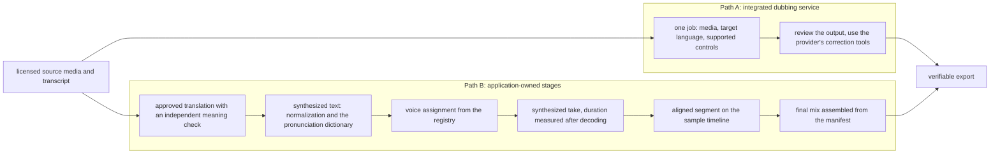
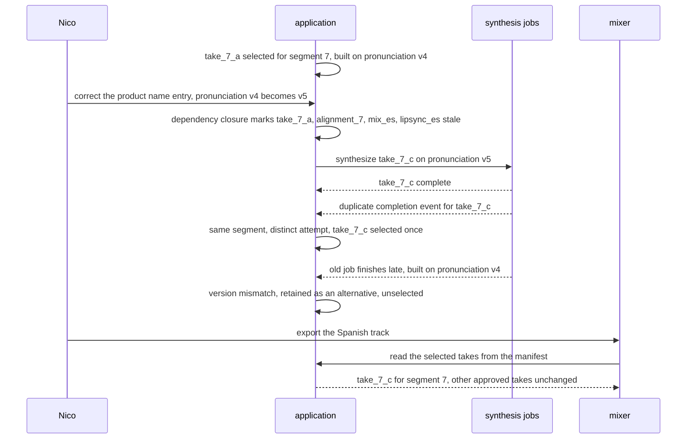

# Chapter 10. Dubbing that keeps both timing and meaning

Status: draft.

[Previous: Chapter 9](./09-an-image-studio-that-keeps-the-logo-exact.md) · [Table of contents](../table-of-contents.md) · [Next: Chapter 11](./11-replacing-a-chorus-keeping-the-verse.md)

**New in this chapter:** sample-accurate timebases; duration-aware generation; dependency closure for selective regeneration.

**Assumes:** licensed source media and consented voices; a transcript already exists or is produced by a transcription stage outside this chapter's scope; one project at a time per editor; publication is a separate authorized step.

**Reuses:** asynchronous provider jobs (chapter 9); Holistic vs Assembly (chapter 9); grounding to spans (chapter 1).

> **About the examples.** Nico's training video, the two presenters, the script, the workload, and every price in this chapter are fictional. Numbers are illustrative unless labeled *measured*. Provider documentation supports specific interface contracts and links to reviewed sources; none establishes a product's pipeline or validates the design.

## A mispronounced name after everything else was approved

Nico localizes a four-minute training video into Spanish and Japanese. Two presenters alternate, sometimes over background music. The script has product names, dates, prices, and one sentence with a negation.

The first pass sounds fluent. One product name is mispronounced in both languages. Nico corrects it after accepting every other segment, and the question is what, exactly, has to be regenerated: the two takes that contain the name, their placement on the timeline, the final mixes that include them, and the lip-synced video if there is one, and nothing else.

Chapter 9's output was a picture, where the artifact had no duration and "fits" meant pixels inside a canvas. Here the output has a clock: each translated line has to land where the original line was spoken and last about as long, and a translation that is accurate and too long is a failure. The product is a persistent editorial timeline of takes: approved translations, voice assignments, pronunciations, selected takes, a final mix, and a verifiable export.

Our application is a dubbing studio for permitted source media. An inferred speaker label is never authorization to imitate a person. The studio does not substitute a new voice when synthesis fails, and publishing remains a separate authorized step.

## What a dub has to preserve

### Script fidelity, speaker consistency, timing tolerance

A meaning error outweighs timing drift. "Do not reset during installation" cannot become "reset during installation" to fit a shorter slot. Duration pressure is grounds for a revised translation or an allowed timeline change; it is never permission to drop content.

| Requirement | Proposed application contract |
| --- | --- |
| Script fidelity | Approved translation preserves names, numbers, instructions, meaning |
| Speaker consistency | Explicit project voice assignment per speaker and language |
| Timing | Segment placement and duration checked against a declared tolerance |
| Revision scope | Correcting one segment invalidates its dependent takes and mixes only |
| Assembly | One selected take per manifest entry, with explicit overlap rules |
| Export | Full decode checked for duration, channels, clipping, content |
| Authority | Voice authorization checked before every new synthesis and export |

The baseline is a translator, voice talent, and an editor working from a timecoded script, with reviewers checking semantic fidelity and the assembled soundtrack. Both AI paths deliver the same contract: two approved language versions with stable speakers, intelligible delivery, complete content, correct placement.

Illustrative workload: 50 four-minute projects a day in two target languages, with 25 percent extra synthesized duration from revisions, is 50 × 4 × 2 × 1.25 = 500 generated minutes a day. A preview can stream for quick listening; the accepted take is a complete immutable audio object. Raw speaker samples, scripts, generated takes, and deliverables have separate retention.

### Two presenters, a product name, a price, a prohibition

The fixture has two presenters alternating across 40 segments. Segment 12 is the second presenter saying, in 3.2 seconds, "Do not reset the unit during installation." Segment 7 contains the product name that will be corrected. Segment 19 contains a price with a currency. The answer key for each language: the negation survives in segment 12, the price is read in the target locale's convention in segment 19, the corrected name is pronounced per the approved dictionary entry in segment 7, each segment lands at its source sample position within tolerance, and the two presenters keep their assigned voices throughout.

### The naive version lays translated lines end to end

Start with the obvious design: translate the transcript, synthesize each line with a voice per speaker, and concatenate the audio in order.

Against the fixture, segment 12's Spanish translation runs 3.8 seconds in a 3.2-second slot. Every line after it drifts later by the overrun, and by segment 40 the dub is seconds behind the picture. A second attempt asks the translator for something shorter, and the shorter line is "Reinicie la unidad durante la instalación": the prohibition is gone, the line fits, and nothing in the pipeline checks meaning against duration. The price in segment 19 is read digit by digit. The corrected name regenerates all 40 segments because nothing records which ones contain it.

The limitation is that the pipeline has no timeline, no meaning check independent of fitting, and no dependency record. The first decision is whether to own those stages or to buy a service that owns them.

## One provider or your own pipeline

### Path A: integrated dubbing service

Submit the source media, the target language, and the controls the service supports; review the output and use the provider's correction tools. This fits when the actual version and plan expose the editorial controls the contract needs: per-segment regeneration, script editing, voice assignment.

### Path B: application-owned stages

Store and review each stage: transcript, approved translation, pronunciation and voice, synthesized take, aligned segment, final mix. Synthesize selected segments and assemble them under a timeline manifest. This fits selective correction and strict provenance.



Figure 10.1. The two paths from source media to an export. Path A submits one job and reviews its output; Path B stores and reviews each stage, so a correction can regenerate selected takes and reassemble.

| Dimension | Integrated service | Application-owned stages |
| --- | --- | --- |
| Quality | Provider coordinates speech and background; some decisions opaque | Inspectable script and timing; stage errors and audible seams can compound |
| Latency and cost | Fewer integration stages; whole-job rework on correction | More orchestration; selective regeneration and staged approval |
| Privacy | Full source media under provider terms | Narrower stage inputs; more internal artifacts to protect |
| Safety | Provider checks plus project permissions | Application owns the speaker registry, script approval, output checks |
| Operations | Supported versions, jobs, artifacts | Plus language pipelines, timebases, mixing, dependency versions |
| Recovery | Provider editing or a new job | New immutable take for changed segments; deterministic reassembly |

This is chapter 9's Holistic vs Assembly in audio. The integrated service is Holistic: one job produces a coherent soundtrack and exposes whatever controls its plan includes. The owned pipeline is Assembly: exact control over every segment, and the seams between stages are the engineering.

> **Source finding.** ElevenLabs's dubbing documentation [distinguishes](https://elevenlabs.io/docs/overview/capabilities/dubbing) automatic dubbing jobs from an editable studio that exposes transcript editing, speaker reassignment, and per-segment regeneration, with different controls available under different versions and plans. The documentation is a product contract and reports no fidelity measurement.

> **Source finding.** Captions [described](https://captions.ai/blog/shaping-voices) approving and refining the audio before conditioning avatar video on it, because video generation is the expensive stage. The account motivates the approval boundary between audio and video; it supplies no cost ratio for this workload.

We start with Path B, because selective name correction and inspectable script approval are the case's requirements, and keep Path A as the comparison when a provider's plan exposes the needed controls. Under Path B, the first model task is to make a translation fit a slot without changing what it says.

## What the model sees and returns

### Duration-aware translation

The translation prompt carries the slot and the constraint, and the check runs separately from the generation:

```text
Translate the segment into Spanish for spoken delivery by presenter B.
Source: "Do not reset the unit during installation."
Slot: 3.2 seconds. Target length: about 11 syllables (Spanish, ~3.5 syllables/second at this speaker's pace).
Preserve: the prohibition ("do not"), the object ("the unit"), the condition ("during installation").
Return JSON: {"text": ..., "syllables": N, "preserved": {"prohibition": true|false, ...}}
Do not drop any preserved element to meet the length. If the length cannot be met, return the
shortest faithful translation and set "fits": false.
```

The model's `preserved` field is a self-report. A second, independent step checks meaning: a back-translation into the source language and a comparison of the required elements, or a bilingual reviewer for critical segments. Back-transcription of the synthesized take (speech recognition on the output) is a diagnostic for dropped words, and it can reproduce the translation's own mistake, so it never replaces the meaning check. Numbers, names, and negations are on a critical list that always gets a human.

### Synthesis controls

Where a provider offers a target duration or a speaking-rate control, the application uses it and records the setting, and it treats the result as a candidate whose actual duration is measured after decoding. Where a provider offers prosody transfer from the source take, the setting is recorded as part of the profile. Application-side time stretching is the fallback: 3.8 seconds into 3.2 is a ratio of 3.2 ÷ 3.8 ≈ 0.842, playback about 1.188 times as fast, and whether that is acceptable is a listening judgment under the declared tolerance. Stretching is an explicit operation with parameters and validation, and the final word is never clipped to fit.

### The segment

```json
{
  "segment_id": "segment_12",
  "language": "es",
  "script_version": 6,
  "voice_assignment_version": 3,
  "pronunciation_version": 4,
  "selected_take": "take_12_b",
  "start_sample": 600000,
  "slot_samples": 153600,
  "sample_rate": 48000,
  "transform_version": 2,
  "meaning_check": {"method": "bilingual_review", "passed": true, "reviewer": "r-02"}
}
```

A take can fit its slot and pass its meaning check and land at the wrong sample.

## One timebase, in integer samples

The project has one timebase: integer sample positions at the project rate, converted to display seconds at the interface and nowhere else. At 48,000 samples a second, a segment beginning at 12.5 seconds starts at sample 600,000, and a 3.2-second slot is 153,600 samples. Segment boundaries are never accumulated by adding rounded floating-point durations, since forty roundings drift audibly.

A 44.1 kHz source is resampled under a declared transform before it joins a 48 kHz timeline, and the transform version is recorded on the segment. Source timestamps are preserved from the media's own clock, and the mapping from source time to project samples is one more declared transform, as chapter 5's three clocks were. Missing or corrupt source intervals stay visible; a translation never repairs missing audio by inventing the original sentence.

```text
project timeline (48 kHz)        source line                        slot          take_12_b (es)
sample 600,000 ─────────────── "Do not reset the unit ..." ──── 153,600 ──── 151,200 samples (3.15 s), fits
                                                                               ends sample 751,200
sample 753,600 ─────────────── next line (presenter A) ...
                                                                   2,400 samples of trailing silence placed deliberately
```

Figure 10.2. One segment on the project timeline: the source line's position, its slot in samples, and the selected take's measured length. The take lands at its start sample; the slot's remainder is explicit silence.

The synthesizer reads whatever text it is given, and the text that fits the timeline is not yet text it would read correctly.

## Normalize text without changing meaning

Four texts are stored separately: the original transcript, the corrected source script, the translated text, and the synthesized text (what the synthesizer was actually given). Normalization produces the fourth from the third by expanding dates, abbreviations, and numbers in the target locale's convention. "03/04" needs a resolved date before it has a pronunciation, and a normalizer that guesses the locale guesses wrong half the time. Segment 19's price is expanded to words with its currency in the target convention and shown to the reviewer that way.

Names and technical terms use a versioned pronunciation dictionary. An entry names the language, the spelling, the pronunciation guidance in a notation the provider supports, and its approval. Unsupported phoneme notation is a validation error or a provider-specific alternative; it never becomes text that is read aloud as letters. The dictionary is a dependency of every take that uses an entry, which is what makes the corrected name traceable.

Reviewers approve meaning before synthesis where practical. Synthesis costs money per attempt, and a meaning error caught after synthesis costs the take.

A synthesized text is read by a voice, and who may use that voice is a question the synthesizer cannot answer.

## Voices are permissions

Diarization proposes anonymous speaker segments. Nico, or a reviewed source mapping, assigns project identities and permitted voices to them. Overlapping speech may need separate tracks and manual correction; a single dominant label is insufficient.

The voice registry holds authorization scope, language support, provider version, settings, and revocation state. A sample from someone without authority cannot enroll a clone, and a similarity score between two voices is neither identity verification nor permission. Authorization is rechecked at job admission and before a generated take is published. Withdrawal stops future synthesis; retained historical exports follow the project's rights policy; cached embeddings and samples are revoked with the primary records, under chapter 4's lifecycle rule.

The name is corrected, the voices are authorized, and the question is what else is now stale.

## Regenerate only what the correction touches

Every artifact records the versions it was built from. Correcting the pronunciation entry for the product name creates pronunciation version 5. The dependency closure of that change is: every take whose synthesized text used the entry, in every language; the alignment transform of each such take; every mix that references one of those takes; and any lip-synced video rendered from such a mix. Segments without the name are untouched, and their approvals stand.

```text
pronunciation v4 → v5 ("Veltrix")
  ├─ take_7_a (es)  → stale → take_7_c (es) synthesized
  │    └─ alignment_7 (es) → recomputed
  │         └─ mix_es v3 → stale → mix_es v4 rendered
  │              └─ lipsync_es v2 → stale → re-rendered
  ├─ take_7_a (ja)  → stale → ... same chain
  └─ take_12_b, take_19_a, ... (no entry used) → unchanged, approvals stand
```

The mixer reads the manifest, never "all files in the output folder." Each synthesis attempt is a new take ID bound to its script, pronunciation, voice, language, and profile versions, and the timeline selects one take per segment; a retried segment stored twice cannot become duplicated narration because both files exist. Provider-complete, stored, aligned, reviewed, and selected are separate states, as in chapter 9, and a completion event reconciles an attempt without selecting it. A stuck job consumes no retries until its status and budget are checked, and an unknown outcome stays unknown with its replacement labeled as a new attempt.

Two editors can correct different segments concurrently. Segment patches merge when they share compatible script and timeline bases; a speaker reassignment touching both is a conflict, under chapter 8's expected-version rule. A late job attaches to its source revision and cannot overwrite a newer selection.

Assembly is deterministic from the manifest: selected takes, source background, gain, channel mapping, resampling, fades, placement. Channel count and sample rate come from decoded metadata. Crossfades reduce clicks and blur consonants, so they are used at appropriate boundaries and then listened to; loudness normalization hides clipping introduced by summing, so peaks are inspected on the rendered file. Background separation leaves residue or removes wanted effects, and its version is recorded. A preview stream carries take ID, chunk order, and cancellation identity, and chunks from an old take are never played after a correction; chapter 15 owns the streaming mechanics, and the stored take is the authority for assembly.

## A duplicate completion and a late take

Duplicate a synthesis completion, correct a translated name, leave one old job processing past the correction, and export the current language track.



Figure 10.3. The drill's injections on segment 7. The corrected dictionary entry marks take_7_a and its descendants stale, a duplicate completion yields one selected take, and the job built on version 4 arrives late and stays unselected.

| Injection | Detection and state | Recovery | Assertion |
| --- | --- | --- | --- |
| Retry produces a second take | Same segment, distinct attempt | One take selected explicitly | Segment heard once |
| Name corrected after lip-sync | Dependency versions stale | Affected descendants regenerated | Script, audio, and video agree |
| Job stays processing | Deadline and status reconciliation | Cancelled where supported, or marked uncertain | No invented completion |
| Old take finishes late | Script version mismatch | Retained as alternative, unselected | Approved take stays selected |
| Sample-rate mismatch | Decoded metadata against manifest | Explicit resampling transform | Segment lands at the intended sample |
| Negation dropped to fit | Bilingual meaning check fails | Translation revised or timing constraint relaxed | Full instruction preserved |
| Voice permission revoked | Admission and publish authority fail | New synthesis stopped; retention policy applied | No new unauthorized take |
| Mix clips after normalization | Peak check and listening | Gains changed; rerendered | Decoded export passes |

A passing drill includes the audible file and the selected manifest. Total duration and every placement are checked, and the result is listened to for duplicated, missing, and stale speech. These drills are specified and have not been run.

## Which path to ship first

Path B was the provisional choice. The lab compares it with the integrated service on identical material and keeps the two kinds of judgment, meaning and sound, apart.

### Thirty clips, two languages

Use licensed multilingual clips with consent records: short and long sentences, names, numbers, code switching, noisy capture, overlapping speakers, timing pressure. Thirty clips in two target languages, followed by scripted correction rounds, with speakers, content families, and difficult language pairs held out. Both paths run from the same source and the same approved semantic requirements, with the integrated path's inaccessible intermediate state documented and no path given unlimited review while the other gets one attempt.

Bilingual reviewers score meaning and terminology. Native listeners score intelligibility, tone, seams, and speaker consistency. Deterministic graders check placement, duration, duplication, clipping, file integrity, and dependency versions. Automatic speaker-similarity scores and predicted listening-quality scores are triage: they rank candidates for human attention and are reported with their own calibration, and neither decides whether a name is pronounced correctly or a prohibition survived. Speech recognition on the output flags omissions and cannot judge pronunciation.

Results are reported per clip and per correction round, as best-candidate quality and as consistent acceptance across repeated trials, sliced by critical instructions, numbers, overlap, sentence expansion, and source noise.

### Cost per accepted minute

Five hundred generated minutes a day are 30,000 audio seconds; at a real-time factor of 0.5, serial generation is 15,000 seconds, about 4.17 hours of service, before batching, model loading, and provider queueing. Stereo 48 kHz 16-bit PCM is 48,000 × 2 × 2 × 60 = 11,520,000 bytes a minute, so 500 minutes are 5.76 GB of raw takes a day; compressed listening copies do not replace editing sources. At $0.20 a generated minute, synthesis is $100 a day. Reviewing 400 final language minutes at two review minutes per media minute is 800 minutes, about 13.3 reviewer hours, which is the larger number. Accepted-minute cost divides all expenditure, including rejected takes, by approved duration.

### Gates

Release when the fixed regression suite shows zero critical meaning or voice-authorization failures, every export has a valid manifest, and reviewers find the result non-inferior to the baseline under the agreed budget, with statistical thresholds set after a pilot. Use the integrated service where its actual plan meets the editorial contract and the comparison shows it; otherwise Path B. Voice profiles and stage versions roll back together, and media already distributed needs an explicit correction and replacement.

## Key ideas

- A dub has a clock. A translation that is faithful and too long fails; one that fits by dropping a negation fails worse. The meaning check is independent of the fit.
- Duration-aware translation puts the slot in the prompt and verifies the result outside the model; synthesis controls are candidates measured after decoding; stretching is an explicit operation.
- One timebase in integer samples; resampling and source-time mapping are declared transforms; boundaries are never accumulated from rounded seconds.
- Four texts are stored (transcript, corrected source, translation, synthesized text); the pronunciation dictionary is a versioned dependency.
- Voices are permissions in a registry, checked at admission and publication; similarity is neither identity nor consent.
- A correction's dependency closure is computed from recorded versions: takes, alignments, mixes, lip-sync. Takes are attempts; the manifest selects one.
- Review hours outweigh synthesis cost: 13.3 hours against $100 on the fixture workload.

Chapter 11 keeps the timeline and the dependency closure and moves to music, where the regenerated part has to match a part that stays.

## Exercises

1. A synthesized take runs 4.1 seconds for a 3.5-second slot. What stretch ratio brings it into the slot, and how much faster is playback? Name two alternatives to try before stretching.

2. The pronunciation entry for a product name is corrected. The project has 40 segments in two languages; the name appears in segments 7 and 23; lip-synced video exists for Spanish only. List every artifact the correction invalidates and every artifact it leaves approved.

3. Write a duration-constrained translation instruction for "Press and hold for three seconds, then release" into a 2.4-second slot, and describe the check that runs on the result.

<details>
<summary>Answers</summary>

1. Ratio 3.5 ÷ 4.1 ≈ 0.854; playback about 1.171 times as fast. Before stretching: request a shorter faithful translation with the slot in the prompt, and use the provider's duration or rate control if the plan offers one. If neither fits within tolerance, mark a timing conflict and request an allowed timeline change.

2. Invalidated: take 7 and take 23 in Spanish and in Japanese (four takes); their four alignment transforms; the Spanish mix and the Japanese mix; the Spanish lip-sync render. Left approved: the other 38 segments' takes and alignments in both languages, their meaning checks, and the voice assignments. The two mixes are re-rendered from the manifest with the new takes selected; nothing else is regenerated.

3. Instruction: translate for spoken delivery into a 2.4-second slot (about 8 syllables at this speaker's pace); preserve the two actions ("press and hold", "release"), their order, and the duration "three seconds"; return the text, a syllable count, a `preserved` report for each element, and `fits: false` with the shortest faithful version if the length cannot be met. Check: an independent back-translation or bilingual reviewer confirms both actions, the order, and "three" with its unit; "three" is on the critical list, so it always gets a human; the synthesized take's measured duration is compared against the slot after decoding, and the number is confirmed by back-transcription as a diagnostic.

</details>

## Sources

Sources used here, linked to the original articles:

- [ElevenLabs dubbing paths](https://elevenlabs.io/docs/overview/capabilities/dubbing) and [dubbing revisions](https://elevenlabs.io/docs/eleven-api/guides/how-to/dubbing/refine-and-regenerate)
- [Captions: audio before video](https://captions.ai/blog/shaping-voices)

