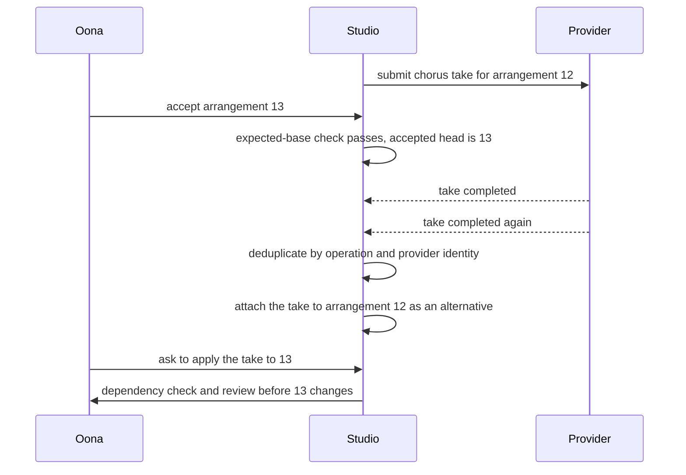
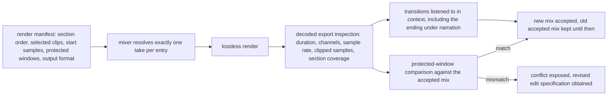

# Chapter 11. Replacing a chorus, keeping the verse

Status: draft.

[Previous: Chapter 10](./10-dubbing-that-keeps-both-timing-and-meaning.md) · [Table of contents](../table-of-contents.md) · [Next: Chapter 12](./12-regenerating-only-the-shots-affected-by-a-change.md)

**New in this chapter:** musical time vs sample time; **preservation contracts** (source vs rendered samples); stem provenance; symbolic vs audio generation.

**Assumes:** permitted recordings, lyrics, and voices; one creator per project; a hosted music model behind an adapter whose actual controls are recorded; publication is a separate authorized step.

**Reuses:** asynchronous provider jobs (chapter 9); Holistic vs Assembly (chapter 9); selective regeneration (chapter 10).

> **About the examples.** Oona's podcast theme, the arrangement, the fixture bars, the workload, and every price in this chapter are fictional. Numbers are illustrative unless labeled *measured*. Provider documentation supports specific interface contracts and links to reviewed sources; none establishes a product's backend or validates the design.

## A brighter chorus and a changed verse

Oona creates a 90-second theme for a podcast: a calm instrumental introduction, a sung refrain on approved lyrics, and a quiet ending that sits under the host's voice. She selects a version, then asks: "Replace the chorus with a brighter one, keep the verse and ending exactly, and do not add another lyric."

"Exactly" is the word that matters. Chapter 10's correction changed one name and left the rest of the dub approved because every segment was its own take. Music does not divide that cleanly: a chorus shares tempo, key, and a vocal with the verse on either side of it, and an edit that sounds local can reach into bars the creator believed were finished. The chapter's task is to say what "keep exactly" means in samples, and to build the edit so it can be checked.

Our application is a music studio for permitted material. It interprets the brief and proposes sound; ordinary application state preserves what the creator accepted. Generating or separating a stem establishes no right to publish it, and the studio describes the provider controls that exist instead of assuming inpainting, stems, or exact preservation are available everywhere.

## What the composition has to keep

### Hard requirements and preferences

The project specification names duration, section order, lyric revision, required and preferred musical traits, source permissions, output format, and the acceptance owner. Hard requirements are checkable: exact lyric coverage, unchanged source clips, unchanged rendered samples. Preferences need listening: "brighter" is an interpretation.

| Requirement | Proposed contract |
| --- | --- |
| Edit scope | Chorus only; verse and ending preserved under the contract the creator chose |
| Lyrics | Approved lines represented with no added or repeated words |
| Timing | Fit declared section slots or propose a reviewed arrangement change |
| Continuity | Transitions, rhythm, harmony, loudness, vocal identity reviewed |
| Durability | Complete takes stored; deterministic render manifest |
| Reproduction | Accepted audio reassembles; identical new generation is never promised |

The baseline is a musician in a digital audio workstation arranging licensed loops and recordings, where a local edit preserves selected material because the timeline points at immutable clips. Both AI paths deliver the same 90-second theme and a reversible arrangement.

Illustrative workload: 100 projects a day, three initial candidates, two chorus candidates per project, a two-minute preview wait. Voice samples, private lyrics, and project sharing carry separate permission and deletion policies.

### Ninety seconds, chorus at bars 17 to 24

The fixture is a 90-second theme in 4/4 at 120 beats per minute: introduction bars 1 to 8, verse bars 9 to 16, chorus bars 17 to 24, verse bars 25 to 32, ending bars 33 to 45 under narration. Lyric revision 3 holds the refrain's four lines. The answer key for Oona's request: the chorus bars change; every sample outside the chorus region in the lossless render is identical to the accepted mix; the four refrain lines are audible with no fifth; the ending starts at the same sample it did before.

### The naive version regenerates the song

Start with the obvious design: add "brighter chorus" to the original prompt and generate the song again.

The chorus is brighter. The verse has a different melody, the vocal is a slightly different voice, the ending is two bars shorter, and a new line appears in the refrain. Every bar was regenerated because the model produced the whole track, and "keep the verse exactly" is a sentence the generator has no mechanism to honor. Oona's selected version exists only as a saved file with no arrangement behind it, so there is nothing to put the new chorus into.

The limitation is that there is one artifact and one operation on it. The first decision is whether to generate whole tracks and pick, generate sections and assemble, or generate something that is editable by construction.

## Whole track, sections, or a score

### Path A: full-track generation and selection

Generate complete alternatives from the brief and select. The model coordinates global development, and a small edit replaces everything. This is Holistic generation in chapter 9's terms.

### Path B: section generation and non-destructive assembly

Maintain an arrangement. Request a supported section edit or generate a replacement clip for the chorus, align it, and mix it with the untouched verse and ending. This is Assembly: exact preservation outside the edit, and seams inside it.

### A third path: symbolic generation rendered to audio

Generate a score (notes, instruments, dynamics in a symbolic format) and render it to audio with a synthesizer or sample library. Edit locality comes free: changing bars 17 to 24 of a score leaves bars 9 to 16 untouched by construction, and rendering is deterministic. The costs are that sung vocals, timbral richness, and production polish are harder to reach symbolically, and the render chain becomes the studio's to own.

| Dimension | Full track | Section assembly | Symbolic rendered |
| --- | --- | --- | --- |
| Quality | Globally coherent; no locality | Scope control; seams and context mismatch | Exact locality; timbre and vocals limited by the render chain |
| Latency and cost | Simple; repeated full tracks | Alignment and mixing; less generated duration | Cheap regeneration; render chain to maintain |
| Privacy | Whole brief and lyrics submitted | Changed content narrowed; context still needed | Score is small; vocals may still need audio models |
| Safety | Source and output permissions | Plus stem provenance | Plus sample-library licensing |
| Operations | Job, candidate, selection, export | Plus arrangement graph, tempo map, transforms | Plus synthesizer, sample library, score editor |
| Recovery | Restore accepted track | Restore section or rerender the mix | Re-render from the score |

> **Source finding.** Suno's Studio 2.0 release [describes](https://blog.suno.com/blog/studio-2) MIDI-conditioned generation, stem separation, timeline editing, parameter automation, and conversational creation beside direct controls. ElevenLabs's composition-plan guide [documents](https://elevenlabs.io/docs/eleven-api/guides/how-to/music/composition-plans) an ordered plan of sections with text, durations, styles, and a contextual-adherence setting, revisable before rendering, with stored audio references that can preserve sections. Both are interface descriptions; neither reports preservation or fidelity measurements.

We start with full-track exploration and saved alternatives, because the first job is finding a theme Oona likes, and add section editing where the adapter can preserve what the contract requires. Symbolic generation enters when the brief is instrumental and locality matters more than timbre. Under any path, the first model task is turning "brighter" into something a generator accepts.

## What the model sees and returns

### The composition plan

The plan is an ordered list of sections, each with a role, intended duration, lyric lines or none, and style requirements. Explicit repetition is recorded ("refrain repeats at bar 33") so a repeated line differs from an accidental one. "No lyrics" is a section constraint carried in the plan, where a check can read it.

```json
{
  "arrangement": 12,
  "tempo_map": [{"bar": 1, "bpm": 120, "meter": "4/4"}],
  "lyric_version": 3,
  "sections": [
    {"id": "intro",    "bars": [1, 8],   "lyrics": null, "style": ["calm", "piano", "pad"]},
    {"id": "verse_1",  "bars": [9, 16],  "lyrics": null, "style": ["calm", "light percussion"]},
    {"id": "chorus_1", "bars": [17, 24], "lyrics": "refrain:v3", "style": ["warm", "sung"]},
    {"id": "verse_2",  "bars": [25, 32], "lyrics": null, "style": ["calm"]},
    {"id": "ending",   "bars": [33, 45], "lyrics": null, "style": ["quiet", "under narration"]}
  ]
}
```

### From a request to plan fields, or a question

The planner maps Oona's sentence onto the plan. "Replace the chorus" selects `chorus_1`. "Brighter" becomes a style change on that section, with the mapping shown ("brighter → major-leaning voicing, higher register, more high-frequency content"), because the word has several musical readings and the creator should see which one was chosen. "Keep the verse and ending exactly" sets `preserve_sources` and raises the question the next section answers. "Do not add another lyric" is a hard constraint: `lyrics` stays `refrain:v3` and the lyric check runs on the result.

When a request does not map, the planner asks instead of guessing. "Make it more like the demo" with no demo attached is a clarifying question, and "keep the melody" against a provider that accepts only style text is a stated limitation, since the interface cannot promise melody preservation.

```json
{
  "operation_id": "chorus_edit_9",
  "base_arrangement": 12,
  "target_section": "chorus_1",
  "lyric_version": 3,
  "desired_change": {"style_add": ["bright"], "mapping": "major voicing, higher register, more treble"},
  "preserve_sources": ["verse_take_4", "ending_take_2"],
  "preservation_contract": "rendered_samples",
  "allow_duration_change": false,
  "max_candidates": 2
}
```

Prompt controls are intentions. The adapter maps the plan to the fields the provider supports and records what it could not enforce. A candidate chorus comes back at 17.3 seconds for an eight-bar slot of 16.

## Beats, bars, and samples

Musical edits are in beats and bars. Playback is in samples. The tempo map connects them, and mapping a bar to a sample position integrates over the map, since a deliberate slowdown in the ending changes the sample length of every later bar.

At 120 beats per minute in 4/4, a beat is 0.5 seconds, a bar is 2 seconds, and eight bars are 16 seconds. At 48 kHz that slot is 768,000 samples. A chorus candidate of 17.3 seconds has three dispositions. Stretching it to 16 seconds changes duration by about 7.5 percent and alters timbre audibly on sung material. Cutting it may remove a phrase. Shifting every later section would move the ending, which Oona fixed. The system produces an alignment proposal with the trade-off stated, or rejects the take, and never silently chooses.

A tempo detector or key detector can flag a candidate for listening. A ritardando into the ending or a modulation into the chorus is a musical choice, and a continuity heuristic that expects constant tempo grades it as a defect; the human decides.

With the chorus placed, "keep exactly" still has two meanings, and the difference between them is audible.

## Two preservation contracts

Source preservation means the verse and ending clips on the timeline are the same immutable sources as before. Rendered-sample preservation means the samples of the final export outside the chorus region are identical to the accepted mix's samples. The first is a statement about references; the second is a statement about bytes.

Source preservation is cheap and weaker. Unchanged clips sound different after global mastering, a new reverb tail, or changed automation, and a creator who asked for "exactly" will hear it. Rendered-sample preservation is what Oona asked for, and it constrains the render: the approved mix's protected PCM windows are retained and copied unchanged into the new lossless render; transition handles and processing are limited to the authorized chorus region; a fade that reaches into the verse needs an expanded edit grant; global normalization and stateful effects do not run over the protected windows, because a compressor with unchanged settings still changes samples when its input changes. Before acceptance, the decoded export is compared sample by sample with the protected reference.

```text
accepted mix (48 kHz, lossless)
|◄──── protected window A ────►|◄──── chorus region ────►|◄──────── protected window B ────────►|
bar 1                       bar 17                     bar 25                               bar 45
sample 0              sample 1,536,000           sample 2,304,000                     sample 4,320,000

new render = copy(A) ‖ new chorus (+ handles inside region only) ‖ copy(B)
check: samples[0 : 1,536,000] == reference;  samples[2,304,000 : 4,320,000] == reference
```

Figure 11.1. The protected PCM windows around the replaced chorus. The render copies A and B byte for byte and processes only the chorus region.

If the requested output format or processing cannot preserve the windows (a lossy export, a mastering chain the creator insists on), the conflict is exposed and a revised edit specification is obtained. The studio never downgrades to source preservation silently. For providers with stored audio references that preserve sections, the reference ID and its retention behavior are recorded, and application-owned audio remains the accepted project's authority, since an expired remote reference cannot strand an arrangement that was declared saved.

Preservation contracts are named here because every later media chapter inherits them: chapter 12's protected shots and chapter 24's recorded call segments are the same two contracts over different bytes.

The verse's vocal, which the chorus has to match, was not recorded as a vocal. It was separated from a mix.

## Where a stem came from

An uploaded vocal, a generated vocal, and a vocal separated from a mix have different provenance and different defects. Separation leaves percussion in the vocal and takes transients out of the instrumental, and recombining separated stems does not reproduce the original. Each stem records its origin, the separation model and version where applicable, the source it came from, its alignment, and known limitations. Summing stems and comparing against the source is a diagnostic; listening is the judgment. Separated tracks are never called the original studio stems.

Context given to the generator is scoped the same way. A chorus replacement benefits from the preceding harmony and rhythm and the following section, passed under the provider's supported contract, and a contextual-adherence setting reduces discontinuity without proving a match. A candidate arrives with transition handles where supported, short audio before and after the boundary, and the timeline decides which handle portions may replace neighboring samples; without that rule, a local edit quietly overwrites approved material.

The same boundary applies to effects. A request for "more shimmer" maps to approved effect implementations with typed parameters. A generated plugin would be arbitrary code in the render chain, and that needs an execution boundary this chapter does not provide.

A take arrives late, and the mixer has to decide what to play.

## Assemble from one manifest

An operation moves through `requested → submitted → generated → stored → aligned → reviewed`, under chapter 9's job protocol: request identity persisted first, completions deduplicated at intake, outcomes recorded as unknown when lookup is unavailable, and a seed treated as provenance that does not promise identical regeneration. Selection updates the arrangement through an expected-base check. A take that finishes for arrangement 12 after Oona accepted arrangement 13 is attached to 12 as an alternative; applying it to 13 is a dependency check and a review.



Figure 11.2. A chorus take that finishes for arrangement 12 after Oona accepted arrangement 13. The duplicate completion is dropped at intake, the take attaches to 12 as an alternative, and applying it to 13 is a dependency check and a review.

The render manifest lists section order, selected clips, start samples, gains, pan, fades, effect versions, automation, protected windows, and output format. The mixer resolves exactly one take per entry and never discovers files by directory order, so a retried chorus stored twice is heard once. A replacement creates a new arrangement revision and invalidates dependent mixes, and the old accepted mix stays until the new one is accepted.

The decoded export is inspected for duration, channels, sample rate, clipped samples, section coverage, and the protected-window comparison, and the transitions are listened to in context, including the quiet ending under narration, where a mix that passes section checks can still mask the host. Permissions follow derivatives: revoking a voice stops new work and triggers the retention response, and a cached mix cannot bypass a current download check.



Figure 11.3. From the render manifest to an accepted mix. The mixer resolves one take per entry, and the decoded export is inspected, compared against the protected reference, and listened to before acceptance.

## The wrong-length chorus and a double completion

Replace the chorus with a take of the wrong duration, obscure one lyric, deliver its completion twice, and accept a different take meanwhile.

| Injection | Detection and state | Recovery | End-state assertion |
| --- | --- | --- | --- |
| Chorus lasts 17.3 seconds | Slot validation fails | Reviewed alignment or new take | Ending at the approved sample |
| Approved lyric missing | Lyric diagnostic and listener review fail | Corrected section proposal | Exact lines audible |
| Duplicate completion | Operation and provider identity deduplicated | Stored candidate association reused | One candidate, one selected take |
| Late take after another selection | Base revision conflict | Alternative branch | Accepted arrangement unchanged |
| Vocal stem leaks percussion | Separation and transition listening fail | Different separation or the original recording | No unacceptable bleed |
| Tempo detector flags an intentional change | Human review contradicts heuristic | Approved exception recorded | Valid transition retained |
| Render enumerates every retry file | Manifest fixture fails | Selected references only | Chorus heard once |
| Global mastering alters the ending | Protected-window comparison fails | Render from protected PCM, no whole-track processing | Rendered preservation holds in the lossless export |
| Provider unavailable during edit | Job pending or failed | Accepted local mix kept | Project playable |

The oracle is the final audio with its manifest and permissions. A generation that succeeded and shifted the ending fails. These drills are specified and have not been run.

## Which path to ship first

Full-track exploration with saved alternatives, then section editing where the adapter can preserve, was the provisional choice. The lab has to tell a technical defect from a musical choice, and the arithmetic has to show whether local editing saves anything.

### Forty briefs

A licensed set of 40 briefs with local edit requests, explicit lyric and no-lyric requirements, varied tempo maps, sparse and dense arrangements, difficult boundaries, and uploaded and generated sources with known permission scope. Whole-track and section paths run under equal candidate and spend budgets, with all attempts preserved, listening order randomized, and creative preference scored apart from technical compliance. Repetition measures consistent acceptance as well as best-of-many quality.

Deterministic checks cover duration, unchanged source references, protected-window equality, manifest lineage, storage, and permissions. Musicians assess rhythm, harmony, transitions, timbre, lyric intelligibility, and whether the requested edit was useful. Automated continuity detectors are calibrated on deliberate valid changes and known defects so they do not impose one style. Reported: accepted-track rate, local-edit acceptance, unchanged-region violations, seams, reviewer repair, generated minutes per accepted minute, time and cost, sliced by vocal vs instrumental, tempo changes, section length, and stem provenance.

### Waste arithmetic

Three full 90-second candidates are 4.5 generated minutes per project. Two 16-second chorus candidates add about 0.533 minutes, for about 5.033 minutes a project and 503.3 minutes a day over 100 projects. Replacing local editing with two more full candidates is 7.5 minutes a project, 750 a day. The section path saves about 246.7 generated minutes a day on these assumptions, and alignment work, failed edits, and review can erase it; the figure is arithmetic to test. At $0.30 a generated minute, the two paths cost about $151 and $225 a day for generation alone, and accepted-minute cost uses accepted minutes as the denominator: if 60 projects are accepted, their 90 minutes divide the whole spend.

Stereo 48 kHz 24-bit PCM is 17.28 MB a minute, and four aligned stems multiply source storage about fourfold before takes and mixes. Retention is bounded per project, rejected alternatives are cleaned up, fan-out is bounded, and local playback survives a provider outage.

### Gates, and when symbolic generation earns its place

Release changes to provider profiles, alignment, or mixer when the fixed critical fixtures pass and blinded review meets the pre-agreed margin. For Oona's request, choose section assembly when it passes locality and listening; otherwise keep the original and state the limitation. Add stem complexity when measured editing benefit exceeds its artifacts and maintenance. Symbolic generation enters for instrumental briefs where edit locality dominates and the render chain's timbre is acceptable to the creator; it is measured on the same 40 briefs where it applies. Rollback restores the full generation and render profile together, and a distributed track needs correction or withdrawal, since application rollback erases no downloaded audio.

## Key ideas

- "Keep exactly" has two contracts. Source preservation keeps the references; rendered-sample preservation keeps the bytes, and it forbids global processing over protected windows. The creator chooses, and the export is compared.
- Musical time and sample time meet in the tempo map; eight bars at 120 bpm are 768,000 samples at 48 kHz. A wrong-length take is stretched, cut, or rejected, never silently placed.
- Full-track, section assembly, and symbolic generation are three paths; the third gives locality by construction and limits timbre.
- A composition plan is the editable intermediate; intent maps to plan fields with the mapping shown, or becomes a question.
- Stems carry provenance (uploaded, generated, separated) and separated stems are never the originals.
- One manifest selects one take per section; late takes attach to their arrangement; the decoded export is checked and listened to.

Chapter 12 keeps the dependency graph and the preservation contracts and adds a budget: a short film where every shot is an expensive job and a reference change makes finished shots stale.

## Exercises

1. Convert eight bars of 4/4 at 96 beats per minute to a sample count at 48 kHz. How many samples is one bar?

2. A render pipeline applies, in order: (a) copy of protected PCM windows; (b) a fade from the chorus into the verse spanning the boundary by 200 ms; (c) a limiter over the whole track; (d) export to a lossy format; (e) export to lossless. Which steps break rendered-sample preservation, and how is each fixed?

3. Choose symbolic or audio generation for each request and say why: (a) "an instrumental intro, piano and strings, that I can later transpose"; (b) "a sung refrain in this singer's voice"; (c) "a drum pattern that locks to the existing bass line's groove."

<details>
<summary>Answers</summary>

1. A beat is 60 ÷ 96 = 0.625 seconds; a bar is 2.5 seconds; eight bars are 20 seconds; at 48,000 samples a second that is 960,000 samples. One bar is 120,000 samples.

2. (b) breaks it, because the fade changes 200 ms of verse samples; fix by confining the fade handle inside the chorus region or obtaining an expanded edit grant. (c) breaks it, because a limiter's output over the protected windows depends on the new chorus's level even with unchanged settings; fix by running it over the chorus region only, or by re-mastering as a separately approved change. (d) breaks it, because lossy encoding changes every sample; the comparison is defined on the lossless export (e), and the lossy file is a derivative. (a) and (e) preserve.

3. (a) symbolic: transposition and later edits are trivial on a score, and piano and strings render well from a sample library. (b) audio: a specific singer's voice is a timbre a symbolic render cannot produce; it needs a permitted voice and an audio model. (c) either, with a lean toward symbolic: the bass line's groove can be extracted as onset timing and used to quantize a drum pattern exactly, and the result renders deterministically; audio generation conditioned on the bass stem is the alternative when the drum timbre matters more than the exact lock.

</details>

## Sources

Sources used here, linked to the original articles:

- [Suno editable generative workstation](https://blog.suno.com/blog/studio-2)
- [ElevenLabs structured music plans](https://elevenlabs.io/docs/eleven-api/guides/how-to/music/composition-plans)
- [OpenAI webhook delivery contract](https://developers.openai.com/api/docs/guides/webhooks), carried from chapter 9 as the asynchronous-job method

