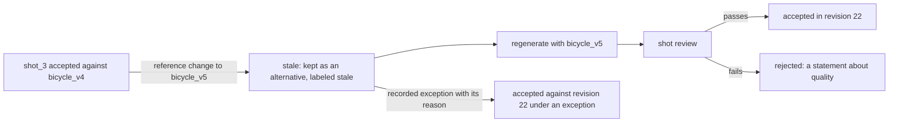
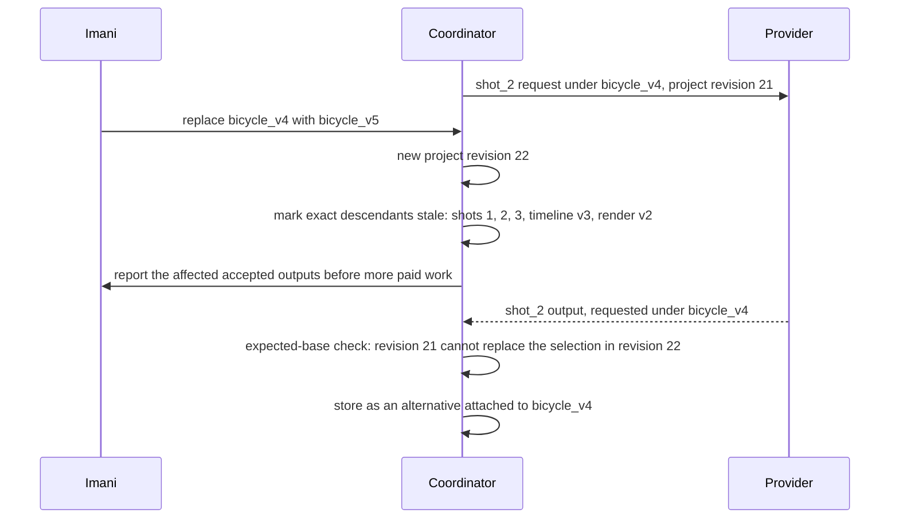

# Chapter 12. Regenerating only the shots affected by a change

Status: draft.

[Previous: Chapter 11](./11-replacing-a-chorus-keeping-the-verse.md) · [Table of contents](../table-of-contents.md) · [Next: Chapter 13](./13-generating-cad-parts-that-measure-as-specified.md)

**New in this chapter:** the production dependency graph; cost-budgeted scheduling of expensive asynchronous jobs; **stale vs rejected**; continuity across cuts with reference conditioning.

**Assumes:** permitted references, voices, and likenesses; approved narration and offer text as controlled assets; one producer per project; publication and media buying outside the workspace.

**Reuses:** asynchronous provider jobs (chapter 9); selective regeneration (chapter 10); Holistic vs Assembly (chapter 9); preservation contracts (chapter 11).

> **About the examples.** Imani's bicycle shop, the four shots, the references, the workload, and every price in this chapter are fictional. Numbers are illustrative unless labeled *measured*. Provider documentation supports specific interface contracts and links to reviewed sources, dated as inspected; none establishes a product's backend or validates the design.

## Three good shots and a wrong bicycle

Imani produces a 20-second advertisement for a bicycle shop. The storyboard has four five-second shots: a rider entering, a close-up of the bicycle, a ride past the storefront, and a closing offer card. The same rider and bicycle appear throughout, with approved narration and exact offer text.

Three shots are accepted when the close-up fails review. Imani swaps the bicycle reference for the correct model. Two of the accepted shots show the old bicycle and are now wrong. A job that was generating the close-up with the old reference is still running, and it costs money whether or not anyone wants its output.

Chapters 9 through 11 edited one artifact at a time. Here the product is a graph of artifacts, each produced by a job that takes a minute and has a price, and a change to one input ripples through the graph while jobs are in flight. The application has to know which finished work is affected, which running work to stop, and which alternatives to keep, before it pays for anything else.

Our application is a short-film production workspace. AI generates visual action and interprets revisions; the application owns dependencies, budgets, selection, and export. The product is a reviewed film with an editable project behind it. A generated scene is never automatically approved for publication, and the workspace buys no placement.

## What the film has to satisfy

### The project contract and a baseline

The contract declares shots, duration, frame rate, aspect ratio, continuity references, narration, captions, permitted variation, and the acceptance owner. The bicycle model is a hard requirement. "Energetic sunlight" is a preference.

| Requirement | Proposed assertion |
| --- | --- |
| Completeness | All shots, narration, and offer present |
| Continuity | Approved identity and product references respected across cuts |
| Timing | Shots and audio fit the declared timeline |
| Revision | Only affected dependencies regenerated or rerendered |
| Durability | Accepted media stored under project ownership |
| Export | The full file decodes with correct duration, layout, audio |
| Authority | Source use and export permissions checked at execution and publication |

The baseline is stock or live footage assembled in an editor with narration and graphics: predictable editing and exact overlays, with coherent footage expensive to find. Both AI paths deliver the same specification.

Illustrative workload: 80 projects a day, four shots each, two candidates per shot, 25 percent more generations from revision, for 800 shot attempts a day, with a five-minute budget to a first cut. Originals, proxies, thumbnails, frames, and exports have separate retention; a proxy is a convenience, and it is no evidence that the full-resolution original is still valid.

### Four shots, one rider, one bicycle, one card

The fixture: shot 1, the rider enters frame left on the bicycle; shot 2, a product close-up; shot 3, the ride past the storefront, screen direction left to right; shot 4, the offer card, rendered from approved text and the logo. Frame rate 30, each shot 150 frames. The answer key after the reference change: shots 1, 2, and 3 depict `bicycle_v5`; shot 4 is unchanged; the rider is the same person in 1 and 3; the export is exactly 20.0 seconds with the declared transitions; nothing generated with `bicycle_v4` is in the final.

### The naive version generates all twenty seconds from one prompt

Start with the obvious design: describe the whole advertisement in a prompt and ask a video model for a 20-second clip.

The rider changes between what should be shots 1 and 3, because nothing holds identity across the clip's internal cuts. The offer text is misspelled, because it was generated as pixels. When the bicycle reference changes, the only fix is to generate all twenty seconds again, and the three good seconds of storefront are paid for a second time along with everything else.

The limitation is that there is one artifact, so there is one job, and a change to anything is a change to everything. The first decision is how many artifacts there should be.

## One clip or a storyboard

### Path A: one complete short generation

Request the film as one clip where the provider supports the duration and controls, and add exact text and audio by deterministic post-processing. The model may achieve integrated motion; a local correction is another full clip. This is Holistic generation.

### Path B: storyboard, per-shot generation, deterministic assembly

Generate and select per-shot assets, then assemble a versioned timeline. Revision and partial recovery follow from the structure, and cross-shot continuity becomes the application's and the reviewer's responsibility. This is Assembly.

### A third input: keyframes

Chapter 9's studio produces a still that keeps a product exact. A still of the correct bicycle with the correct rider, approved once, can condition image-to-video generation for each shot, attacking identity directly instead of describing it in a prompt. This is an addition to Path B, and it moves continuity from hope to a reference the reviewer approved.

| Dimension | One clip | Storyboard and shots |
| --- | --- | --- |
| Quality | Integrated temporal development; limited shot control | Inspectable shots; identity, motion, and lighting can drift at cuts |
| Latency and cost | Few jobs; whole-clip rework | Parallel shots and selective reuse; more review and render work |
| Privacy | Whole brief and references submitted | Per-shot inputs; more derivative storage |
| Safety | Scene review and factual depiction | Plus dependency, overlay, and reference permission checks |
| Operations | Clip lifecycle and composition | Graph scheduler, selection, continuity checks, timebase, renderer |
| Recovery | Keep the old clip; request another | Resume the failed node; invalidate descendants of changed inputs |

> **Source finding.** Luma's Ray 2 video documentation, as inspected on 2026-09-04, [described](https://docs.lumalabs.ai/docs/video-generation) generation requests that return an identity, with extensions and keyframe-conditioned requests that depend on an earlier completed generation. The page pointed to newer documentation at the time; the lifecycle lesson (a dependent request needs its prerequisite's completed identity) is what this chapter uses, and no parameter or retry behavior is taken from it as current.

We start with Path B with keyframe conditioning for continuity, and keep Path A for single-scene clips where integrated motion matters more than local control. Under Path B, the first model task is writing the storyboard.

## What the model sees and returns

### The storyboard

The planner receives the brief, the approved narration, the references available, and the contract's hard requirements, and returns a storyboard: per shot, the action, the role, the reference dependencies, the required duration, the camera framing, the transition into the next shot, and whether the shot is generated or deterministic.

```json
{
  "storyboard_version": 8,
  "frame_rate": {"numerator": 30, "denominator": 1},
  "shots": [
    {"id": "shot_1", "action": "rider enters frame left, rides toward camera", "references": ["rider_v2", "bicycle_v4"],
     "frames": 150, "framing": "wide", "screen_direction": "left_to_right", "kind": "generated",
     "keyframe": "still_rider_bike_v3", "transition_out": {"type": "cut"}},
    {"id": "shot_2", "action": "static close-up of the bicycle frame and badge", "references": ["bicycle_v4"],
     "frames": 150, "framing": "close", "kind": "generated", "keyframe": "still_bike_closeup_v2",
     "transition_out": {"type": "dissolve", "frames": 8}},
    {"id": "shot_3", "action": "rider passes storefront, left to right", "references": ["rider_v2", "bicycle_v4", "storefront_v1"],
     "frames": 150, "framing": "medium", "screen_direction": "left_to_right", "kind": "generated",
     "keyframe": "still_rider_bike_v3", "transition_out": {"type": "dissolve", "frames": 8}},
    {"id": "shot_4", "action": "offer card", "references": ["offer_text_v3", "logo_v2"],
     "frames": 150, "kind": "deterministic", "transition_out": null}
  ]
}
```

Shot 4 is deterministic: the offer is rendered from approved text and the logo under chapter 9's rule that a transform owns what it can express exactly. Narration is approved before any audio-conditioned video, because the audio is cheap and the video is the expensive stage.

> **Source finding.** Captions [described](https://captions.ai/blog/shaping-voices) generating and refining the voice first and conditioning avatar video on the approved audio. The staging is what this chapter borrows; the account gives no cost ratio.

### The shot request

```json
{
  "shot_id": "shot_2",
  "storyboard_version": 8,
  "reference_assets": ["bicycle_v4"],
  "keyframe": "still_bike_closeup_v2",
  "audio_take": null,
  "duration_frames": 150,
  "generation_profile": "product_closeup_v3",
  "base_project_revision": 21
}
```

The server adds identity, authority, and budget. The profile records the effective prompt, provider and model version, resolution, controls, and substitutions. The provider's generation ID is a foreign key for reconciliation, never the shot's identity. Inputs that change while a job runs do not mutate its request; the output belongs to the old dependency set.

### What "the same bicycle" can mean

Reference conditioning steers toward resemblance. Keyframe conditioning starts the clip from an approved frame and holds identity best near that frame. Neither promises that the badge reads correctly in frame 140, so the promise the application makes is the one it can check: the shot was conditioned on the approved reference and keyframe versions, it passed a similarity triage against them, and a human saw the product in the frames where it matters. An exact depiction of a product is a controlled-asset problem, and where it must be exact, chapter 9's compositing puts the approved still over the generated motion.

A reference change arrives with three shots finished and one job running.

## A graph of jobs, each with a price

The project is a directed graph: brief and storyboard at the root; references, audio, and keyframes as inputs; shot attempts depending on their inputs; accepted shots; the timeline; renders; export acceptance. The coordinator schedules only nodes whose dependencies are complete. Independent shots run concurrently; an extension waits for its prerequisite clip; audio-conditioned video waits for the accepted take; rendering waits for selected clips and overlays and never for discarded candidates.

Every node carries an admission estimate (duration, resolution, profile price), a deadline, remaining retries, and a resource class. Fan-out is bounded per project and per user, and capacity is reserved for assembly so a generation burst cannot starve exports. Priority favors projects close to an accepted export, with starvation limits for expensive new work. A cancelled project stops new descendants and requests cancellation of running jobs where the provider supports it; the provider's charge for a job it already started is recorded as incurred.

Paid jobs are reconciled before anything is retried, under chapter 9's protocol: submission intent and request identity persisted first, the provider response stored, a crash between submission and receipt treated as an uncertain external outcome, lookup used only where documented, callbacks through authenticated durable intake with deduplication and polling for the ones that never arrive. Unknown, processing, completed, failed, and cancelled are five outcomes, and a stuck job can still cost money or finish later.

> **Source finding.** OpenAI's webhook documentation [specifies](https://developers.openai.com/api/docs/guides/webhooks) signature verification against the raw body, quick acknowledgement with work moved to the background, and redelivery with backoff for up to 72 hours. It is one provider's delivery contract and says nothing about any video provider's.

Downloaded output is validated (decode, frame count, duration, resolution, codec, audio tracks, orientation) and stored under project ownership before "saved"; proxies are made from the stored original with their mapping preserved, and a proxy URL never enters a render manifest. A finished shot that depended on `bicycle_v4` is now in the store, decoded and valid, and the storyboard says `bicycle_v5`.

## Stale is not rejected

Changing the reference creates `bicycle_v5` and a new project revision. The coordinator computes the exact descendants: every shot whose request named `bicycle_v4` (shots 1, 2, 3), every timeline selection that includes one of them, and every render built from such a timeline. Shot 4 depends on `offer_text_v3` and `logo_v2` and is untouched. If the new reference also changed a product claim in the narration, the audio take and everything downstream of it would join the set.

```text
brief ─► storyboard v8 ─┬─► shot_1 attempts ─► shot_1 accepted ─┐
                        │      ▲ rider_v2, bicycle_v4 ──┐      │
                        ├─► shot_2 attempts (running) ◄──┤      ├─► timeline v3 ─► render v2 ─► export
                        │      ▲ bicycle_v4 ────────────┤      │
                        ├─► shot_3 attempts ─► shot_3 accepted ─┤
                        │      ▲ rider_v2, bicycle_v4, storefront_v1
                        └─► shot_4 (deterministic) ──────────────┘
                               ▲ offer_text_v3, logo_v2

bicycle_v4 → bicycle_v5:  STALE = {shot_1 accepted, shot_2 running, shot_3 accepted, timeline v3, render v2}
                          UNCHANGED = {shot_4, narration take, storyboard v8 text}
```

Figure 12.1. The production graph for the fixture and the nodes a reference change makes stale. The running job's output will attach to the old dependency set.

Stale is a statement about dependencies. Rejected is a statement about quality. A stale shot may be a good shot: shot 3's storefront pass has the right motion, lighting, and rider, and it shows the wrong bicycle. It is kept as an alternative, labeled stale, and it cannot satisfy the new contract automatically. Imani can accept a stale shot under a recorded exception ("the bicycle is not legible at this distance; accepted against revision 22"), and that decision is stored against the new revision with its reason, so a later reviewer can see that the exception was made and why.



Figure 12.2. Stale and rejected are different statements about a shot. A stale shot is kept as an alternative; it is regenerated under the new reference or accepted under a recorded exception against revision 22.

Selection and merge use an expected-base check, as in chapter 8: a late shot generated against revision 21 cannot replace the selection in revision 22, and the coordinator reports which accepted outputs are affected before any more paid work is submitted. The running close-up finishes, attaches to `bicycle_v4`, and sits beside the new attempts as an alternative that nobody will select.



Figure 12.3. The running close-up finishes after the reference change. Its output attaches to the dependency set it was requested under and cannot replace the selection in revision 22.

Three shots are regenerated with the new reference, each passes its own review, and the film still has a problem that no shot-level check can see.

## Continuity is a property of cuts

Shot quality does not establish film coherence. The reviewer looks at adjacent cuts for identity, wardrobe, object state, direction of motion, lighting, camera axis, and story progression. A bicycle leaving frame right in shot 1 and entering from the right in shot 3 breaks the sequence with two attractive shots.

The storyboard is the continuity contract. It names screen direction per shot, the camera axis, and the object state that has to carry across (the rider's helmet, the bicycle's color, the time of day), and it names the discontinuities that are intentional: a cut to a close-up changes viewpoint on purpose, and a tool that smooths every cut destroys the edit.

Reference embeddings and visual similarity triage identity drift between shots and between a shot and its keyframe, and they accept similar-looking wrong models and miss geometry. Inspectable comparisons against the approved reference and human review decide the factual depiction. Boundary checks look for motion and audio discontinuities at each cut and report them for the reviewer; the storyboard says which are defects.

Keyframes carry continuity across cuts the way a reference carries identity within a shot: shots 1 and 3 share `still_rider_bike_v3`, so their rider and bicycle were conditioned on the same approved frame, and the storyboard's screen direction is enforced by the planner's framing instruction and checked by the reviewer at the cut.

The reviewed shots are assembled, and the render comes out 0.6 seconds short.

## Render from exact dependencies

At 30 frames a second, four 150-frame shots are 600 frames and 20.0 seconds. Two 8-frame dissolves overlap their neighbors, so the assembled film is 600 − 16 = 584 frames, about 19.47 seconds. Transition overlaps are part of the contract, declared in the storyboard, and the timeline compensates (longer source shots, or a contract duration that accounts for them) before anything is generated; a film discovered to be short at render time was specified wrong.

The render manifest lists selected sources, trims, placement, transition overlaps, caption and text layers, the audio version, fonts, codec, color settings, and output dimensions. A missing input fails the render; nothing is replaced with a blank frame. The assembled file is validated throughout its duration (frozen frames, black tails, missing audio, caption timing, final aspect ratio), since thumbnails show none of those. Acceptance of a first cut is separate from approval of each final rendition, and a rendition in another aspect ratio is a new export under chapter 9's rule.

Render capacity is a bottleneck of its own, kept apart from generation in the next section.

## The reference changes, a callback is lost, a render crashes

Change the reference after three shots finish, leave an old shot running, drop a completion callback, and crash a render worker near the end.

| Failure | Detection and state | Recovery owner | Assertion |
| --- | --- | --- | --- |
| Reference changes mid-production | Dependency version mismatch | Coordinator marks exact descendants stale | No old-reference clip accepted automatically |
| Callback lost | Polling finds external completion | Reconciler retrieves the existing result | No needless replacement submission |
| Duplicate completion | Event and provider identity match | Intake deduplicates | One artifact association |
| One shot fails | Node failed; other selections intact | Only the failed node retried, under budget | Unrelated clips unchanged |
| Render crashes after encoding | Artifact and manifest reconciliation | Committed file recovered, or same manifest rerendered | Complete validated export |
| Late cancelled job finishes | Cancel and base-revision guard | Stored as alternative or cleaned under policy | Accepted head unchanged |
| Proxy mistaken for original | Manifest resolution and hash check | Stored original resolved | Full-resolution media in the final |
| Transition shortens the film | Frame-duration assertion fails | Timeline adjusted and reviewed | Exact intended duration |
| Stale shot accepted without exception | Revision check at selection | Exception recorded or shot regenerated | Every selection explained against the current revision |

The recovered film satisfies reference, timing, completeness, and authority checks. "All jobs completed" is never the outcome. These drills are specified and have not been run.

## Which path to ship first

Path B with keyframe conditioning was the provisional choice. The lab measures waste after edits, because that is where the structure pays or fails, and it keeps render capacity in its own column.

### Thirty briefs

Thirty permitted multi-shot briefs with identity and product continuity, dialogue, motion direction, local edits, aspect-ratio changes, and intentional cuts, with licensed references and approved narration, holding out reference identities and story structures. Both paths run under explicit duration, candidate, and spend budgets, with unsupported full-clip requests reported instead of invented; generative trials repeat, and discarded clips and reviewer edits are retained.

Automatic graders check manifest completeness, dependency versions, export properties, duration, and storage. Blinded editors grade shot utility and assembled coherence separately. Visual diagnostics are calibrated on similar-but-wrong products and valid camera changes; a high average shot score cannot compensate for the wrong advertised bicycle.

Reported: time to first cut and to accepted film; wasted generations after edits (generations whose output was stale or rejected, per accepted film); queueing by stage; review time; provider charges; storage and egress; render CPU; sliced by identity continuity, dialogue, product detail, and local revision.

### Generation, storage, and assembly, sized apart

Eight hundred five-second attempts are 4,000 generated seconds a day; at $0.08 a generated second, $320 a day before review, storage, or assembly. If 60 films are accepted, generation alone is about $5.33 per accepted film with discarded work included. Burst capacity is an assumption to measure: at a 60-second job service time, an assumed burst of 40 attempts a minute needs about 40 active slots at full utilization, and provider concurrency limits and tail times decide whether that is reachable.

At 8 megabits a second, five seconds is about 5 MB of encoded video before container and audio, and 800 outputs are about 4 GB a day before originals, proxies, renditions, and replicas; raw pixel bytes are no estimate of encoded size. Assembly is its own bottleneck: if a final render occupies a worker for 45 seconds and 20 exports arrive a minute, average demand is about 15 workers before headroom, and that stays true when generation is outsourced.

### Gates

Prefer Path B where repeated local edits and reusable shots decide acceptance; use Path A where global coherence and lower operating burden win the same-task comparison. Add reference and continuity services when they improve accepted-film outcomes, and remove heuristic gates that mostly reject valid creative choices. Release thresholds come from a pilot's confidence and material-error margins. Rollback restores generation profiles, graph rules, and renderer versions together and identifies affected exported manifests for corrected renditions; a published film is an external artifact that is replaced, never rolled back.

## Key ideas

- The product is a graph of priced jobs. Every node names its dependency versions, and a change computes its exact descendants before any more money is spent.
- Stale is about dependencies; rejected is about quality. A stale shot is kept as an alternative, and accepting one is a recorded exception against the current revision.
- A keyframe approved in the image studio conditions each shot, carrying identity across cuts; exact product depiction is still a controlled-asset problem.
- Continuity is a property of cuts, specified in the storyboard (screen direction, axis, object state, intentional discontinuities) and checked at the boundaries.
- Transition overlaps are in the contract: 600 frames with two 8-frame dissolves are 584 frames.
- Paid jobs are reconciled before retry; a running job's output attaches to the dependency set it was requested under.
- Generation, storage, and render capacity are three budgets; outsourcing generation leaves the render bottleneck in place.

Chapter 13 keeps generate-validate-select and moves from pixels to geometry, where validity has a measurement: CAD parts that compile, render well, and have to be the right size.

## Exercises

1. Four 150-frame shots at 30 frames a second are joined with three dissolves of 0.25 seconds each. What is the assembled duration? How many frames does each generated shot need if the film must be exactly 20.0 seconds and every dissolve is kept?

2. The rider reference changes from `rider_v2` to `rider_v3`. Using Figure 12.1, list the stale nodes and the unchanged nodes. Which accepted shot could Imani accept under an exception, and what would the exception have to say?

3. Plan keyframes for the four shots so that identity is carried across every cut that needs it. Which shots share a keyframe, which need their own, and which need none?

<details>
<summary>Answers</summary>

1. Three dissolves of 0.25 seconds are 7.5 frames each at 30 fps, which the contract rounds to 8 frames (0.267 s); the assembled film is 600 − 24 = 576 frames, 19.2 seconds. For exactly 20.0 seconds (600 frames) with three 8-frame overlaps, the shots need 624 frames in total: for example, 156 frames each, or 150 for shot 4 and 158 for each of the others, declared in the storyboard before generation.

2. Stale: shot 1 (names `rider_v2`), shot 3 (names `rider_v2`), timeline v3, render v2. Unchanged: shot 2 (bicycle only), shot 4, the narration take, the storyboard text. Shot 3 could be accepted under an exception if the rider is small in frame; the exception would name the shot, the revision it is accepted against, the reason ("rider not identifiable at medium framing past the storefront"), and the reviewer.

3. Shots 1 and 3 share `still_rider_bike` (same rider, same bicycle, same screen direction), so identity carries across the cut between them even though shot 2 intervenes. Shot 2 needs its own close-up keyframe of the bicycle, conditioned on the same `bicycle` reference so the badge and color match. Shot 4 needs none; it is deterministic.

</details>

## Sources

Sources used here, linked to the original articles:

- [Luma video dependency contract](https://docs.lumalabs.ai/docs/video-generation), dated as inspected
- [Captions: audio before video](https://captions.ai/blog/shaping-voices)
- [OpenAI webhook delivery contract](https://developers.openai.com/api/docs/guides/webhooks)

