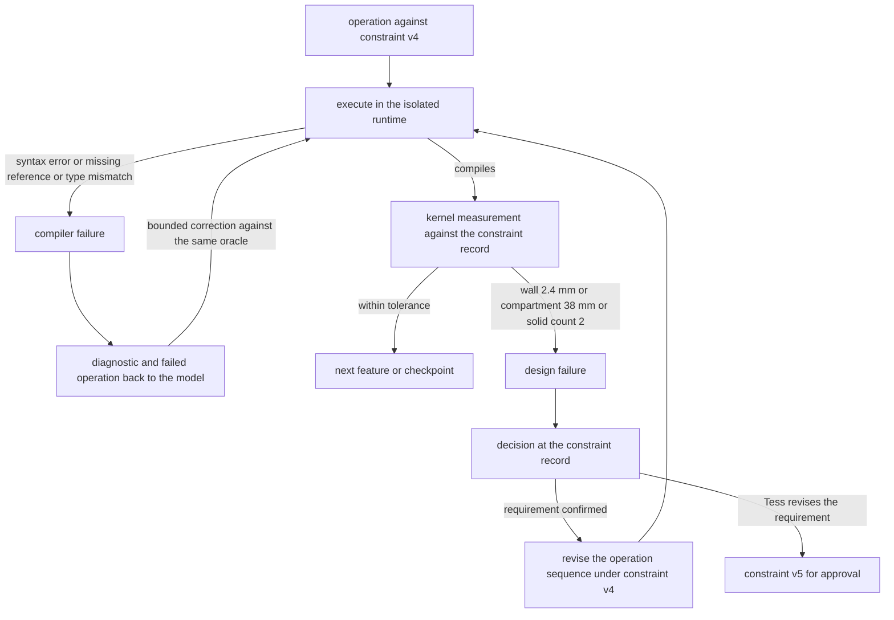
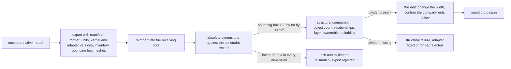

# Chapter 13. Generating CAD parts that measure as specified

Status: draft.

[Previous: Chapter 12](./12-regenerating-only-the-shots-affected-by-a-change.md) · [Table of contents](../table-of-contents.md) · [Next: Chapter 14](./14-a-character-that-remembers-and-forgets-when-asked.md)

**New in this chapter:** constraint feasibility; **generate, validate, repair**; compiler repair vs design repair; units as types; round-trip export.

**Assumes:** a geometry kernel owns the shape; a conceptual design exercise with no fabrication; one designer per project; an isolated runtime for generated operations as in chapter 7.

**Reuses:** Curated vs Generated (chapter 7); expected-version updates (chapter 8); sandboxed execution (chapter 7).

> **About the examples.** Tess's tray, its dimensions, the workload, and the timing figures in this chapter are fictional. Numbers are illustrative unless labeled *measured*. Company and project references support specific mechanisms or disclosed failure classes and link to reviewed sources; none validates the design. No fabrication, structural, or safety claim follows from any software check described here.

## A picture of a tray that cannot be built

Tess sketches a desktop organizer: a tray 120 mm by 80 mm, 30 mm tall, with 3 mm walls and a divider making two equal compartments. The workspace generates it, renders it, and the render looks right. She then asks: "Make it narrower, but keep each compartment at least 40 mm wide."

The next render also looks right. It is 85 mm wide, with two compartments and a divider, and the compartments are 38 mm each, because 85 mm cannot hold two 40 mm compartments, three 3 mm walls, and nothing else. Tess's own constraint was violated to satisfy her own request, and the picture does not show it.

Chapters 9 through 12 generated media whose quality was a judgment. Geometry has a measurement. A generated part is right or wrong by a number, and a part can compile, render, and be wrong by a factor of 25.4. The model translates the sketch and the sentence into parameters or operations; a geometry engine owns the shape; and the chapter's job is to put a measurement between the two.

Our application produces editable geometry with its constraints shown and its validation recorded, and it explains an impossible revision. The accepted product is native editable state, a validation report, and a checked export. Sending a design to a machine is outside its authority.

## What a design has to satisfy

### The input contract and a baseline

The contract records units, coordinate system, dimensions, relationships, tolerances, intended representation, and required editability. A sketch without a scale cannot give absolute dimensions; the planner proposes a scale or asks for one, and perspective estimation is never recorded as a measurement.

| Requirement | Proposed assertion |
| --- | --- |
| Dimensions | Kernel measurements satisfy explicit tolerances |
| Topology | Required closed solids, cavities, and the divider exist |
| Constraints | Dependent relationships hold after edits |
| Scope | The operation targets the correct object and revision |
| Editability | Required parameters and history stay accessible |
| Export | Reimport keeps dimensions, units, object membership, structure |
| Execution | Generated operations reach no network, secrets, or unrelated files |

The baseline is a designer building the parametric model by hand, measuring it, exporting it, and opening the export in the receiving tool. Illustrative workload: 100 design requests a day, up to 50 operations each, three repair attempts, a 30-second preview budget for ordinary designs, with complex Booleans admitted to background work. A native project, a mesh preview, and an interchange export serve different purposes, and equal editability across formats is claimed only after a target-tool test.

### The tray in numbers

Outer 120 × 80 × 30 mm; walls and bottom 3 mm; one divider 3 mm across the width; compartments at least 40 mm wide. Available width for compartments is 120 − 2 × 3 − 3 = 111 mm, so equal compartments are 55.5 mm. The minimum outer width for two 40 mm compartments is 2 × 40 + 2 × 3 + 3 = 89 mm. These figures assume straight walls, no interior fillets, and the stated orientation; the constraint record states those assumptions so a fillet added later is checked against them.

The answer key for "narrower, compartments at least 40 mm": any outer width from 89 mm up satisfies the request; 85 mm is infeasible and is reported as a conflict with three alternatives (wider outer, thinner walls or divider, smaller minimum). Volume of the unfilleted base tray is 120 × 80 × 30 = 288,000 mm³; its cavity before the divider is 114 × 74 × 27 = 227,772 mm³; the material is 60,228 mm³.

### The naive version asks the model for CAD code

Start with the obvious design: give the model the sketch and the sentence and ask for a CAD script. Run it. Render it.

The script compiles. The render is a tray. The walls are 3 inches, because the script's default unit was inches and nobody told it otherwise, and the render has no ruler. When Tess asks for 85 mm, the model writes a script that makes 85 mm work by shrinking the compartments, since it was asked for a tray and it delivered one. Nothing measured anything.

The limitation is that the loop went from text to pixels with the geometry kernel's measurements unused. The chapter's first decision is whether the model should write operations at all.

## Templates or generated operations

This is chapter 7's Curated vs Generated with a kernel in place of a warehouse.

### Path A: validated parametric templates

Select a known design family, a partitioned tray, and propose constrained parameters. A reviewed builder creates the geometry with defined topology and dependencies. A novel shape is rejected as outside the family.

### Path B: generated CAD operations in an isolated runtime

Propose operations or a bounded script for unfamiliar shapes, execute on a branch, validate the geometry after each meaningful step. More expressive, and nothing about successful execution says the shape is right.

| Dimension | Templates | Generated operations |
| --- | --- | --- |
| Quality | Predictable family geometry; limited novelty | Broad range; valid execution can still yield the wrong or an invalid shape |
| Latency and cost | Few parameters; known kernel workload | Planning, execution, repairs, rendering, expert review |
| Privacy | Sketch and parameters | Generated scripts and traces may hold proprietary detail |
| Safety | Small operation surface | Runtime isolation, operation policy, resource bounds, geometry checks |
| Operations | Template versions and parameter migrations | Plus kernel and runtime versions, repair loops, export compatibility |
| Recovery | Reject invalid parameters; keep the prior model | Abort the branch or restore a checkpoint; revalidate |

> **Source finding.** Illoca's changelog [recorded](https://illoca.com/changelog), between July and August 2026, fixes for edits applied to the wrong plan and for exports that went stale after a parametric change. The entries disclose failure classes in an editable parametric product; they disclose no solver internals.

We start with Path A for the tray, with Path B for shapes outside the catalog, and a template rejection means "outside this family" and never "no valid design exists." Under either path, nothing has yet read Tess's sketch.

## What the model sees and returns

### From a sketch to constraints, with a confirmation

A vision-language model reads the sketch and returns candidate constraints: the shape family, dimensions with the units it believes they are in, relationships (walls equal, divider centered), and anything it could not determine. The output is a proposal shown to Tess for confirmation before any geometry exists.

```json
{
  "family": "partitioned_tray",
  "dimensions": {"outer_length": {"value": 120, "unit": "mm", "source": "label on sketch"},
                 "outer_width": {"value": 80, "unit": "mm", "source": "label on sketch"},
                 "height": {"value": 30, "unit": "mm", "source": "label on sketch"},
                 "wall": {"value": 3, "unit": "mm", "source": "annotation"}},
  "relations": [{"kind": "equal_compartments", "count": 2}, {"kind": "divider_parallel_to", "axis": "width"}],
  "undetermined": ["bottom thickness (assumed equal to wall)", "corner radius (assumed 0)"],
  "scale_confidence": "labels present; no scale bar"
}
```

The confirmation step is where "3 inches" dies. Units are shown beside every number, assumptions are listed, and Tess confirms or edits before the constraint record is created.

### The operation

```json
{
  "operation_id": "op_24",
  "base_model_revision": 9,
  "object_id": "tray_main",
  "feature_id": "outer_shell",
  "operation": "set_parameter",
  "parameter": "outer_width",
  "value": 95,
  "unit": "mm",
  "constraint_version": 4
}
```

The server resolves object and authority. Features have stable semantic IDs (`outer_shell`, `divider_1`) that an adapter maps to kernel entities; kernel face and edge indices change after a Boolean or a fillet, so "face 7" is never a reference the model writes. Model text cannot create a cross-project target or elevate an operation into fabrication.

### Code against a feature library

Under Path B, the model writes operations against a feature library (`box`, `shell`, `partition`, `fillet`, `hole`) with typed parameters that carry units, and executes them in the runtime chapter 7 described: pinned kernel and libraries, no network, read-only originals, bounded wall time, memory, operation count, and tessellation. A short script can create a huge geometric workload, so script length is no estimate of cost.

A request arrives that no geometry can satisfy.

## Feasibility before geometry

"Narrower, compartments at least 40 mm" is checked against the constraint record before anything is built. The minimum outer width is 89 mm. If Tess's narrower target is 85 mm, the application reports the conflict with its arithmetic and the assumptions behind it, and offers alternatives: outer width 89 mm or more; walls or divider thinner than 3 mm; a minimum compartment below 40 mm. It does not build an 85 mm tray.

Requirements are classified as hard, preferred, or unresolved. A hard dimension is never relaxed because an attempt failed; a revised constraint is a new approved requirement version. A feasibility check is cheap arithmetic on the constraint record, and it happens before the kernel is touched, which is the only point at which "this cannot be built" costs nothing.

Feasible constraints produce geometry, and geometry that compiles has not yet been measured.

## Validate after every feature

The build runs as a sequence of features, each followed by kernel measurements against the constraint record and against independent fixture arithmetic where it exists.

```text
feature            kernel measurement                       expected (constraint v4)      result
box 120×80×30      bbox = (120, 80, 30) mm; volume 288,000  288,000 mm³                   pass
shell 3 mm         cavity volume 227,772; wall min 3.0      227,772 mm³; ≥ 3.0 mm         pass
                   bottom present (face at z=0..3)          yes                            pass
partition (1)      solids = 1 (connected); compartments 2   1; 2                           pass
                   compartment widths 54.0, 54.0            each ≥ 40 mm, equal ±0.1       pass
export STEP        reimport bbox (120, 80, 30); solids 1    unchanged                      pass
                   compartments 2                           2                              pass
```

Figure 13.1. Step-by-step validation of the tray build. Each row's measurement comes from the kernel; the expected column comes from the constraint record and the fixture arithmetic.

The checks are solid count, watertightness where required, self-intersection, degenerate features, declared constraints, and the specific measurements each feature promised. A representation that cannot support a check records the check as unsupported, never as passed. A render is an inspection aid: multiple views and sections help a reviewer see a missing divider, and no image proves a 3 mm wall.

Semantic IDs make the sequence stable. `divider_1` is addressed by name; the adapter re-resolves it to kernel entities after each topology change and invalidates the mapping when it cannot. The repair loop runs against a fixed oracle: the constraint record and the fixture arithmetic do not change because an attempt failed.

> **Source finding.** The CADCodeVerify paper [separated](https://arxiv.org/html/2410.05340v2) compilation of generated CAD code from checking the rendered result against the requirements with a vision-language model, on a 200-example benchmark with normalized shape comparison. The method establishes the compile-vs-verify distinction; normalized comparison says nothing about absolute dimensions, and the paper's reference geometry is unavailable for a shape a user invents.

Two failures now come back from the loop, and they look the same from the outside.

## Compiler repair is not design repair

A syntax error, a missing reference, and a type mismatch are compiler failures. Their diagnostic goes back to the model with the failed operation for a bounded correction, and the fixed code is run against the same oracle. A wall measured at 2.4 mm, a compartment at 38 mm, and a solid count of 2 are design failures. Their diagnostic is a decision: the geometry is wrong against a requirement, and the model cannot resolve it by changing the requirement or disabling the check. A design failure returns to the constraint record, where either the requirement is confirmed and the operation sequence is revised, or the requirement is revised by Tess as a new version.



Figure 13.2. Compiler repair and design repair leave the loop through different doors. A compiler diagnostic returns to the model; a design failure returns to the constraint record, where the requirement is confirmed or revised as a new version. Three attempts share one runtime budget.

```json
{"rejected": "op_31", "class": "design",
 "measurement": {"compartment_width_min": 38.0, "unit": "mm"},
 "constraint": {"compartment_width_min": 40.0, "version": 4},
 "options": ["revise operations under constraint v4", "propose constraint v5 for approval"]}
```

The loop permits three attempts under one total runtime budget, each with its code, inputs, diagnostics, and output hash preserved. A script that compiles and omits the divider fails the design check and consumes an attempt. CADCodeVerify's visual feedback is a supplementary signal in the design-repair branch, useful when a reference exists.

Partial execution recovers from checkpoints: verified states after meaningful feature groups, with their constraint and runtime versions, and restart only where re-executing later operations is safe inside the isolated model. A failed branch never partially replaces the accepted model; a worker that dies during export leaves a partial file that is not an export; cancellation keeps the last accepted model and blocks late promotion. Concurrent edits promote through chapter 8's expected-base check, and two parameter changes on different fields can interact through the same geometry, so disjoint keys are no proof of independence.

The tray passes every check, exports, opens in the receiving tool, and has no divider.

## Test the edit the user will make

Export produces a manifest: format, units, kernel and adapter versions, object and feature inventory, bounding box, and hashes. Reimport into the intended receiving tool compares units, bounding box, object count, relationships, layer ownership, and required editability against the manifest. A preview of the export proves none of that.

An inch-millimeter mismatch is a factor of 25.4 in every dimension, and a shape-similarity score that normalizes coordinates hides it completely. Absolute dimensions are compared before any normalized distance. An interchange format that keeps geometry and loses parameter history is disclosed as such, with the native project retained. An export with a missing divider or geometry assigned to the wrong object fails the structural comparison however similar its silhouette.

The round trip ends with the edit Tess will make: change the width in the receiving tool and confirm the compartments follow. Opening the file is not the test. The receiving tool's tessellation changes a mesh slightly, which is a tolerance, and a missing feature is never inside it.



Figure 13.3. The round trip from the native model to the edit Tess will make. Absolute dimensions are compared before any structural or similarity comparison, and the test ends with the edit, because opening the file is not the test.

## Wrong units, a mid-sequence failure, a lost divider

Generate plausible geometry in the wrong units, request 85 mm against the 40 mm minimum, fail after hollowing, and export a model without the divider.

| Injection | Detection and state | Recovery | Assertion |
| --- | --- | --- | --- |
| 120 interpreted as inches | Absolute measurement and unit check fail | Units corrected on a new branch | Bounding box matches the millimeter specification |
| Requested width 85 mm below the 89 mm minimum | Feasibility conflict before geometry | Reviewed requirement trade-off | No silent relaxation |
| Worker fails mid-sequence | Checkpoint state incomplete | Last verified checkpoint restored | Accepted model unchanged |
| Divider disappears on export | Reimport structural comparison fails | Adapter fixed or format rejected | Required compartments retained |
| Wrong object selected | Stable ownership guard rejects the operation | Target resolved explicitly | Other objects unchanged |
| Compiles but non-manifold | Kernel validity fails | Geometry repaired under budget | Valid solid topology |
| Late old branch tries promotion | Expected-version check fails | Rebase reviewed | Accepted head unchanged |
| Script requests network or package install | Runtime policy denies | Approved capability or decline | No unrestricted execution |

The oracle combines native geometry measurements, constraint results, and the receiving-tool artifact. Successful execution and an attractive render do not pass it. These drills are specified and have not been run.

## Which path to ship first

Path A for the tray, Path B outside the catalog, was the provisional choice. The lab separates three things the naive version conflated.

### Compilation, correctness, compliance

Eighty expert-reviewed design tasks: known template families, novel operation sequences, infeasible requirements, topology traps, interoperability cases, with shapes and feature combinations held out and parameter ranges swept across their valid and invalid boundaries. Both paths run on the same specifications, with unsupported-template cases recorded as such. Generation and bounded repairs repeat from clean environments with pinned tools.

Compilation rate, geometric correctness (kernel measurements against the constraint record), specification compliance (hard requirements including feasibility reporting), export fidelity (round trip with the promised edit), and acceptance are five numbers, reported apart. Grader negatives include scaled-but-similar shapes, missing internal features, wrong-object edits, and visually plausible invalid solids; chapter 16 makes testing the grader its own subject. Experts assess requirement interpretation and editable usefulness.

### Kernel work and review

One hundred requests at 40 operations are 4,000 operations; if 20 percent need two more full passes, 4,000 + 20 × 2 × 40 = 5,600 operations, at 0.2 seconds each about 1,120 serial seconds, before rendering, imports, and expensive outliers. Boolean and fillet costs vary strongly with topology, so service time is profiled by feature complexity, and tessellation is bounded before render or export. If 60 designs are accepted while 100 consume compute and review, accepted-design cost includes all 100, and a ten-minute expert review dominates inference. Time to an approved native model and time to an approved export are tracked apart, since a fast preview can hide a failing export stage.

### Gates and promotion

Release when the authority, units, ownership, and round-trip fixtures pass and expert-approved results meet the agreed budget, with margins and repeat counts from a pilot. Prefer templates for stable families; add generated operations where held-out coverage improves enough to pay for repair and review; promote recurring valid sequences into reviewed templates under chapter 7's rule; remove automatic promotion where verification is weak. Rollback restores builders, kernel and runtime, and adapters together and issues replacement exports. Physical use is a separately controlled responsibility.

## Key ideas

- Geometry has a measurement, and a part can compile, render well, and be wrong by 25.4×. Units are types on every parameter, shown at confirmation.
- Feasibility is arithmetic on the constraint record before the kernel is touched: 2 × 40 + 2 × 3 + 3 = 89 mm.
- Generate, validate, repair: every feature is measured against a fixed oracle; a render is an inspection aid.
- Compiler repair goes back to the model with the diagnostic; design repair goes to a decision about the requirement. Three attempts, one budget.
- Features have semantic IDs; kernel indices are re-resolved after every topology change.
- A round trip tests the edit the user will make in the receiving tool, with absolute dimensions compared before any normalized similarity.

Chapter 14 leaves measurable artifacts for a persistent conversation, where the thing that has to be checked is what the application remembers and what it has promised to forget.

## Exercises

1. Minimum outer width for three compartments of at least 40 mm with 3 mm walls and 3 mm dividers. What changes if the walls are 2.5 mm?

2. Classify each failure as compiler repair or design repair, and say where the diagnostic goes: (a) `shell()` called with a negative thickness; (b) a cavity volume 12 percent below the fixture value; (c) a reference to `divider_2` when only `divider_1` exists; (d) a watertightness check failing on the exported mesh; (e) two solids where one connected solid was required.

3. A reimported model has bounding box (3048, 2032, 762) in the receiving tool's declared millimeters. What happened, and what single check catches it before any similarity score runs?

<details>
<summary>Answers</summary>

1. Three compartments need two dividers: 3 × 40 + 2 × 3 + 2 × 3 = 132 mm. With 2.5 mm walls and 3 mm dividers: 120 + 5 + 6 = 131 mm; with 2.5 mm for both: 120 + 5 + 5 = 130 mm.

2. (a) compiler repair: a type or range error; the diagnostic goes to the model with the failed operation. (b) design repair: a measurement against the oracle; it goes to a decision about the shell operation or the constraint. (c) compiler repair: a missing reference; back to the model. (d) design repair in the export stage: the geometry or adapter produced an invalid mesh; it goes to the adapter or the operation sequence, never to a relaxed check. (e) design repair: the topology violates a hard requirement; back to the operation sequence under the same constraint version.

3. The model was built in inches and exported as if the numbers were millimeters: 120 × 25.4 = 3048, 80 × 25.4 = 2032, 30 × 25.4 = 762. The absolute bounding-box comparison against the constraint record's (120, 80, 30) mm catches it; a normalized shape comparison would score the two trays as nearly identical.

</details>

## Sources

Sources used here, linked to the original articles:

- [Illoca parametric state failures](https://illoca.com/changelog)
- [CADCodeVerify: render and validate](https://arxiv.org/html/2410.05340v2)

