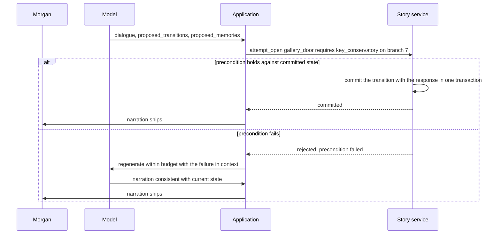
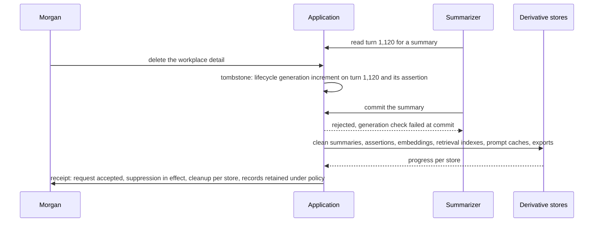

# Chapter 14. A character that remembers, and forgets when asked

Status: draft.

[Previous: Chapter 13](./13-generating-cad-parts-that-measure-as-specified.md) · [Table of contents](../table-of-contents.md) · [Next: Chapter 15](./15-resuming-a-chat-response-after-a-disconnect.md)

**New in this chapter:** memory kinds and promotion; context assembly under a budget; **model proposes, application commits**; correction and deletion lineage.

**Assumes:** an adult fictional experience presented as AI with no clinical claims; one player per story branch at a time (concurrent devices appear in the drill); delivery of a committed turn is reliable (chapter 15 removes that); access and age policy are decided outside this chapter with specialist review.

**Reuses:** lifecycle tombstones (chapter 4); effective vs knowledge time (chapter 4); answer-key evaluation (chapter 1).

> **About the examples.** Morgan's mystery, the guide character, the fixture facts, the workload, and every price in this chapter are fictional. Numbers are illustrative unless labeled *measured*. Company references support specific product behaviors or evaluation methods and link to reviewed sources; none discloses a memory architecture or validates the design.

## A guide that remembers the key and forgets the brother

Morgan returns, after a month, to a fictional mystery game. The guide character remembers that Morgan's detective hid a key in the conservatory, that Morgan dislikes spoilers, and that the missing painting is still missing. In the same session Morgan changes the detective's backstory ("the detective is an only child; the brother was from an earlier draft") and asks the guide to forget a real personal detail mentioned outside the story.

Three things have to be true afterward. The key is still in the conservatory. The brother is gone from the fiction and was never a fact about Morgan. The real detail does not come back, through an old summary or any other route.

Chapters 1 through 13 treated each interaction as complete in itself: a transcript, a packet, a brief, a part. A character that persists across months accumulates state, and the state has four kinds of owner (the author, the world, the story, and the player) with different rules for what may be written, corrected, and erased. The model proposes dialogue and what to remember; the application decides what is committed.

Our application is a persistent story with a conversational guide. The character is presented as an AI fiction and offers no clinical care. Session length and return rate are measured and are never success targets.

## What persistence has to mean

### Four kinds of state and a baseline

| Requirement | Proposed contract |
| --- | --- |
| Persona | Authored identity and boundaries stay stable across model versions |
| Canon | Shared lore is versioned and never contains private player facts |
| Narrative state | Explicit event and state IDs distinguish story branches |
| Personal memory | Purpose, source, scope, correction, expiry, deletion |
| Context | Relevant records selected under an explicit budget |
| Safety | Conversation-level policy overrides fictional continuation |
| Control | The player can inspect, correct, disable, or delete permitted memory |

The baseline is a scripted game with explicit save state and a human-authored character and world guide: limited conversational freedom, reliable inventory, discovered clues, and corrections. Both AI paths keep that reliable state and add natural dialogue.

Illustrative workload: 10,000 sessions a day of 20 turns, with 3,000 retained turns for a long-running player. Replaying everything at 200 tokens a turn is 600,000 tokens before the next response, so context is bounded, and bounding it establishes nothing about remembering correctly. Conversation events, derived summaries, explicit memory, moderation records, and shared canon have separate retention, and the application states its actual deletion policy.

### The key, the spoiler rule, the brother, and one real detail

The fixture: story branch 7 has the key in the conservatory (event at turn 204); an explicit player instruction "no spoilers" from turn 31; a fictional backstory assertion "the detective has a brother" from turn 88, corrected at turn 2,410; a real personal detail about Morgan's workplace mentioned at turn 1,120 and deleted at turn 2,415. The answer key after turn 2,415: the guide refers to the key's location correctly; it never reveals the painting's fate; it treats the detective as an only child and never attributes a brother to Morgan; the workplace detail appears in no prompt, summary, retrieval result, or export; the deletion receipt lists every derivative cleaned.

### The naive version sends the last twenty turns and a running summary

Start with the obvious design: each turn, send the persona, the last twenty turns, and a running summary of everything before them, regenerating the summary whenever it is stale.

The summary written at turn 2,000 says the detective has a brother, because turn 88 said so, and the correction at turn 2,410 is in the recent window for twenty turns and then falls out, leaving the summary's brother standing. The workplace detail is in the summary too, and deletion removes turn 1,120 from the transcript while the summary keeps its paraphrase; the next regeneration reads the old summary and carries it forward. And the summary says the gallery door is "probably unlocked," because the guide improvised that line in turn 1,890, and nothing distinguishes narration from state.

The limitation is that a summary is one undifferentiated text with no owner, no scope, no lineage, and no way to be corrected or deleted in part. The first decision is whether to keep summarizing and repair the summary, or to make state explicit.

## Rolling summaries or explicit state

Both paths keep the deterministic save state (inventory, discovered clues, branch), the authored persona and canon, durable turn identities, and the permission and deletion controls. The comparison holds those fixed, so a memory benefit on one path is never confused with giving only that path a reliable inventory.

### Path A: recent dialogue plus rolling summaries

A bounded recent window and an editable summary of earlier sessions, with the summary owning no state and authorizing no transition. Simple, adequate for episodic play, and the summary can lose sources, corrections, and constraints.

### Path B: explicit state and scoped memory

Authored canon, narrative events, player instructions, and permitted preferences stored as separate, individually addressable records with provenance, and relevant records retrieved per turn. Long-lived control, with more conflict, retrieval, and deletion work.

A third option enters the lab as a measurement: a long-context model with cached prefixes, where the whole history rides in the prompt and the provider's cache makes the repeated prefix cheap. It removes the summarizer and keeps every problem of correction and deletion, since a cached prefix that contains the deleted detail is a copy.

| Dimension | Rolling summaries | Explicit state and scoped memory |
| --- | --- | --- |
| Quality | Smooth recent context; compressed facts drift | Precise state and corrections; a retrieval miss still breaks continuity |
| Latency and cost | Simple assembly; periodic summarization | Retrieval, memory validation, maintenance per player |
| Privacy | Summaries hold sensitive facts opaquely | Explicit scopes and deletion lineage; more stored derivatives |
| Safety | A summary may omit gradual signals | Dedicated policy context and records; classification still imperfect |
| Operations | Summary versions and source links | Canon registry, event projection, memory lifecycle, indexes, tombstones |
| Recovery | Rebuild the summary from permitted sources | Recompute affected projections; suppress superseded and deleted assertions |

> **Source finding.** Character.AI's Lorebook post [described](https://blog.character.ai/lorebook/) keyword-triggered world entries that enter context when their triggers appear, and shared, editable lore. The post describes a product feature and discloses no memory architecture.

We start with Path B for months-long play, built from ordinary tables, events, and a bounded retriever. Its prompt has five parts, and what goes into each is the next design decision.

## What the model sees and returns

### Five kinds of context under one budget

The assembled prompt has an illustrative budget of 8,000 tokens: 1,000 for persona and policy, 1,000 for current state, 3,000 for recent dialogue, 2,000 for retrieved lore and memory, 1,000 for overhead and the response schema. The five kinds, in order, each with an owner:

```text
1. Authored persona and boundaries      owner: author          immutable per version; never learned
2. Shared canon (world)                 owner: world editors   versioned; keyword and ID retrieval; no player facts
3. Story state and events (this branch) owner: story service   deterministic; projected from committed transitions
4. Player instructions and memories     owner: player          scoped; explicit outranks inferred; deletable
5. Recent dialogue                      owner: conversation    last N turns, verbatim, labeled by turn
```

Figure 14.1. The five kinds of context, their owners, and their rules. The model reads all five and may write to none of them directly.

### The response and its proposals

The model returns the guide's dialogue plus proposed transitions and proposed memories, as separate fields:

```json
{
  "dialogue": "The conservatory key should still be where you left it. Shall we try the gallery door?",
  "proposed_transitions": [{"event": "attempt_open", "target": "gallery_door", "requires": ["key_conservatory"]}],
  "proposed_memories": [{"kind": "preference", "text": "Morgan likes to re-check locations before acting", "evidence_turns": [2418]}]
}
```

### The persona prompt and its regression set

The persona section states identity, voice, boundaries (never claims to be human; never offers clinical advice; breaks character on the policy route), and what the guide does not know. A persona regression set, forty prompts with expected qualities and forbidden behaviors, runs against every model version, since a provider upgrade changes voice and compliance without changing a line of the prompt.

A model's narration opens the gallery door. The inventory says the key is still in the conservatory.

## The model proposes, the application commits

A transition is a typed event with preconditions. `attempt_open(gallery_door)` requires `key_conservatory` in inventory, or an approved story exception. The story service checks the current branch and version and commits allowed transitions in the same transaction as the response. If a precondition fails, the response is regenerated within budget with the failure in context, or a response consistent with current state is produced; narration that contradicts committed state never ships.



Figure 14.2. The model proposes a transition and the story service commits or rejects it against committed state. Narration that contradicts the inventory is regenerated; inventory wins.

This is the rule the book names here and reuses from chapter 15 onward: the model proposes; the application commits. Narration is a proposal about the world. Inventory is the world. When they disagree, inventory wins and narration is rewritten.

Branching is explicit. Replaying a scene selects or creates a branch; it rewrites no past turn. New canon versions apply prospectively, and an existing session continues under its pinned world or migrates under a declared rule, so a retroactive lore change does not erase a solved mystery. Two devices submitting conflicting actions against the same state are serialized or branched with a visible conflict, under chapter 8's expected-version check; both cannot consume the same unique item.

The same rule applies to the extractor, which has just proposed remembering everything Morgan said.

## Memory is a proposal too

After a turn, the extractor proposes memories. Each proposal has a kind, and the kind decides what may happen to it:

| Kind | Example | Retention rule |
| --- | --- | --- |
| Fictional event | the detective hid the key | committed by the story service through a transition; never by the extractor |
| Fictional backstory | the detective has a brother | scoped to the branch; the player's own assertion; correctable |
| Explicit player instruction | "no spoilers" | retained automatically, highest precedence, visible and editable |
| Inferred preference | "likes puzzles" | retained only in permitted categories, with evidence links; confirmable |
| Real personal detail | workplace, health, relationships | never retained automatically; explicit opt-in per category, if the policy allows at all |
| Character improvisation | "the door is probably unlocked" | never a memory; it is dialogue |

```text
Extract candidate memories from the player's turns in this window (turns 2401–2420).
For each: kind (from the taxonomy), text, scope (branch or player), evidence turn IDs.
Rules: dialogue spoken by the guide is never evidence about the player. A statement about the
detective is fiction. Do not propose real personal details. Explicit instructions ("don't",
"always", "stop") are instructions, never preferences.
```

Explicit instructions outrank inferences, and a repeated hallucination gains no credibility through repeated extraction: proposals are deduplicated against existing assertions and linked to actual player turns, and model confidence is stored and never equated with truth. False promotion (a memory stored that the taxonomy forbids, or a fiction stored as a real fact) is a measured rate in the evaluation, with a target of zero on the forbidden categories.

Morgan's correction arrives, and three old summaries still say the detective has a brother.

## Correct without resurrecting

The correction creates a superseding assertion scoped to branch 7's backstory, marks `memory_12` (the brother) inactive with its disposition, and invalidates every summary that depends on it, which chapter 4's two clocks make possible: the brother was asserted at turn 88 and known false from turn 2,410, and the correction's effective scope is the fiction, so no real-player record is touched. A global preference and a session exception coexist by scope: "no spoilers" stays, and "spoilers are fine for this completed case" applies to one branch.

The assembler selects active assertions and adds a minimal correction marker where an older claim was retracted, so the model has the fact and its disposition. When raw historical dialogue is retrieved (turn 88, say, because Morgan asks what they discussed), its outdated claims carry a historical label in the prompt, since a correctly updated memory table does not stop the model from reading an old turn as current.

Deletion is the harder operation, and a summarizer is running while Morgan requests it.

## Forget across every derivative

Deleting the workplace detail starts with chapter 4's tombstone: the source turn and the assertion get a lifecycle generation increment before cleanup begins, and every memory promotion and summary write checks the generation at commit. The summarizer that was reading turn 1,120 when the deletion landed finishes, tries to commit, and is rejected. Cleanup then traverses the derivatives: summaries, assertions, embeddings, retrieval indexes, prompt caches (the long-context option's cached prefix included), and exports, with progress per store. An index rebuild applies tombstones before anything becomes searchable.



Figure 14.3. A deletion lands while a summarizer is reading the source turn. The tombstone's generation check rejects the late commit, cleanup walks every derivative, and the receipt reports progress per store and what was retained.

The deletion receipt distinguishes four things: the request was accepted; retrieval suppression is in effect; derivative cleanup completed, per store; records retained under an explicit policy (moderation records, for example) are listed. Backup restore and cache expiry are tested, and the receipt never claims that removing one visible memory row erased every copy.

One kind of signal in the conversation must not become memory of any kind, and must not stay in character.

## Safety routing outside the persona

A fictional guide answers in character during ordinary play. A conversation-level policy, evaluated over relevant surrounding context under privacy controls, can require an out-of-character response route with verified resources for the served location and language. Persona instructions cannot override the route, and a distress signal never becomes plot material or a stored preference.

> **Source finding.** Character.AI's September 2026 safety update [described](https://blog.character.ai/continuing-to-build-upon-our-safety-priorities/) conversation-context safeguards, routing to support resources, and moderation controls, alongside access and age-assurance measures. These are dated company claims about product behavior; this chapter reproduces no implementation and makes no age-estimation claim.

Single-message checks miss patterns across turns; retaining everything forever is unacceptable; the minimum policy context, its retention, and its access are defined with specialist review. Moderation records and appeals have their own audit trail and are never ordinary character memory. Engagement is not a success metric here or anywhere in the chapter.

## A planted fact, a correction, a deletion, a second device

Plant a fictional personal claim, correct it, delete a related real detail while a summarizer runs, and resume from another device.

| Injection | Detection and state | Recovery | Assertion |
| --- | --- | --- | --- |
| Fiction proposed as a real player fact | Kind and scope validation fail | Promotion rejected | Real-player memory unchanged |
| Old claim after correction | Supersession lineage check | Affected summary rebuilt | Corrected backstory used |
| Deleted source reappears in a summary | Tombstone guard at commit | Stale write rejected; derivative cleaned | No retrieval or prompt inclusion |
| Private fact enters shared lore | Ownership and publish guard fail | Proposal removed; outputs audited | Other players cannot retrieve it |
| Two devices consume the same key | Expected-story-version conflict | Serialized or branched | One coherent inventory transition |
| Policy route changes during a slow response | Final policy and version check | Response withheld or regenerated | Persona cannot bypass the route |
| Gradual concerning pattern | Conversation-level fixture | Reviewed support route | No plot escalation from the signal |
| Summary keeps tone and loses the clue | Continuation probe fails | Permitted event retrieved or summary improved | Correct next action available |
| Cached prefix holds a deleted detail | Cache listed as a derivative | Cache invalidated with the tombstone | No deleted text in any prompt |

The deletion oracle checks retrieval, prompt assembly, stale writes, and derivatives; a reassuring in-character reply establishes nothing. These drills are specified and have not been run.

## Which path to ship first

Path B for months-long play was the provisional choice. The lab compares it with rolling summaries and with long context plus caching on the same histories, and grades remembering by what the character can do next.

### Sixty histories and continuation probes

Sixty consented or synthetic story histories with held-out continuation tasks: canon, inventory, player instructions, fiction-vs-real separation, corrections, deletions, concurrent devices, and gradual sensitive patterns reviewed by specialists, spanning several compression boundaries and return intervals. All three options run from identical prefixes to identical next tasks, with the shared game rules and transaction checks fixed.

> **Source finding.** Factory [evaluated](https://factory.ai/news/evaluating-compression) context compression by whether an agent could complete the next task from the compressed context (functional recall and continuation probes) instead of by textual similarity to the original. The method transfers; the vendor ranking and private corpus do not.

Story state and memory eligibility are graded deterministically against the fixture's answer key. Expert reviewers assess persona continuity, appropriate uncertainty, and sensitive-response behavior. Model judges are calibrated on believable but wrong memories, and continuations repeat to measure consistent success. Reported: continuity, correction success, appropriate forgetting, private-memory exposure, false promotion rate, safety false positives and negatives, retrieval recall, latency, lifetime cost, sliced by long history, similar names, conflicting versions, and post-deletion restoration.

### Lifetime cost

At 200,000 turns a day, 1,500 historical-context tokens a turn add 300 million input tokens, $600 a day at $2 per million before current dialogue and output. Summarization at $0.01 per 20-turn session adds $100 a day for 10,000 sessions. Long context with caching has its own arithmetic: a 50,000-token cached prefix at a cached-input rate one tenth of the base rate costs the same as 5,000 uncached tokens per turn, plus the cache writes, and the prefix has to be invalidated on every correction and deletion, which is where its cost and its risk both sit. Two memory candidates a session are 20,000 a day before filtering, so promotion rules, expiry, and deletion bound growth. The metric is tokens per successful continuation, never compression ratio.

### Gates

Release when the scope, deletion, and concurrency fixtures pass and specialist-reviewed safety behavior is within agreed bounds, with margins from a pilot. Choose rolling summaries for short episodic use if they meet correction and deletion requirements; explicit state where long-run correctness and control pay for maintenance; long context where measured continuity justifies its invalidation discipline. Promote only memory categories shown useful and safe under the declared policy, and remove features that mainly create privacy or correction burden. Canary memory changes with rollback to the prior assembler and promotion policy, and rollback removes invalid promoted records and repairs derivatives, since restoring a prompt undoes no disclosure.

## Key ideas

- Five kinds of context with five owners; the model reads all and writes none directly.
- The model proposes, the application commits: transitions have preconditions checked against committed state, and narration that contradicts inventory is rewritten.
- Memory is a proposal with a kind, and the kind sets the retention rule; explicit instructions outrank inferences; fiction is never a fact about the player; improvisation is never memory.
- Correction supersedes by scope and time and invalidates dependent summaries; retrieved old dialogue carries a historical label.
- Deletion is a tombstone checked at commit plus per-store cleanup, caches included, with a receipt that names what was retained.
- Safety routing sits outside the persona and its records outside memory; engagement is never a success metric.
- Remembering is graded by what the character can do next, at a cost in tokens per successful continuation.

Chapter 15 keeps the committed turn and asks what happens when its delivery to the player fails halfway through.

## Exercises

1. Classify each statement by memory kind and give its retention rule: (a) "My detective grew up in Lisbon." (b) "Please stop describing blood." (c) "I work night shifts, so I play late." (d) The guide says, "The curator seemed nervous." (e) "I always check the library first," said by Morgan after doing so three times. (f) Morgan picks up the lantern.

2. Morgan says at turn 2,410, "The detective is an only child." Describe the records written, and list what the assembler returns for the detective's family in the next prompt if (i) only memory is retrieved; (ii) turn 88 is also retrieved because Morgan asks "what did I tell you about the family back then?"

3. Allocate an 8,000-token budget across the five context kinds for a turn where Morgan has just returned after a month and the current state has 14 discovered clues and 6 inventory items. Say what you cut and why.

<details>
<summary>Answers</summary>

1. (a) fictional backstory, scoped to the branch, correctable by Morgan. (b) explicit player instruction, retained automatically with highest precedence, visible and editable. (c) real personal detail; never retained automatically; at most an opt-in preference ("plays late") with the workplace fact excluded. (d) character improvisation; dialogue, never memory. (e) inferred preference; retained only if the category is permitted, with the three evidence turns linked and a confirmation if policy requires. (f) fictional event; committed by the story service as a transition, never by the extractor.

2. Records: a new assertion (`only_child`, scope branch 7 backstory, source turn 2,410, effective for the fiction); `memory_12` (brother) marked inactive with disposition "corrected by turn 2,410"; summaries depending on `memory_12` invalidated and queued for rebuild. (i) The assembler returns the active assertion "only child" with a minimal marker "an earlier backstory mentioned a brother; corrected." (ii) It additionally returns turn 88 labeled historical ("turn 88, superseded at turn 2,410"), so the model can answer the question about what was said without treating the brother as current.

3. One allocation: persona and policy 900; current state 1,400 (the 14 clues and 6 items are compact as IDs and one-line labels, and they are the authoritative state); recent dialogue 1,700 (a month-old session's last turns matter less than usual; keep the final exchange and the return greeting); retrieved lore and memory 3,000 (expanded, because the player's instructions, the key's location, and the branch summary are what a returning player needs); overhead and schema 1,000. The cut is recent dialogue, because after a month its marginal value is low and the retrieved records carry what matters; the state budget is never cut below what the full inventory needs, since a truncated inventory is a wrong world.

</details>

## Sources

Sources used here, linked to the original articles:

- [Character.AI contextual lore](https://blog.character.ai/lorebook/) and [conversation safety controls](https://blog.character.ai/continuing-to-build-upon-our-safety-priorities/)
- [Factory functional memory evaluation](https://factory.ai/news/evaluating-compression)
- [Anthropic agent evaluation method](https://www.anthropic.com/engineering/demystifying-evals-for-ai-agents), carried as the repeated-trial and calibrated-grader method

