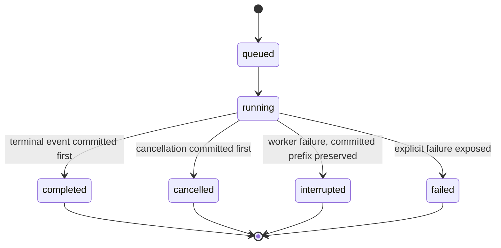
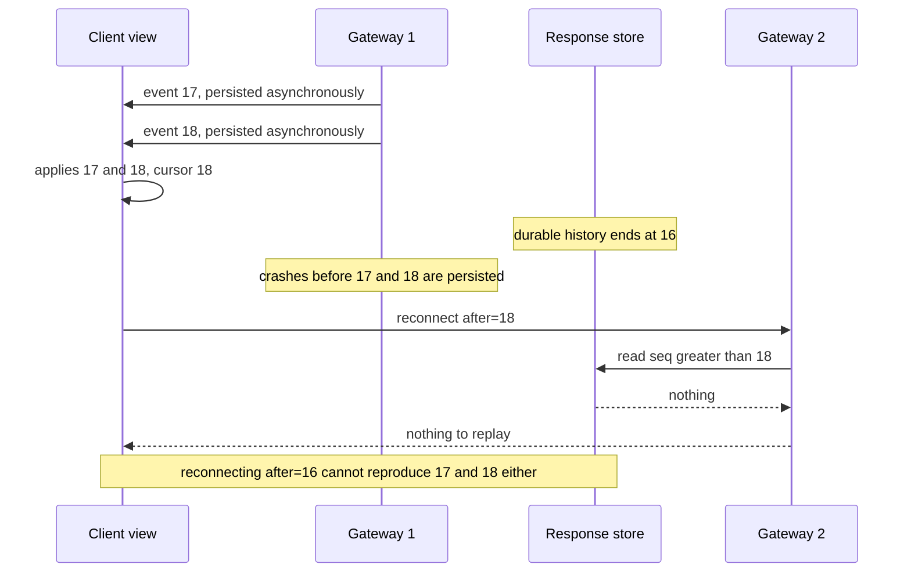

# Chapter 15. Resuming a chat response after a disconnect

Status: draft.

[Previous: Chapter 14](./14-a-character-that-remembers-and-forgets-when-asked.md) · [Table of contents](../table-of-contents.md) · [Next: Chapter 16](./16-simulated-users-that-cant-cheat.md)

**New in this chapter:** attempts vs history; client cursors and replay; provisional output (stream vs buffer-and-check); cancellation that does not alter history.

**Assumes:** an existing model API; text responses with no tool execution in the first release; one user per conversation (shared editing is chapter 8's); evidence selection is an input, with no new retrieval design.

**Reuses:** fenced publish (chapter 3); expected-version updates (chapter 8); model proposes, application commits (chapter 14).

> **About the examples.** Nora's release investigation, the workload, the records, and every calculation in this chapter are fictional design fixtures. Numbers are illustrative unless labeled *measured*. Vendor and standards documents support specific interface contracts and link to reviewed sources; nothing here reconstructs a company's serving system.

## Two answers joined into one

Nora asks her team's AI workspace why yesterday's release failed. The answer appears gradually, connecting a deployment change with a configuration error. Halfway through, her train enters a tunnel. When the connection returns, the workspace starts a new answer. Its explanation differs from the first, and the interface has silently joined the two paragraphs.

Nora cannot tell whether she is reading one investigation, two attempts, or an incomplete answer presented as complete. The missing text is the smaller problem.

Every chapter so far assumed that once the application had an answer, the user received it. Chapter 14 ended with a conversation whose history the application committed turn by turn. Here the transport between the application and the user fails in the middle of a turn, while the model is still producing it, and the design has to say what the user can recover and what status the recovered text has.

Our application is a persistent, text-based AI chat workspace. Users ask questions, watch a response develop, interrupt it, and return later. Within the retention and authorization boundary, a user can recover the committed prefix of a response and determine whether that attempt completed, stopped, or failed. That is weaker than promising generation survives every failure and more useful than promising a socket never drops: a delivery gateway can fail while a generation worker continues, and a worker can fail after preserving part of an answer, and the interface tells those apart.

## What must remain true

### Turns, attempts, and a committed prefix

A conversation contains user turns and separate model attempts. A retry creates another attempt, never an invisible continuation of the old one. Each attempt exposes a contiguous committed prefix and an explicit terminal status. A client reconnects without starting another model call because its transport changed.

Ordered means event 19 cannot be applied while event 18 is missing. Repetition during recovery is allowed; visible duplication is a defect. Completion is an application record; a closed connection implies nothing about it.

Authorization applies to live output and to replay. A user who loses access cannot recover the conversation by keeping its identifier or an old cursor. Retention has an expiry and a deletion policy.

The baseline waits for the complete response, saves it, and displays it. Partial rendering and delivery recovery disappear from the interaction, while the provider request still needs timeout and failure handling. It is a credible choice when responses are short or need whole-answer review before exposure. Streaming has to earn its complexity: it makes the application feel responsive and lets a user stop an irrelevant answer early, and it makes the answer no more accurate and the computation no shorter.

| Requirement | Design exercise assumption |
| --- | --- |
| Open workspaces | 25,000 browser connections at the illustrative peak |
| Active generation | 2,500 attempts at that peak; other connections idle or reading |
| Event rate | Average 12 normalized content events per active attempt per second |
| Event size | Average 500 bytes including envelope |
| Response limit | Explicit output allowance and a two-minute application deadline |
| First visible text | p95 of 2.5 seconds, including admission and provider wait |
| Live delivery | p95 of 75 ms from application commit to client application, in a defined regional test |
| Recovery | p95 of three seconds after connectivity returns, when the cursor is still covered |
| Storage | Full event replay for 24 hours; snapshots for 30 days unless deleted earlier |

The product also has stretch targets: 50,000 simultaneous streaming sessions and delivery within 50 ms of generation. Both are kept, with their contradictions resolved in the contract. "Within 50 ms" describes the healthy path in one region at a stated percentile; delivery during a multi-second outage is a recovery sample with its own objective, never a 50-ms miss. Fifty thousand sessions are connections; the inference load is the active fraction. And unbounded generation, a permanently offline client, finite storage, and unlimited lossless retention cannot all hold, so generation has an output budget and retention has an expiry.

Latency figures have different clocks. Provider time to first event is not delivery latency; a network outage is not a slow-generation sample; browser receipt is not rendering. Each boundary is instrumented separately.

### The naive version ends generation when the relay restarts

Start with the obvious design: a request handler opens a provider stream, reads deltas, and writes each one to the user's socket as it arrives.

Against the fixture, the handler is the generation task and the connection at once. When Nora's socket drops, the handler's write fails, the handler exits, and the provider stream is abandoned half-read. Nothing was saved, so the reconnecting client has nothing to recover and the application starts a new request. The new answer differs, the client appends it to whatever it still had on screen, and the two paragraphs join.

The limitation is that generation depends on the connection and output exists only in flight. Every mechanism in this chapter separates the two. The first decision is what the user should see while generation is still running.

## Show the user as it arrives, or check first

Both paths run generation independently of any connection and commit output before delivery. They differ in when the user sees it.

### Path A: stream to the user, labeled provisional

Deliver each committed event to the view as soon as it is accepted. The response is marked provisional until the terminal event arrives, with evidence links attached as they become available. Nora reads the explanation as it forms and can stop it early.

The cost is exposure. A provisional claim can be read before its qualification arrives, and a claim that a later check rejects has already been seen. Later deletion does not undo that disclosure.

### Path B: buffer and check before showing

Commit events as they arrive and hold delivery at a gating boundary: a sentence, a paragraph, or a claim with its citation. A check runs on each unit (the span exists, the claim is in the permitted scope, no partial tool call is present) before the unit is released to the view. The user sees text in larger steps with a delay of one unit.

This path fits answers whose individual claims carry consequences and answers that include tool calls, where a partly emitted command must never be shown as an instruction or acted on. It costs first-visible-text latency and a gating implementation whose own failures (a check that never returns) need a deadline.

| Dimension | Stream, provisional | Buffer and check |
| --- | --- | --- |
| Answer quality | Same model output | Same output; a rejected unit is withheld, never rewritten |
| Latency | First text at provider first-event time plus commit | Plus one gating unit and the check |
| Cost | Delivery only | Plus a check per unit |
| Privacy | Full output exposed as produced | Rejected units never leave the store |
| Safety | Provisional label; qualifications may arrive after the claim | Each released unit passed its check |
| Operations | Gateways, store, cursors | Those plus gating policy and check deadlines |
| Recovery | Replay committed events | Replay released units; unreleased committed events stay in the store |

A third option is to buy the loop. Some providers offer a background response that keeps running when the client disconnects and can be resumed by identifier with a cursor. Behind an adapter it replaces the generation worker and the response store for the provider's part of the path; it does not replace the application's attempt record, authorization on replay, retention policy, or the view's cursor, because the application still owns what the user saw and what status it had.

Storage is an implementation note under either path. A relational response store, with one row per event and a primary key of `(attempt_id, seq)`, has fewer moving parts and a recovery contract that is easy to inspect; its bottleneck is small writes and replay reads, which batching and measurement address. A partitioned log with a materializer into the same store absorbs intake bursts and serves multiple consumers, at the price of another stage, another queue, and recovery lag. The store is authoritative in both; a broker acknowledgement is never the replay guarantee.

> **Source finding.** Kafka's design documentation [describes](https://kafka.apache.org/40/design/design/) ordered partitions with one assigned consumer per group, offsets that survive compaction without renumbering, and durability conditioned on acknowledgement and in-sync replica settings. These are storage contracts and say nothing about what a browser has displayed.

We start with Path A for text answers, with provisional labeling and evidence links attached as they arrive, and Path B for any answer that includes tool calls. A relational response store comes first, and the log is adopted when measured intake bursts or additional consumers justify it. Both paths commit events, and what an event is comes from the provider's stream.

## What the model sends

Provider streams deliver typed events, and the types matter more than the text inside them.

> **Source finding.** Anthropic's streaming documentation [describes](https://platform.claude.com/docs/en/build-with-claude/streaming) a sequence of typed events: a message start, content block starts and stops, deltas within a block, a message delta carrying the stop reason and cumulative usage, and error events that can arrive mid-stream. Tool-use input arrives as partial JSON deltas that are complete only at the block's stop. This is a public adapter contract and describes nothing about the backend.

Three event kinds change the application's behavior. A text delta is appended. A partial tool-call delta is accumulated and never executed or displayed as an instruction until its block closes and the full arguments parse; chapter 14's rule that the model proposes and the application commits applies to every fragment. A thinking interval, where the provider emits nothing visible for several seconds, is a normal phase and is recorded as one, so stall detection asks whether the recorded phase expects output before it declares anything stuck.

The adapter normalizes each provider event into an application envelope:

```json
{
  "schema_version": 1,
  "attempt_id": "attempt-b",
  "writer_epoch": 4,
  "seq": 18,
  "kind": "text_delta",
  "block_id": "answer",
  "payload": {"text": "The configuration changed before the restart."}
}
```

An event is not a token and not a transport fragment. One envelope may carry several tokens; one TCP segment may carry part of an envelope. The sequence belongs to the attempt, never to a partition or a connection. A stop reason such as `stop` or `length` is recorded when the provider sends it and is never fabricated for an interrupted stream.

The envelope has an `attempt_id` because the generation can outlive the connection that requested it, and something has to own the sequence.

## An attempt is not the conversation

A turn starts with an authenticated command, `POST /conversations/{id}/turns`, carrying an idempotency key and the expected conversation revision (chapter 8). One transaction validates access, rejects a stale revision, creates the turn and the attempt, and records work for a generation worker. A retry with the same key returns the same operation; the same key with different input is a conflict.

| Record | Owned information |
| --- | --- |
| Conversation revision | Admitted history, participant access, input versions |
| Turn | User input and command identity |
| Attempt | Model configuration, pinned input revision, deadline, state, provider request identity when known |
| Writer lease | Owner, expiry, fencing epoch for accepted writes |
| Response event | Attempt, sequence, kind, payload, integrity digest |
| Snapshot | Canonical content through a sequence |
| Client view | The attempt and highest contiguous sequence applied by one view |

The attempt pins its input. A follow-up turn uses an interrupted response only if the product includes that partial content explicitly and labels its status; otherwise history is assembled from completed attempts. Neither policy needs the next turn to reach the same machine, because the application history is the durable record and any provider-side cached state is an optimization verified separately.

The store accepts an event only when `writer_epoch` matches the current lease and `seq` equals the next expected position, in the same transaction that advances the counter. An identical, already-accepted position returns its existing receipt. The same position with different content is corruption and is rejected. A gap is never accepted into the prefix. This is chapter 3's fenced publish applied per event: asking an old worker to stop is not fencing, because it may be partitioned from the coordinator and still reach the store.

A worker that crashes after sending the provider request and before recording its identifier leaves an uncertain external outcome. The attempt is marked interrupted, its committed prefix stays, and a replacement is offered as a new attempt. The replacement arrives in the stream as a typed control record, `attempt_replaced`, referencing both attempts; the view marks the old prefix interrupted and selects the new one visibly. No reset marker travels inside answer text, so generated text can never masquerade as a control instruction and the user's evidence of the failure is never erased.

The attempt now has a durable, ordered, fenced history. Nora's browser reconnects and has to say where it was.

## The cursor belongs to the view

The client keeps the highest contiguous sequence it has applied for the selected attempt. On reconnect it sends `after=applied_cursor`, and the gateway reads `attempt_id = requested AND seq > after` in ascending order. Sequences start at zero, so an empty view connects with `after=-1`; connecting with `after=0` would skip event zero.

For each incoming event the client does one of three things. If `seq <= applied_cursor`, it is a duplicate, including overlap from two gateways during a handoff, and is ignored after an optional consistency check. If `seq == applied_cursor + 1`, the client applies it and advances. If it leaves a gap, the client stops applying and requests the missing range.

The cursor is never persisted without its content. After a page refresh, the client restores content and cursor together or recovers from a server snapshot. A remembered cursor with an empty page would tell the server to omit text the page no longer has.

> **Source finding.** The WHATWG specification for server-sent events [defines](https://html.spec.whatwg.org/dev/server-sent-events.html) an event ID that the browser sends back as `Last-Event-ID` on automatic reconnection, and `close()` as aborting the connection and preventing that object from reconnecting. The transport position says nothing about whether the application applied the event.

Our client controls reconnect itself. On a transport error it calls `close()`, settles or discards pending view updates, reads a consistent content-and-cursor pair, and subscribes again with its explicit application cursor. An event the browser parsed and never applied is therefore replayed, where native `Last-Event-ID` would have skipped it. WebSocket is the alternative when frequent bidirectional control belongs on one connection; it changes the framing and nothing about the cursor rule.

```text
client view            gateway 1           response store        gateway 2
   |  subscribe after=-1  |                     |                     |
   |<---- events 0..17 ---|<--- read seq>-1 ----|                     |
   |  (applies 0..17)     |                     |                     |
   |<---- event 18 -------|                     |                     |
   |  X tunnel: 18 parsed, never applied        |                     |
   |                      X gateway 1 dies      |  worker commits 18..24
   |  reconnect after=17  ------------------------------------------->|
   |                                            |<-- subscribe wakeups|
   |                                            |<--- read seq>17 ----|
   |<------------------------- events 18..24 ----------------------- -|
   |  (applies 18..24; duplicates, if any, dropped by seq<=cursor)    |
```

Figure 15.1. A disconnect during event 18, a gateway failure, and a reconnect to a second gateway with the view's cursor. Event 18 is replayed because the view never applied it.

On the gateway side, the recovery read and the wakeup subscription race: events committed between the read and the subscribe would be missed. The gateway subscribes to wakeups first, then reads after its last sent position, and reads again on each wakeup. Overlap produces harmless duplicates; a missed wakeup is covered by periodic polling. Notifications carry only an attempt ID and an available sequence; the payload stays behind an authorized read.

Different tabs are different views with independent cursors. A view's acknowledgement helps flow control and diagnostics; it is neither permission to delete globally nor a billing event. Gateways own sockets and bounded send queues and are replaceable because none holds the only copy of the response.

A view that acknowledges slowly, or never, makes the gateway's queue the next problem.

## Bounded buffers and a recovery hierarchy

Each connection has a byte limit on pending output. At the high-water mark the gateway stops fetching for that view; if the transport cannot drain within the product's deadline, the gateway disconnects it and leaves recovery to the cursor. Other views and the generation worker are unaffected. Generation has its own output and time budget, because durable storage moves backlog and does not make it unlimited; storage exhaustion leads to admission control or an explicit failure, never to removing events still promised for replay.

Recovery has two levels. Recent views replay events. Older views receive a canonical snapshot through sequence S, then events after S, and a view adopting a snapshot replaces its displayed state and cursor together. A snapshot is persisted and verified before the events it covers are trimmed. A cursor older than the retained range receives a resynchronization instruction; an expired or deleted response returns its lifecycle state. If no verified snapshot or history covers an outstanding cursor, the attempt terminates with an explicit recovery error, and nothing regenerates the lost bytes under the old attempt.

Deletion and revocation stay separate, as in chapter 4. Revocation closes affected subscriptions and denies future reads. Deletion also schedules removal of event bodies, snapshots, caches, and any intake copies. Neither recalls content a browser already received.

Nora, back online, taps stop at the moment the worker commits the terminal event.

## Cancel without rewriting history

An attempt moves from queued to running and then to exactly one of completed, interrupted, cancelled, or failed. Terminal transitions are monotonic, and the store serializes a cancellation against a completion: whichever commits first is the result, and no later delta is eligible for delivery under either outcome.



Figure 15.2. An attempt's states. The four terminal states are monotonic, and the store serializes a cancellation against a completion so that exactly one of them is the result.

Provider cancellation is a separate fact. The worker asks the provider to stop where supported, and until that is confirmed, work and charges may continue. The user is told that the application stopped presenting output and, separately, whether upstream cancellation was established.

Failure preserves the accepted prefix with an interrupted status. The replacement is a new attempt that references the failed one, and its text is never spliced into the first answer. Replaying committed events reproduces history; asking the model to continue from that prefix is a new generation under the provider's current contract, and nothing about it restores the old execution.

Streaming changed the safety exposure, and this is where the two paths differ most. Under Path A, Nora may have read a provisional claim that a later event qualifies or that a later check rejects. The provisional label and attached evidence are the mitigation; the exposure remains. Under Path B, a rejected unit never left the store.

A tempting optimization closes the section. A display-first fast path sends each event to the view immediately and persists it asynchronously. Its failure window is exact: the browser applies event 18, the durable history ends at 16, and the gateway crashes. Reconnecting after 18 finds nothing to replay; reconnecting after 16 cannot reproduce 17 and 18 unless some surviving component holds their exact payload. That path can offer only a weaker promise, with the uncommitted suffix marked provisional and an explicit reset when it proves unrecoverable. For the strict promise, commit before delivery, and use a direct wakeup after the append to avoid a polling delay.



Figure 15.3. The display-first fast path's failure window. The view applied 18 while the durable history ends at 16, so neither cursor recovers the missing events, and this path can only promise a provisional suffix with an explicit reset.

## A gateway dies after event 18

A synthetic producer emits a known sequence of text, block, and terminal events, so a replay defect cannot hide behind model variation.

The primary drill kills a delivery gateway after the client applies event 18 and before the gateway records its progress. The worker continues. The client reconnects to another gateway with its applied position. The assertions: the assembled response equals the accepted stream; no duplicate text; no skipped position; the original attempt remains selected; the number of provider requests is unchanged. A green reconnect indicator establishes none of these.

| Injected condition | Required observable result |
| --- | --- |
| Gateway dies during send | Suffix recovered, overlap deduplicated, generation not restarted |
| Browser parses event 18 before applying it, then disconnects | Reconnect from the paired application cursor replays 18 |
| Generation worker dies after a commit | Prefix preserved; interruption shown; replacement is a new attempt |
| Provider stream closes without a stop reason | Status not inferred from closure |
| Duplicate or conflicting append | Identical event deduplicated; conflicting content rejected |
| Stale writer appends after lease loss | Rejected by epoch check at the store |
| One browser stops consuming | Its queue bounded; unrelated attempts unaffected |
| A wakeup is lost | Polling finds the committed events |
| Client returns after event retention | Snapshot adopted with its boundary, or expiry shown |
| Access revoked during replay | Subscription closed; later reads denied |
| Store unavailable | Uncommitted output withheld; failure exposed when limits expire |
| Cancel races with completion | One terminal outcome; no later eligible deltas |
| Two gateways deliver overlapping ranges | Each position applied once; conflicting payload detected |
| Partial tool-call delta arrives | Accumulated; never displayed as an instruction or executed |
| Display-first fast path crashes before persistence | Missing suffix demonstrated; strict recovery claim rejected |

For the log-backed store, the materializer is also killed between the response-store commit and the offset commit, and reprocessing must leave the accepted content unchanged. These drills are planned; no recovery percentage or failover time has been measured.

## Which path to ship first

Path A for text and Path B for tool calls was the provisional choice. The evidence that confirms it comes from a delivery test that has nothing to do with answer quality.

### Delivery tested apart from answers

The synthetic producer runs first, against both storage options and both gating policies, with exact assertions for prefix completeness, ordering, duplicate application, terminal transitions, authorization, and bounded queues. Tests cover multiple views, browser suspension, Unicode boundaries split across events, long outputs, and reconnect storms. Then permitted investigation fixtures with real model output are run with context and generation policy held comparable, and the answer's evidence and usefulness are graded independently of its delivery. A reliable stream carries a wrong explanation perfectly.

Four positions per attempt define the lag signals: `G`, received from the provider; `D`, accepted by the store; `S`, sent to a view; `A`, applied by that view. Intake lag is `G − D` with the age of the oldest unaccepted event; view backlog is `D − S`; acknowledgement lag is `S − A` with pending bytes and oldest pending age. A generation stall is time since accepted content while the recorded phase expects output, which excludes a thinking interval. A client stall is time since view progress while pending data exists. Record counts and elapsed ages are separate metrics, and a transport heartbeat measures neither.

### Capacity arithmetic before a load test

```text
2,500 active attempts × 12 events/s = 30,000 events/s
30,000 × 500 bytes = 15 MB/s of logical event data
15 MB/s × 86,400 s = 1.296 TB/day at continuous peak (×3 replicas = 3.888 TB)
```

Continuous peak is a stress scenario. A forecast needs active-attempt distributions and response durations. If measurement establishes 24 KiB per open connection including the send window, 25,000 connections need about 586 MiB of gateway memory for that component, before process overhead, TLS, kernel buffers, and failure headroom. At the 50,000-session stretch target with the same 10 percent active fraction, intake doubles to 60,000 events per second; if every connection were generating, it would be ten times that. Neither figure fixes an inference fleet without model, context, batching, and SLO measurements.

Time is measured at each boundary with synchronized clocks or recorded clock-error bounds: admission, provider first event, store accept, gateway send, client apply, snapshot recovery, and total time to a usable completed answer. Outages and interrupted attempts stay in the denominator. Cost per usable completed response includes failed attempts, replay storage, gateways, and retries; a replayed event creates no new inference and is never charged as one.

### Gates

Before release, both paths pass the deterministic fault suite, the authorization tests, and the lifecycle tests with no known gaps. Achievable latency and memory gates come from a sustained deployment-specific load test that includes failures and retention cleanup. Provisional-output exposure under Path A is reviewed on the real investigation fixtures, and any answer type whose exposure is unacceptable moves to Path B.

A rollback restores compatible event readers, writer schemas, adapter behavior, and policy together; an old gateway that misreads newer stored events is an unsafe target. Readers stay compatible across the rollout window, and there is a tested way to stop new generation without destroying existing responses.

## Key ideas

- A conversation holds turns and attempts. A retry is a new attempt with a typed `attempt_replaced` record; two attempts are never spliced.
- Generation is independent of any connection, and output is committed before it is delivered. The display-first fast path has an exact failure window (applied 18, committed 16) and can only make a weaker promise.
- The cursor belongs to the view: highest contiguous applied sequence, sent as `after`, starting at −1, never persisted without its content. Duplicate, next, gap.
- Subscribe to wakeups before the recovery read; cover missed wakeups with polling; deduplicate the overlap.
- Stream with a provisional label for text; buffer and check for anything with tool calls. A partial tool-call delta is never an instruction.
- Terminal states are monotonic and serialized against cancellation; provider cancellation is a separate fact; history is never rewritten.
- Four positions (`G`, `D`, `S`, `A`) define lag; a heartbeat and a thinking interval are not stalls.

Chapter 16 keeps the attempt record and tests the application with simulated users whose success has to be judged by something other than the application's own completion message.

## Exercises

1. A view has applied events 0 through 17 and parsed event 18 when the connection drops. What cursor does it send on reconnect, and what does the gateway send back first? What would go wrong if the client relied on the transport's `Last-Event-ID` instead?

2. A view with `applied_cursor = 18` receives event 21. What does it do? If events 19 and 20 then arrive from a second gateway, in that order, what does it do with each? What if a second copy of 21 arrives afterward?

3. Choose stream or buffer-and-check for each response type and say why: (a) a plain-language explanation of a release failure with citations; (b) an answer that includes a `restart_service` tool call; (c) a short factual answer about a retention setting that will be pasted into a compliance ticket.

<details>
<summary>Answers</summary>

1. It sends `after=17`, because 18 was parsed and never applied. The gateway's first event is 18. With `Last-Event-ID`, the browser would report 18 as received and the server would resume at 19, so the view would never render 18 and would then reject 19 as a gap, or, worse, apply it and leave a hole in the text.

2. Event 21 leaves a gap (expected 19), so the view stops applying and requests the range 19 through 20, holding 21. When 19 arrives it is applied and the cursor moves to 19; 20 is applied and the cursor moves to 20; the held 21 is then applied and the cursor moves to 21. A second copy of 21 has `seq <= applied_cursor` and is dropped, with an optional digest check against the applied copy.

3. (a) Stream with a provisional label; the claims are low-consequence until confirmed, citations attach as they arrive, and early stopping is useful. (b) Buffer and check; the tool-call block must be complete and parsed before anything about it is shown or acted on, and a partially emitted command is never an approval. (c) Buffer and check at the claim level; the answer is short, so the latency cost is small, and a wrong setting pasted into a ticket is a consequence the provisional label does not undo.

</details>

## Sources

Sources used here, linked to the original articles:

- [Claude streaming event contract](https://platform.claude.com/docs/en/build-with-claude/streaming)
- [Server-sent events](https://html.spec.whatwg.org/dev/server-sent-events.html) and the [WebSocket protocol](https://www.rfc-editor.org/rfc/rfc6455)
- [Kafka ordering and durability boundaries](https://kafka.apache.org/40/design/design/)
- [gRPC streaming and browser boundaries](https://grpc.io/docs/guides/flow-control/) and the [vLLM KV transfer boundary](https://docs.vllm.ai/en/stable/features/disagg_prefill/), background on alternatives this draft does not adopt

