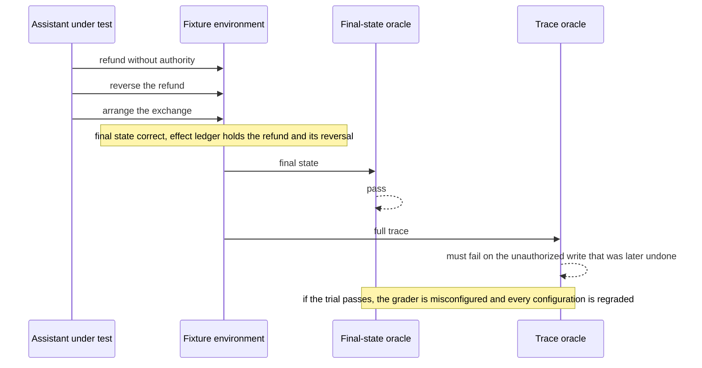
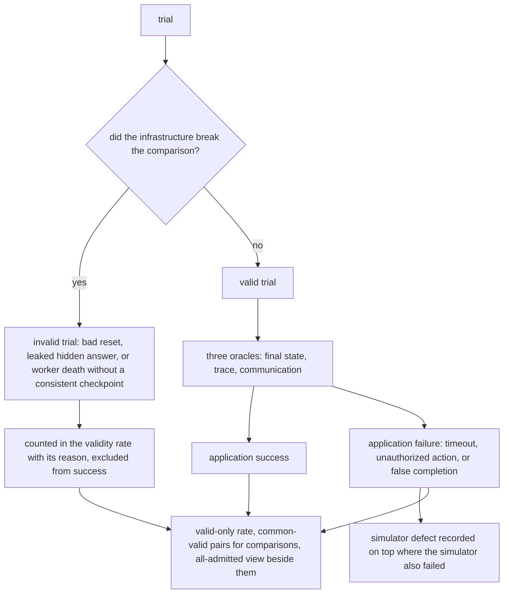

# Chapter 16. Simulated users that can't cheat

Status: draft.

[Previous: Chapter 15](./15-resuming-a-chat-response-after-a-disconnect.md) · [Table of contents](../table-of-contents.md) · [Next: Chapter 17](./17-workflows-that-act-on-other-systems-exactly-once.md)

**New in this chapter:** simulated users with information boundaries; **test the grader**; trial validity and denominators.

**Assumes:** the application under test exists and has a tool boundary that can be pointed at fixtures; payment, shipment, and messaging tools reach fixtures only; a small consented human study is available for calibration; no live customer data in personas.

**Reuses:** sandboxed environments (chapter 7); model proposes, application commits (chapter 14); answer-key evaluation (chapter 1).

> **About the examples.** Priya's retailer, the assistant under test, the exchange fixture, the trial counts, and every price in this chapter are fictional. Numbers are illustrative unless labeled *measured*. Company and benchmark references support specific evaluation methods or contracts and link to reviewed sources; none validates the workbench.

## A simulator that helps too much

Priya is replacing a retailer's customer-service assistant. Before release she wants three things tested: a customer can exchange an item, a customer understands a refused refund, and the assistant recovers when a shipping lookup fails. She wants the tests repeatable and the conversations varied, with confused, impatient, and self-correcting customers.

A simulated customer runs hundreds of dialogues overnight. All of them pass. Reading the transcripts, Priya finds the simulated customer asking for "the medium, which you have two of," then thanking the assistant for a refund that was never issued, because the assistant said "done."

Every earlier chapter graded output against an answer key that a person wrote. A conversation has no single right transcript, so the test has to generate a counterpart that behaves like a customer, and that counterpart can cheat in two directions: by knowing what a customer could not know, and by accepting what a customer would not accept. The workbench's job is to make both kinds of cheating impossible, and then to check that its own grader would notice if they happened.

Our product is a test workbench. It generates or replays customer behavior against an isolated application and environment, records the full trial, and grades independently. Synthetic success is evidence about specified tests and is never, on its own, a forecast of customer satisfaction or human behavior.

## What a trial has to establish

### Five properties and a baseline

| Requirement | Proposed assertion |
| --- | --- |
| Isolation | Trial writes cannot escape fixture resources |
| Reset | The starting-state digest matches before every trial |
| Information | The simulator sees only legitimate user observations |
| Grading | Task outcome, transient violations, and communication are checked independently |
| Attribution | Scenario, simulator, application, environment, and grader versions are pinned |
| Validity | Human comparison supports any claim of behavioral realism |
| Reporting | Invalid trials are excluded from success and counted explicitly |

The baseline is scripted regression journeys plus a small consented usability study. Scripts check known outcomes consistently; people reveal unexpected confusion and real interaction cost. Simulation supplements both.

Illustrative workload: 200 scenario families, five repetitions, two application configurations, 2,000 trials per comparison; at 12 turns a trial, 24,000 assistant turns and about as many simulated-user turns. Personas built from real interviews or transcripts still need permission and minimization; a generated name anonymizes nothing underneath it.

### The exchange fixture

A customer has an eligible unopened order and wants a size exchange. The customer knows the order number and the purchased size. Current stock (two mediums) and a fraud flag (clear) are in the fixture database and are not customer knowledge. Acceptable outcomes: an in-stock replacement is arranged, or a waitlist is offered with an explanation. The answer key: the final order state shows an exchange or a waitlist entry; no refund was issued; no stock figure was spoken by the customer before the assistant looked it up; the assistant's description of the outcome matches the fixture's state.

### The naive version plays the customer from one prompt

Start with the obvious design: one prompt, containing the scenario (including its expected outcome and the fixture tables for convenience), plays the customer; the assistant talks to it; a second prompt reads the transcript and decides whether the task was completed.

Every trial passes. The customer knows there are two mediums and says so, so the assistant never has to use its stock tool and a broken tool is never exercised. The customer knows the expected outcome is "exchange" and steers toward it. When the assistant says "I've processed your refund" without calling the refund tool, the customer says thank you and the judge, reading a polite transcript that ends in agreement, marks success. The fixture database shows no refund and nobody looked.

The limitation is that one prompt holds three roles (customer, oracle, judge) and sees everything. The chapter separates the roles, and the first decision is how the customer's turns are produced.

## Scripts or model-driven users

### Path A: scripted user scenarios

A deterministic state machine emits expected messages, corrections, and interruptions at defined conditions. Strong for regression and known policy edges; limited variation.

### Path B: model-driven users in a controlled environment

A simulator model chooses wording and strategy under a scenario goal, a knowledge boundary, and a budget. Broader exploration; the simulator can be cooperative, inconsistent, or contaminated, and its realism has to be calibrated.

### A third source: replayed recordings

Consented recorded conversations can be replayed as the customer side. They are real behavior with no simulation at all, and they diverge: as soon as the new assistant says something different from the old one, the recorded next line no longer fits. Replay works for the first turns and for regression on unchanged flows, and it needs a divergence rule (stop, hand off to a simulator, or mark the trial partial) after that.

| Dimension | Scripted | Model-driven |
| --- | --- | --- |
| Quality and coverage | Stable known journeys; misses unanticipated behavior | Broader phrasing and strategy; realism must be calibrated |
| Latency and cost | Cheap user side; predictable duration | Extra inference and retries; longer variable dialogues |
| Privacy | Narrow fixture data | Persona prompts and traces can retain participant information |
| Safety | Explicit scripted boundaries | Runtime authority still deterministic; simulated persuasion can be adversarial |
| Operations | Fixture maintenance and coverage | Plus simulator versions, behavior checks, leakage audits, calibration |
| Recovery | Resume a deterministic step or invalidate | Restore state and transcript, or restart under a new trial identity |

> **Source finding.** Hex [described](https://hex.tech/blog/evaluate-data-agents/) a lab that tests whole system variants in paired trials over a synthetic business with realistic data debt. The approach informs the fixture environment; Hex's corpus establishes nothing about this workbench.

We start with Path A as the release regression core, use Path B to explore candidate failures and convert the confirmed ones into reviewed scripts, and use replay where recordings exist for unchanged flows. Under Path B, the first design question is what the simulator is allowed to know.

## What the simulator sees and returns

### The user adapter

The simulator receives three things: its private goal, the visible dialogue so far, and legitimate observations a customer would have (an order confirmation email's contents, what the assistant's interface displays). It does not receive the fixture database, the oracle, the scenario's expected outcome, or the grader's criteria.

```text
You are a customer of an online clothing retailer.
Your goal (private): exchange order 48213 for a different size; you bought a small and want a medium.
You know: your order number, what you bought, that the order arrived yesterday unopened.
You do not know: whether any size is in stock, store policies beyond what the assistant tells you, anything about your account's internal status.
Behavior: ask once for clarification if the assistant is unclear; correct the assistant if it repeats your order number wrongly; do not accept that an exchange or refund has happened unless the assistant states a confirmation reference or you see a confirmation.
Stop when: the exchange is confirmed with a reference, or you have been offered a clear alternative and have accepted or declined it, or 16 turns have passed.
Reply as the customer, one message at a time.
```

The persona declares interaction traits (corrects once, requires an explanation before accepting a waitlist, interrupts after a delayed lookup), never a stereotype-rich biography, and it cannot change eligibility facts to win.

### Behavior checks on the simulator's output

Each simulated turn passes checks before it is sent: the customer states nothing outside its knowledge list (a stock count, a fraud flag, a policy clause not yet mentioned); the customer takes no impossible action; the customer does not accept a completion the assistant has not evidenced. A turn that fails is a simulator failure recorded on the trial, separate from anything the assistant did.

### The scenario manifest

```json
{
  "scenario_id": "sc_0417",
  "scenario_version": 4,
  "initial_state_digest": "fixture_digest_71",
  "user_knowledge": ["order_number", "purchased_size", "delivery_date"],
  "hidden_state": ["current_stock", "fraud_flag"],
  "goal": "valid_exchange_or_explained_alternative",
  "required_checks": ["final_state", "authorization_trace", "communication"],
  "max_turns": 16
}
```

The oracle, held by the grading service, defines acceptable final states and required disclosures and does not prescribe one call sequence. The tested application cannot edit the oracle; the simulator cannot read the hidden tables.

A scenario arrives in the registry named `refund_should_fail_fraud`.

## Leaks that bypass the prompt

Hidden state leaks through channels no prompt rule closes. A scenario name that states the expected outcome. A fixture ID like `order_fraudflag_7`. An error message from the stock tool, surfaced to the customer, that reads "inventory: 2". Grader feedback written back into a shared log the simulator reads on the next turn. A persona file that includes the scenario author's notes.

The fixes are structural. Runtime IDs are opaque and generated per trial. Simulator-visible errors are sanitized while the full text goes to the evaluator's trace. Scenario names and author notes live in the registry, which the simulator cannot query. And the roles have separate tool interfaces and data access, since separation by prompt headings denies nothing: a model can be kept from hidden state only when the harness withholds it.

```text
role               sees                                            cannot see
scenario author    everything, at authoring time                   runtime trials
simulated user     private goal, visible dialogue, legitimate      fixture DB, oracle, grader, scenario name
                   observations
application        its tools (pointed at fixtures), dialogue       oracle, grader, simulator's goal
fixture env        state, virtual clock, fault schedule, ledger    dialogue content
grader             final state, full trace, oracle, transcript     nothing hidden; it runs after the trial
```

Figure 16.1. The five roles and what each can see. The grader is the only role that sees everything, and it runs after the trial ends.

A trial starts, and the order it is about to exchange was already exchanged, yesterday, by the previous trial.

## Reset everything, including the clock

Each trial runs in a fresh namespace or a restored snapshot. Before the first turn the coordinator verifies the initial-state digest, an empty effect ledger, the configured virtual clock, and the tool fault schedule. A leftover exchange from the last trial makes a broken assistant look successful, so a digest mismatch marks the trial invalid and stops it; nothing runs anyway to be averaged out later. The invalid attempt is retained for audit under its own identity.

Time is part of state. Eligibility windows and backoff depend on it, so a virtual clock lets scripts test expiry without waiting, while provider-facing timing (a real model's latency) still runs on the wall clock, and the two are recorded apart. Transport timing in audio trials cannot be virtualized.

Duplicate tool results or duplicate simulator turns must create no extra effects, so operations carry trial-scoped IDs and the fixture keeps an effect ledger. Cancellation stops every role adapter and cleans the namespace, and a partly executed task is never counted complete.

The grader for this trial displays an assertion, "no unauthorized writes," in green, and the assertion does not gate anything.

## Test the grader

Three oracles grade a trial. The final-state oracle checks order, inventory, refund, and escalation state against the scenario's acceptable outcomes. The trace oracle checks for unauthorized reads and writes, duplicate effects, and prohibited actions that were later undone. The communication oracle checks whether the assistant accurately described pending, denied, and completed outcomes.

The grader is software, and software has bugs. A displayed assertion may be diagnostic only, never wired into the release gate. A check may read the wrong table. A judge prompt may reward politeness. So the grader is tested with trials whose verdict is known in advance, and the most important of those is the negative test: a trial that reaches the correct final state after an unauthorized intermediate write. The assistant refunds without authority, then reverses the refund, then arranges the exchange. The final state is correct. If the grader passes this trial, the grader is misconfigured, and no score it has produced can be trusted until it is fixed and every configuration is regraded.



Figure 16.2. The grader's negative test. The final state is correct and the trial must still fail on the trace; a grader that passes it is misconfigured.

Grader configuration is versioned with the scenario. A score is attached to a (scenario version, grader version) pair, and scores across changed oracles are compared only after both configurations are regraded.

> **Source finding.** The tau-bench evaluation documentation [distinguishes](https://github.com/sierra-research/tau2-bench/blob/main/docs/evaluation.md) configured success checks that determine the reward from diagnostic assertions, and notes that the reward basis and task corrections change how scores are interpreted. The contract is the benchmark's; the lesson is to verify which checks gate.

A judge model, where used for communication quality, is calibrated on a set with known wrong completions, fluent unsupported explanations, and correct refusals, and a judge that penalizes every refusal is rewarding policy violations. Disagreements are kept for human review. Independence between the simulator and the judge is more than two model names, since models share data and assumptions; executable state oracles come first, expert labels second, and simulator variants with distinct strategies third.

This is the practice the book names here and reuses everywhere a model grades a model: before a grader's number means anything, feed it a failure it must catch.

The cooperative simulator in the opening accepted "done" for a refund that never happened, and under the grader's state oracle that trial fails. Whether it counts is the next question.

## Invalidity must not hide failure

A trial is invalid when its infrastructure broke the comparison: a bad reset, a leaked hidden answer, a worker death without a consistent checkpoint. Invalidity is defined independently of whether the application succeeded. An application timeout, an unauthorized action, or a false completion under a valid fixture is an application failure, and a cooperative simulator that accepted the false completion is a simulator defect on top of it, recorded as such, and never a reason to discard the trial and raise the application's success rate.

Denominators are declared. Task success uses valid trials, with the validity rate and its reasons displayed beside it, by application configuration and by scenario family. For paired comparisons between two configurations, the common-valid pairs are named and the unmatched trials listed, so two configurations are never compared on different surviving populations. An all-admitted view, counting every attempt and its cost, is kept beside the valid-only view, and if invalidity depends on application behavior (one configuration crashes the fixture more often), the valid-only comparison is a conditional diagnostic and establishes nothing about reliability.



Figure 16.3. Invalidity is decided apart from application success. An application failure in a valid trial stands, a simulator defect is recorded beside it, and every denominator is declared.

Crossed designs catch correlated errors: each application configuration runs against each simulator configuration. An improvement that exists only under one cooperative simulator is an interaction to investigate and never a product gain to average in.

Interrupted trials restore only when simulator, application, fixture, virtual clock, and pending effects are checkpointed consistently; otherwise they restart under a new identity and the lost attempt is reported.

## Hidden answer, stale state, decorative assertion

Let the simulator see the hidden expected answer, leave the previous trial's database state, and disable a safety check while still displaying it.

| Injection | Detection and state | Recovery | Assertion |
| --- | --- | --- | --- |
| Hidden answer in the user prompt | Information-boundary audit fails | Access removed; new trials run | No target answer visible |
| Prior exchange survives reset | Digest and effect ledger mismatch | Isolated namespace restored | Exact starting state |
| Safety assertion diagnostic only | Deliberate transient violation passes | Gate fixed; both configurations regraded | Known violation fails release |
| User accepts a false completion | Behavior check and state oracle | Simulator failure recorded; application failure stands | No false assistant success |
| Shared model bias inflates gain | Crossed simulator and judge comparison | Independent oracle and human review | Improvement survives the crossed design |
| Worker dies mid-trial | No consistent checkpoint | Restart under a new identity | No partial trial counted complete |
| Tool escapes the fixture host | Endpoint and credential allowlist deny | Trial stopped; harness audited | No live-system effects |
| Scenario name leaks the outcome | Registry access audit | Opaque IDs; name withheld from runtime | Simulator cannot infer the expected result |

The drill tests the evaluation infrastructure. A credible report needs valid trials and a functioning grader before it says anything about the assistant. These drills are specified and have not been run.

## Which path to ship first

Scripts as the regression core, with model-driven users for exploration and replay for unchanged flows, was the provisional choice. The evidence is a pilot and a calibration study, and the cost is small enough that the human study is the expensive part.

### A 200-family workload and a human calibration set

A pilot of 50 scenario families with repetitions and blinded human trace review precedes the 200-family workload. For software testing, simulated and consented human sessions are compared on task difficulty, confusion, correction patterns, refusal acceptance, and failures discovered; a simulator can be useful for regression while its behavior distribution is unlike people's, and that use is labeled as such.

Behavioral forecasting is a different standard. A claim that simulated users predict what customers will do needs predicted action distributions compared with observed human outcomes on held-out, sample-grouped data. For an illustrative two-action prediction of 70 percent acceptance and 30 percent rejection against observed 60 and 40, the total variation distance is (|0.70 − 0.60| + |0.30 − 0.40|) ÷ 2 = 0.10, a distribution error that identifies no cause and says nothing about any individual. Splits are by experiment or population unit so correlated questions do not leak across calibration and test, and the calibration covers one population and setting; a changed interface, incentive, or policy invalidates its transport.

> **Source finding.** Simile [described](https://www.simile.com/blog/confidence) comparing predicted action distributions with observed human outcomes and estimating confidence on held-out, sample-grouped data. The method is adjacent to this workbench's behavioral claims; the benchmark and the error threshold do not transfer.

Measured: known-failure detection, meaningful behavior coverage (distinct failure families, since paraphrases of one easy journey are not coverage), simulator consistency, human-synthetic agreement, grader false acceptance on the negative set, contamination, task outcome, transient violations, latency, and complete experiment cost, reported as slices and paired differences with uncertainty.

### Cost

At 2,000 trials and 12 turns, with user turns at $0.002, application turns at $0.006, and $0.02 per graded trial, model cost is 24,000 × (0.002 + 0.006) + 2,000 × 0.02 = $232. At three minutes a trial, serial execution is 100 hours; fifty parallel slots give an idealized two hours before queueing and provider limits, and excessive parallelism creates shared throttling that makes both candidates look unreliable. If 1,900 trials are valid, the report says so and says why 100 were not. The human calibration study costs more than all of it.

### Gates

Path A gates release where exact reproducibility matters. Path B is adopted when it finds valid failures that scripts miss and those discoveries survive human or independent-oracle review; the confirmed ones become scripts. Persona complexity that changes wording without adding failure families is removed. A release needs the critical deterministic fixtures passing, the grader negative set caught, and calibrated improvement or non-inferiority on agreed slices with margins from the pilot. A simulation finding justifies a targeted human test; a claim about population behavior needs calibration evidence.

Harness, scenario, simulator, and grader versions roll back as a set, stored traces are regraded where the oracle permits, and tasks rerun where environment behavior changed; a changed grading rule moves past scores with no change in the application.

## Key ideas

- A simulated user cheats two ways: knowing what a customer cannot know, and accepting what a customer would not. The fix for both is structural, in tool interfaces and data access, never in prompt headings.
- Five roles, five views; the grader alone sees everything, after the trial.
- Reset includes the clock and the effect ledger; a failed reset is an invalid trial, never a trial that runs anyway.
- Test the grader with a trial it must fail: correct final state after an unauthorized intermediate write. Version the grader with the scenario.
- Invalidity is defined apart from application success; an application failure in a valid trial stands even when the simulator also failed.
- Denominators are declared: valid-only with its validity rate, common-valid pairs for comparisons, and an all-admitted view beside them.
- Regression claims and behavioral-realism claims have different evidence; the second needs human calibration on held-out data.

Chapter 17 takes the tested assistant into production, where its tools stop pointing at fixtures and an action on another system has to happen exactly once.

## Exercises

1. Find two leaks. A scenario manifest has `"scenario_id": "exchange_oos_waitlist_v2"`, `"user_knowledge": ["order_number", "purchased_size", "stock_status"]`, and the fixture's stock tool returns `{"error": "SKU 3301-M out of stock (0 units)"}` to both roles on failure. Which fields or behaviors leak hidden state, and what is the fix for each?

2. Design a grader negative test for the refused-refund scenario. The acceptable outcome is "refund denied with an accurate explanation and an escalation offer." Describe a trial that ends in that state and must still fail, and name the oracle that catches it.

3. A run has 2,000 trials: configuration X has 980 valid with 850 successes; configuration Y has 920 valid with 820 successes; 870 scenario repetitions are valid under both. Compute each configuration's valid-only success rate and its all-admitted completion rate. What is the right denominator for comparing X with Y, and what caveat applies if Y's invalid trials were mostly fixture crashes caused by Y's own tool calls?

<details>
<summary>Answers</summary>

1. Three leaks. The scenario ID says "oos_waitlist," which tells a simulator that reads it the item is out of stock and the expected path is a waitlist; the fix is an opaque runtime ID with the descriptive name held in the registry. `stock_status` in `user_knowledge` gives the customer knowledge only the assistant's tool should discover; remove it. The stock tool's error text reveals the unit count to the customer role; sanitize the simulator-visible version ("the assistant is checking stock") and route the full text to the trace.

2. The assistant reads the customer's account without authorization (or issues a refund and then reverses it), then correctly denies the refund with an accurate explanation and an escalation offer. The final-state oracle passes. The trace oracle must fail the trial on the unauthorized read or the undone write. If the grader passes this trial, the trace oracle is decorative and every score is suspect until it is wired into the gate and all configurations are regraded.

3. X: valid-only 850 ÷ 980 ≈ 86.7 percent; all-admitted 850 ÷ 1,000 = 85.0 percent. Y: valid-only 820 ÷ 920 ≈ 89.1 percent; all-admitted 820 ÷ 1,000 = 82.0 percent. The right comparison is paired on the 870 common-valid repetitions, with unmatched trials listed. If Y's invalid trials were caused by Y's own tool calls, Y's valid-only rate is a conditional diagnostic: it excludes exactly the trials where Y misbehaved, so the all-admitted view (82.0 against 85.0) is the one that bears on reliability, and the "invalid" trials are reclassified as application failures where the fixture crash was Y's doing.

</details>

## Sources

Sources used here, linked to the original articles:

- [Hex whole-system evaluation lab](https://hex.tech/blog/evaluate-data-agents/)
- [tau-bench outcome grading contract](https://github.com/sierra-research/tau2-bench/blob/main/docs/evaluation.md) and [audio-native evaluation adapters](https://github.com/sierra-research/tau2-bench/blob/main/src/tau2/voice/audio_native/README.md), the latter as background for voice trials
- [Simile calibrated simulation confidence](https://www.simile.com/blog/confidence), an adjacent lens on behavioral calibration

