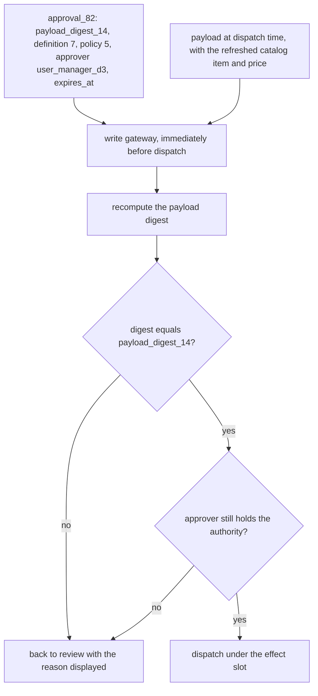
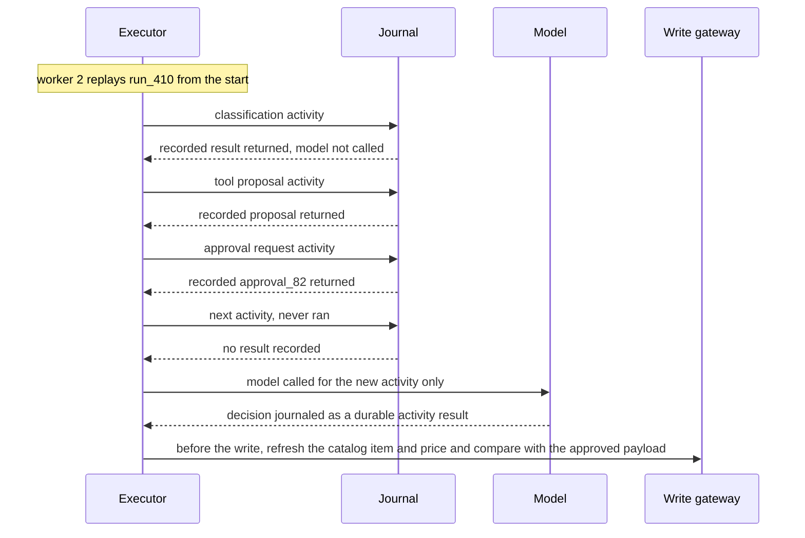
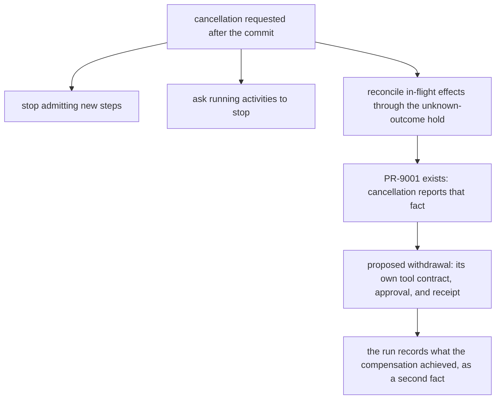

# Chapter 17. Workflows that act on other systems exactly once

Status: draft.

[Previous: Chapter 16](./16-simulated-users-that-cant-cheat.md) · [Table of contents](../table-of-contents.md) · [Next: Chapter 18](./18-balanced-invoices-posted-to-the-wrong-company.md)

**New in this chapter:** the **logical effect slot**; the **unknown-outcome hold**; **bound approval** to an exact payload; replaying recorded model decisions; compensation as a new action. This is the chapter later chapters reference whenever an application changes something outside itself.

**Assumes:** one external system per effect, reached through an API that returns a receipt; one approver; no money moves (chapter 25 adds payments); no browser automation (chapter 26). The workflow is authored once and runs many times.

**Reuses:** Workflow vs Agent (chapter 6); fenced publish (chapter 3); output schemas with a repair loop (chapter 1); response cancellation (chapter 15).

> **About the examples.** Owen's company, its procurement system, the workload, and every price in this chapter are fictional. Numbers are illustrative unless labeled *measured*. Company references support specific lessons and link to reviewed sources.

## The request exists and the receipt doesn't

Owen manages equipment requests. He wants a reusable workflow: read a request, classify its purpose, check the approved catalog, obtain the right budget approval, and create a purchase request in the procurement system. The purchase order itself stays outside this case.

Most requests follow a stable process. Some contain an ambiguous description or an item that is out of stock, and those need research and a proposed alternative. AI helps build the workflow and interpret the exceptions. It must never decide that a supplier's persuasive product page is an approval to spend.

The incident that organizes this chapter is ordinary distributed-systems behavior. The procurement system creates the request. The worker crashes before it records the receipt. On restart, the workflow sees a step that never finished and runs it again, and procurement now holds two purchase requests for one laptop.

Every chapter before this one assumed that nothing left the application. From here on, the application writes to systems it does not own, and those writes have three properties that reads never had: they cost something, they can be seen by other people, and they cannot be taken back by deleting a row. The rest of the chapter is about making such a write happen exactly once, even when the application cannot see whether it happened.

Building a workflow grants no authority to run it. Credentials, budgets, policy, approvals, and the set of allowed actions are checked separately from the definition. The system in this chapter creates approved purchase requests and nothing else.

## What a run has to record

### Outcomes, and a baseline that already works

The baseline is a web form, deterministic policy checks, a human approver, and a manually created procurement request. It is reliable, and it makes people copy fields between systems and handle every exception by hand. Both paths below must deliver the same approved request and the same receipt.

A completed run records the request identity, the policy and catalog versions it used, the extracted fields and their sources, the approved payload, the external receipt, and a disposition. Five dispositions are distinct and none may be inferred from another: denied, waiting, cancelled, uncertain, confirmed.

| Requirement | Illustrative first-release target |
| --- | --- |
| Volume | 1,000 runs per day, six ordinary steps each |
| Exceptions | 15% of runs need research and a proposed alternative |
| Approvals | Hours of waiting, during which no worker is occupied |
| Definition | Every run pins one tested, published workflow version |
| Judgment | Every AI classification is visible and checked against typed rules |
| Authority | An approval binds to an exact payload and current permission |
| Recovery | An unknown external write is reconciled before anything replaces it |

The fixture is one run: equipment request R-410 for a laptop, catalog item L-7, department D-3, an approval from Owen's manager, and one call to `create_purchase_request`. The procurement system's response to that call is the thing the chapter will lose, delay, and duplicate.

### The naive version creates the request twice

Start with the obvious design: a script. It calls the model to classify the request, calls the catalog, asks the approver, calls the procurement API, and retries any step that throws. Retrying is the standard advice for flaky networks, and it is the step that breaks this case.

Walk through the crash. The procurement API receives the call at t3 and commits a purchase request at t4. The response is in flight when the worker process dies at t5. The supervisor restarts the script at t6; it finds no receipt, treats the step as not done, and calls the API again at t7. Procurement commits a second request at t8. Both are real. Both will be fulfilled.

The script has no record that says "a request for R-410 may already exist," so it cannot tell a failed call from a lost response. The natural fix is to give the business action an identity that exists before the call and survives the crash. Before building that, the chapter has to settle who decides each step.

## A graph with AI nodes or a planner at the edges

This is Workflow vs Agent from chapter 6 with a difference that changes everything: the steps now have business effects. The comparison below assumes the same tool contracts, the same executor, and the same effect ledger for both paths, so that the only variable is who chooses the next step.

### Path A: an explicit graph with AI nodes

Application-owned control flow with typed nodes: read, transform, decide, approve, write. Models fill bounded fields and judgments inside nodes. The graph is compiled, tested against fixtures, and published as an immutable bundle (graph, code, prompts, model references, schemas, retry rules, policy bindings). A visual canvas shows the same node identities that execute.

This fits stable recurring work. Unexpected cases become an explicit graph revision or a human exception.

### Path B: a bounded planner inside a durable executor

At named exception points, a model proposes the next authorized step: search for an alternative item, draft a question to the requester, propose a substitute. The executor journals each decision, checks it against capabilities and budgets, and dispatches the activity. The planner returns to the graph's approval-and-write boundary; it cannot create a route around it.

This fits variation that would make a fixed graph unwieldy. It adds replanning cost, trajectory variance, and the question of whether a plan was sound.

### Authoring a workflow is also a model task

A workflow builder's first job is to turn "read the request, check the catalog, get approval, create the purchase request" into a graph. The authoring model proposes nodes and their implementations; the compiler checks node types, references, reachable terminal states, required approvals, and schema compatibility; a read node cannot hide a write behind a broad connector. The authoring model also proposes tests from recorded failures, and the release oracle stays outside its reach: a model cannot fix a workflow by weakening the tests that rejected it.

A non-technical reviewer approves the graph by reading it, so each node carries a plain-language description and the canvas shows exactly what will execute. Sandbox auto-approval is a test convenience and proves nothing about production approvals.

> **Source finding.** Decisional [described](https://www.decisional.com/blog/workflow-automation-should-be-code-managed-by-agents) typed workflow graphs with published versions, separating repeated execution from the agent that maintains the workflow. Auctor [described](https://www.getauctor.com/blog/the-agent-is-a-workflow-that-writes-itself) lowering individual calls into durable activities with interpreted control flow. Both are architectural accounts; neither reports the duplicate-write behavior of its own system under the crash in this chapter.

| Dimension | Path A: explicit graph | Path B: bounded planner |
| --- | --- | --- |
| Quality | Known branches are inspectable; unanticipated cases stall | Exceptions handled; wrong tool or argument possible |
| Latency and cost | Predictable calls per node | Replanning adds calls and variance |
| Privacy | Narrow node context | Planner may combine more sources; capability limits essential |
| Safety | Explicit gates, few write nodes | Same enforcement, plus step, tool, and budget limits |
| Operations | Definition testing and versioning | Plus planner traces, stop rules, plan validation |
| Recovery | Resume the journaled graph position | Resume journaled decisions; never replan committed work |

We start with Path A for Owen's process and attach Path B at the "item unavailable" exception. Switch more of the process to B when the exception rate and operator effort show that a fixed graph is losing cases the planner recovers.

Both paths call the same tool to create the request, and that tool's contract is where exactly-once begins.

## What the model sees and returns

### A tool with a task-level contract

The planner, in either path, never sees the procurement API. It sees `create_purchase_request`, a tool the application owns:

```text
tool: create_purchase_request
input:
  equipment_request_id   string   (resolved by the server to tenant and run)
  catalog_item_id        string   (must exist in the approved catalog)
  quantity               integer  (1–10)
  department_id          string
  justification_ref      string   (a stored document, never free text)
output, one of:
  confirmed  { receipt_id, external_request_id }
  rejected   { reason_code, retryable: false }
  pending    { operation_id, poll_after_seconds }
  unknown    { operation_id }
```

The server resolves the supplier, the account scope, and the current price. The model cannot pass a credential, a tenant, or a price. An HTTP 200 that means "accepted for processing" maps to `pending`, never to `confirmed`. Errors are sanitized so that a third-party error message cannot become an instruction.

The planner's proposal is the tool call plus a one-sentence rationale, validated against the schema with the repair loop from chapter 1. This is our proposed design.

### Tool descriptions are part of the design

A planner chooses tools by reading their descriptions, so a vague description is a planning bug. The description states what the tool changes in the world, what it requires, and what it returns; it names the business identity the call is keyed on; and it says when not to call it. If the application exposes tools through a shared protocol such as MCP, the same discipline applies to every server it connects, and the set of tools visible to the planner is scoped per run.

### Result states the planner must handle

`confirmed`, `rejected`, and `pending` are easy. `unknown` is the state the naive script never had. The planner may not resolve it by calling the tool again; the executor refuses, as the next sections show. What the planner may do with `unknown` is wait, or hand the run to a person.

Giving the tool an `unknown` state still does not stop a restarted worker from calling it again. That needs a record the call cannot run without.

## One logical effect, one slot

The crash at t5 duplicates the request because the second call carries no memory of the first. The fix is a record created before the first call and keyed by the business action, so a second attempt finds it.

The application keeps an **effect ledger**. Before any external write, one transaction does three things: it checks the run's lifecycle, the step's lease generation, the approval digest, and the current execution permission; it claims a unique **logical effect slot**; and it stores the immutable payload. The slot for the fixture is keyed `(tenant, R-410, create_purchase_request)`. It is unique across runs, retries, and workflow versions. Only the transaction that moved the slot from `ready` to `dispatching` may send the request.

```text
Figure 17.1. One slot, two attempts.

t0  run commits slot (tenant, R-410, create_purchase_request) = ready
t1  worker 1 claims slot → dispatching (lease generation 1), stores payload digest P
t3  worker 1 calls procurement
t4  procurement commits request PR-9001
t5  worker 1 dies; response lost
t6  worker 2 restarts the run
t7  worker 2 finds slot = dispatching, generation 1, no receipt
      → it does NOT call procurement; it enters reconciliation (next section)
```

The naive script's t7 was a second API call. The slot turns it into a lookup.

Two details keep the slot honest. The key is the business identity, never a random per-attempt token: a model asked to "try again" may generate a fresh idempotency key, and the executor must recognize that `(tenant, R-410, create_purchase_request)` is already occupied whatever key the model attached. And the claim is atomic with its checks. A read of the lease followed by an unconditional send leaves a window in which two workers both see `ready`, which is the fencing problem from chapter 3 applied to an external call.

The slot answers "has this action been attempted?" It does not answer "did the attempt take effect?"

## Hold the unknown

At t7, worker 2 holds a slot in `dispatching` with no receipt. Three things could be true: procurement never received the call, it received the call and rejected it, or it committed PR-9001 and the response was lost. The ledger's state for all three is the same: **unknown**.

The rule is that an unknown effect blocks every equivalent effect until it is resolved. Resolution comes from outside the application, in this order:

1. Lookup by the receipt or operation identity, if the provider returns one before committing.
2. Lookup by the business key, if the provider supports a query such as "requests for R-410."
3. A provider idempotency key, if the provider documents one, reused only with the identical payload and only within the provider's documented retention window.
4. A person, with the ledger entry and the payload in front of them.

Each resolution writes one of two outcomes. `confirmed` records PR-9001 and the run continues to its next step. `not executed`, proven by the provider, returns the slot to `ready` and permits one more attempt under the same slot. Nothing else clears an unknown. A search that returns nothing is not proof of nonexecution, because many systems' search is eventually consistent, and the ledger records that limitation for the provider in use.

```text
Figure 17.2. The effect state machine.

ready ──claim──► dispatching ──response──► confirmed
                     │                └──► rejected
                     └──timeout / crash──► unknown ──lookup──► confirmed
                                                   └──proven not executed──► ready
```

This machine is the **unknown-outcome hold**. Every later chapter that writes to another system (ledgers in 18, moderation actions in 20, refunds in 23, payments in 25, submissions in 26, deployments in 34) reuses it under that name.

Lease expiry does not resolve an unknown. If worker 1's lease lapses while its request is in flight, a replacement worker inherits a `dispatching` slot and enters reconciliation. It never inherits permission to send. A pinned workflow definition does not freeze authority either: a revocation or an emergency policy can block future dispatches without rewriting a run's history.

The purchase request is now created once. The payload it carried was approved hours earlier, and the catalog may have changed since.

## Approve the bytes

Owen's manager approved a laptop at a quoted price on Monday. On Tuesday the catalog price rises, and the planner, handling an "item unavailable" exception, proposes a substitute model with a different quantity. If approval attaches to "the purchase request for R-410," the substitute goes out under Monday's approval.

An approval is a record bound to an exact payload:

```json
{
  "approval_id": "approval_82",
  "run_id": "run_410",
  "operation_id": "purchase_request_410",
  "payload_digest": "payload_digest_14",
  "definition_version": 7,
  "policy_version": 5,
  "approver": "user_manager_d3",
  "expires_at": "2026-10-05T00:00:00Z"
}
```

Immediately before dispatch, the write gateway recomputes the payload digest and compares it to the approval, and checks that the approver still holds the authority. A changed item, quantity, or price yields a different digest, and the run returns to review with the reason displayed. "Looks good" attached to Monday's draft approves nothing on Tuesday. This is **bound approval**.



Figure 17.3. Bound approval at the gateway. A changed item, quantity, or price yields a different digest, and a revoked approver fails the authority check; either sends the run back to review.

Two authorities are kept apart. Editing or testing a workflow is one right; approving a spend is another; executing an approved write is a third. A workflow author cannot approve a request by editing the graph, and an approver cannot execute one by approving it.

Human waits persist without a worker. Three hundred runs waiting four hours for approval are 1,200 waiting run-hours and zero compute hours: the run is a row with a timer, and a worker picks it up when the approval event arrives. A changed payload, a revoked approver, or an expired approval moves the row back to review instead of forward to dispatch.

The run now creates the approved bytes once. What happens to the model's own decisions when the run is replayed after a crash is the next limitation.

## Replay reuses decisions

Durable executors recover by replaying a run's journal from the start and skipping activities whose results are recorded. A model call inside that replay is a trap: calling the classifier again during recovery can return a different answer, and the run would then diverge from its own history, possibly past an approval that referred to the earlier answer.

Model decisions are durable activity results. During replay, the executor returns the recorded classification, the recorded tool proposal, and the recorded approval request. It calls the model only for a new activity: a step that never ran, or a permitted repair after new information. The same rule covers the planner in Path B, whose journaled decisions are facts about the run, whatever the model would say today.

A database snapshot of the run does not freeze the outside world. Before a write, the gateway refreshes the fields the approval depends on (the catalog item and its price) and compares them with the approved payload. A changed item needs a new approval, which the previous section already requires.



Figure 17.4. Replay returns recorded model decisions and calls the model only for an activity that never ran. The outside world is refreshed at the gateway, because a snapshot of the run freezes nothing outside it.

What replay cannot do is make an effect disappear. A run cancelled after PR-9001 exists still has a purchase request.

## Compensation is another action

Cancellation stops the admission of new steps, asks running activities to stop, and reconciles in-flight effects through the unknown-outcome hold. If PR-9001 exists, cancellation reports that fact. It may propose a separate, authorized withdrawal. It cannot erase the request.

A compensating action has its own tool contract, its own approval, and its own receipt. Withdrawing a purchase request after a supplier has been notified may be impossible or may leave an email that was already read. The run records what happened and what the compensation achieved, as two facts.



Figure 17.5. Cancellation after the commit. The request that exists is reported as created, and a withdrawal is a separate authorized action with its own receipt.

Chapter 15's response cancellation stays independent. Closing a chat socket cancels nothing in this run, and stopping the run cannot unsend progress text the user already received.

With the five mechanisms in place, the drill replays every failure in this chapter against the complete design.

## A crash after the write, a published change, a disconnected client

Crash after the procurement system creates the request, then publish a changed workflow and disconnect the client. The oracle is the procurement fixture's own ledger plus the application's effect trace, never the run's terminal label.

| Injected condition | How it is detected | Required outcome |
| --- | --- | --- |
| External commit before local receipt | Slot in `dispatching` with no receipt | Lookup resolves PR-9001; one request, one stored receipt |
| Two workers claim creation together | Unique slot and conditional claim | One dispatch; the loser reads the existing slot |
| Model proposes a new idempotency key | Occupied business-keyed slot | No second request |
| Payload changes after approval | Digest mismatch at the gateway | Back to review; nothing dispatched |
| Approver loses authority while waiting | Current-permission check | Reassigned under policy; no stale-authority write |
| New workflow version published mid-run | Pinned definition differs from latest | Run continues on its version; migration is explicit |
| Trigger delivered twice | Trigger identity deduplicated | One logical run |
| Cancellation after commit | Receipt confirms the effect | Reported as created; withdrawal is a separate authorized action |
| Replay re-invokes the classifier | Recorded activity result returned | Same decision as the first run |
| Test-mode auto-approval reaches live | Environment gate | Deployment or run blocked |

The fixture connector injects faults before, during, and after the commit. These drills specify intended behavior. They have not yet been run against an implementation.

## Which path to ship first

Path A with Path B at one named exception was the provisional choice above. This section describes the evidence that would confirm it or overturn it, and the gates a release has to pass.

### A lab with a lying connector

Build 100 procurement scenarios: ordinary requests, ambiguous descriptions, unavailable items, denied approvals, stale catalog data, duplicate triggers, lost responses, cancellation after commit, and version changes mid-run. The connectors are fakes with deterministic fault schedules and their own hidden ledgers. The trials remain to be run.

Compare the explicit graph and the bounded planner under identical authority and the same outcome oracle. Grade request correctness, effect count, transient violations (a second request later withdrawn still fails), operator effort, recovery, latency excluding and including human waits, and cost. Report unsupported cases and repeated-run variance; a planner's flexibility counts only when verified outcomes improve.

### Where the cost is

At 1,000 runs and six steps, 6,000 ordinary executions a day; the 15% exception runs add four planner steps each, so 6,600; an assumed 10% extra attempts brings it to 7,260. If baseline inference is $0.03 per run and exceptions add $0.10 for 150 runs, the model bill is $45 a day. If operators spend five minutes on each of 100 problematic runs, that is 8.33 hours a day. The operator line dominates the model line by a wide margin, so the metrics that matter are retry amplification, unresolved-effect age, approval wait, and manual reconciliations per day.

> **Source finding.** Sierra [described](https://sierra.ai/blog/building-sierras-mcp-gateway-an-engineering-iceberg) a gateway that centralizes tool authority, scoped identities, and approvals away from the model's prompt. Decagon [described](https://decagon.ai/blog/why-we-built-decagon-duet-on-agent-operating-procedures) an improvement loop that proposes procedure changes from analyzed failures and tests them before release. Our payload-bound approval and effect ledger are our own design, built behind that kind of gateway.

### Release gates, and when to extend the planner

Before release:

- every commit, approval, version, and cancellation fixture passes;
- the effect fixture shows exactly one external request per logical slot across all fault schedules;
- accepted outcomes meet a pilot-derived quality margin on the exception slice;
- published definitions are canaried on low-risk requests first.

Roll back new runs to the prior bundle; finish, migrate, or stop existing runs explicitly. External requests already created are reconciled or compensated, never forgotten.

Extend the planner to more exception types when its verified outcomes and operator effort beat the graph's on the same gate. Convert exception sequences that succeed repeatedly into reviewed graph nodes. Remove dynamic branches that add cost without useful coverage.

## Key ideas

- An external write costs something, is visible to others, and cannot be undone by deleting a row.
- Give every business action a logical effect slot, keyed by business identity, claimed atomically before the call.
- An unknown outcome blocks every equivalent effect until the provider, or a person, resolves it; lease expiry resolves nothing.
- Approval binds to a payload digest and the approver's current authority, checked at the gateway immediately before dispatch.
- Replay returns recorded model decisions; the model is called only for new activities.
- Compensation is a new action with its own contract and receipt.
- Tool contracts and descriptions are design artifacts: resolved identifiers, typed result states including unknown, and a scoped tool set per run.
- Workflow vs Agent, with effects: a graph with AI nodes by default, a bounded planner at named exceptions, and promotion of proven exception paths into the graph.

Chapter 18 keeps these mechanisms and adds a resource that can run out: a payment that two invoices both want to consume.

## Exercises

1. Classify the responses. The procurement fake returns, in six runs: (a) HTTP 200 with a receipt; (b) HTTP 200 with "accepted for processing" and an operation ID; (c) HTTP 409 "duplicate"; (d) a TCP timeout after the request was sent; (e) HTTP 403; (f) a process crash before the request was sent. Give each its effect state and say what the executor may do next.

2. Resolve an unknown. Worker 2 finds the slot for R-410 in `dispatching` with no receipt. The provider offers a query "requests by equipment_request_id" that is documented as eventually consistent within 30 seconds. Write the resolution steps and say what each possible result allows.

3. Bind the approval. Owen's manager approved payload digest P14 on Monday. On Tuesday the catalog price of item L-7 changes and the planner proposes quantity 2. List which of these can proceed under approval_82 without review: (a) the original payload; (b) the original payload after the price change; (c) the planner's new quantity; (d) the original payload sent by a different approver's run.

<details>
<summary>Answers</summary>

1. (a) `confirmed`; continue. (b) `pending`; poll by operation ID, never resend. (c) `rejected` with a duplicate reason; treat as a signal that a request may already exist and enter reconciliation by business key. (d) `unknown`; hold the slot and reconcile. (e) `rejected` and final under these credentials; route to review. (f) `ready`; the slot was claimed and nothing was sent, so one attempt may proceed under the same slot.

2. Query by R-410. If a request is returned, record its external ID as the receipt and mark `confirmed`. If none is returned, wait past the 30-second consistency window and query again; a second empty result, plus the provider's documented consistency bound, counts as proven nonexecution, which returns the slot to `ready` for one attempt. If the provider cannot bound its consistency, the slot stays `unknown` and a person resolves it.

3. (a) Proceeds: digest matches and the approver's authority is rechecked. (b) Does not proceed: the gateway refreshes the price into the payload, the digest changes, and the run returns to review. (c) Does not proceed: new quantity, new digest. (d) Does not proceed: the approval binds to run_410's operation, and another run has its own slot and needs its own approval.

</details>

## Sources

Sources used here, linked to the original articles:

- [Decisional code-owned workflows](https://www.decisional.com/blog/workflow-automation-should-be-code-managed-by-agents)
- [Auctor durable execution](https://www.getauctor.com/blog/the-agent-is-a-workflow-that-writes-itself)
- [Sierra tool-gateway authority](https://sierra.ai/blog/building-sierras-mcp-gateway-an-engineering-iceberg)
- [Decagon procedure-improvement loop](https://decagon.ai/blog/why-we-built-decagon-duet-on-agent-operating-procedures)

