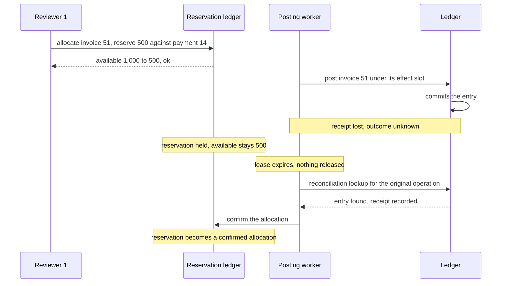
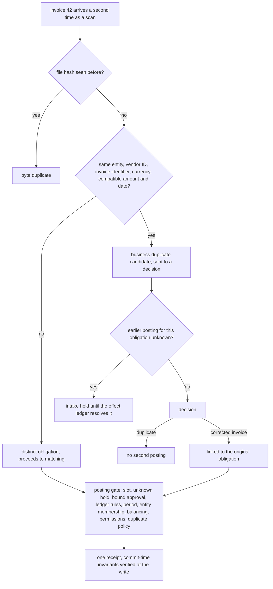

# Chapter 18. Balanced invoices posted to the wrong company

Status: draft.

[Previous: Chapter 17](./17-workflows-that-act-on-other-systems-exactly-once.md) · [Table of contents](../table-of-contents.md) · [Next: Chapter 19](./19-underwriting-when-evidence-is-missing-or-contradictory.md)

**New in this chapter:** entity-scoped identity; **bounded reservation** (atomic allocation held while an outcome is unknown); business duplicates; reconciliation residuals.

**Assumes:** the ledger is authoritative for posted balances; posting goes through chapter 17's effect slot with its unknown hold and bound approval; configured authorization and domain-reviewed rules exist; the workspace pays nothing and infers no tax treatment.

**Reuses:** the logical effect slot, the unknown-outcome hold, and bound approval (chapter 17); the four checks on a citation (chapter 2); Workflow vs Agent (chapter 6).

> **About the examples.** Dana's accounting team, the suppliers, the fixture amounts, the workload, and the review-time estimates in this chapter are fictional engineering fixtures and not accounting advice. Numbers are illustrative unless labeled *measured*. Company references support specific mechanisms or review methods and link to reviewed sources; none validates the design.

## An entry that balances and is wrong

Dana's team receives a supplier invoice, a purchase record, and a bank transaction. The workspace extracts the invoice, matches the records, explains any difference, and prepares an entry for approval.

The packet has four traps. Two suppliers have similar names. Two invoices carry the same amount. The bank payment includes a fee the invoice does not show. One invoice arrived twice, by email and by scan. The first draft entry balances to the cent, posts the full bank amount to the wrong supplier's account, and the matcher has already consumed the same bank payment for a second invoice.

Chapter 17 made an action on another system happen exactly once. The ledger here is such a system, and the chapter adds what happens before the action: a payment is a finite resource that several candidate matches compete for, an identity is only meaningful inside one company's books, and a difference between two numbers is a question with an evidence trail. A balanced entry proves that debits equal credits and nothing else.

Our application interprets documents and investigates exceptions. The ledger stays authoritative for posted balances. The result is an approved, reconciled posting with evidence and a receipt, or a precise exception for review.

## What a posting has to prove

### Three correctnesses and a baseline

Extraction correctness, reconciliation correctness, and posting correctness are separate. A total extracted correctly from an invoice does not place it in the right company. A correct match grants no authority to post. A posting that succeeded can still have been the wrong entry.

| Requirement | Proposed assertion |
| --- | --- |
| Evidence | Fields resolve to a source document, version, and region |
| Identity | Entity, vendor, account, period, and currency resolved explicitly |
| Reconciliation | Amount differences explained under reviewed rules |
| Approval | The exact entry and source versions bound to the authorization |
| Posting | Balancing, open-period, duplicate, and permission checks outside the model |
| Recovery | An unknown posting blocks another logical posting |
| Correction | Traceable adjustment or reversal under the ledger's own rules |

The baseline is manual invoice entry and bank matching with a reviewed workpaper: evidence and judgment preserved, repetitive work expensive. Illustrative workload: 2,000 documents a day, 15 percent ambiguous, 500 intended postings. The measures are time to a reconciled transaction and reviewer minutes, and an exception that correctly defers beats a fast wrong match. A model's "95 percent confidence" is text, and it is never a posting probability.

### The fixture

Invoice 42 from Supplier A: subtotal $1,000, a separately itemized $80 charge, total $1,080. Bank outflow 9: $1,085. Supplier A' has a similar name and operates in another entity's books. Invoices 51 and 52, from Supplier B, are $500 each; bank payment 14 of $1,000 covers both. Invoice 42 arrives a second time as a scan with a different file hash.

The answer key: invoice 42 belongs to Supplier A in entity A; the $5 residual is recorded and classified with evidence (a bank fee if the statement shows one, otherwise unresolved), and the invoice total is untouched; payment 14 is allocated $500 to each of invoices 51 and 52 and never $1,000 to either; the scanned copy of invoice 42 is a business duplicate and produces no second posting; every posting has one receipt.

### The naive version matches by amount and posts

Start with the obvious design: extract fields with a document model, find the bank transaction whose amount is closest, pick the vendor whose name is most similar, post the entry.

Supplier A' has the closer string distance and gets the invoice. The $5 difference is absorbed into the supplier's account because the entry has to balance and the bank amount is what cleared. Invoice 51 matches payment 14 for the full $1,000, and so does invoice 52, because each match was computed against the payment's original amount. The scanned copy has a new hash and is a new invoice. Every entry balances.

The limitation is that the matcher has no notion of entity, no record of a residual, no reservation of the payment, and no business identity for a document. The first decision is how much of the matching should be rules and how much should be an investigator.

## Deterministic matching or a bounded investigator

Both paths sit behind the same posting gate: balancing, period, duplicate, permission, and authority checks that no model output can weaken.

### Path A: extraction, deterministic matching, review

Parse candidate fields, apply reviewed identifiers and tolerances, reconcile, and queue ambiguity for a reviewer. Fits stable documents and matching rules.

### Path B: a bounded discrepancy investigator

An agent with read-only tools (source search, master data, payment references, related documents) proposes a better-supported match or explanation for an exception, under a query, token, time, and evidence budget. It fits exceptions where more evidence could resolve the question, and it cannot touch the gate.

| Dimension | Deterministic matching | Bounded investigator |
| --- | --- | --- |
| Quality | Predictable matches; unusual documents go to reviewers | Better exception coverage; wrong-record and unsupported-rationale risk |
| Latency and cost | Bounded extraction and matching | More reads, inference, evidence review |
| Privacy | Narrow document and record scope | Broader reads across sensitive books |
| Safety | Deterministic posting gate | The identical gate plus bounded read tools |
| Operations | Parsers, rules, queues | Plus evidence plans, budgets, investigation traces |
| Recovery | Correct the candidate; reapprove | Preserve attempts; reconcile posting separately |

This is chapter 6's Workflow vs Agent on a reconciliation queue: the matcher is the workflow and the investigator is the agent, compared on the same exceptions with the same gate.

> **Source finding.** Rillet [described](https://www.rillet.com/blog/inside-the-raab-methodology-the-rubric-we-use-to-grade-ai-on-accounting) a rubric in which accountants grade an AI's reconciliation work on correctness, use of context, proposed next steps, and the judgment to act or pause. The study graded single responses; it validates no autonomous ledger write.

We start with Path A for unambiguous matching and admit Path B where additional evidence is likely to resolve an exception; when evidence cannot distinguish two bills, both paths defer. Both depend on the extraction that comes first.

## What the model sees and returns

### Two ways to read an invoice

OCR followed by a language model structures text that was already recognized: cheap, inspectable at the text layer, and blind to layout cues the OCR flattened. A vision-language model reads the page image directly: better on tables and stamps, and its output has no intermediate text to audit. Either way the result is a candidate field, never a fact.

```json
{
  "document": "invoice_42_v2",
  "fields": [
    {"name": "vendor_name", "value": "Northwind Supply Co.", "region": {"page": 1, "bbox": [72, 88, 310, 112]},
     "confidence": 0.93, "status": "candidate"},
    {"name": "invoice_total", "value": "1080.00", "currency": "USD", "region": {"page": 1, "bbox": [412, 690, 520, 712]},
     "confidence": 0.88, "status": "candidate"},
    {"name": "line_fee", "value": "80.00", "currency": "USD", "region": {"page": 1, "bbox": [412, 640, 520, 662]},
     "confidence": 0.71, "status": "needs_review"},
    {"name": "due_date", "value": null, "confidence": 0.0, "status": "unknown"}
  ],
  "extractor_version": "vlm-inv-3"
}
```

A field's confidence is the extractor's own number until it is calibrated against the labeled packet set: on 1,000 labeled fields, the fields the extractor scored at 0.7 should be right about 70 percent of the time, and where they are not, the threshold for `needs_review` moves. Missing fields stay `null` and `unknown`; zero is a value. Human corrections supersede candidates and never rewrite the original bytes, which are stored with their ingestion provenance before any interpretation.

### What the investigator may read

Path B's tools return source documents in the current entity's scope, master data, payment references, and related documents, read-only. Its plan states which ambiguity each read might resolve, and a document that repeats the same amount adds no identity evidence. Third-party invoice text is data: an instruction inside a PDF to forward records anywhere is text about a PDF.

The extractor returns "Northwind Supply Co." and master data has two vendors whose normalized names collide.

## Identity is scoped to the company

A normalized vendor name is a candidate key. Identity comes from approved master data (vendor IDs, tax identifiers, bank details on file) with explicit aliases, and every lookup is scoped to the authorized entity. Supplier A and Supplier A' are different vendor IDs in different books, and a match across books is a wrong match however close the strings. Identical invoice numbers across subsidiaries or suppliers are legitimate; a global uniqueness rule would reject valid documents or join different companies' books.

Currency is part of the amount type. USD 1,000 and EUR 1,000 are different amounts, and a conversion needs an approved rate, date, and accounting convention; no agent picks a convenient rate to close a gap.

With identity resolved, invoice 42's total is $1,080 and the bank shows $1,085.

## A residual is a question

The reconciliation records `bank − invoice = $5` as its own object, with the two amounts, their sources, and a classification that starts as `unresolved`. The system then looks for evidence: a fee line on the bank statement, a fee schedule on file, a second small charge. A classification is proposed with its evidence and goes to review. The invoice total is never edited to make the numbers equal, and "rounding" is a classification that needs evidence like any other.

A balanced entry can still be wrong. Posting $1,085 to the supplier's account balances the bank; the $5 belongs in a fee account under the fixture's rules, and whether it does in a real book is an expert's call that this chapter does not make. Balancing is necessary and establishes nothing about category.

Split and combined payments need a relationship model, which brings the fixture's second trap: two reviewers are about to allocate payment 14.

## Reserve the payment atomically

A payment has an available amount: its original amount minus confirmed allocations minus active reservations. Allocating an invoice against it reserves the amount in one atomic transaction that checks the available figure at that moment, so two proposals cannot each reserve $1,000 of a $1,000 payment after both read an unallocated balance.

```text
payment 14: $1,000 available

t1  reviewer 1 opens invoice 51 ($500)      reads available $1,000
t2  reviewer 2 opens invoice 52 ($500)      reads available $1,000
t3  reviewer 1 proposes allocate $500       reserve($500): available 1,000 → 500   ok
t4  reviewer 2 proposes allocate $500       reserve($500): available 500 → 0       ok
t5  reviewer 2 edits to $1,000 (mistake)    reserve(+$500): available 0            rejected
t6  invoice 51 posting dispatched           reservation held; outcome unknown for 40 s
t7  posting receipt arrives                 reservation → confirmed allocation
```

Figure 18.1. Two allocations against one payment. The second proposal's edit to the full amount is rejected because the reservation check runs against confirmed plus reserved, and the first reservation is held through the unknown interval.

Approval binds the allocation version: a changed reservation is a new proposal. An unknown posting keeps its reservation until chapter 17's reconciliation establishes whether the allocation was consumed, and a lease expiring does not return the amount to the pool, because the ledger may have taken it. This is the pattern the book names bounded reservation: a finite resource is allocated atomically against its available amount and the allocation is held, never released by timeout, while the effect that depends on it is unknown. Chapter 25 reuses it for a spending limit.



Figure 18.2. A reservation held through an unknown posting. The lease expiring releases nothing, because the ledger may already have consumed the $500; reconciliation turns the reservation into a confirmed allocation.

Invoice 42 arrives a second time.

## Duplicates at two levels

A file hash catches repeated bytes. The scan of invoice 42 has a different hash from the emailed PDF, so the second level is a business duplicate candidate: same entity, same vendor ID, same invoice identifier, same currency, and compatible amount and date. The candidate goes to a decision because it can be wrong in both directions: a legitimate recurring invoice repeats amounts, and a corrected invoice links to the original obligation instead of becoming an unrelated posting.

While an earlier posting for the same obligation is unknown, related intakes are held. The effect ledger's unresolved operation outranks a fresh extraction and outranks any model suggestion to create another transaction. Posting itself, with its logical slot, unknown hold, bound approval, and receipt verification, is chapter 17's mechanism, applied here with the gateway validating current ledger rules, period status, account and entity membership, balancing, permissions, and duplicate policy immediately before the write, and with the ledger's own commit-time invariants verified at the write, since a successful preflight guarantees nothing about the commit.



Figure 18.3. Duplicates at two levels and the hold. A new hash is not a new invoice; the business-duplicate candidate goes to a decision, and intake waits while an earlier posting for the same obligation is unknown.

Corrections after a confirmed posting follow the ledger's adjustment and reversal rules as a new proposal linked to the original, with its own authority, period checks, slot, and receipt. An uncertain original is reconciled before any correction, since reversing an entry that never existed creates the error it was meant to fix.

## A lost receipt, a rescanned duplicate, a corrected source

Lose a posting receipt, ingest a differently scanned duplicate, and correct the source invoice while the first outcome is unknown.

| Injection | Detection and state | Recovery | Assertion |
| --- | --- | --- | --- |
| Ledger commits, local receipt lost | Effect unknown (chapter 17) | Original operation queried and reconciled | One posted entry, linked receipt |
| Duplicate arrives under a new hash | Business duplicate candidate; identity unresolved | Intake held | No second logical posting |
| Source corrected after approval | Source and entry digest mismatch | New correction proposal after reconciliation | Original approval preserved |
| Similar vendor in another entity | Scope and identity check fails | Resolved with permitted evidence | Correct books only |
| Bank fee hidden in the amount | Residual check | Investigate or defer | No forced equality |
| Two proposals allocate the same remainder | Atomic reservation rejects the excess | Alternatives reviewed against current availability | Confirmed plus reserved never exceeds the payment |
| Closed period after approval | Current ledger validation rejects | Domain-reviewed disposition | No silent date shift |
| New retry key after provider expiry | Business-operation guard rejects | Manual or provider reconciliation | No duplicate |
| Balanced wrong-category entry | Expert semantic oracle fails | Proposal corrected | Balance alone cannot pass |

The drill grades extraction, reconciliation, and effect state separately. Recovery requires the ledger receipt and the correct domain outcome, and a locally marked "posted" is neither. These drills are specified and have not been run.

## Which path to ship first

Path A with Path B on evidence-resolvable exceptions was the provisional choice. The lab keeps three metrics apart and does the queue arithmetic before promising savings.

### A 120-case suite with three oracles

Synthetic, expert-reviewed books with known matches, legitimate duplicate invoice numbers, split and combined payments, mixed currencies, wrong entities, closed periods, corrections, and unknown commits: 120 cases with independent workpaper and ledger oracles. Both paths run on the same exceptions with identical posting controls. Field correctness, match and allocation correctness, and effect correctness (one receipt per logical posting, no duplicate effects, correct unknown handling) are graded apart, with appropriate deferral, reviewer effort, unauthorized or unbalanced entries, and transient violations counted even when final balances were repaired. Reviewers and explanation judges are calibrated on plausible wrong matches and balanced wrong-category entries, under chapter 16's rule. Destructive tests run against fault connectors, never live books.

### Exception-queue arithmetic

At 2,000 documents and 15 percent ambiguity, 300 exceptions a day at six reviewer minutes are 1,800 minutes, 30 hours. If Path B resolves 100 of them and each resolution takes two minutes to review while the other 200 still take six, review is 1,400 minutes, a saving of 400 minutes, about 6.7 hours, and only if the investigator's resolutions are right; a wrong resolution that a reviewer accepts costs a correction later. Tracked: unresolved age, operator workload, extraction and match errors, duplicate-effect rate, posting latency, cost per reconciled transaction. Books are isolated in storage, retrieval, logs, and caches, and a shared model gateway justifies no cross-company context.

### Gates

Release when the entity, duplicate, period, approval, and uncertain-posting cases pass and a pilot shows non-inferior reconciliation. Keep Path A for unambiguous matching; add Path B where measured exception burden falls without more false matches; promote recurring evidence rules into deterministic logic; keep unresolved cases visible instead of optimizing queue closure. Rollback stops new candidate versions and locates affected proposals and entries; posted corrections follow ledger rules, since software rollback rewrites no financial history.

## Key ideas

- Extraction, reconciliation, and posting are three correctnesses; a balanced entry proves only that debits equal credits.
- Identity is scoped to the entity and comes from master data with explicit aliases; a normalized name is a candidate key, and currency is part of the amount.
- A residual is its own object with a classification that needs evidence; the invoice total is never edited to close it.
- Bounded reservation: allocate a finite resource atomically against confirmed plus reserved, and hold the reservation while the dependent effect is unknown; timeouts release nothing.
- Duplicates exist at two levels, bytes and business identity; the second goes to a decision, and intake is held while an earlier posting is unknown.
- A field confidence is calibrated against labels before it routes anything; unknown is a state, and zero is a value.

Chapter 19 keeps the unknown state and the scoped identity and moves from numbers that must balance to criteria whose state may be `met`, `not_met`, `unknown`, or `contradictory`.

## Exercises

1. Invoice total $2,340; bank outflow $2,352.50; the bank statement shows a $12.50 "wire fee" line on the same day. Compute the residual, propose its classification, name the evidence, and say what would change if the statement showed no fee line.

2. Payment 21 is $750. Invoice 61 ($400) is proposed and dispatched; its posting outcome is unknown for 90 seconds. During that interval, invoice 62 ($400) is proposed against the same payment. What does the reservation check return, and why does the answer not change when the posting worker's lease expires at 60 seconds?

3. Three invoices from one vendor in one entity: (a) invoice 77, $300, dated March 3, received by email; (b) a scan of invoice 77, $300, dated March 3, different hash; (c) invoice 78, $300, dated April 3. Classify each as a byte duplicate, a business duplicate, or a distinct obligation, and say what the system does with each.

<details>
<summary>Answers</summary>

1. Residual = 2,352.50 − 2,340 = $12.50, recorded as its own object. Proposed classification: bank fee, evidence the statement's $12.50 fee line on the same day; the proposal goes to review and, under the fixture's rules, posts to a fee account. With no fee line, the classification stays `unresolved`, the investigator may look for a fee schedule or a second small charge, and the entry waits; the invoice total is never adjusted to $2,352.50.

2. Available = 750 − 0 confirmed − 400 reserved = $350, so `reserve($400)` for invoice 62 is rejected and the proposal is queued or revised. The lease expiring changes nothing because the reservation is tied to the unknown posting and never to the worker; until reconciliation establishes whether the ledger consumed the $400, releasing it would risk allocating $800 of a $750 payment.

3. (a) and (b): (b) is a business duplicate of (a), same entity, vendor, invoice number, amount, and date with a different hash; the system raises a duplicate candidate for a decision and creates no second posting, and if (a)'s posting is unknown, (b) is held. (c) is a distinct obligation: a different invoice number and date with a repeated amount, which is a legitimate recurring invoice; it proceeds to matching on its own.

</details>

## Sources

Sources used here, linked to the original articles:

- [Rillet reconciliation review rubric](https://www.rillet.com/blog/inside-the-raab-methodology-the-rubric-we-use-to-grade-ai-on-accounting)
- [EvenUp durable document record](https://www.evenuplaw.com/blog/document-ai/), carried from chapter 2 as the source-linked record method
- [Stripe idempotency retention boundary](https://docs.stripe.com/api/idempotent_requests), carried from chapter 17 for the posting slot

