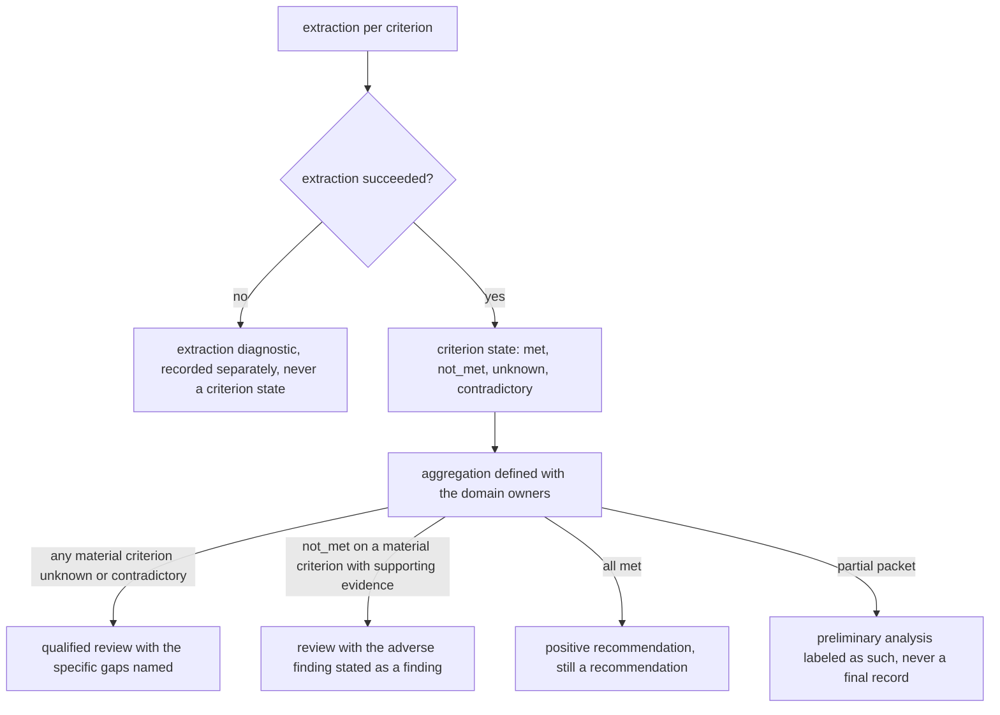
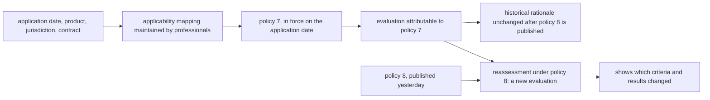
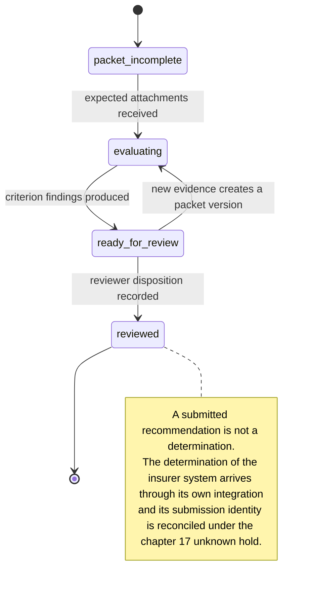

# Chapter 19. Underwriting when evidence is missing or contradictory

Status: draft.

[Previous: Chapter 18](./18-balanced-invoices-posted-to-the-wrong-company.md) · [Table of contents](../table-of-contents.md) · [Next: Chapter 20](./20-marketplace-moderation-when-most-flags-are-wrong.md)

**New in this chapter:** **four-state criteria**; policy pinned by applicability; subgroup uncertainty; automation bias measured in production.

**Assumes:** a commercial equipment-coverage policy whose criteria domain professionals have approved as executable; authorized reviewers own every determination; the external insurer system's status is integrated through chapter 17's slot; no clinical or legal determination of any kind.

**Reuses:** the four checks on a citation (chapter 2); effective vs knowledge time (chapter 4); the unknown-outcome hold (chapter 17).

> **About the examples.** Rae's insurer, the packet, the policy's numerical criteria, the workload, and the error counts in this chapter are toy engine fixtures and not underwriting rules or advice. Numbers are illustrative unless labeled *measured*. Company references support specific evaluation methods or product boundaries and link to reviewed sources; none validates the design or establishes fairness.

## A missing attachment that became a denial

Rae reviews an equipment-coverage application. The packet holds an application form, an equipment schedule, and an inspection report. The equipment's serial number differs between the schedule and the report. The application mentions a maintenance log that is not in the packet.

The first recommendation says "not eligible." Its reasoning: the maintenance criterion is not met, because no maintenance log was found, and the identity criterion is not met, because the serials disagree.

Neither conclusion follows. A missing log means the criterion is unknown. Two disagreeing serials mean the criterion is contradictory, which is a different question for a reviewer than a mismatch that fails. Chapter 18's reconciliation had a residual that was a number; here the residual is a state, and the naive design has only two of them.

Our application produces policy-grounded recommendations with every criterion linked to evidence and every gap visible. Authorized reviewers own consequential determinations. There is no autonomous denial, no binding coverage, no payment, and no medical or legal judgment anywhere in it.

## What a recommendation has to show

### Evidence, sufficiency, policy version, review

| Requirement | Proposed assertion |
| --- | --- |
| Evidence | Every material finding has an eligible source, version, and location |
| Sufficiency | Missing, contradictory, and extraction-failed evidence are distinguished |
| Policy | The correct effective version and exception scope are applied |
| Recommendation | No unsupported consequential determination |
| Review | Decision and override bound to evidence and policy snapshots |
| Operations | Urgent and ordinary queues measured separately |
| Fairness | Error and delay slices reported with uncertainty and case mix |

The baseline is a reviewer reading the packet, completing a criterion checklist, and recording a rationale. Illustrative workload: 500 packets a day, median 30 pages, 20 percent needing more information, 10 percent urgent. The goal is a useful reviewed recommendation, and automatic closure rate is never the target. Sensitive evidence, prompts, audit records, and exported explanations each have purpose-specific access and retention, since a derived summary reveals protected information when the raw document is hidden.

### The fixture

Policy 7, in force on the application date, has five toy criteria: equipment identity (serial on the schedule matches the serial on the inspection report), inspection recency (inspection dated within 180 days of the application), maintenance evidence (a maintenance log covering the prior 12 months), declared use (the schedule's use category is one the policy covers), and valuation (a current appraisal or purchase record). The packet has a schedule showing serial `EQ-4471-B`, an inspection report dated 92 days before the application showing serial `EQ-4471-8`, a purchase record, and an application that refers to a maintenance log the packet does not contain.

The answer key: identity is contradictory (two sources disagree; a transcription error is plausible and is the reviewer's call); recency is met; maintenance is unknown with a missing-evidence record naming the log; declared use is met; valuation is met via the purchase record. The recommendation is "qualified review, two criteria unresolved," with a request for the log and a serial confirmation. "Not eligible" is a forbidden output on this packet.

### The naive version asks whether the packet meets the policy

Start with the obvious design: give the model the policy text and the packet and ask whether the application is eligible.

The answer is "not eligible," with a fluent rationale: the maintenance log is absent, so the maintenance criterion fails; the serials differ, so identity fails. The model has reduced five criteria to a yes-or-no, treated absence as failure, treated disagreement as failure, and applied whatever version of the policy it was handed. A reviewer who sees "not eligible" first has to argue with it.

The limitation is a binary outcome over criteria that have four states, with no record of which policy, which evidence, or which gaps. The first decision is how much of the policy becomes rules.

## Rules over extracted facts or a grounded recommendation

### Path A: cited fact extraction plus explicit policy rules

A model extracts candidate facts with citations. Deterministic logic evaluates each bounded criterion from those facts and routes ambiguity to review. Fits policies whose intended semantics professionals can formalize.

### Path B: a policy-grounded recommendation behind deterministic gates

A model reads the narrative evidence with the policy and its approved exceptions, produces cited criterion findings, and proposes a recommendation. Hard scope and sufficiency gates and qualified review stay outside the model. Within B there is a design question: prompt criterion by criterion, which keeps each finding small and checkable, or ask for a whole-packet recommendation, which lets the model weigh exceptions and makes every finding harder to audit. The criterion-by-criterion form is the one this chapter develops, since it produces the same four-state records as Path A.

| Dimension | Rules over facts | Grounded recommendation |
| --- | --- | --- |
| Quality | Consistent formal criteria; exceptions exceed the rule model | Contextual interpretation; misapplied exceptions, inconsistent findings |
| Latency and cost | Predictable rule execution after extraction | More retrieval, inference, and reviewer interpretation |
| Privacy | Criterion-specific context | Broader packet context |
| Safety | Unknown criteria block unsupported action | The same gate; the recommendation never overrides it |
| Operations | Policy encoding, tests, effective-version mapping | Plus prompts, citation checks, calibration, drift review |
| Recovery | Re-extract or correct facts; re-evaluate | Preserve rationale versions; rerun against declared snapshots |

> **Source finding.** Anterior [described](https://anterior.com/insights/building-ai/bias-evaluation/) a prior-authorization system whose outputs are approval recommendations or escalation to a human, never denials, and a bias evaluation that compares outputs on matched inputs. The boundary is a product claim from a vendor in an adjacent domain; it is not evidence of absent bias. Sixfold's 2024 review [described](https://www.sixfold.ai/content/post/2024-year-in-review) source-linked facts, carrier-specific signals, and document deduplication in an underwriting pipeline; its performance and compliance claims are promotional and are not adopted.

We start with Path A for criteria that can be formalized, with Path B's criterion-by-criterion form for narrative exceptions where it improves expert-approved findings. Under either path, a criterion comes back from extraction in a state that is neither met nor unmet.

## What the model sees and returns

### The criterion schema

```json
{
  "criterion_id": "equipment_identity",
  "policy_version": 7,
  "packet_version": 12,
  "state": "contradictory",
  "supporting_evidence": [{"doc": "schedule_v1", "page": 2, "span": "Serial: EQ-4471-B"}],
  "counter_evidence": [{"doc": "inspection_v1", "page": 1, "span": "S/N EQ-4471-8"}],
  "missing_evidence": [],
  "extraction_status": "ok",
  "disposition": "qualified_review"
}
```

### The extraction prompt

```text
From the documents listed, extract statements relevant to criterion "maintenance_evidence":
a maintenance log covering the 12 months before the application date (2026-09-14).
For each statement give: the document and page, the exact span, the author or source of the
statement, its date, and whether it asserts, denies, or qualifies the criterion.
Preserve negation ("no service performed") and uncertainty ("appears to have been serviced") verbatim.
If a document refers to another document that is not in the list, report the reference as missing evidence.
Do not infer anything about the equipment's condition from its age, price, or location.
```

Negation, time, and author are the three things an extractor loses first, and each one flips a state: a lost "no" turns not met into met, a lost date turns an expired inspection into a current one, and a lost author turns an applicant's assertion into an inspector's finding.

### The entailment check

Every citation passes chapter 2's four checks, and support is checked by a second call that receives only the span and the claim and answers whether the span entails it. That checker is calibrated on a labeled set with true entailments, spans that mention the entity and concern a different unit, spans with the right words and the wrong time, and spans that deny what the claim asserts; its false-acceptance rate on those is reported before it gates anything, under chapter 16's rule. The recommendation itself may never output a determination word ("approved," "denied," "eligible") as a conclusion; its allowed outputs are the criterion states, the missing-evidence requests, and a routing disposition.

The five criteria are extracted, and the aggregation step ANDs them.

## Four states for every criterion

A criterion is `met`, `not_met`, `unknown`, or `contradictory`. Extraction failure (an OCR job returned nothing, a page was unreadable) is a diagnostic on the extraction, recorded separately, and never a criterion state; a blank page is not an inspection report that says nothing.

| Criterion | Evidence | State | Disposition |
| --- | --- | --- | --- |
| equipment_identity | schedule `EQ-4471-B`; inspection `EQ-4471-8` | contradictory | qualified review: confirm serial |
| inspection_recency | inspection dated 92 days before application | met | none |
| maintenance_evidence | application refers to a log; log absent | unknown | request missing evidence |
| declared_use | schedule category within policy scope | met | none |
| valuation | purchase record dated within policy window | met | none |

Figure 19.1. The criterion table for the fixture under policy 7. Two criteria are unresolved, in two different ways.

Aggregation is defined with the domain owners, and it is never a Boolean AND that treats unknown as false. The proposed rule for this workspace: any material criterion in `unknown` or `contradictory` routes the packet to qualified review with the specific gaps named; `not_met` on a material criterion with supporting evidence routes to review with the adverse finding stated as a finding; only all-`met` produces a positive recommendation, and that recommendation is still a recommendation. Partial packets support preliminary analysis labeled as such and never a final record.



Figure 19.2. From extraction to a routing disposition. Extraction failure is a diagnostic; unknown and contradictory route to qualified review; only all met yields a positive recommendation, and it remains a recommendation.

Completeness is checked before interpretation. Intake records expected attachments against received files, so a reference to an absent log produces a missing-evidence record on the packet, and ten copies of one report are one observation. Longitudinal facts carry effective time and source history under chapter 4's two clocks.

A packet evaluated this morning is correct under policy 7, and policy 8 was published yesterday.

## Pin the policy by applicability

The policy version is selected by explicit applicability rules (application date, product, jurisdiction, contract), from an authoritative mapping that professionals maintain, and never by whichever document retrieval ranks first. A packet evaluated under policy 7 stays attributable to 7 after 8 is published, and reassessment under 8 is a new evaluation that shows which criteria and results changed. A newer guideline rewrites no historical rationale.



Figure 19.3. The policy version is selected by applicability rules, never by retrieval rank. Reassessment under policy 8 is a new evaluation, and the policy 7 record stays attributable.

The registry keeps the policy text apart from its executable interpretation. The interpretation is the mapping from criteria to rules and exceptions, and professionals approve it, since a generated rule that passes every syntax check can still read "unless" backwards. An exception proposal under Path B names the clause and the evidence that makes it applicable, and it cannot invent a waiver.

Local workflow status (`packet_incomplete`, `evaluating`, `ready_for_review`, `reviewed`) is separate from the insurer system's determination, which arrives through an integration with its own authoritative state. A submitted recommendation is not a determination, an interface error is never narrated as an adverse decision, and submission identity is reconciled under chapter 17's unknown hold. New evidence creates a packet version and invalidates dependent findings; late evaluations attach to their old packet; urgency changes scheduling and never evidentiary requirements.



Figure 19.4. Local workflow status for a packet. These states describe the workspace's queue; the insurer system's determination is a separate authoritative state.

The recommendation reaches the reviewer, and the reviewer reads it before reading the evidence.

## Reviewers rubber-stamp

A reviewer who sees the recommendation first tends to agree with it. That is automation bias, and it is measured in production; it is never assumed away. Three instruments: the agreement rate between reviewer decisions and recommendations, tracked over time, where a rate that climbs toward 100 percent is a warning; the override rate with rationale quality, where overrides are professional decisions and never automatically correct labels; and seeded audit cases, packets with known defects inserted into the queue, where the reviewer's catch rate on seeded defects is the direct measurement of whether review is happening.

The interface supports independent-first review: the reviewer sees the evidence and the criterion table before the recommendation, at least on a sampled fraction of cases, and the two orderings are compared. Disagreements in evaluation go to independent adjudication with dissent retained; difficult cases are kept, and no model is retrained on overrides without checking their consistency.

> **Source finding.** Abridge [described](https://tech.abridge.com/blog/ai-evaluation-at-abridge) an evaluation lifecycle with blinded domain review, judges calibrated against expert labels, and staged monitoring after deployment. It is a process description from clinical documentation; it establishes method and nothing about this eligibility system.

The audit program finds 3 errors in a slice of 30 cases.

## Small slices, honest uncertainty

Eight errors in 100 cases is 8 percent. Three in 30 is 10 percent. The two-point difference is inside the second slice's uncertainty: a 95 percent interval for 3 of 30 runs from about 2 percent to about 27 percent (Wilson), and the interval for 8 of 100 runs from about 4 to 15 percent. Neither parity nor disparity is established by these counts, and a report that calls the slices "comparable" has claimed more than the data holds.

Sample sizes, material tolerances, and the uncertainty analysis are planned before results are inspected. Error and delay are analyzed with case-mix controls and lawful, governed attributes only; missing subgroup data stays missing; absence of statistical significance is never evidence of fairness; and agreement with a reviewer is one signal about the model and none about the reviewer or the policy.

Delay is measured beside error. A system that avoids wrong decisions and delays one group's missing-information requests disproportionately has an operating problem that accuracy metrics will not show.

## A new policy mid-run and a removed attachment

Publish policy 8 while a packet is under evaluation, remove the decisive attachment, and let an old recommendation finish late.

| Injection | Detection and state | Recovery | Assertion |
| --- | --- | --- | --- |
| Missing report treated as failure | Completeness and four-state oracle | State restored to unknown; evidence requested | No unsupported adverse conclusion |
| Policy changes mid-run | Pinned version mismatch with current route | Distinct reassessment and review | Historical rationale attributable |
| Serial numbers conflict | Counter-evidence check | Qualified review | No silent convenient selection |
| OCR returns empty text | Ingestion state check | Retried under budget | Failure never read as absence |
| Old packet result arrives late | Expected-version guard | Superseded result retained | Current review uses the current packet |
| Submission timeout | External state unknown (chapter 17) | Authoritative receipt reconciled | No fabricated decision |
| Reviewer override lacks evidence | Review-quality diagnostic | Independent adjudication | Override never promoted as truth |
| Small subgroup labeled "fair" | Uncertainty check | Marked inconclusive | Claims match the evidence |
| Seeded defect passes review | Audit catch rate | Review ordering changed; retraining of reviewers | Automation bias measured and acted on |

The oracle covers criterion states, evidence scope, reviewer disposition, and external status where relevant. These drills are specified and have not been run.

## Which path to ship first

Path A for formalizable criteria, with B's criterion-by-criterion form for narrative exceptions, was the provisional choice. The evidence has two parts, and only one of them can be made in a lab.

### Synthetic engine cases, then one real policy

One hundred synthetic engine cases cover dates, identity, missing and contradictory evidence, exceptions, policy changes, and integration faults, and they validate mechanics and nothing about domain safety. Production use needs one bounded real policy with qualified domain owners, permissioned and independently reviewed cases, and separate validation of the legal obligations that apply. Both paths run on identical evidence and policy snapshots; reviewers are blinded where practical; disagreement is adjudicated; criterion interpretation, missing-evidence detection, false actions, false escalations, review effort, and downstream delay are graded with slices and uncertainty.

### Gates

Any unsupported adverse conclusion in the regression suite fails the release, whatever the average accuracy. Any critical scope, missing-evidence, version, or authority failure fails it. Pilot data sets margins, sample sizes, and subgroup tolerances. Recommendations are canaried under qualified review before any broader boundary is considered. Routing thresholds are calibrated on observed errors and costs, never on model self-confidence, and a policy family whose semantics cannot be formalized is removed from the automatic route instead of having its gates loosened.

Rollback restores policy interpretation, model, retrieval, and routing versions together, identifies affected recommendations, and requests reassessment; a determination already communicated is corrected through authorized procedures, since no configuration change undoes it.

## Key ideas

- A criterion has four states: `met`, `not_met`, `unknown`, `contradictory`. Extraction failure is a fifth thing and never a state. Aggregation is defined with domain owners and never ANDs unknown into false.
- Extraction preserves negation, time, and author, because each one lost flips a state; citation support is checked by a calibrated second call.
- The policy version is pinned by applicability rules and stays attributable; text and executable interpretation are separate, and professionals approve the mapping.
- Automation bias is measured in production: agreement rate, override quality, seeded audit cases, independent-first review on a sample.
- Three errors in thirty is an interval from about 2 to 27 percent; absence of significance is never fairness.
- The recommendation may never output a determination word; reviewers own every consequential decision.

Chapter 20 keeps the four states and moves to a queue where most incoming flags are wrong, so the cost of a false positive and the cost of a false negative have to be set before anything is acted on.

## Exercises

1. Assign a state to each criterion for a packet where: the schedule and inspection serials match; the inspection is dated 201 days before the application; the maintenance log is present and shows no service in the last 14 months; the use category is "mobile crane," which policy 7 covers; the only valuation is an appraisal dated four years ago, and the policy requires one within three years.

2. Aggregate the fixture's criterion table (Figure 19.1) under policy 7 and under a policy 8 that adds "an inspection within 90 days." Give the routing disposition under each and say which historical record is preserved.

3. An audit finds 3 errors in 30 cases for one slice. Compute an approximate 95 percent confidence interval (Wilson or normal approximation) and state what the report may and may not say about this slice relative to a slice with 8 errors in 100.

<details>
<summary>Answers</summary>

1. Identity: met. Recency: not met, with the inspection date as supporting evidence of the adverse finding. Maintenance: not met, since the log is present and denies service in the window (the preserved negation is what makes this not met instead of unknown). Declared use: met. Valuation: not met, with the appraisal date cited. Three adverse findings with evidence route to review with the findings stated; none of them is unknown.

2. Policy 7: identity contradictory, maintenance unknown; disposition "qualified review, two unresolved," with a serial confirmation and a log request. Policy 8: the same two unresolved, and recency becomes not met (92 days exceeds 90), so the disposition is "qualified review, two unresolved and one adverse finding." The policy 7 evaluation stays attributable as the record for the original application date; the policy 8 evaluation is a separate reassessment that shows recency changed state, and it applies only if policy 8's applicability rule covers this application.

3. Normal approximation: p̂ = 0.10, standard error √(0.1 × 0.9 ÷ 30) ≈ 0.055, interval about 0.10 ± 0.107, roughly −1 to 21 percent, which the Wilson interval corrects to about 3.5 to 26 percent; either way the interval spans the other slice's 8 percent comfortably. The report may say the observed rates are 10 and 8 percent with these intervals and that the difference is not established at this sample size. It may not say the slices are "comparable," "fair," or "disparate"; it says the comparison is inconclusive and states the sample size needed for the tolerance the owners set.

</details>

## Sources

Sources used here, linked to the original articles:

- [Anterior bias monitoring boundary](https://anterior.com/insights/building-ai/bias-evaluation/) and [Sixfold underwriting pipeline](https://www.sixfold.ai/content/post/2024-year-in-review)
- [Abridge evaluation lifecycle](https://tech.abridge.com/blog/ai-evaluation-at-abridge)
- [OpenEvidence evidence-strength pipeline](https://www.openevidence.com/blog/introducing-evidencegrade-grading-the-strength-of-medical-evidence-in-real-time), background on distinguishing weak from insufficient evidence

