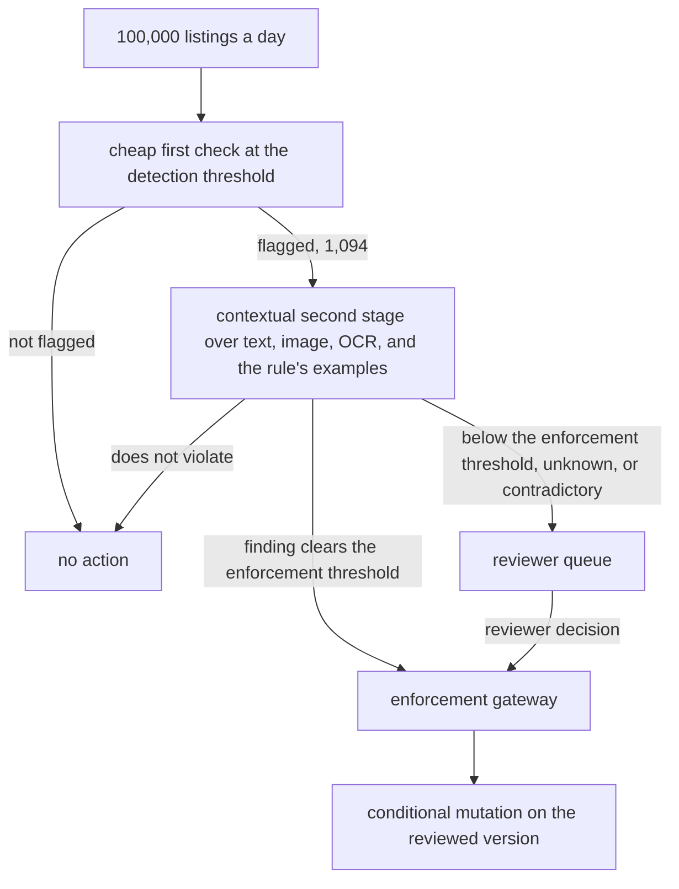
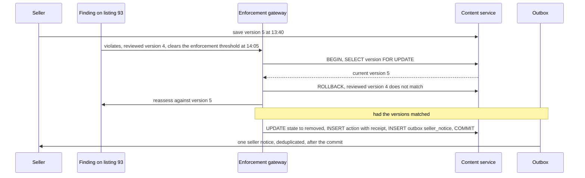
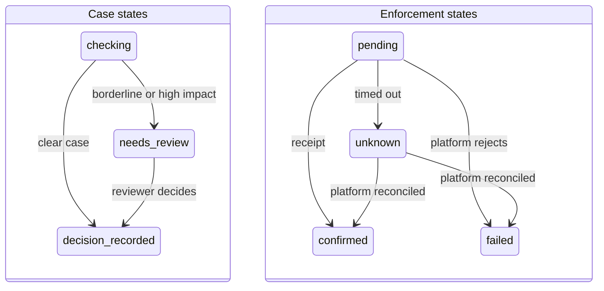

# Chapter 20. Marketplace moderation when most flags are wrong

Status: draft.

[Previous: Chapter 19](./19-underwriting-when-evidence-is-missing-or-contradictory.md) · [Table of contents](../table-of-contents.md) · [Next: Chapter 21](./21-investigating-a-compliance-alert-when-names-collide.md)

**New in this chapter:** base rates and threshold separation; **conditional mutation** on the reviewed version; appeals and reversal; policy agility.

**Assumes:** fictional platform rules with no legal definition of harm; enforcement actions go through chapter 17's effect slot and receipt; account-level and irreversible actions need explicit authority outside this chapter; a trained reviewer pool exists.

**Reuses:** bound approval and effect states (chapter 17); four-state criteria (chapter 19); answer-key evaluation (chapter 1).

> **About the examples.** Jules's marketplace, its rules, the three listings, the prevalence and traffic figures, and every price in this chapter are fictional. Numbers are illustrative unless labeled *measured*. Company and benchmark references support specific mechanisms or methods and link to reviewed sources; none validates the design or defines a harm category.

## A listing that changed before the ban

Jules operates a marketplace's moderation queue for misleading product claims. Three listings arrive together. One has innocuous text and an image whose overlaid caption makes the claim. One quotes a prohibited claim in order to criticize it. One made a prohibited claim yesterday; the seller edited it this morning, and the removal issued this afternoon was based on yesterday's version.

The third case is the one that costs the most. The classifier was right about the content it saw. The action was wrong about the content that existed. And every one of the three sits in a queue where, as the next section's arithmetic shows, most of the flags are about listings that did nothing wrong.

Chapter 19 gave a criterion four states and sent the unresolved ones to a reviewer. Here the volume is 100,000 listings a day, the true violation rate is a tenth of a percent, and the two kinds of error have different prices: a missed violation harms a buyer, and a wrong removal harms a seller and generates an appeal. The chapter sets those prices before it sets a threshold, and it binds every action to the exact version that was reviewed.

Our application gathers context, proposes an outcome per rule, applies only authorized actions against the version it reviewed, and lets sellers appeal. Deterministic services own policy version, object identity, enforcement, and appeal state.

## What enforcement has to get right

### Outcomes, evidence, authority, version, appeal

| Requirement | Proposed assertion |
| --- | --- |
| Policy | Correct tenant and effective version |
| Evidence | The decision names the content, context, and rule |
| Authority | Detection cannot execute arbitrary enforcement |
| Version | The action targets the exact reviewed object or triggers reassessment |
| Uncertainty | Borderline and high-impact cases route to review |
| Appeal | A new decision preserves the original rationale and effects |
| Rollout | Slice-level drift can pause affected actions |

The baseline is keyword and specialist checks plus trained reviewers: cheap on clear recurring violations, with context escalated. A case records content version, context scope, policy, evidence, proposed action, review, effect receipt, notification, and appeal, and "flagged," "held," "removed," and "appealed" are different states. Illustrative workload: 100,000 listings a day, 1 percent routed to contextual review, a two-minute budget for urgent actions. A dependency outage holds selected risky items or queues them; it never silently becomes allow or remove. Thumbnails, extracted text, and model traces carry the same access discipline as the original content.

### Three listings and a base rate

Listing 77 version 8: text "premium supplement, lab tested"; image with overlaid caption "cures insomnia in 3 days." Listing 81: text quoting "'cures insomnia in 3 days', which is exactly the kind of claim this product does not make," with a plain product image. Listing 93 version 4 (yesterday): "clinically proven to reverse hair loss"; version 5 (this morning): "formulated for hair care."

Traffic: 100,000 listings a day; prevalence of true violations under the misleading-claim rule: 0.1 percent, so about 100 violating listings. The answer key: listing 77 violates (the claim is in the image); listing 81 does not (quotation for criticism, a distinction the policy author defines); listing 93 version 4 violated and version 5 does not, so an action on 93 must target version 5 and find nothing to enforce, or reassess.

### The naive version removes everything above a threshold

Start with the obvious design: a text classifier scores each listing, and anything above 0.8 is removed with an automatic notice.

Listing 77 passes, because the claim is in the image. Listing 81 is removed, because the prohibited sentence is in its text. Listing 93 is removed on version 4's score while version 5 is live. And at a 0.1 percent base rate, with a detector that has 95 percent recall and a 1 percent false-positive rate, the day's removals are about 91 percent wrong: 95 true violations removed alongside about 999 benign listings.

The limitation is a single threshold doing three jobs (detect, decide, enforce) against a base rate it never saw, with no record of which version it judged. The first decision is how much of the judgment is rules and how much is context.

## Rules with a queue or a contextual cascade

### Path A: rules and specialist checks with a review queue

Known rules and narrow detectors identify clear cases; uncertain cases go to reviewers. Predictable and cheap, and it misses context: an image caption, a quotation, a new evasion.

### Path B: a policy-grounded contextual cascade

Cheap initial checks route selected cases into a bounded investigation over text, image, and allowed context. A model proposes rule-specific findings. A deterministic action policy and qualified review govern enforcement.

| Dimension | Rules with a queue | Contextual cascade |
| --- | --- | --- |
| Quality | Strong on known patterns; weak on context | Broader interpretation; inconsistent borderline findings |
| Latency and cost | Low per item; reviewer work on exceptions | Extra reads and model calls; adversarial handling |
| Privacy | Narrow data | Context expansion can reveal unrelated seller or buyer data |
| Safety | Explicit action rules | The same rules plus prompt-injection and tool restrictions |
| Operations | Detector and policy maintenance | Plus routing calibration, context provenance, model regressions |
| Recovery | Reassess or reverse a recorded action | Preserve investigation and action versions; same reversal controls |

The reason to adopt B is policy agility. When the policy text changes, Path A retrains or re-tunes detectors, which takes weeks and labeled data. Path B applies the new text to the same model with a regression set of 300 reviewed examples re-run against it, which takes an afternoon and shows exactly which examples changed outcome. Neither path lets classifier confidence or a policy citation authorize removal on its own.

> **Source finding.** SafetyKit [described](https://www.safetykit.com/news/safetykits-engineering-culture) deploying per-tenant isolated environments and rolling out changes in stages. The account is a culture post; tenant isolation removes no quota, queue, or capacity constraint from a shared gateway.

We start with Path A for clear, low-risk decisions and Path B for contextual findings, both behind one enforcement gateway. Path B's first task is a judgment over an image and its text together.

## What the model sees and returns

### A multimodal finding per rule

The model receives the listing's text, the image, the OCR of any text in the image, the rule's text and its author's examples (including the quotation-for-criticism distinction), and the allowed context (linked product information, prior versions of this listing). It returns one finding per rule in scope.

```json
{
  "case_id": "case_302",
  "content_id": "listing_77",
  "content_version": 8,
  "policy_version": 12,
  "rule_id": "misleading_claim",
  "finding": "violates",
  "evidence": [{"source": "image_v8_ocr", "span": "cures insomnia in 3 days", "note": "claim appears only in image overlay"}],
  "counter_evidence": [],
  "context_used": ["product_page_v3"],
  "confidence": 0.86,
  "proposed_action": "hold_for_review"
}
```

The finding states are chapter 19's: violates, does not violate, unknown (context unavailable, image unreadable), contradictory (text and image disagree in a way the rule's examples do not resolve). Counter-speech is handled by the rule's own examples: the model is shown what quotation for criticism looks like under this policy, and a quoted claim with a critical frame returns "does not violate" with the frame cited.

### The regression set when policy text changes

Policy version 13 changes how a borderline category is treated. The 300-example set runs against version 13 before any enforcement does, and the diff of outcomes is reviewed: examples that flipped are either expected (the policy intended that) or defects. The same set runs on every model version change for the same reason.

### Evasion shifts after enforcement

Sellers adapt. Claims move from text to images, from images to video thumbnails, from English to another language, from "cures" to "has helped many with." Drift monitoring tracks finding rates on adversarial slices (image-only claims, non-English listings, paraphrase families), and a slice whose finding rate drops while appeals on that slice stay flat is a slice where evasion is winning.

The cascade's detector is good. The review queue it feeds is still mostly false alarms.

## Precision at the base rate

```text
100,000 listings; prevalence 0.1% → 100 violating, 99,900 benign
detector: recall 95%, false-positive rate 1%

                    flagged         not flagged
violating (100)        95 (TP)          5 (FN)
benign (99,900)       999 (FP)     98,901 (TN)

flags = 95 + 999 = 1,094
precision = 95 / 1,094 ≈ 8.7%
```

Figure 20.1. The confusion matrix for a strong-looking detector at a 0.1 percent base rate. Nine of every ten flags are benign.

The arithmetic is why detection and enforcement thresholds are separate. A detection threshold decides what enters the queue, and it can be low, because the cost of a flag is a review. An enforcement threshold decides what acts without a reviewer, and it is set by the cost of a wrong action under the rule's reversal semantics, which for a removal with a seller notice is high. Between them sits the cascade: a cheap first check, a contextual second stage for the flagged 1,094, and a reviewer for what the second stage cannot settle. Queue capacity enters the threshold choice directly, since 1,094 flags at five reviewer minutes are 91 hours.



Figure 20.2. The cascade between the two thresholds. The detection threshold decides what enters the queue, the enforcement threshold decides what acts without a reviewer, and the gateway acts only on the reviewed version.

Model self-confidence routes nothing until it is calibrated against labeled outcomes, under chapter 18's rule for field confidence. Thresholds are set per language and category slice, because a single global threshold at one base rate is wrong at every other.

A finding on listing 93 clears the enforcement threshold. The listing was edited an hour ago.

## Act on the version you reviewed

Every finding names the content version it judged. Enforcement is a conditional mutation inside the content service's own transaction: compare the current version with the reviewed version, check the action grant, claim the logical action identity (chapter 17's slot), and write the state change with its receipt, all together. If the version moved, the transaction fails and the case is reassessed against the new version. A preflight read followed by an unconditional removal leaves a race the seller's edit falls into, and chapter 8's expected-version update is what closes it.

```text
BEGIN
  SELECT version FROM listings WHERE id = 93 FOR UPDATE;      -- current: 5
  -- reviewed_version = 4 → mismatch → ROLLBACK, reassess v5
  -- (had it matched:)
  UPDATE listings SET state = 'removed', state_version = version + 1
    WHERE id = 93 AND version = :reviewed_version;
  INSERT INTO actions (case_id, content_id, content_version, action, grant_id, receipt) VALUES (...);
  INSERT INTO outbox (kind = 'seller_notice', action_id = ...);
COMMIT
```

The notice to the seller is dispatched from a deduplicated outbox after the action commits, so a crash between action and notice produces one notice on recovery, never zero or two. Where enforcement goes through a separate platform API, that API has to support a conditional write (a version precondition or a lock); if it cannot, the adapter narrows the reviewed action or the gateway stops promising exact-version enforcement, since a local check cannot make a remote write conditional.



Figure 20.3. The conditional mutation on listing 93. The transaction reads the current version under lock, finds 5 where the finding named 4, rolls back, and reassesses; a matching version would have written the state change, the action receipt, and the outbox entry together.

Case states (`checking`, `needs_review`, `decision_recorded`) and enforcement states (`pending`, `confirmed`, `unknown`, `failed`) are separate records, and a timed-out removal is unknown until the platform is reconciled, because a repeat under a new operation key duplicates the notice even when the removal is idempotent. A listing finding never widens into an account restriction on its own; that is a separately defined action with its own authority.



Figure 20.4. Case states and enforcement states as separate records. A timed-out removal stays unknown until the platform is reconciled, because a repeat under a new operation key would duplicate the notice.

The seller of listing 77 disputes the removal.

## An appeal is a new decision

An appeal brings new evidence or contests the interpretation. The reviewer sees the original snapshot, the rule, the rationale, the action receipt, and the seller's submission, and records a superseding decision with a reason. The original decision is preserved; it is never edited.

Reversal of an error and prospective application of a new policy are different events. A policy update does not make every historical action wrong, and rolling back a broken model does not restore every removed listing. Restoration itself goes through the same conditional mutation: it checks the current content, current permissions, and intervening actions, and it links to the action it reverses. A listing the owner deleted is not recreated by reversing moderation. A newer, independently authorized restriction on the same seller is not cleared by a delayed appeal against an earlier one; the restoration rejects the changed current state instead of overwriting it.

A model update ships, and appeals from one language double in a week.

## Shadow, canary, stop

New checks run in shadow against the same snapshots with no enforcement, and their decisions are compared with the current route's by slice: language, category, image-only claims, sellers' tenure. Shadow performance says nothing about action recovery, which the effect harness tests separately.

Canaries are scoped by tenant, rule, and category with explicit action limits and a stop switch that pauses a route while preserving its pending cases. A rise in removals or appeals is a signal to inspect prevalence, traffic, review lag, and policy shifts, and it is never by itself evidence of better or worse moderation. Tenant isolation contains some failures; a shared gateway or quota fails for everyone, and both are monitored.

Caches respect versions. A cache key includes content and context hashes, policy version, model profile, and tenant scope, so an unchanged text with a changed image is a new input and a policy update invalidates affected decisions. A cached finding served during backlog processing still meets the gateway's version and policy check before anything acts.

## A slice regression, a stale cache, an edit before enforcement

Deploy a model change that over-flags one language, drain cached decisions under an old policy, and edit a listing between review and enforcement.

| Injection | Detection and state | Recovery | Assertion |
| --- | --- | --- | --- |
| Slice-specific over-flagging | Blinded labels and appeal drift | Route paused; actions reviewed | No continued mass mistaken enforcement |
| Cached old-policy finding | Version applicability guard | Case re-evaluated | Current policy used |
| Content edited after review | Expected-version mismatch | New version reviewed | No stale action on the new version |
| Edit between preflight and mutation | Conditional write rejects the stale version | Edited listing reassessed | No check-then-write race |
| Removal succeeds, receipt lost | Effect unknown (chapter 17) | Platform reconciled | One action, one notice |
| Prompt injection in an image | Tool and policy authority guard | Adversarial case recorded | No escalation of authority |
| Appeal reverses a restriction | New decision; restoration checks | Authorized corrective action | Correct current platform state |
| Owner deletes listing before reversal | Current-state conflict | Restoration recorded as unavailable | No invented restored content |
| Safety check displayed and not gated | Negative trace test passes incorrectly | Release oracle fixed (chapter 16) | Known violation blocks release |

The oracle is the content service's state, the action ledger, the outbox, and the appeal record together. These drills are specified and have not been run.

## Which path to ship first

Path A for clear cases and Path B for context, behind one gateway, was the provisional choice. The lab needs labels per rule, a grader that is itself tested, and arithmetic for the queue.

### A 300-example policy set

For each rule in scope, 300 reviewed examples: clear positives and negatives, quotation and context cases, borderline cases, multilingual listings, image-text disagreement, content edits, appeals, and adversarial inputs, with sellers, repeated templates, and abuse families held out. Both paths run on identical snapshots and policy versions. Graded: harmful misses, mistaken enforcement, correct escalation, support for the rationale, transient authority violations, appeal outcomes, latency, reviewer burden, cost per accepted case, with unstable cases repeated and judges calibrated against trained reviewers.

Grader negatives, under chapter 16's rule: a correct final platform state reached through an unauthorized restriction; a finding with a plausible citation to an irrelevant policy clause; a correct removal of the wrong version. Average quality compensates for none of them. Small slices get uncertainty intervals under chapter 19's rule, and no slice is called fair.

### Cascade and reviewer arithmetic

At 100,000 items a day, a $0.001 initial check is $100 a day; 1,000 contextual reviews at $0.05 add $50. If 10 percent of contextual cases need five reviewer minutes, review is 500 minutes a day, about 8.3 hours, and if routing doubles without staffing, queue age grows while model latency stays flat. At 200 arrivals a minute and a two-second initial check, average active demand is about 6.7 slots before headroom and provider throttling. Harmful misses and mistaken enforcement are tracked apart from throughput, because a fast queue that is wrong is the opening failure at scale.

### Gates

Release when the version, authority, and reversal fixtures pass and a pilot sets error bounds per supported slice. Keep Path A where known checks handle cases reliably; add Path B where contextual coverage improves under the same action constraints; promote stable contextual patterns into reviewed rules after held-out validation; keep specialist review for ambiguous and high-impact actions. Rollback stops new affected actions, restores prior profiles, inventories executed sanctions, and schedules eligible corrections; sent notices and lost sales are not undone by it.

## Key ideas

- At a 0.1 percent base rate, 95 percent recall and a 1 percent false-positive rate give 8.7 percent precision; detection thresholds and enforcement thresholds are different numbers set for different costs.
- Enforcement is a conditional mutation inside the content transaction: compare the reviewed version, claim the action slot, write state and receipt together, notify from an outbox.
- Findings are per rule with four states, over image and text together, with the rule's own examples defining counter-speech.
- Policy agility is the reason for the contextual path: a policy text change runs the regression set, and the outcome diff is reviewed before enforcement.
- An appeal is a new decision that preserves the original; restoration is conditional on current state and intervening actions.
- Shadow, canary by slice, stop with pending cases preserved; caches carry policy and content versions.

Chapter 21 keeps the four states and the base-rate arithmetic and moves to an investigation where the entity itself is uncertain: a compliance alert on a name that two people share.

## Exercises

1. Recompute Figure 20.1 at a 0.5 percent base rate with the same detector. What is the precision, and how many reviewer hours do the flags cost at five minutes each?

2. A finding on listing 93 version 4 says "violates" and clears the enforcement threshold at 14:05. The seller saved version 5 at 13:40. Describe exactly what the gateway does, and what happens if the seller saves version 6 at 14:06 while version 5 is being reassessed.

3. A seller appeals a removal from March 3 and wins on April 10. On March 20, an independent review restricted the seller's account for a different rule. What does restoration do to the listing, to the account, and to the two decision records?

<details>
<summary>Answers</summary>

1. At 0.5 percent, 500 listings violate and 99,500 are benign. Flags: 475 true positives plus 995 false positives = 1,470; precision 475 ÷ 1,470 ≈ 32.3 percent. At five minutes each, 1,470 flags are 7,350 minutes, about 122.5 reviewer hours. Precision quadrupled because the base rate did, with the same detector; the detector's quality never changed.

2. The gateway's transaction reads listing 93's current version under lock, finds 5 where the finding named 4, rolls back, and opens a reassessment of version 5 (whose text no longer carries the claim, so the expected finding is "does not violate"). If version 6 is saved at 14:06 while version 5 is being reviewed, the reassessment of 5 names version 5; any action it proposes will again fail the version comparison against 6 and trigger another reassessment. No action is ever applied to a version nobody reviewed, and the seller's edits are never overwritten.

3. The listing: restoration runs as a conditional mutation against the listing's current state; if the listing still exists and the seller still owns it, it is restored and the restoration links to the March 3 action it reverses. The account: untouched, because the March 20 restriction is an independently authorized action under a different rule; the appeal against the listing removal has no authority over it, and the restoration rejects any attempt to clear it. The records: the March 3 decision is preserved as it was; the April 10 decision supersedes it with the reason; the March 20 decision stands on its own with its own appeal path.

</details>

## Sources

Sources used here, linked to the original articles:

- [SafetyKit tenant isolation and rollout](https://www.safetykit.com/news/safetykits-engineering-culture)
- [AgentDojo state and trace oracles](https://agentdojo.spylab.ai/concepts/task_suite_and_tasks/), background on environment and trace assertions
- [Anthropic agent evaluation method](https://www.anthropic.com/engineering/demystifying-evals-for-ai-agents), carried as the calibrated-grader method

