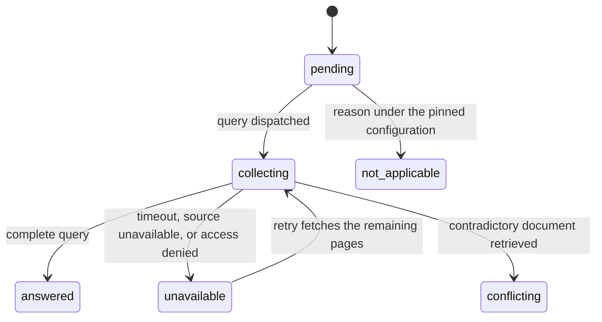
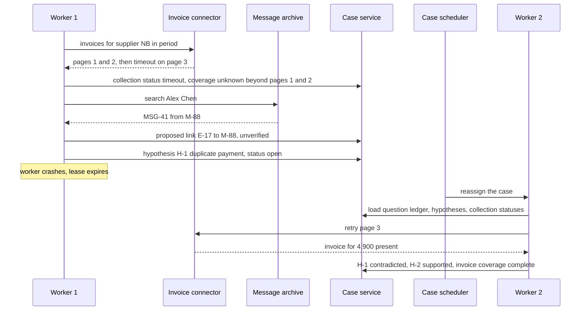

# Chapter 21. Investigating a compliance alert when names collide

Status: draft.

[Previous: Chapter 20](./20-marketplace-moderation-when-most-flags-are-wrong.md) · [Table of contents](../table-of-contents.md) · [Next: Chapter 22](./22-claim-appeals-that-take-weeks-and-three-channels.md)

**New in this chapter:** identity across namespaces; **competing hypotheses with discriminating queries**; collection outcomes (a timeout is not "nothing found"); closure through a coverage ledger.

**Assumes:** read-only connectors to a transaction system, an invoice archive, and a message archive; a qualified analyst owns disposition; no sanctions, freezes, filings, or legal determinations; the alert's compliance obligations are supplied by domain specialists.

**Reuses:** Workflow vs Agent (chapter 6); source independence (chapter 6); the four checks on a citation (chapter 2); fenced publish (chapter 3).

> **About the examples.** Ari's alert, Northbank Services, the two people named Alex Chen, the three payments, and the workload figures in this chapter are fictional and establish no legal threshold or compliance obligation. Numbers are illustrative unless labeled *measured*. Company references support specific mechanisms and link to reviewed sources; none validates the design.

## One name, two people, one timeout

Ari reviews an alert about repeated transfers to a supplier called Northbank Services. A transaction export, an invoice archive, and a message search seem to connect the activity to a person named Alex Chen. The message search also returns an Alex Chen employed by a different supplier. The invoice connector times out on page two of the requested period.

The first report tells a confident story: three payments totaling $14,900, a duplicated invoice, and messages in which Alex Chen discusses the duplicate. The messages belong to the other Alex Chen. The invoice archive was never fully read. And "duplicate payment" was one of three explanations the evidence fit equally well.

Chapter 20's moderation case had one question per rule. An investigation has a question whose answer is itself uncertain (who is this, and what happened), several explanations that compete for the same evidence, and sources that fail in ways that look like answers. The deliverable Ari needs is an account of which events belong to which entity, what alternative explanations remain, which questions were checked, and what supports each finding.

Our application is an investigation workspace whose agent proposes questions and assembles evidence. A qualified analyst controls disposition. Scope has a subject, permitted sources, a time interval, a purpose, and a responsible reviewer, and an interesting search result widens none of them.

## What a defensible case contains

### Findings with subjects, questions that survive restarts

- Every substantive finding names its subject, evidence versions, supporting and contrary material, and owner.
- Required questions survive tool failures, worker restarts, and changes in direction.
- Missing evidence stays distinguishable from evidence for an innocent explanation.
- Calculations bind to canonical query results and never to numbers copied from prose.
- Closure is a reviewed case transition with an explicit record of unresolved work.
- Evidence access follows case permissions and is audited.

The baseline is a manual checklist: open the alert, resolve the subject, collect an agreed evidence list, record calculations, consider contrary evidence, write a review packet. Its elapsed time, omissions, correction rate, and reviewer effort are measured before any adaptive investigation is introduced.

> **Source finding.** Bretton [described](https://www.bretton.com/blog/brettons-agent-harness-makes-our-platform-regulator-approved) an agent harness for financial investigations with entity-owned investigators, explicit required checks, durable workflows, controlled calculations, and retrieval-backed citations. The title's claim of regulatory approval is not independently established, and the account proves nothing about any domain obligation this design meets.

### The fixture

Three USD payments to Northbank Services: $4,800, $5,200, $4,900. An invoice archive that, when fully read, contains an invoice for $10,000 payable in two installments and a separate invoice for $4,900. A message archive with threads from employee M-88, whose display name is Alex Chen, discussing "the duplicate." The transaction system's account holder for the payments is E-17, display name Alex Chen, a different person. The invoice connector returns two pages and times out; page three holds the $4,900 invoice.

The answer key: the payments belong to E-17's account; M-88's messages do not enter any finding about E-17 without corroboration beyond the name; the invoice coverage is incomplete until page three is retrieved, so no finding may claim the archive was reviewed; with page three, the $4,800 and $5,200 are the two installments and the $4,900 is a separate invoice, which supports "legitimate split settlement" and contradicts "duplicate payment"; the gross total is $14,900 and stays so.

### The naive version writes a story

Start with the obvious design: give the model the transaction export, the two pages of invoices, and the message search results, and ask what happened.

The model writes that Alex Chen caused a duplicate payment of $4,900 to Northbank Services, citing the messages and the two invoice pages, and recommends escalation. The messages are M-88's. The duplicate invoice is on the page the connector never returned, and when it is read it says the opposite. The report cites real sources, and chapter 2's four checks would pass the citations: they exist, they support the sentences, they are current. What failed is identity, coverage, and the choice among explanations.

The limitation is that one prompt produced one explanation from whatever evidence happened to arrive. The first decision is whether the investigation is a fixed checklist or an investigator that asks the next question.

## A fixed case workflow or a bounded investigator

### Path A: fixed collection and assembly

A versioned alert configuration specifies identity checks, queries, required attachments, calculation definitions, and report sections. Models extract facts and draft prose inside those stages. Unexpected relationships become unresolved questions for the reviewer.

### Path B: a bounded investigator over a question ledger

The investigator has read tools and a query budget. It inspects a finding, formulates another question, and retrieves evidence the checklist did not anticipate. Required checks live in deterministic case state; the investigator cannot remove them or grant itself access.

| Dimension | Fixed collection | Bounded investigator |
| --- | --- | --- |
| Quality | Comparable coverage on recurring alerts; misses unanticipated explanations | Follows new evidence; may pursue an attractive unsupported story |
| Latency | Predictable dependencies; parallel collection | Variable query chains |
| Cost | Bounded retrieval and model stages | Per-case limits; controls on repeated searches |
| Privacy | Source scopes known before execution | Every adaptive query under the same enforced boundary |
| Safety | Missing stages visible; a rigid template can hide an unsuitable alert type | Identity drift, scope expansion, premature closure need gates |
| Operations | Workflow maintenance as alert families change | Tracing, question ownership, conflict management |
| Recovery | Resume incomplete stages on pinned inputs | Resume durable questions and findings; never rebuild from a summary |

This is chapter 6's Workflow vs Agent with one change: the durable unit is the case, which owns the alert lineage, configuration version, scope, entity candidates, question ledger, evidence snapshots, query attempts, calculations, findings, and dispositions. Workers hold leases; none holds the only copy of the investigation. Both paths share evidence storage, identity resolution, calculations, and review controls, so the comparison is about investigation policy.

We start with Path A for a stable alert family and add Path B where a labeled case set shows adaptive questions recovering material evidence the checklist misses. Under Path B, the model's job is to say what to ask next.

## What the model sees and returns

### The hypothesis record

The investigator keeps hypotheses as records, each with the observations it predicts, the evidence for and against it so far, and its status. The model proposes updates to these records; the case service commits them.

```json
{
  "hypothesis_id": "H-1",
  "statement": "The $4,900 payment duplicates one of the installments.",
  "predicted_observations": [
    {"query": "invoices for supplier NB in period", "expects": "one invoice totaling 10,000 and no invoice for 4,900"},
    {"query": "payment references on TX-103", "expects": "reference matches TX-101 or TX-102"}
  ],
  "support": ["MSG-41 (subject M-88, identity unresolved)"],
  "contrary": [],
  "status": "open"
}
```

### The next-query proposal

```text
Open hypotheses: H-1 duplicate payment; H-2 legitimate split settlement; H-3 payments and messages concern different entities.
Evidence so far: TX-101, TX-102, TX-103 (account E-17); invoice pages 1–2 (coverage incomplete; page 3 pending); MSG-41 from M-88.
Propose one query. For each open hypothesis, state what the query would show if that hypothesis were true.
Prefer the query whose expected results differ most across hypotheses. Tie it to a required question ID.
Do not propose queries outside the case scope (subject E-17, supplier NB, period 2026-07-01 to 2026-09-30).
```

### Anchoring, and the guard against it

The model's known failure is anchoring: having written "duplicate payment" once, it proposes queries that would confirm it and reads ambiguous evidence as support. The guard is in the schema: every proposal states a predicted observation under every open hypothesis, and a proposal whose predictions are identical across hypotheses is rejected by code as non-discriminating. Contrary evidence is a required field, and a hypothesis that accumulates support with an empty contrary list after three queries is flagged for the analyst.

The two Alex Chens are the first thing the ledger has to keep apart.

## Identity is a link with evidence

An entity link records two identifiers, the linking evidence, the namespace or issuer of each, time validity, proposed match status, and the reviewer's decision. "Alex Chen" is a search aid. The transaction system's E-17 and the message archive's M-88 are identifiers in different namespaces, and a shared display name proposes a link and establishes nothing.

Before M-88's messages can enter a consequential finding about E-17, the link needs authorized corroboration: a shared employee ID, an email address in the transaction system's contact record, a signed document naming both. A conflicting employer on M-88's profile is contrary evidence against the link, recorded as such.

Links are reversible and versioned. When the reviewer rejects a link, every finding and calculation whose lineage depends on it is invalidated, dependent report versions are superseded, and already reviewed dispositions enter a reopening queue. The rejected link stays in the ledger with its reason, so the next worker does not rediscover it as a new fact.

With identity scoped, the next problem is a query that returned two pages and stopped.

## Four outcomes of a collection

A connector response records the query parameters, access scope, source watermark where available, pagination completion, retrieval time, and a status. Four statuses mean four different things.

| Collection outcome | Permitted interpretation |
| --- | --- |
| Complete query, zero matching records | No matches under that query and covered interval |
| Timeout before pagination completes | Coverage unknown beyond the persisted pages |
| Source unavailable or access denied | Required evidence unavailable; permission is never bypassed |
| Retrieved contradictory document | Evidence against a specific finding, subject to identity and interpretation checks |

Partial results are saved with their incomplete coverage. A retry may fetch the remaining pages, and only a documented snapshot or source version establishes that the combined pages describe one consistent view; otherwise the collection interval is labeled and changes reconciled. A tool error never becomes an empty evidence array that reads like a successful negative search, and the closure gate below reads status objects, never the report's prose.

With coverage incomplete, three hypotheses fit the evidence that exists.

## Choose the query that separates hypotheses

Each hypothesis predicts what a query would return. The next query is the one whose predicted results differ most across the open hypotheses, because a query all three predict the same way teaches nothing whichever way it comes out.

```text
                                    H-1 duplicate      H-2 split settlement    H-3 different entities
Q-a: invoice page 3                 no $4,900 invoice  $4,900 invoice present  (uninformative)
Q-b: TX-103 payment reference       matches TX-101/102 distinct reference      (uninformative)
Q-c: E-17 ↔ M-88 corroboration      (uninformative)    (uninformative)         no shared identifier
Q-d: supplier NB contract           (weak)             two-installment terms   (uninformative)

observed after Q-a: $4,900 invoice present  → H-1 contradicted, H-2 supported
observed after Q-c: no shared identifier    → H-3 supported; MSG-41 leaves E-17's findings
```

Figure 21.1. The hypothesis matrix for the fixture: predicted observations per query, then the observed cells. Q-a separates H-1 from H-2; Q-c separates H-3 from the rest.

Contrary evidence is retained at the claim level. An invoice stating two installments supports split settlement only if it belongs to this supplier and these payments, and it does not explain the third payment; the matrix records that qualification instead of letting a supported cell lend certainty to a story. A hypothesis is closed by evidence against it, never by the investigator's preference for another.

This mechanism, predicted observations per hypothesis and a next query chosen for discrimination, is named here and reused by chapter 34's incident repair, where the hypotheses are causes and the queries are telemetry.

The evidence is in. The report needs a total, and the model must not compute it.

## Canonical numbers and an explicit close

$4,800 + $5,200 + $4,900 = $14,900, computed in a deterministic service over integer minor units from the selected records, with currency, direction, time basis, reversals, and grouping recorded under a calculation ID. If a $4,900 reversal appears later, gross outgoing stays $14,900 and net outgoing becomes $10,000 under a definition that includes the reversal; the report binds to one calculation ID and uses its label, and it never swaps gross for net in prose. Currencies are never summed without a declared conversion source and valuation time, and no grouping key implies beneficial ownership. The writer receives calculation IDs and labels and nothing to add up.

Closure is a coverage table, assembled before any disposition is offered: each required question, its state (pending, collecting, answered, unavailable, conflicting, or not applicable with a reason), its evidence, its owner, its unresolved issue, and the permitted next action. "Not applicable" needs a reason under the pinned configuration, so the model cannot dispose of an inconvenient check. The reviewer accepts findings, requests collection, rejects links, or records an unresolved disposition the policy allows, and approval binds to the case and report versions under chapter 3's fenced publish. New evidence after approval triggers impact analysis and rewrites nothing the reviewer approved.



Figure 21.2. The states of a required question in the coverage table. Not applicable needs a reason, and the closure gate reads these states and the collection status objects, never the report's prose.

Citations pass chapter 2's four checks, with coverage claims attached to collection records and semantic claims to evidence spans. Tools receive a case capability resolved server-side; search results and document text are untrusted, and an instruction inside an invoice changes neither scope nor closure criteria.

## A timeout and a namesake, then a crash

Inject the invoice timeout and the name collision together, then crash the worker after it persists a preliminary duplicate-payment hypothesis.



Figure 21.3. The drill: a timeout, a namesake, and a crash. The durable questions, the unverified link, and the incomplete coverage survive the restart, and the retry of page three contradicts H-1.

| Injection | Required signal and resulting state | Recovery owner | Observable oracle |
| --- | --- | --- | --- |
| Connector times out after page two | Query incomplete; invoice coverage unavailable | Collection worker and question owner | Report cannot claim all invoices were reviewed |
| Name search returns M-88 | Proposed link, unverified | Identity reviewer | Messages absent from supported E-17 findings |
| Worker restarts | Lease expires; durable questions remain | Case scheduler | No required question disappears or becomes answered |
| Model writes "no innocent explanation" | Contradiction and coverage checks fail | Finding owner and reviewer | Report stays provisional |
| Reviewer rejects the identity link | Dependent findings invalidated | Case owner | Rebuilt packet excludes M-88 and names the retraction |
| Late connector result arrives | Evidence attaches to the correct query version | Collection worker | Approved packet preserved; impact reviewed |
| Non-discriminating query proposed three times | Schema guard rejects; analyst flagged | Investigator and analyst | Anchoring visible in the trace |

The oracle includes the historical report and the current case state. A cleaner second report does not show that unsupported findings were retracted wherever they were consumed. These drills are specified and have not been run.

## Which path to ship first

Path A for a stable alert family was the provisional choice. The lab needs a ledger the investigator cannot see and a metric for the evidence it missed.

### A hundred cases with a hidden ledger

One hundred synthetic cases with identity collisions, duplicate exports, split settlements, reversals, missing periods, access failures, and plausible innocent explanations. The hidden event ledger, what actually happened, stays separate from the evidence exposed to the investigator, and some cases are built so that the evidence cannot settle the question, where the target outcome is an honest unresolved disposition.

Both paths run on the same permitted sources and budget. Scored: required-source coverage, correct subject attribution, calculation semantics, supported and unsupported findings, missed contrary evidence (evidence in the exposed set that contradicted the reported hypothesis and was never cited), closure correctness, and analyst review time. Retrieval recall and citation entailment are measured apart. Blinded expert review of packets records disagreement and adjudication. Evaluation versions are frozen and unfamiliar case patterns held out.

### Analyst time

Two hundred cases a day, each with 18 retrievals and eight model steps, with 20 percent needing ten more retrievals, are 4,000 retrievals and 1,600 model steps before retries; at $0.002 and $0.04, direct processing is $72 a day. Twelve review minutes a case are 40 analyst hours. Admission is by source capacity and case complexity, with connector and model capacity reserved for analyst-requested follow-up so a backlog of speculative searches cannot block a correction. Tracked: oldest unresolved question, repeated-query rate, reopen rate, reviewer corrections, cost per reviewed disposition.

### Gates

Release a new investigator configuration in shadow, then a bounded canary with independent review. Active cases stay pinned to their configuration unless an explicit migration records changed obligations and invalidates affected findings. Rollback stops new assignments and preserves evidence gathered by the rejected version. Adaptive authority expands only when it improves supported outcomes under the same review standard, and entity owners split into specialists only when workload requires it and conflict reconciliation stays reliable.

## Key ideas

- The case is the durable unit: alert lineage, scope, entity candidates, a question ledger, evidence snapshots, calculations, findings, dispositions. Workers lease; none owns the only copy.
- Identity is a link between identifiers in named namespaces, with evidence and a reviewer's decision; a shared display name proposes and never establishes. Rejected links invalidate their descendants and stay recorded.
- A collection has four outcomes, and a timeout after page two is coverage unknown; the closure gate reads status objects.
- Hypotheses carry predicted observations; the next query is the one that separates them; a proposal that predicts the same result under every hypothesis is rejected by code.
- Numbers come from a calculation service with an ID and a label; gross and net are different measurements.
- Closure is a coverage table where "not applicable" needs a reason, and approval binds to versions.

Chapter 22 keeps the question ledger and the case as the durable unit and stretches the timeline: an appeal that takes weeks and arrives through three channels.

## Exercises

1. Fill the predicted-observation cells for three hypotheses about two payments of $2,500 to one supplier a week apart, for the queries (a) the supplier's invoices in the period and (b) the payment references on both transactions. Hypotheses: a duplicate; two installments; two unrelated invoices.

2. Given your matrix, which query is most discriminating, and why would a query for the supplier's registration documents be rejected?

3. The invoice connector returns pages one and two of five and times out. The two pages contain no invoice for $4,900. What may the report say about the $4,900 payment, and what may it not say?

<details>
<summary>Answers</summary>

1. (a) Invoices: duplicate predicts one $2,500 invoice; installments predicts one $5,000 invoice with two-installment terms; unrelated predicts two distinct $2,500 invoices with different numbers. (b) References: duplicate predicts the same reference on both; installments predicts one invoice number with installment markers 1 and 2; unrelated predicts two different invoice numbers.

2. Both queries separate all three hypotheses, and (a) is more discriminating in practice because its three predicted outcomes are structurally different documents, while (b)'s outcomes depend on how the payer filled in references. A registration-documents query predicts the same result under all three hypotheses (the supplier exists under each), so the schema guard rejects it as non-discriminating, and it is also outside the case's stated scope unless a required question asks it.

3. It may say: the two retrieved pages contain no invoice for $4,900; invoice coverage for the period is incomplete (pages three to five not retrieved); the question "is there an invoice for the $4,900 payment" is in state collecting or unavailable. It may not say that no invoice exists, that the payment is unsupported by an invoice, or that the archive was reviewed; and no hypothesis may be closed on the strength of the missing pages.

</details>

## Sources

Sources used here, linked to the original articles:

- [Bretton case harness](https://www.bretton.com/blog/brettons-agent-harness-makes-our-platform-regulator-approved)
- [Harvey expert evaluation infrastructure](https://www.harvey.ai/blog/scaling-ai-evaluation-through-expertise), carried from chapter 2 for separating retrieval evaluation from citation checks

