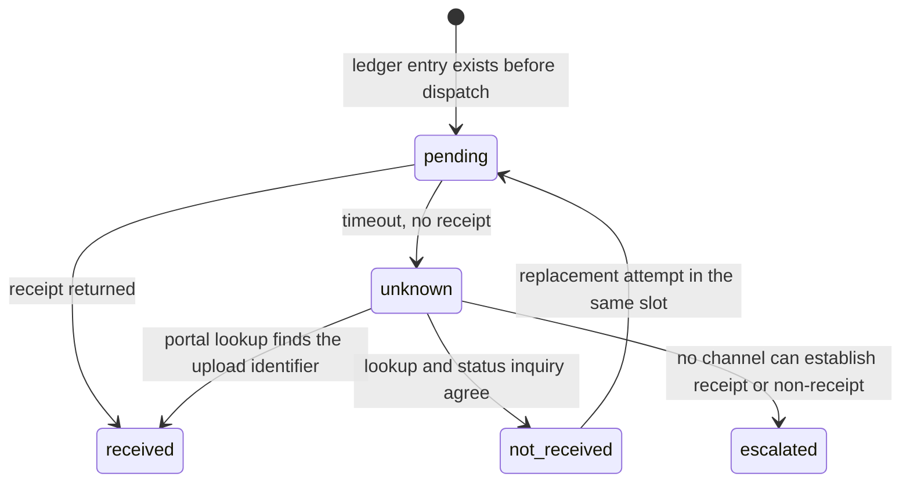
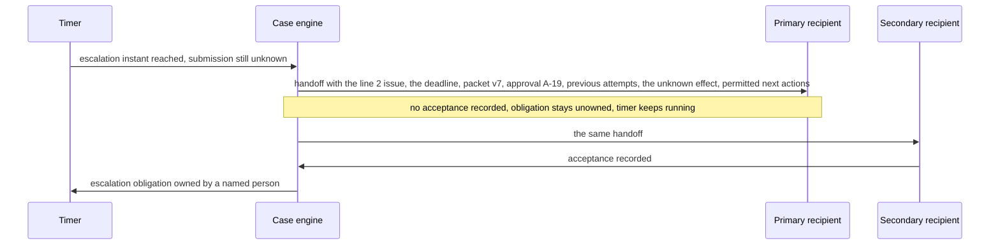

# Chapter 22. Claim appeals that take weeks and three channels

Status: draft.

[Previous: Chapter 21](./21-investigating-a-compliance-alert-when-names-collide.md) · [Table of contents](../table-of-contents.md) · [Next: Chapter 23](./23-refunds-over-chat-when-the-confirmation-gets-lost.md)

**New in this chapter:** case state that outlives any conversation; deadlines vs reminders and timers; submissions with unknown receipt; **accepted handoff**.

**Assumes:** a toy payer configuration with a configured deadline and required attachment; submission through chapter 17's effect slot; a human case owner exists for escalation; voice calls are placed by an adapter whose mechanics chapter 24 owns; portal automation belongs to chapter 26.

**Reuses:** the effect slot and unknown hold (chapter 17); the four checks on a citation (chapter 2); bound approval (chapter 17).

> **About the examples.** Lena's claim, its three lines and amounts, the payer profile, the deadline, and the workload figures in this chapter are fictional and state no legal, clinical, or contractual requirement. Numbers are illustrative unless labeled *measured*. Standards and company references support specific interface boundaries and link to reviewed sources; none validates the design.

## The upload that timed out and the call that said "still denied"

Lena manages a claim with three service lines. One is accepted, one is denied for missing documentation, one is pending. She collects the corrected document, approves an appeal for the denied line, and asks the application to submit it through the payer's portal. The portal accepts the upload and times out before showing a receipt. The next morning a phone representative says the claim is still denied.

Chapter 21's investigation ran over a day. This case runs over weeks, through a portal, a phone line, and the mail, and the application has to hold the obligations between contacts: which line the representative meant, the exact packet that was sent, whether the upload exists on the payer's side, and a deadline that does not move because a conversation ended. Activity is not resolution. A completed call, an accepted upload, an adjudication, and an observed payment are four different events.

Our application prepares appeals and tracks them. The agent gathers permitted evidence and drafts; submission and external communication need authority covering destination, content, and action; clinical and legal conclusions are outside the model's authority entirely.

## What the case has to track

### Lines, deadlines, and a baseline

The claim is a record with separate line state. One scalar "resolved" cannot represent a case whose lines are accepted, denied, appealed, and pending at once. A deadline differs from a reminder: a reminder may move, and a deadline changes only through an authorized policy or evidence update, with a named owner and a fallback for every imminent obligation.

The baseline is a durable checklist with a human case owner: record the denial, request the missing material, prepare a packet, obtain approval, submit, record the receipt, follow up. Its missed obligations, wrong line states, duplicate submissions, review time, and time spent waiting on nobody are measured first.

> **Source finding.** HL7's fixed-version FHIR R4 ClaimResponse [separates](https://hl7.org/fhir/R4/claimresponse.html) a resource's status from its processing outcome and carries line-level adjudication, including partial outcomes. It is an interface example from healthcare; it is neither a payer's appeal protocol nor evidence that any company in this book uses it.

### The fixture

Claimed amounts: $120, $180, $200, total $500. The observed decision allows $90 on line 1, denies line 2 for missing documentation, leaves line 3 pending. Submission deadline for line 2's appeal: October 20, 17:00 in the payer's configured timezone; unresolved receipt escalates 48 hours earlier. Packet version 7 is approved for line 2 with the corrected attachment. The portal upload of version 7 returns no receipt. A phone call the next day yields "the claim is still denied."

The answer key: line 1 has allowed $90 with a $30 adjustment whose interpretation is the payer profile's; line 2 is under appeal, round 1, submission state unknown; line 3 is pending and untouched by anything that happens to line 2; the deadline is stored as a local rule and a UTC instant and never as prose; the call is an observation about the pre-appeal decision until the payer's authoritative status says otherwise; exactly one appeal for line 2 round 1 exists externally when reconciliation finishes; a human accepted ownership of the unknown submission before the escalation instant.

### The naive version keeps the case in a chat thread

Start with the obvious design: a conversational assistant with tools for the portal and the phone, and the case lives in the thread.

The assistant uploads the packet, the portal times out, and the thread records "upload attempted." Nothing records whether an appeal now exists. The next day's call transcript says "still denied," the assistant summarizes the case as denied, and proposes resubmitting; a second appeal is created for a line that already has one. The deadline is a sentence in a message from two weeks ago, and when the thread is summarized to fit the context window, the sentence is gone.

The limitation is that a conversation is the wrong container for obligations, receipts, and deadlines, because it ends, gets summarized, and has no state a timer can wake. The first decision is whether the case engine runs a fixed checklist or an adaptive agent.

## A checklist workflow or an adaptive case agent

### Path A: a versioned checklist workflow

For familiar denial categories, a versioned workflow requests specified evidence, fills an approved template, and advances through explicit approval and follow-up states. A novel denial goes to a human queue.

### Path B: an adaptive case agent in the same durable engine

The agent compares documents, proposes follow-up questions, chooses an allowed channel, and refines a draft. It cannot change a deadline, treat a conversation as an adjudication, or execute an unapproved submission.

| Dimension | Checklist workflow | Adaptive case agent |
| --- | --- | --- |
| Quality | Consistent evidence coverage; unfamiliar cases stall | Resolves evidence-dependent exceptions; may overinterpret a representative |
| Latency | Predictable preparation; the exception queue dominates | Variable searches and calls; useful follow-up reduces waiting |
| Cost | Bounded draft and extraction work | More model steps; expensive communications |
| Privacy | Known document and destination scopes | Case-level field and channel controls on every adaptive read |
| Safety | Reviewable steps; stale templates | Incorrect authority or premature resolution needs independent gates |
| Operations | Payer-specific configurations and adapters | Plus query budgets, tool routing, interpretation checks |
| Recovery | Resume the pending obligation | Resume the case ledger; reconcile channel effects before new work |

This is chapter 6's Workflow vs Agent with the case engine shared between them. We start with Path A for one reviewed workflow and add Path B where it finds missing evidence or resolves ambiguous status under the same outcome oracle. Both keep unknown submissions visible. Inside either path, the model does two things: it writes the appeal, and it reads the call.

## What the model sees and returns

### The appeal letter

The letter is built from the denial reason, the applicable policy text, and the evidence record, and every assertion in it is checked against the evidence under chapter 2's four checks before the packet is assembled.

```text
Draft an appeal for claim C-42, line 2, denied with reason code D-17 ("missing documentation: operative report").
Policy text (version payer-demo@3, section 4.2): [provided].
Evidence available: DOC-9 (operative report, received 2026-10-03, pages 1–4), DOC-4 (original claim form).
Write the argument in three parts: what was denied and why; what the attached evidence shows, citing document and page;
why the policy's requirement is met. Make no clinical judgment; describe what the document states.
Return the letter and a list of claims, each with the document and page it relies on.
```

The claim list is what gets checked: each claim's cited page must exist in the packet, support the sentence, apply to this line and date, and the packet's manifest must show the required attachment present and readable.

### The call

The adapter places the call and the model reads the transcript afterward; chapter 24 owns the mechanics of the conversation itself. The extraction asks for exact status language and line identity, since "still denied" is only useful with the question that preceded it.

```text
From this call transcript, extract every status statement by the payer representative.
For each: the exact words; which claim and line (by identifier if spoken, otherwise "unspecified");
which decision it refers to (original decision, appeal intake, appeal decision), if stated;
the representative's stated authority (reads status, can escalate, can decide).
Do not infer a line or a decision that was not stated. Mark "unspecified" where the transcript is silent.
```

### What the model may never set

Deadlines, receipts, and submission states are set by the case engine from configuration and adapter evidence. A model output that contains a date is a draft sentence; a model output that says "submitted" is a claim about the world that the ledger has to confirm. The naive version stored a deadline as text in a message. That is the next problem.

## Obligations outlive conversations

An obligation is a record with a due time, a prerequisite, an owner, a retry policy, and an escalation time. It waits on a document, an approval, a receipt, or an external decision with no model process alive. A timer resumes the obligation; it never replays the earlier calls that led to it.

```json
{
  "obligation_id": "OB-C42-L2-submit",
  "case": "C-42", "line": 2,
  "kind": "submit_appeal",
  "prerequisite": "approval:A-19",
  "due_local": {"date": "2026-10-20", "time": "17:00", "tz": "payer-demo@3.timezone"},
  "due_utc": "2026-10-20T21:00:00Z",
  "escalate_utc": "2026-10-18T21:00:00Z",
  "owner": "case-owner:lena",
  "state": "waiting_on_prerequisite"
}
```

Both the local rule and the derived UTC instant are stored, because the local rule is what the payer means and the instant is what a timer fires on, and a daylight-saving boundary between them changes the arithmetic. An intake record with no timezone, or with conflicting dates, requires reconciliation; the model never infers a convenient date from nearby prose.

Line state is typed. Claimed, allowed, adjustment, responsibility, and payment are different fields with different meanings, and $500 − $90 is not a collectible, payable, or lost amount. A later decision on line 2 does not close line 3. Aggregate status is a projection over current line records with the unresolved count and reasons shown; the payer's system stays authoritative for external decisions.

```text
Oct 3   DOC-9 received ───────────────────────────────────────────────────────────
Oct 5   packet v7 approved (A-19) ──────────────────────────────────────────────────
Oct 6   portal upload v7 ─── timeout, no receipt ──► submission state: UNKNOWN
Oct 7   phone: "still denied" ──► observation (decision: unspecified; line: unspecified)
Oct 9   DOC-9 corrected → packet v8 ──► approval requested; v8 WAITS on v7 reconciliation
Oct 12  portal lookup finds upload id ──► v7 RECEIVED; v8 → amendment procedure or withdrawn
Oct 18  21:00Z escalation instant (unused; reconciled Oct 12)
Oct 20  21:00Z deadline instant
Oct 27  mail: appeal decision letter ──► observation (decision: appeal round 1; line 2)
```

Figure 22.1. The case timeline across portal, phone, and mail. The phone observation on October 7 is scoped as unspecified; the mail observation on October 27 is the appeal decision.

An approved packet exists, and the corrected document changed after approval.

## Approve the exact packet

Approval references the packet digest, the destination, the case and line IDs, the allowed action, the approver, the authorization scope, and an expiry, under chapter 17's bound approval. A corrected document after approval is packet version 8, which needs its own approval; version 7's approval does not float forward, and a changed destination with identical files revalidates both authority and payload.

The logical appeal slot is unique to tenant, claim, affected lines, and appeal round. Packet version is the approved payload for that slot and is never permission to create another appeal. Version 8, approved while version 7's submission is unknown, waits: if 7 was received, 8 follows the payer profile's amendment or replacement procedure under separate authority; if 7 was conclusively not received, the same slot records the replacement attempt. A new document and a new approval clear none of the earlier uncertainty.

Channel capabilities are separate: status lookup, draft preparation, contact, and submission. Read access to a case grants no permission to communicate its contents, and credentials stay in the adapter.

The upload is dispatched and the portal times out.

## Unknown receipt is a state

The submission ledger entry exists before dispatch:

```json
{
  "operation_id": "appeal-C42-L2-round1",
  "packet_version": 7,
  "packet_digest": "fixture-packet-v7",
  "destination_profile": "payer-demo@3",
  "approval_id": "A-19",
  "state": "pending",
  "external_receipt_id": null,
  "reconciliation_due": "2026-10-18T12:00:00Z"
}
```

After the timeout the state is `unknown`, with the available upload identifier, the response evidence or screenshot, the request time, and the adapter attempt persisted. No new operation ID is created because the model proposes trying again. Reconciliation goes by lookup with the portal's documented identifiers, then by an authorized status inquiry, and where the portal offers idempotency its actual parameter and retention contract are used; a provider's documented key behavior transfers to no other portal. When no channel can establish receipt or non-receipt, the unknown outcome escalates with the deadline and the packet evidence attached, and a person chooses a documented follow-up. An unconditional retry manufactures no certainty.



Figure 22.2. Submission states for operation appeal-C42-L2-round1. A timeout leaves the state unknown; lookup, then inquiry, then escalation resolve it, and a replacement attempt reuses the slot.

The next morning, a second channel reports.

## Each channel adds an observation

Every contact yields an observation: channel, external party, identity verification method, time, claim and line discussed, exact status language, evidence, and the party's authority. "Still denied," asked without a line identifier the day after an upload with no receipt, is most likely a statement about the original decision while the appeal awaits intake, and it contradicts nothing. The reconciliation view shows the call observation and the upload attempt side by side with their times and scopes.

Precedence between channels is applied only where the reviewed payer profile names an authoritative status endpoint; otherwise the conflict is preserved for review, and the newest sentence never overwrites the case. Call scripts ask for identifiers and for the distinction between original decision, appeal intake, and appeal decision, so the transcript extraction has something to extract.

Handoff to a person is the mechanism the book names here. A handoff carries the line-specific unresolved issue, the imminent deadline, the current packet, the approval status, previous attempts, unknown effects, and the next permitted actions; "agent failed" transfers nothing. And a handoff is complete only when someone accepts ownership: the escalation obligation stays open until a named recipient records acceptance, and a notification that nobody acknowledged leaves the obligation unowned, with the timer still running. Chapter 24's live transfers and chapter 28's away-time escalations reuse this rule.



Figure 22.3. Accepted handoff. The escalation obligation stays open until a named recipient records acceptance, and a notification nobody acknowledged transfers nothing.

Disclosure is a projection per destination. Internal reasoning, unrelated lines, and third-party records do not travel because they are in the case; the reviewed channel profile redacts or omits, and logs keep identifiers and evidence references, never full attachments by default.

## A committed upload with a dropped response

Run the toy portal and call simulator against the case.

| Injection | Required state | Recovery action | Oracle |
| --- | --- | --- | --- |
| Portal commits the upload, drops the response | Submission unknown | Reconciled from persisted attempt and packet identifiers | Exactly one appeal exists externally |
| Worker crashes before saving a receipt | Pending or unknown effect durable | Queried before redispatch | No second appeal on restart |
| Call reports the old denial | Observation scoped unspecified or to the original decision | Line and decision version verified | Receipt separate from adjudication |
| Corrected attachment arrives | New packet; earlier approval historical | Changed payload reviewed | Old approval cannot submit new bytes |
| New packet approved while prior submission unknown | Slot occupied | Reconcile first, then amendment rules | Packet version cannot bypass duplicate protection |
| Duplicate receipt webhook | One submission observation | Event deduplicated; projection recomputed | No extra follow-up obligation |
| Receipt unknown near the deadline | Escalated with a named owner | Human accepts handoff and chooses the action | Case never silently resolved or abandoned |
| Escalation sent, nobody accepts | Obligation still unowned | Secondary recipient; timer continues | Acceptance recorded before the instant |
| Partial decision arrives out of order | Line histories retained | Source version and event time reconciled | Pending line 3 survives aggregate updates |

The simulator counts external submissions and records exact payload bytes; a plausible transcript overrides nothing. These drills are specified and have not been run.

## Which path to ship first

Path A for one reviewed workflow was the provisional choice. The lab needs a simulator with a hidden submission count, and the operations arithmetic has to count open cases, since most of this system's work is waiting.

### Eighty cases

Eighty fictional cases with delayed receipts, partial outcomes, missing attachments, timezones, changing policies, and inaccessible channels, run on both paths with identical authority. Asserted: no duplicate submissions, exact approved payloads, correct line state, timely accepted handoffs. Graded apart: narrative accuracy (evidence support and omission in the letter), external execution, review edits, time to confirmed receipt, unresolved line age, cost per observed resolution. The simulator tests mechanics; qualified review and payer-specific testing precede any domain claim.

### Open cases, Little's law

If 300 cases start a day and stay open 14 days on average, about 300 × 14 = 4,200 cases are open at any time. One status read per open case per day is 4,200 reads for 300 arrivals; event-driven updates and adaptive polling reduce the reads where the payer supports them and remove no deadline timer. If 10 percent of new cases need a six-minute call, that is 180 call minutes a day, $27 at $0.15 a minute. Forty escalations at eight minutes are about 5.3 human hours. Monitored: timer lag, oldest unknown submission, handoff acceptance time, repeated contacts, and cases with no assigned next obligation.

### Gates

Adapter changes are released against the simulator and a permitted test account before a bounded rollout. Writes stop when receipt reconciliation degrades, with authorized reads continuing and affected obligations surfaced. Rollback preserves operation history and clears no uncertain effect. Path B expands where adaptive follow-up improves line outcomes or review effort without more duplicate communication or unsupported conclusions; more calls are not more resolved claims.

## Key ideas

- A case has line-level state and obligations with due times, prerequisites, owners, and escalations; a conversation is not its container.
- A deadline is a local rule plus a UTC instant that only policy or evidence can move; a reminder may move; a timer resumes an obligation and replays nothing.
- Approval binds a packet digest to a destination and an appeal slot per round; a new version waits on an unknown predecessor.
- Unknown receipt is a state with persisted evidence: lookup, then inquiry, then escalation with the deadline attached.
- Each channel yields a scoped observation; precedence applies only where the payer profile defines it; the newest sentence overwrites nothing.
- Accepted handoff: an escalation is complete when a named person records ownership, and the timer runs until then.
- The model drafts the letter and reads the transcript; it never sets a deadline or a receipt.

Chapter 23 compresses the timeline back to minutes and keeps the unknown receipt: a refund over chat where the confirmation is lost between the payment provider and the customer.

## Exercises

1. A new decision arrives: line 1 allowed $90 (unchanged); line 2 appeal round 1 allowed $150 of $180; line 3 denied for a reason code. Give each line's state and the claim's projection, and say what the $30 on line 2 is.

2. The payer timezone is UTC−5 until November 2 and UTC−6 after. The deadline is November 3, 17:00 local. Compute the deadline instant and the 48-hour escalation instant in UTC, and say what goes wrong if the escalation is computed as "deadline instant minus 48 hours" before the timezone change is applied.

3. Packet v7's submission is unknown. Packet v8 is approved. The portal lookup finds no upload ID; a status inquiry call yields "we have no appeal on file for line 2." What is the next step, and which slot and operation does it use?

<details>
<summary>Answers</summary>

1. Line 1: allowed $90, adjustment $30, state decided (original). Line 2: appeal round 1 decided, allowed $150, adjustment $30 under the appeal decision; whether a round 2 is available is the payer profile's rule. Line 3: denied, with the reason code, and an appeal obligation may be created for it with its own deadline. Projection: 3 lines, 0 pending, 1 denied (line 3), unresolved count 1. The $30 on line 2 is an adjustment under the appeal decision, typed as such; it is not a loss, a balance, or a payable amount until the payer profile's interpretation assigns responsibility.

2. On November 3 the offset is UTC−6, so 17:00 local is 23:00Z on November 3. Forty-eight hours earlier is 23:00Z on November 1, which is 18:00 local under the UTC−5 offset in force that day. Computing the escalation as "17:00 local minus 48 hours = 17:00 local on November 1" and converting with the November 3 offset gives 23:00Z, which is correct here by coincidence; converting it with the November 1 offset gives 22:00Z, an hour early. Storing the rule and deriving instants from the correct offset at each instant avoids the ambiguity, and the engine records both derived instants with the rule they came from.

3. Two channels agree that v7 was not received, and the portal is the authoritative source for upload identifiers under the profile, so v7's operation `appeal-C42-L2-round1` is reconciled to not received. The same slot (tenant, C-42, line 2, round 1) records an authorized replacement attempt with packet v8 as its payload, under v8's approval, and the original v7 attempt stays in the ledger as the reconciled failed attempt. No new slot is created, because no appeal round has been opened externally.

</details>

## Sources

Sources used here, linked to the original articles:

- [FHIR claim adjudication boundaries](https://hl7.org/fhir/R4/claimresponse.html), as an interface example
- [EvenUp durable document record](https://www.evenuplaw.com/blog/document-ai/), carried from chapter 2 for the evidence record behind the packet
- [Stripe idempotency retention boundary](https://docs.stripe.com/api/idempotent_requests), carried from chapter 17 for the submission slot

