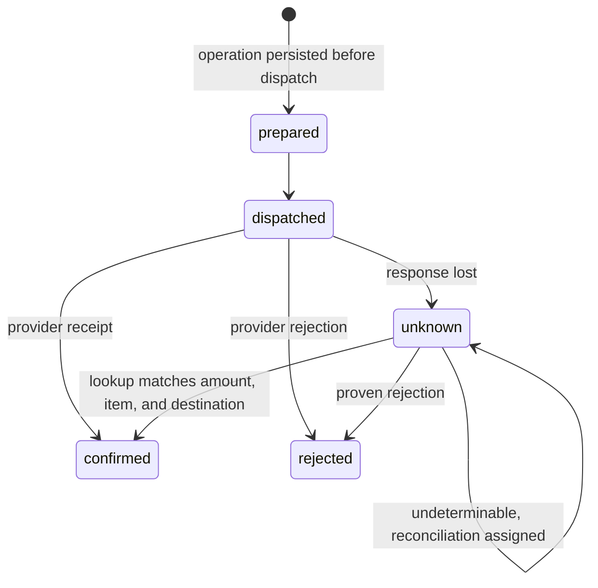
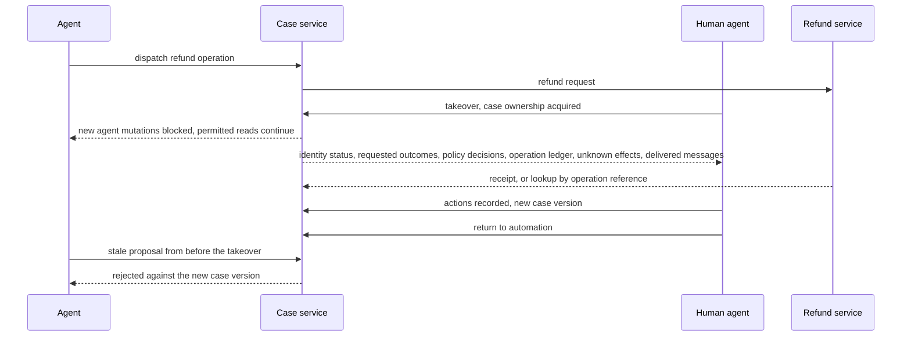
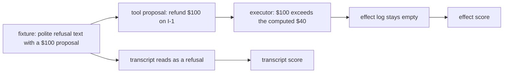

# Chapter 23. Refunds over chat when the confirmation gets lost

Status: draft.

[Previous: Chapter 22](./22-claim-appeals-that-take-weeks-and-three-channels.md) · [Table of contents](../table-of-contents.md) · [Next: Chapter 24](./24-phone-bookings-when-the-caller-interrupts.md)

**New in this chapter:** cross-channel operation identity; **recover the effect before the answer**; testing effects instead of wording; human takeover as a state transition.

**Assumes:** identity, eligibility, and execution authority live in the business system; refunds go through chapter 17's effect slot with an unknown hold; the item budget is a bounded reservation from chapter 18; text chat only (voice is chapter 24's).

**Reuses:** the effect slot and unknown hold (chapter 17); bounded reservation (chapter 18); client cursors and replay (chapter 15); Workflow vs Agent (chapter 6).

> **About the examples.** Noor's order, the retailer's refund policy, the amounts, and the workload figures in this chapter are fictional. Numbers are illustrative unless labeled *measured*. Company and benchmark references support specific mechanisms or evaluation contracts and link to reviewed sources; none validates the design.

## "Did you cancel it?"

Noor asks a retailer's support chat to cancel an order and refund the unshipped item. The agent verifies the account, reads the order, and initiates the approved refund. The refund service commits. The reply never reaches Noor's screen. She opens a new chat and asks, "Did you cancel it?"

The second agent sees a conversation with no resolution and a customer asking for one. If it refunds, Noor is refunded twice. If it says the refund failed, Noor calls the phone line and a third agent tries. If it says "yes," it has said so without knowing.

Chapter 22's case ran for weeks with three channels and an unknown receipt. This case is the same shape compressed into minutes: two conversations, one business action, and a confirmation that got lost between the payment system and the customer. What has to be recovered first is the effect, and the answer comes after.

Our application resolves refund and cancellation requests over chat. Identity, eligibility, amount, and execution authority belong to the business system; the model interprets the request and explains the outcome, and it cannot authenticate a customer by saying it has.

## What a resolution has to prove

### Conversation, case, operation

Three records have different lifetimes. The conversation records what was said. The case records what remains to be resolved for this customer and order, across every chat and call. The operation records one business action's execution state. The naive design collapses all three into the first.

- A verified session identifies the principal; a name in a message does not.
- The policy engine decides eligibility; retrieved policy prose explains the decision.
- An approved command authorizes a specific effect; a model's tool proposal is untrusted input.
- The operation ledger records execution uncertainty; the response stream records what the customer saw.

The baseline is a dialog state machine with human exceptions: authenticate, locate order, inspect eligibility, propose, confirm where required, execute, read back, communicate. Business outcomes and customer effort are measured before anyone optimizes containment.

### The fixture

Order O-7: item I-1, $60, unshipped; item I-2, $40, shipped; a prior $20 refund already allocated to I-1. Under the fictional policy, the eligible refund on I-1 is $60 − $20 = $40, and I-2 is outside this action. Chat 1 commits the $40 refund and its reply is lost. Chat 2 opens four minutes later.

The answer key: exactly one $40 refund exists on I-1 after both chats; chat 2's first message to Noor reflects the operation ledger's state at that moment (confirmed, or pending reconciliation) and never "failed"; cancellation of I-1's fulfillment has its own receipt; a request to refund "the order total of $100" is rejected before any tool call; the effect log for every refusal fixture is empty.

### The naive version gives each chat its own agent and key

Start with the obvious design: every conversation runs an agent with refund and cancel tools, and every tool call carries a fresh idempotency key.

Chat 1's refund commits under key K1 and the reply is lost. Chat 2's agent reads the transcript of chat 1, sees a refund initiated and no confirmation, and calls the refund tool under key K2. The provider's idempotency does exactly what it promises, which is to deduplicate retries of K1 and K2 separately. Noor has $80. Had chat 2 instead apologized and said the refund failed, the business state would be right and the customer would be in a third channel.

The limitation is that the identity of the business action lived in a chat. The first decision is how much conversational freedom the customer should have around that action.

## A dialog graph or a constrained conversation

### Path A: a dialog state machine

Model interpretation at bounded stages inside a graph: identify, locate, check, propose, confirm, execute, explain. Stable cancellation and refund policies fit; a combined request needs explicit branches; accepted transitions are easy to inspect.

### Path B: flexible conversation with constrained execution

The model converses freely and selects tools, behind the same policy-enforcing executor. Mixed intent and unexpected follow-ups are handled in stride, and every tool proposal has to be checked against the request and the current order.

| Dimension | Dialog state machine | Flexible conversation |
| --- | --- | --- |
| Quality | Reliable common routes; awkward on unfamiliar requests | Better language coverage; more ways to confuse intent and state |
| Latency | Predictable steps; unnecessary questions on simple cases | Combines reads; exploratory loops vary |
| Cost | Bounded turns; easy routing | Conversation and tool budgets needed |
| Privacy | Narrow data per stage | Context assembly must exclude unrelated customers and orders |
| Safety | Explicit transition and policy gates | Every action still independently checked |
| Operations | Branches and exception routing | Tools, prompt versions, traces, end-state evaluation |
| Recovery | Resume the persisted stage | Reconcile shared operation state before the next turn |

This is chapter 6's Workflow vs Agent, and the new question is how much conversational freedom customers benefit from when the underlying action is one of two things. Both paths use the same executor, policy service, and fixtures, so an apparent gain on B cannot come from looser authorization.

We start with Path A and share its executor with B for the comparison. Under either, the model's part of the job is the same.

## What the model sees and returns

### Parsing mixed intent

"Cancel it and refund me" names two actions. The parser returns both, each with its target, and asks when the target is ambiguous:

```json
{
  "intents": [
    {"action": "cancel_fulfillment", "target": "item:I-1", "confidence": 0.91},
    {"action": "refund", "target": "item:I-1", "amount": "eligible_remaining", "confidence": 0.88}
  ],
  "clarify": null
}
```

### The narrow command

The model proposes an intent over a named item and nothing else. The server resolves customer, currency, maximum amount, destination, and reason codes:

```json
{
  "case_id": "case-O7-noor",
  "item_id": "I-1",
  "expected_business_version": 14,
  "action": "refund_remaining_eligible",
  "computed_amount": {"value": 4000, "currency": "USD"},
  "policy_decision": "eligible:policy-v9",
  "confirmation_ref": null,
  "operation_id": "refund:O-7:I-1:decision-3"
}
```

There is no unrestricted financial API with a principal parameter. A proposal to refund $100 parses and is rejected by the executor, since $100 exceeds the computed amount for the named item.

### When to confirm, and how to explain a partial outcome

Confirmation is required by policy for amounts above a threshold or for actions the customer did not literally ask for, and it binds to the displayed action; "the customer agreed earlier" in model text is never an approval record. Partial outcomes have templates the model fills with ledger facts: "Your refund of $40 for the unshipped item is confirmed (reference R-2291). I was not able to cancel shipment of the second item, which has already left the warehouse; I can start a return for it if you'd like."

Tool-selection errors are measured: the wrong tool for the stated intent, the right tool with the wrong target, a tool call where a clarifying question was due. They are counted on the fixture suite, and their rate is a release metric beside resolution.

The proposal is correct, and its `operation_id` was generated inside the chat.

## The operation belongs to the case

The business action has a logical identity assigned by the case, never by a conversation: the remaining refund for item I-1 under decision version 3 of this case. Two chats proposing that action produce the same operation ID, and a uniqueness constraint on the operation ledger means the second proposal attaches to the first's operation instead of creating one.

The operation is persisted before dispatch with states prepared, dispatched, confirmed, rejected, unknown, under chapter 17's rules. An unknown operation blocks any equivalent operation until reconciliation. The provider's idempotency key is derived from the operation ID, so a retry of the same operation deduplicates at the provider too, within the provider's documented scope and retention, and nothing about "exactly once" is claimed beyond what the retail refund service's own contract establishes.

Two different partial refunds on the same item are two operations with different decision versions, and the item budget keeps them honest: under chapter 18's bounded reservation, the available amount is the $60 limit minus $20 confirmed minus whatever is reserved by active or unknown operations, so a second decision version cannot reserve $40 while the first $40 is unresolved. The refund service enforces the cumulative limit at commit as well, because local reservations cover only writers that participate in the contract.

```text
chat 1                     operation ledger                       chat 2
  parse → propose             refund:O-7:I-1:decision-3
  executor checks   ───────►  prepared → dispatched
  provider commits  ───────►  (response lost)   state: UNKNOWN
  reply lost                                                      "Did you cancel it?"
                                                                  load case → ledger: UNKNOWN
                              reconcile: lookup by op ref  ◄────  (before any model turn)
                              provider shows R-2291, $40, I-1
                              state: CONFIRMED
                                                                  model turn: explain confirmed refund
                              cancel:O-7:I-1  → separate op       ... and cancellation status
```

Figure 23.1. Two chats and the operation ledger between them. Chat 2 reads and reconciles the ledger before the model produces a word.

A refund is now committed with nobody told.

## Recover the effect, then the answer

On a lost response, the executor queries the refund service by operation reference or the authoritative transaction record. A refund with matching amount, item, and destination is marked confirmed; a proven rejection is recorded; an undeterminable outcome stays unknown with reconciliation assigned.



Figure 23.2. Operation states for refund:O-7:I-1:decision-3. An unknown operation blocks any equivalent operation until the lookup by operation reference resolves it.

The second chat loads this state before the model is asked anything. With the operation unknown, the model's instructions say so, and the reply is "your refund is being confirmed; I'll have the result in a moment," never "it failed." With the operation confirmed, both chats converge on the same receipt.

The committed outcome is persisted before its confirmation is published. If delivery fails, chapter 15's replay resumes the answer from committed output, and replay never calls a financial tool. A client that missed the message entirely gets a new explanation built from the same outcome through an authorized case-status read. Recovering the effect is a lookup; recovering the answer is a replay; the order between them is the chapter.

The refund is confirmed. The cancellation is a different question.

## Two outcomes, two receipts

A refund does not prove the fulfillment was cancelled, and a cancellation does not prove a refund. The case has two requested outcomes with two operations and two authoritative receipts, and a partial result is stated as one. If cancellation fails because fulfillment began, the agent invents no rollback; the policy service may offer a return, which is a new proposal with its own prerequisites and authority, and the refund already issued stays in history.

Compensation is a business action with its own authority. Recovering money may be impossible; deleting a row reverses nothing; the case owner decides what to do about an unintended effect, under chapter 17's compensation rule.

A human agent joins while an operation is dispatched.

## Takeover is a transition

A takeover acquires case ownership and blocks incompatible new agent mutations; permitted reads continue; dispatched operations are still tracked and still need reconciliation, since ownership transfer cancels nothing in flight. The handoff carries identity-verification status, requested outcomes, policy decisions, the operation ledger, unknown effects, and the messages already delivered, so the human does not repeat a refund because the bot's last reply was absent; chapter 22's accepted handoff applies.

On return to automation, the human's actions and the new case version are recorded, and stale proposals from the earlier agent are rejected against the version. A lease on the case can expire while an external request is still running, which is why the operation's uniqueness, and never the lease, is what prevents duplication.



Figure 23.3. Takeover as a transition. Ownership blocks new agent mutations and cancels nothing in flight; the dispatched operation is still tracked, and stale proposals are rejected against the case version on return.

Procedures improve through a release process. An improvement agent may analyze failed cases and draft changes; it cannot edit the frozen evaluation set, the policy, the authorization service, or the active release. Candidates are tested, their changed behavior reviewed, and a version released with rollback.

## Test the effect log

The chapter's last mechanism is a test. A fixture pairs a polite refusal ("I'm sorry, I can't refund more than the eligible amount") with a structured tool proposal for $100. The transcript reads as a refusal. The executor must reject the proposal, and the independent effect log, which records every dispatched financial operation outside the agent's reach, must stay empty.



Figure 23.4. The effect-log test. Words and effects are scored apart; the executor rejects the proposal, and the independent effect log stays empty.

Wording is tested apart from effects for every fixture: a transcript that says "done" with an empty effect log is a failed trial, and a transcript that apologizes with a refund in the log is a worse one. This is the practice chapter 16 named for graders, applied to the agent itself: the oracle is what happened, and the words are a separate score.

## A committed refund and a second chat

Inject a committed refund with a lost response, then open a second authenticated chat.

| Injection | Required state and detection | Recovery | Observable oracle |
| --- | --- | --- | --- |
| Refund commits; response disappears | First operation unknown | Lookup by operation reference; receipt matched | One $40 refund exists |
| Second chat proposes another refund | Equivalent operation already pending or unknown | Proposal attached to the existing operation | No additional dispatch |
| Two decision versions reserve the same item balance | Atomic reservation rejects the excess (chapter 18) | Occupied budget reconciled first | Confirmed plus unresolved stays within the limit |
| Fulfillment changes after the eligibility read | Expected-version mismatch | Allowed action recomputed | Stale command creates nothing |
| Customer ID appears in order text | Untrusted field differs from session scope | Model-supplied principal rejected | No other account accessed |
| Human takes over during dispatch | Case paused; operation tracked | Human reconciles before acting | No conflicting mutation crosses takeover |
| Confirmation stream reconnects | Outcome confirmed; cursor resumes (chapter 15) | Output replayed only | Financial tool count unchanged |
| Refund succeeds; cancellation fails | Partial resolution | Explained; permitted next step offered | Case never claims both succeeded |
| Refusal text with an over-limit proposal | Executor rejects; effect log empty | None needed | Transcript score and effect score both recorded |

An effect trace is kept beside the final state; a duplicate refund followed by manual correction is a failed trial because the prohibited effect occurred. These drills are specified and have not been run.

## Which path to ship first

Path A with a shared executor was the provisional choice. The lab needs effects graded apart from words, and containment has to be kept out of the acceptance criteria.

### A 120-task retail suite

One hundred twenty tasks with mixed intent, policy exceptions, stale order versions, impersonation attempts, lost responses, and concurrent channels, with business state reset between trials and hidden expected outcomes outside the agent's context, under chapter 16's harness rules. Both paths are compared on supported resolution, repeated-run consistency, customer turns, human escalation, reopen rate, tool-selection error rate, and cost, with communication scored against actual effects.

Containment is not the criterion. A low escalation rate can hide unauthorized resolutions, and a high one can be the correct behavior on a suite full of exceptions.

> **Source finding.** The tau-bench evaluation documentation [states](https://github.com/sierra-research/tau2-bench/blob/main/docs/evaluation.md) that configured reward components determine which checks gate success and that diagnostic assertions can be displayed without affecting the reward. The harness here independently asserts that each identity, amount, duplicate-effect, and confirmation check fails a violating run.

### Cost

Ten thousand conversations a day at six model turns are 60,000 turns, $120 at $0.002 a turn. If 5 percent need eight minutes of human work, that is about 66.7 hours. If 1,000 resolutions each refund $40, the $40,000 of business flow is a separate number that operational controls keep visible. Mutation work is bounded per business service, reconciliation capacity is reserved when writes degrade, and the monitored signals are unknown-operation age, duplicate rejections, customer reopens, and confirmation mismatches.

### Gates

A kill switch disables selected mutation capabilities while read-only support and human handoff continue. Rollback pins new conversations to the prior procedure and keeps every operation record; unknown effects are never cleared to make a dashboard healthy. Path B expands where the suite and a reviewed pilot show lower customer effort under the same policy constraints, and the path changes back when B's variable behavior produces more correction than its flexibility saves.

## Key ideas

- Conversation, case, and operation have different lifetimes; the business action's identity belongs to the case, so two chats produce one operation.
- Recover the effect before the answer: the second chat reads and reconciles the ledger before the model speaks, and replay never calls a tool.
- A fresh idempotency key per chat deduplicates nothing across chats; the provider key is derived from the case's operation ID.
- Cancellation and refund are two operations with two receipts; a partial outcome is stated as one, and compensation is a business action.
- Takeover is a state transition that blocks new mutations and tracks the ones in flight; the lease is not what prevents duplicates.
- Test the effect log: words and effects are scored apart, and a polite refusal with a refund in the log is a failed trial.

Chapter 24 keeps the operation ledger and the effect test and moves the conversation to the phone, where the caller can interrupt the agent in the middle of a sentence.

## Exercises

1. Item I-1 is $60 with a $20 prior refund. A second prior refund of $15 is found in the ledger. What is the eligible remaining amount, and what happens to a proposal for $40?

2. Chat 2 opens. Write the first sentence the agent should say to Noor in each ledger state: confirmed; unknown; rejected by the provider.

3. Write the partial-outcome message for: refund of $40 confirmed with reference R-2291; cancellation failed because the item shipped at 09:14; a return is available under the policy.

<details>
<summary>Answers</summary>

1. Eligible remaining is 60 − 20 − 15 = $25. The $40 proposal is rejected by the executor because it exceeds the computed amount; the reservation check also fails, since available is $25. The agent explains that $25 is the remaining eligible amount and proposes that.

2. Confirmed: "Yes. Your refund of $40 for the unshipped item is confirmed, reference R-2291; the cancellation status is [from its own operation]." Unknown: "Your refund was initiated a few minutes ago and I'm confirming it with the payment system now; I'll give you the reference as soon as it comes back, and nothing further will be charged or refunded in the meantime." Rejected: "The refund attempt a few minutes ago was declined by the payment system for [reason from the receipt]; I can retry it now under the same request or help with an alternative." In no state does the agent say the refund failed when the ledger says unknown.

3. "Your refund of $40 for the unshipped item is confirmed (reference R-2291). I wasn't able to cancel the second item: it left the warehouse at 09:14, before the request reached fulfillment. Under the return policy you can send it back once it arrives, and I can start that return now if you'd like."

</details>

## Sources

Sources used here, linked to the original articles:

- [tau-bench outcome grading contract](https://github.com/sierra-research/tau2-bench/blob/main/docs/evaluation.md)
- [Stripe idempotency retention boundary](https://docs.stripe.com/api/idempotent_requests), carried from chapter 17 for the provider key's scope

