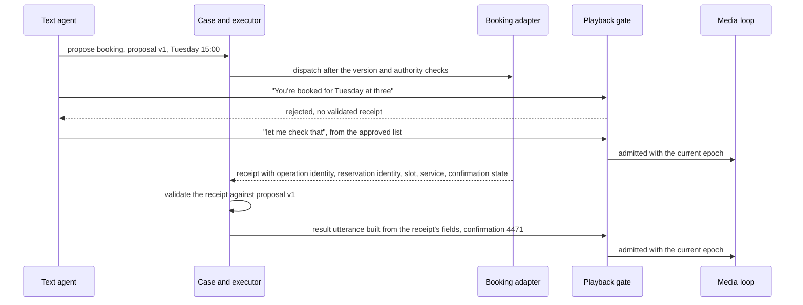
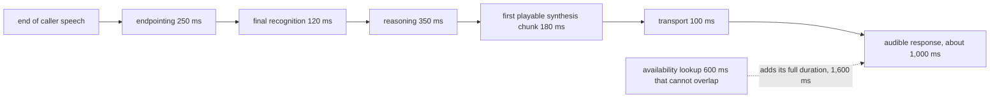

# Chapter 24. Phone bookings when the caller interrupts

Status: draft.

[Previous: Chapter 23](./23-refunds-over-chat-when-the-confirmation-gets-lost.md) · [Table of contents](../table-of-contents.md) · [Next: Chapter 25](./25-a-shopping-agent-allowed-to-spend-but-not-substitute.md)

**New in this chapter:** turn detection and barge-in; interruption epochs on generated speech; interruption linearized against dispatch; **gate speech on receipts**.

**Assumes:** a fictional appointment service with its own booking contract; bookings go through chapter 17's effect slot; identity and booking policy are the service's; the telephony transport buffers audio the application cannot see.

**Reuses:** the effect slot and unknown hold (chapter 17); recover the effect before the answer (chapter 23); client cursors (chapter 15); timebases (chapter 10).

> **About the examples.** Eli's call, the bicycle service, the appointment slots, the latency budget, and the concurrency figures in this chapter are fictional. Numbers are illustrative unless labeled *measured*. Provider documentation and harness references support specific interface contracts and link to reviewed sources; none validates the design.

## "Actually, Wednesday."

Eli calls to book a bicycle service. The operator finds Tuesday at 15:00, reads the details back, and Eli agrees. As the booking request goes out, Eli says: "Actually, Wednesday."

What should happen depends on when the words arrived. Before the request left, the proposal can be replaced. After the service committed Tuesday, the operator has to stop the sentence it was about to say, keep the Tuesday reservation it now owns, and ask about a change. Stopping the audio erases no booking.

Chapter 23's conversation was text, where each side waited for the other. Speech is full duplex: the caller can talk over the agent, the agent's reply is already partly in a telephony buffer when the interruption arrives, and the business operation is running on a clock of its own. Two clocks, media and business, and the application keeps interpretation, authorization, execution, and playback separate while the caller hears one conversation.

Our application is a voice operator for appointments. Voice bypasses no identity check and no booking policy. A caller's number proves nothing about authorization, and an interrupted confirmation is no evidence that the caller heard the committed details.

## What the operator has to guarantee

### Ordered events, confirmed details, verified receipts, bounded stale playback

- Ordered audio events, explicit turn revisions, and a consistent media timebase.
- Separate partial-interpretation and finalized-action fields.
- A repeat-back or equivalent confirmation for consequential details under the booking policy.
- Independent execution authorization and authoritative reservation receipts.
- Bounded stale playback after an interruption.
- Reconciliation and human handoff for uncertain operations or lost call context.

The baseline is a touch-tone menu or a human operator with the reservation system, measured on successful bookings, date and time errors, transfers, caller effort, and elapsed time. Natural speech earns its place by reducing effort without adding wrong reservations.

### The fixture

The service proposes Tuesday 15:00 and Eli agrees. "Actually, Wednesday" arrives at one of four offsets: (1) before final field confirmation; (2) after confirmation, before dispatch; (3) during the dispatched request; (4) after commit, during the confirmation speech. The answer key per offset: (1) zero reservations and a clarified Wednesday proposal; (2) the Tuesday proposal superseded, zero reservations, Wednesday proposed; (3) one Tuesday reservation once reconciled, no blind second booking, a change request recorded; (4) one Tuesday reservation preserved, stale speech stopped, a change offered. At every offset, the caller never hears "booked" for a slot without a matching receipt, and the Wednesday change is a separate operation under the service's reschedule contract.

### The naive version runs the stages in sequence

Start with the obvious design: transcribe the caller's turn when they stop talking, send it to a text agent, synthesize the reply, play it, and call the booking tool when the agent decides to.

The agent decides to book Tuesday and generates "You're all set for Tuesday at three" while the tool call runs. Eli's "Actually, Wednesday" arrives, is transcribed, and waits for the current turn to finish. The synthesized sentence plays to the end because nothing can stop it. The tool returns a timeout, the agent says "booked" anyway because the sentence was already written, and the next turn processes "Wednesday" as a new request and books it too. Eli has two appointments, heard one confirmation that was false when it was spoken, and was never asked which day.

The limitation is that speech, interpretation, and the booking all ran on one sequential loop with no way to interrupt any of them and no link between what was said and what was true. The first decision is which model architecture the loop is built on.

## A cascade or speech-to-speech

### Path A: speech recognition, a text agent, and synthesis

Streaming recognition produces text; a text agent reasons and calls tools; synthesis produces audio. Every stage exposes inspectable text, can be routed and replaced independently, and adds its own delay.

### Path B: direct speech-to-speech with a separate action layer

A native audio model listens and speaks in one loop and emits tool calls to a deterministic action layer. It can use acoustic cues directly and speak fluidly; its intermediate interpretation and its cancellation behavior are whatever its event contract exposes, and provider coupling is high.

| Dimension | Cascade | Speech-to-speech |
| --- | --- | --- |
| Quality | Inspectable fields; transcription errors propagate | Natural interaction; action fields still need independent checks |
| Latency | Several stages, some overlappable | Fewer serial stages; tool and network delay remain |
| Cost | Separate speech and text billing; flexible routing | Audio billing; provider session limits |
| Privacy | Each stage receives a projection, possibly across providers | More media reaches one provider |
| Safety | Final text aids validation; partial text must not trigger writes | Spoken claims and tool proposals need an external authority gate |
| Operations | More adapters; timebase reconciliation | Fewer media components; dependence on one event contract |
| Recovery | Restart stages from recorded state | Re-establish the session; reconcile effects first |

This is a genuine model-architecture choice with application consequences, which is rare in this book: the choice decides whether the application can see text before it is spoken, and that decides whether the action gate below can be enforced. Both paths are compared against the same reservation service, audio fixtures, authorization rules, and timing oracle.

We start with Path A where inspectability matters, which includes every booking, and use Path B only where its event contract supports admitting and cancelling output around an action. Under either path, the first thing the system has to know is when the caller has finished speaking.

## What the model sees and returns

### Turn detection

Two mechanisms decide that a turn ended. Silence-based voice activity detection waits for a pause of configured length; it is cheap and it fires on a thinking pause ("Tuesday at... [pause] ...three") and waits too long on a fast speaker. Semantic end-of-turn detection runs a small model over the transcript so far and asks whether the utterance is complete; it handles mid-sentence pauses and it has its own false-trigger rate on fragments that happen to parse as sentences. The rate at which each fires early (cutting the caller off) and late (dead air) is measured per audio slice, and the thresholds are tuned on those slices; a demo tunes nothing.

### Partial transcripts are provisional

A partial transcript can read "Tuesday" before the caller finishes "not Tuesday, Wednesday." Partials drive speculative reads (an availability check for the hypothesized slot, tagged to that hypothesis) and never a write. The interpretation record carries source turn, revision, date, time, timezone, service, and ambiguity:

```json
{
  "turn": 7, "revision": 2,
  "fields": {"date": "2026-10-28", "time": "15:00", "tz": "service.local", "service": "tune-up"},
  "ambiguity": [], "confirmed": false,
  "source": "final_transcript", "asr_confidence": 0.82
}
```

Relative dates resolve against the call time and the service's timezone; the caller's area code is no timezone authority. A finalized field can still be wrong, so consequential fields get the configured confirmation, and two plausible readings get a targeted question. Confidence routes nothing until it is calibrated on relevant audio.

### Fillers, backchannels, and what may be said during a mutation

The agent may produce short progress speech ("let me check that") while work proceeds, from an approved list. During a mutation it may say nothing that asserts an outcome. For the cascade, this is an output filter on the text agent. For a native model, it is an instruction the model may ignore, and the admission gate below is what enforces it.

The tool contract for the cascade's text agent proposes a booking and receives a receipt; it never receives permission to speak the result, which comes from the application.

An interruption arrives while a booking request is in flight.

## Version every utterance

Every generated audio segment carries a response ID, its source turn, an interruption epoch, a segment number, and the business state version it describes. The playback queue admits only segments from the current allowed response in the current epoch.

On barge-in, the media loop increments the epoch, stops queued speech, and cancels speculative reasoning where the provider supports it. Audio already handed to the telephony transport is beyond the application's queue, so the transport's buffer size bounds the stale playback the caller will hear, and that bound is measured and kept short. Generated, transmitted, and reported-played offsets are recorded separately where the transport exposes them; the application never infers that the caller heard all generated audio.

```text
media clock      ──► t0 caller agrees ──► t1 confirm ──► t2 dispatch ──► t3 commit ──► t4 "booked" speech ──►
business state      proposal v1          confirmed v1    op dispatched    op CONFIRMED   result utterance (epoch 3)

interruption at (1) t0<t<t1: proposal v1 → v2 (Wednesday); nothing dispatched
interruption at (2) t1<t<t2: executor version check rejects v1 dispatch; v2 proposed
interruption at (3) t2<t<t3: epoch++ stops speech; op in flight → UNKNOWN until receipt; change request recorded
interruption at (4) t3<t<t4+: epoch++ stops "booked" mid-word; Tuesday reservation stands; reschedule offered
```

Figure 24.1. The dual-clock timeline. The media clock carries the caller's words and the agent's speech; the business clock carries proposal versions and operation states. The same words produce four outcomes depending on where they land.

After a reconnect, the media clock starts a new epoch; the case is retrieved and the current status is stated or asked, since replaying an old paragraph after intent changed confuses the caller. Epochs are what let the application stop its own speech. They do nothing about the booking request already on the wire.

## Linearize the interruption against the write

Dispatch is a transaction that atomically checks the proposal version, the current intent revision, the authority, and the operation state. If Eli's correction has produced proposal v2 before dispatch runs, v1 is rejected and nothing is sent (offset 2). If dispatch wins the race (offset 3), the operation is in flight; a change request is recorded against the case, the original operation is never labeled cancelled because the caller interrupted, a timeout makes its outcome unknown, and the reservation service is queried before anything else is booked, under chapter 23's rule.

After Tuesday is confirmed (offset 4), Wednesday is a separate change proposal. The reservation service may offer atomic rescheduling, or only book-then-cancel, and the second has a failure window: Wednesday booked, Tuesday's cancel fails, two appointments; or Tuesday cancelled, Wednesday's booking fails, none. The service's contract is verified, and where it offers no atomic reschedule, the change runs as a reviewed two-step with the caller told what exists at each step.

The model receives these structured states (in flight, confirmed, change pending) and the proposal versions, so its explanation is of the current state and never optimistic. The text agent now knows the booking is in flight. It writes "you're booked for Tuesday" anyway.

## Speech you cannot retract

A spoken sentence cannot be taken back. Once "booked" has played, no later transcript check undoes it in the caller's mind. So completion speech is gated on the receipt as an output control, never as a prompt instruction.

The booking adapter returns a receipt with operation identity, reservation identity, slot, service, and confirmation state. The case validates it against the approved proposal. Only then does the application construct the result utterance from the receipt's fields ("You're booked for Tuesday the 28th at 3 p.m., confirmation 4471") and admit it to playback with the current epoch. During the mutation, only approved progress speech is admitted; a failed or unknown result routes to a different utterance and a recovery state.



Figure 24.2. Completion speech gated on the receipt. The text agent's completion sentence is rejected, approved progress speech plays, and the result utterance is built from the receipt's fields and admitted with the current epoch.

> **Source finding.** Retell's function-node documentation [describes](https://docs.retellai.com/build/conversation-flow/function-node) nodes that invoke a function and settings that decide whether the conversation waits for the result before transitioning. Bland's webhook documentation [describes](https://docs.bland.ai/tutorials/webhooks) timeouts, retries, response mapping, and route precedence, including a default completion route that can override other matched routes. Both are conversation-flow controls; neither is an application-wide transaction guarantee, and a flow reaching a "done" node says nothing about the booking.

For the cascade, the gate is natural: the result text is bounded and synthesized directly. For a native model, the gate needs response admission and cancellation controls in the provider's event contract, or an application-owned result segment spliced in before free conversation resumes. If the native interface cannot support that, it is used only in a conversational scope with no mutations, and bookings run on the cascade.

Gating speech on receipts is the mechanism the book names here, and chapter 28's away-time assistant reuses it for every notification about an action.

The gate holds. The whole chain now takes longer than the caller's patience.

## Budget the critical path

An ordinary turn on the cascade, with illustrative component times: 250 ms endpointing, 120 ms final recognition, 350 ms reasoning, 180 ms to the first playable synthesis chunk, 100 ms transport, about 1,000 ms from end of speech to audible response. A 600 ms availability lookup that cannot overlap makes it 1,600 ms. Streaming overlaps recognition with reasoning and reasoning with synthesis, and no overlap bypasses final-field validation: a tool may be called on a partial for a read, never for a write.



Figure 24.3. The cascade's critical path with illustrative component times. Streaming overlaps stages, and a lookup that cannot overlap adds its full duration.

Three latencies are measured apart: first audible response (the filler counts), useful answer (the content), and confirmed action (the receipt). Component p95s do not add to a system p95; per-turn traces give the end-to-end distribution with its correlations and queueing. Media buffers have a maximum duration and explicit overflow behavior, since a growing buffer turns a responsive conversation into stale playback while every component stays healthy; obsolete work is cancelled and new admission shed before latency becomes unusable.

Provider failure needs a fresh session: the durable case, committed and unknown operations, and confirmed fields are restored; unsaved media context is treated as gone; details that cannot be restored are reconfirmed; and no provider is switched silently as though it heard everything. Recording, transcript retention, and business-event retention are separate decisions; a receipt is retained without every audio packet; recordings have their own access control. A human transfer carries current intent, confirmed fields, verification status, existing reservation, unknown operations, and interruption state, and the case is marked under human ownership before any incompatible automated write, under chapter 22's accepted handoff.

## Interruptions at four offsets

Deterministic interruption offsets around dispatch and commit, against the reservation simulator.

| Interruption or fault | Expected behavior | Recovery owner | Oracle |
| --- | --- | --- | --- |
| Before final confirmation | No write; corrected slot clarified | Conversation engine | Zero reservations |
| After confirmation, before dispatch wins | Tuesday proposal superseded | Executor | Old version rejected |
| During the dispatched request | Stale speech stopped; in-flight state retained | Case reconciler | No blind second booking |
| Native audio says "booked" before the receipt | Action-phase admission rejects it | Approved progress or current uncertainty played | No unverified completion heard |
| After commit, before receipt delivery | Unknown until readback | Booking adapter | One Tuesday reservation recovered |
| During confirmed speech | Playback stopped; reservation preserved | Media loop and case owner | Interruption deletes nothing |
| Late old audio arrives | Mismatched epoch dropped | Playback gate | No stale segment admitted |
| Noise turns "fifteen" into "fifty" | Invalid or ambiguous slot | Field validator | No unsupported time booked |
| Provider disconnects | Case survives; new media epoch | Session recovery or human | Restored conversation cites the receipt |
| Semantic end-of-turn fires on a fragment | Turn marked provisional; caller continues | Turn detector | No action on a cut-off turn |

The audible output and the reservation ledger are both recorded; correct final text excuses neither stale speech nor a transient duplicate. These drills are specified and have not been run.

## Which path to ship first

Path A for bookings, with Path B confined to scopes where its event contract supports the gate, was the provisional choice. The lab needs audio slices and interruption offsets, and the capacity arithmetic is about concurrent calls.

### Sixty conversations at several offsets

Sixty scripted conversations across clean audio, noise, accents, corrections, silence, and overlap, each repeated at several interruption offsets. Compared: semantic field accuracy, wrong confirmations, stale audible duration, caller turns, handoffs, and actual booking outcomes. Turn detection is reported per slice: early-cut and late-fire rates for both detector types, by accent and noise level, so no slice is routed to failure by an uncalibrated threshold.

> **Source finding.** The tau-bench audio-native harness documentation [describes](https://github.com/sierra-research/tau2-bench/blob/main/src/tau2/voice/audio_native/README.md) shared logic for buffers, barge-in clearing, queued tool results, and audio conversion, with a distinct adapter model for cascaded speech. It is an evaluation harness; its adapter and grader versions are pinned if used, and the business assertions that must gate success are verified under chapter 16's rule.

### Concurrency and media

Sixty calls arriving per minute, each four minutes long, are about 240 concurrent calls under stable conditions. An admission pool targeting 70 percent occupancy at that load needs at least 343 slots before burst and outage planning. At 8 kHz 16-bit mono, one direction is 16,000 bytes a second and two are 32,000; a thousand concurrent raw calls are 32 MB/s, 256 Mb/s, before protocol overhead; a five-minute two-direction recording is 9.6 MB and 10,000 of them are 96 GB before compression. Transport codecs change these figures substantially. Monitored: concurrency, buffer age, tool latency, unknown operations, interruption clearance time, transfer acceptance.

### Gates

Start with the cascade where inspectability and component control dominate; adopt speech-to-speech where measured full-duplex behavior reduces caller effort and the event contract supports the same action gate. Voice configuration rolls back without touching the shared case ledger. A path is ready when it passes the offset drills and the slice measurements, and sounding natural in a demonstration is none of that.

## Key ideas

- Two clocks: the media loop owns audio, timestamps, and epochs; the case and executor own proposals, operations, and receipts. The same words produce four outcomes at four offsets.
- Turn detection has two mechanisms with opposite failure modes, measured per audio slice; partial transcripts drive reads and never writes.
- Every utterance carries an interruption epoch; barge-in increments it and stops queued speech; the transport's buffer bounds what the caller still hears.
- Dispatch atomically checks proposal version and intent revision; an interruption mid-flight records a change request and never cancels the operation; reschedule is the service's contract.
- Speech cannot be retracted, so completion speech is built from the receipt and admitted by an output gate, never by a prompt instruction.
- The cascade can see text before it is spoken; a native model can be used for mutations only where its event contract supports admission and cancellation.

Chapter 25 keeps the receipt gate and the separate effects and adds money: a shopping agent allowed to spend within a grant and forbidden to substitute.

## Exercises

1. The cascade budget is 250 + 120 + 350 + 180 + 100 ms. A tool lookup takes 300 ms and can overlap with reasoning but not with recognition. What is the end-of-speech-to-audible-response time with and without the overlap, and which stage's p95 would you measure first?

2. Give the outcome of "Actually, Wednesday" at each of the four offsets: reservations that exist, what the caller hears, and what operation (if any) is created.

3. The booking operation is in flight. Which of these utterances may be admitted to playback: (a) "One moment while I confirm that"; (b) "You're booked for Tuesday at three"; (c) "I'm checking Tuesday at three for you"; (d) "That's confirmed"; (e) "It looks like that went through"?

<details>
<summary>Answers</summary>

1. Without overlap: 1,000 + 300 = 1,300 ms. With the lookup overlapping reasoning (which is 350 ms, longer than the lookup), the lookup adds nothing: 1,000 ms. Measure reasoning first, since it is the largest stage and the one the overlap depends on; its p95 decides whether the lookup stays hidden.

2. Offset 1: no reservation; the caller hears a clarification ("Wednesday, same time?"); no operation. Offset 2: no reservation; the Tuesday proposal is rejected at dispatch by the version check; the caller hears the Wednesday clarification; no operation yet. Offset 3: the Tuesday request is in flight; speech stops; after reconciliation one Tuesday reservation exists; the caller hears that Tuesday is being confirmed and that a change to Wednesday can be requested; a change request is recorded, and the reschedule becomes a second operation under the service's contract. Offset 4: one Tuesday reservation exists; the confirmation sentence stops mid-word; the caller hears that Tuesday is booked and a change is offered; a reschedule operation is created only if the caller accepts.

3. (a) and (c) may be admitted: they are approved progress speech and assert no outcome. (b), (d), and (e) assert completion and are rejected until a validated receipt exists; (e) is the dangerous one because it sounds hedged and still asserts the outcome.

</details>

## Sources

Sources used here, linked to the original articles:

- [Retell function-node state transitions](https://docs.retellai.com/build/conversation-flow/function-node) and [Bland webhook routing contract](https://docs.bland.ai/tutorials/webhooks)
- [tau-bench audio-native evaluation adapters](https://github.com/sierra-research/tau2-bench/blob/main/src/tau2/voice/audio_native/README.md)

