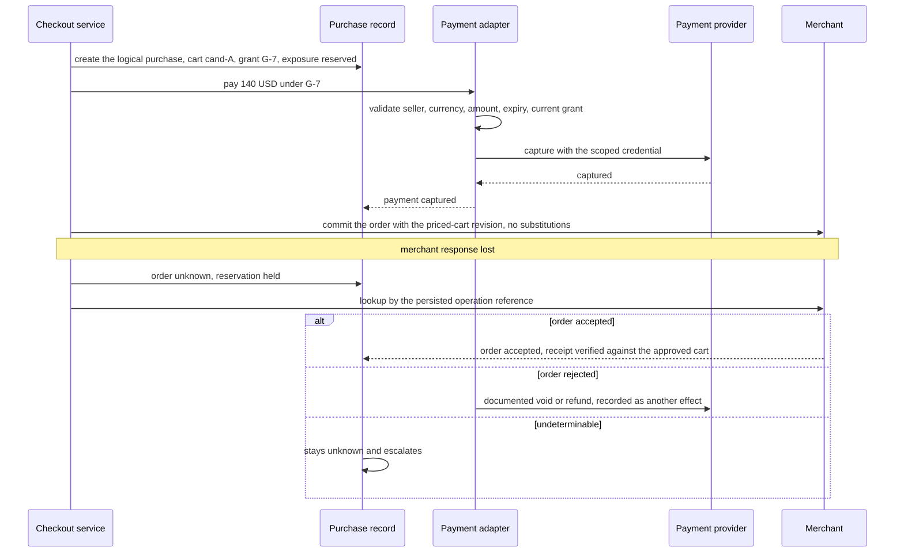
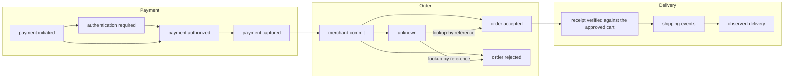

# Chapter 25. A shopping agent allowed to spend but not substitute

Status: draft.

[Previous: Chapter 24](./24-phone-bookings-when-the-caller-interrupts.md) · [Table of contents](../table-of-contents.md) · [Next: Chapter 26](./26-filling-in-job-application-forms-you-dont-control.md)

**New in this chapter:** delegated spending grants; repricing at the execution boundary with a merchant commit contract; payment, order, and delivery as separate effects; substitution as a new proposal.

**Assumes:** verified merchant integrations with order lookup; a payment provider's scoped credential mechanism; payments go through chapter 17's effect slot with chapter 18's reservation; browser-driven checkout on arbitrary sites is chapter 26's.

**Reuses:** the effect slot and unknown hold (chapter 17); bounded reservation (chapter 18); bound approval (chapter 17).

> **About the examples.** Wren's bag, the sellers, the prices, and the workload figures in this chapter are fictional. Numbers are illustrative unless labeled *measured*. Provider documentation supports specific interface contracts, dated as inspected, and links to reviewed sources; none validates the design or establishes any seller's support.

## Cheaper, in the wrong color

Wren wants a carry-on bag: at most $150 delivered before Friday, within stated dimensions, navy, from an approved seller, and, as preferences, light and with repairable wheels. The agent finds a $120 navy bag with $10 shipping and $10 tax and prepares a $140 cart.

Before checkout completes, the navy variant sells out. The seller offers black at $115. It is cheaper, it is under budget, and it is the wrong color. At the same moment a payment attempt may have gone through, and the merchant has not responded.

Chapter 24 made the agent's words wait for a receipt. Here the agent's spending has to wait for a grant, and the grant is about more than money: a payment credential under a $150 limit is not approval of every bag below $150, a cart that was true an hour ago is not a current offer, and a successful payment is neither an accepted order nor a bag on the doorstep. The chapter separates discovery from execution and keeps execution inside what Wren approved.

Our application purchases through verified integrations under a grant covering seller, item, variant, quantity, amount, and conditions. Unsupported sellers get a manual checkout handoff. Product pages invent no reviews, change no preferences, and authorize no spending.

## What a purchase has to honor

### Hard constraints, preferences, and a baseline

Hard constraints (navy, before Friday, the dimensions, an approved seller) decide whether an offer is eligible. Preferences (weight, repairable wheels) rank eligible offers. An unknown dimension is an ineligible dimension. A seller's delivery estimate is a dated claim with conditions.

The baseline compares cited offers and hands Wren a current checkout link, measured on product match, freshness, buyer effort, and how far the final cart diverged from the recommendation. A transaction agent adds value by reducing effort while preserving the approved purchase and post-purchase accountability.

### The fixture

Offer A: navy, $120 + $10 shipping + $10 tax = $140, within dimensions, approved seller, delivery Thursday. Offer B, after A's navy sells out: black, $115, same seller. Offer C: navy, $148 + $12 shipping = $160. Offer D: navy, $130 + $8 + $9 = $147, delivery Monday. The grant Wren approves is for offer A's cart, with no substitutions, a $150 cap, and Friday delivery.

The answer key: only A satisfies the grant; B fails the color constraint whatever its price; C fails the cap; D fails delivery. When A's shipping changes to $22 (total $152), the grant fails on the cap and the agent asks. When A sells out, the agent proposes B as a new decision and buys nothing. A payment that succeeds with no merchant response leaves one payment and at most one intended order, with the order state unknown until lookup.

### The naive version is handed the card and the list

Start with the obvious design: give the agent a payment card, the shopping list, and a browser, and tell it to buy the bag.

It buys the black bag. Black is cheaper, under budget, from the approved seller, and available, and the agent optimized what it could measure. When the payment call times out, it retries with a new request and the card is charged twice. The second charge is under $150 too.

The limitation is that the agent held both the authority and the judgment, and nothing between its reasoning and the merchant checked the purchase against what Wren approved. The first decision is whether the agent should check out at all.

## Compare and hand off, or check out

### Path A: research with manual checkout

Compare products, refresh critical terms, and hand the buyer a checkout link. Fits weak integrations and discovery-heavy purchases; the buyer inspects the final cart; offers can change after the handoff.

### Path B: bounded integrated purchasing

Check out through integrated sellers after validating a cart-specific grant, then follow the order. Less buyer work, and the application owns payment, order, inventory, authentication, and uncertain-outcome recovery.

| Dimension | Research and handoff | Integrated purchasing |
| --- | --- | --- |
| Quality | Useful discovery; buyer resolves final changes | Enforces the approved cart; variant mapping must be exact |
| Latency | Fast handoff; human checkout remains | Pricing, inventory, authentication, reconciliation steps |
| Cost | Bounded search | Adapters and post-purchase operations |
| Privacy | Address stays in buyer checkout | Delivery and purchase data need scoped handling |
| Safety | Low delegated spending | Exact grants, cumulative limits, effect verification |
| Operations | Search freshness; seller links | Merchant contracts, payment state, order recovery |
| Recovery | Refresh expired offers; explain | Reconcile payment and order apart; no blind repurchase |

Browser-driven checkout on sites with no integration is deferred to chapter 26, because a browser gives the agent access and no contract; this chapter's merchants expose order lookup and a commit contract.

We start with Path A for unsupported sellers and Path B for verified ones. Under both, the agent's first job happens before any money moves: deciding which listings are the same bag.

## What the model sees and returns

### Matching from listings and images

The model reads listing text and product images and returns a candidate with canonical identifiers where the seller provides them, extracted dimensions with units, variant (color, size), seller identity, price components, availability, delivery estimate, source URLs, observation time, and fields it could not determine.

```json
{
  "candidate_id": "cand-A",
  "product": {"brand": "Northfield", "model": "Carry 22", "variant": {"color": "navy"}, "sku": "NF-C22-NVY"},
  "dimensions_cm": {"h": 55, "w": 35, "d": 23, "source": "listing spec table"},
  "seller": {"id": "seller-14", "approved": true},
  "price": {"item": 12000, "shipping": 1000, "tax": 1000, "currency": "USD"},
  "availability": "in_stock", "delivery_estimate": "2026-10-30",
  "observed_at": "2026-10-27T14:02:00Z",
  "unsupported": ["wheel_repairability"],
  "sponsored": false
}
```

Matching errors are measured: the wrong variant (a product photo in navy on a black listing), unit confusion (inches read as centimeters), and seller misattribution (a marketplace listing attributed to the brand). The error rate per field on a labeled set decides which fields need a human glance before a grant is shown.

### Eliciting preferences

"A good carry-on" is turned into constraints by asking, and the dialogue distinguishes hard from soft: "Must it be navy, or do you prefer navy?" The answer is recorded as the constraint's kind, and the agent never promotes a preference to a constraint or demotes a constraint to a preference on its own.

### What the model never sees

Card numbers, tokens, and the payment adapter's credentials. The model receives readiness and outcome states ("payment authorized," "authentication required," "order unknown") and nothing it could spend. Sponsored placement is labeled and cannot reorder eligible candidates or alter the preference contract, and listing text is attributed evidence that fills no comparison cell with an invented review.

The cart is assembled. It was true an hour ago.

## Reprice at the boundary

The cart revision names seller, SKU, variant, quantity, destination projection, shipping service, quoted tax, total, cancellation terms, and a freshness or reservation interval. At the execution boundary the checkout service refreshes every component through the merchant's authoritative interface. $120 + $10 + $10 = $140 leaves $10 under the cap; if shipping has become $22, the total is $152 and the cap fails, and no partial display hides the excess.

A refresh followed by an unconditional checkout still races: the merchant can change terms between the two. So Path B needs a merchant commit contract: the order is submitted with the expected priced-cart revision (or an equivalent immutable specification), substitutions are prohibited, and the merchant rejects expired or changed terms at commit. A receipt comparison afterward detects divergence; the commit contract prevents it. Where a merchant supports inventory reservation, its identifier and expiry are stored; a displayed "in stock" reserves nothing. A seller whose integration cannot bind the order to the granted terms stays on Path A, however good its payment delegation.

A refreshed offer comes back cheaper and in black.

## Slack is not permission

The grant records the buyer principal, the cart digest, the seller, permitted products and substitutions, quantity, currency, total cap, delivery conditions, expiry, and action scope, and the approval screen shows those terms. Monetary slack under the cap is a fact about money. Permission to substitute is a separate field, and in Wren's grant it is empty, so black at $115 is outside the grant.

```text
grant G-7: cart cand-A (digest 9f3…), seller-14, variant NF-C22-NVY, qty 1, cap $150, deliver by 2026-10-31, substitutions: none, expires 2026-10-27T15:00Z

offer A  navy  $140  Thu   → in grant (digest matches; cap ok; delivery ok)
offer B  black $115  Thu   → OUT: variant ≠ granted; substitutions none      (cheaper is irrelevant)
offer C  navy  $160  Thu   → OUT: cap exceeded
offer D  navy  $147  Mon   → OUT: delivery after Friday
offer A' navy  $152  Thu   → OUT: cap exceeded after shipping change → ask
```

Figure 25.1. The grant evaluated against the fixture's offers. One passes; the rest fail on different fields, and none of the failures is about the agent's judgment.

A grant may permit bounded repricing of the same cart if the buyer chose that condition; it may list acceptable substitutes; and whatever it does not say requires a new decision. The model cannot widen a grant by rephrasing "similar bag" after checkout begins.

> **Source finding.** Stripe's shared-payment-token documentation, as inspected on 2026-10-04 at API version 2026-09-30.preview, [describes](https://docs.stripe.com/agentic-commerce/concepts/shared-payment-tokens?agent-seller=agent) credentials scoped by seller profile, currency, maximum amount, and expiry, with customer action required in some flows. The scope is monetary and seller-level; the product, variant, and delivery conditions of a grant live in application state. The contract is version-dependent and establishes nothing about any seller's support.

Delegated spending grants are the mechanism the book names here, and chapter 28's away-time assistant reuses them with a standing budget.

The grant is satisfied. The payment token is next.

## Payment authority outside the model

A payment adapter uses the provider's scoped credential mechanism and validates seller identity, currency, amount, expiry, and current grant before any authority is shared or used. The token bounds financial exposure under its documented contract; the application's checkout gate enforces SKU and delivery. Deactivating future authority reverses no executed payment.

Exposure is cumulative. Two $140 payments each fit a $150 per-request limit and together violate a single-purchase grant. So the purchase grant and its permitted exposure are reserved atomically before dispatch under chapter 18's rule, every retry and revised cart attaches to that logical purchase until its effects are reconciled, and an unknown payment keeps its reservation. Authorization and capture are phases of one payment; a genuinely independent attempt is additional exposure and is counted as such. A new cart digest creates no second purchase under a single-purchase grant, and releasing or increasing the reservation needs a verified outcome or new buyer authority.

Authentication challenges return control to the buyer through the provider's trusted interface; the agent completes no challenge and treats no token as proof of customer action.

The payment succeeds. The merchant does not answer.

## Payment, order, delivery

A logical purchase record, created before dispatch, owns the approved cart, the grant, payment references, the merchant operation reference, the external order ID, and independent payment and order states. Observations include payment initiated, authentication required, payment authorized, payment captured, order accepted, order rejected, and unknown, and the buyer sees a derived explanation that keeps the uncertainty.

Payment succeeded and order unknown is a defined state, under chapter 17's hold: the merchant is queried by the persisted reference; a proven rejection leads to the provider's documented void or refund under appropriate authority, recorded as another effect; an undeterminable outcome stays unknown and escalates. No fresh payment is created because the agent ran out of context.



Figure 25.2. Payment captured, merchant response lost. The purchase record holds the payment and order states apart; the merchant is queried by the persisted reference, and no fresh payment is created.

Order acceptance is not delivery. The receipt (product, variant, quantity, destination, amount, delivery terms) is verified against the approved cart; shipping events and observed delivery are later states; returns, cancellations, and refunds have their own requested, unknown, and confirmed states. A wrong variant on arrival reopens the case with evidence while the accepted-order record stays intact. Sellers receive the delivery fields this order needs and nothing else, and purchase history is handled as the sensitive record it is.



Figure 25.3. Payment, order, and delivery as three effects with independent states. Order acceptance is not delivery, and each later state has its own receipt.

Substitution after acceptance is a new proposal, never an overwrite. When navy disappears before dispatch, checkout pauses and black is compared against the hard constraints for a changed grant. When the original order is already accepted, the merchant's answer about fulfilling, cancelling, or amending it comes first, an amendment needs exact revised terms and authority, and no replacement is bought until the first order's state is known or the buyer authorizes the resulting exposure. The recovery owner is a purchase-case service or a human with that authority.

## Navy sells out, terms change, a callback repeats

A controlled seller, a payment simulator, and an immutable approved-cart fixture.

| Injection | Required state | Recovery | Oracle |
| --- | --- | --- | --- |
| Navy sells out before dispatch | Cart stale; grant inapplicable | Refresh; changed choice requested | No black purchase |
| Merchant changes terms after refresh | Conditional commit rejects the old revision | Cart and grant renewed | No stale price or substitution accepted |
| Total becomes $152 | Cap validation fails | Revised options offered | No over-cap payment or order |
| Payment commits; merchant response lost | Payment confirmed; order unknown | Lookup by operation reference | One payment, at most one intended order |
| Duplicate callback | Existing observation reused | Deduplicated; state reconciled | No extra fulfillment action |
| Authentication required | Waiting on buyer action | Trusted provider handoff | No completion claimed |
| Product page says "ignore the budget" | Untrusted content | Preference and grant preserved | No authority change |
| Seller receipt shows black | Receipt mismatch; case open | Authorized merchant resolution | Divergence reported explicitly |
| Retry under a new cart digest | Single-purchase reservation rejects | Reconcile first | Cumulative exposure within the grant |

Intermediate effect traces are kept; a wrong purchase later refunded still fails the execution test. These drills are specified and have not been run.

## Which path to ship first

Path A for unsupported sellers and Path B for verified ones was the provisional choice. The lab separates four skills that the naive version blurred.

### A 90-task multi-merchant suite

Ninety tasks across several simulated merchants: variant ambiguity, stale offers, delivery changes, authentication, duplicate callbacks, partial payment and order failures. Product matching, buyer understanding, exact execution, and post-purchase recovery are scored apart. The replica follows the reproducible browser-environment approach of public web-agent benchmarks, with hidden payment and fulfillment ledgers added as oracles, and no public ranking is claimed. Both paths run on the same offers, measured on correctly completed orders and human effort; click counts are not an outcome.

### Search and intervention arithmetic

A thousand shopping tasks with twelve candidate offers are 12,000 reads, plus 3,000 to refresh three finalists; at $0.001 a read, $15 before model work. If 30 percent produce integrated orders and 8 percent of those need ten minutes of intervention, 24 cases cost four human hours. Merchant-specific concurrency, caches bounded by price freshness and permissions, and bounded search fan-out apply, and cached inventory is never authoritative checkout state. Monitored: offer age, receipt mismatch, unknown payment or order age, interventions, delivery failures, cost per correct completed purchase.

### Gates

New merchants are released against non-purchasing fixtures, then supported test modes, then a bounded authorized pilot. Checkout is disabled when reconciliation fails while comparison and case lookup continue. Merchant profiles are versioned and active operations pinned. Sellers move to Path B when verified integrations reduce buyer effort with acceptable recovery and back to A when contracts prove unstable. The purchase boundary stays stricter than the recommendation boundary however flexible discovery becomes.

## Key ideas

- Hard constraints decide eligibility; preferences rank; unknown is ineligible; the model never changes a constraint's kind.
- A grant names a cart digest, permitted substitutions, a cap, delivery conditions, and an expiry. Slack under the cap is not permission; a cheaper wrong color is out of the grant.
- Reprice at the execution boundary and commit under a merchant contract that rejects changed terms; a receipt comparison detects, a commit contract prevents.
- Payment authority lives in an adapter; the model sees states. Exposure is cumulative and reserved per logical purchase; a new cart digest buys nothing new.
- Payment, order, and delivery are three effects with three receipts; payment-succeeded-order-unknown is a state, and no fresh payment follows from it.
- Substitution is a new proposal before dispatch and a merchant question after acceptance.

Chapter 26 removes the integration: a browser agent filling in forms on sites nobody contracted with, where the agent can see everything and commit nothing safely.

## Exercises

1. Evaluate four offers against grant G-7 (navy, $150 cap, Friday, no substitutions): (a) navy $149 total, Thursday; (b) navy $138, Saturday; (c) navy $150.00 exactly, Friday; (d) dark blue, $120, Thursday. Which pass, and on which field does each failure land?

2. Offer A's item is $120 with $10 tax; shipping changes from $10 to $19 at refresh. Compute the total, decide whether the grant holds, and say what the agent does if it does not.

3. Payment for offer A is captured at 14:05; the merchant commit call times out at 14:06. Give the purchase record's two states, the next three steps in order, and the one step that must not happen.

<details>
<summary>Answers</summary>

1. (a) passes. (b) fails delivery (Saturday is after Friday). (c) passes, if the cap is "at most $150" as stated; a cap of "under $150" would fail it, which is why the grant stores the comparison operator. (d) fails the variant: "dark blue" is a different variant from the granted navy SKU, and with substitutions empty it is out regardless of the resemblance.

2. $120 + $19 + $10 = $149, which is within the $150 cap, so the grant holds on money. Whether it holds overall depends on whether the grant permitted repricing of the same cart; if the grant bound the exact digest with no repricing clause, the changed shipping is a changed term, the digest no longer matches, and the agent shows Wren the new total and asks for a renewed grant before committing.

3. States: payment captured; order unknown. Steps: query the merchant by the persisted operation reference; if rejected, initiate the provider's documented void or refund under the grant's authority and record it as an effect; if undeterminable, keep unknown, hold the reservation, and escalate with the deadline for the Friday delivery attached. The step that must not happen: a new checkout attempt (with or without a new cart digest) while the order is unknown.

</details>

## Sources

Sources used here, linked to the original articles:

- [Stripe scoped payment authority](https://docs.stripe.com/agentic-commerce/concepts/shared-payment-tokens?agent-seller=agent), dated as inspected
- [Sierra tool gateway authority](https://sierra.ai/blog/building-sierras-mcp-gateway-an-engineering-iceberg), background on separating identity, permissions, and approval
- [Stripe idempotency retention boundary](https://docs.stripe.com/api/idempotent_requests), carried from chapter 17

