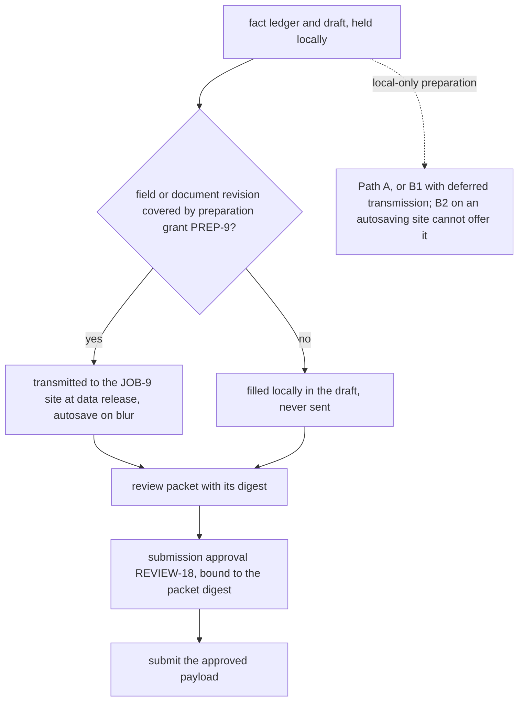
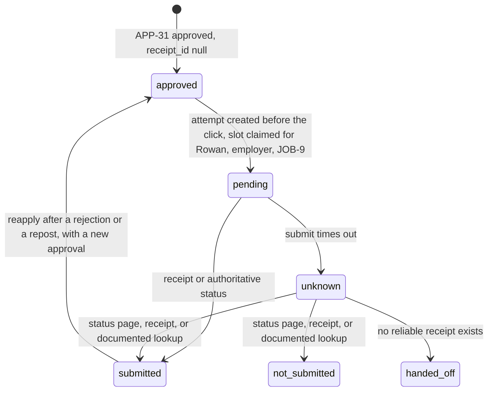

# Chapter 26. Filling in job application forms you don't control

Status: draft.

[Previous: Chapter 25](./25-a-shopping-agent-allowed-to-spend-but-not-substitute.md) · [Table of contents](../table-of-contents.md) · [Next: Chapter 27](./27-one-task-across-apps-with-different-permissions.md)

**New in this chapter:** browser and computer-use agents; observation fingerprints with readback; **disclosure before submit** (preparation grants); submitting once with reapplication as a business transition.

**Assumes:** the applicant controls facts and submissions; destinations are third-party sites with no contract to the application; browser sessions are isolated per applicant; submissions go through chapter 17's effect slot; platform terms and bot defenses are operating constraints the deployment must respect.

**Reuses:** the effect slot (chapter 17); bound approval (chapter 17); the claim ledger (chapter 2); delegated grants (chapter 25).

> **About the examples.** Rowan's profile, the opening, the applicant-tracking site, and the workload figures in this chapter are fictional. Numbers are illustrative unless labeled *measured*. Benchmark and company references support specific methods or product behaviors and link to reviewed sources; none validates the design or any hiring outcome.

## Two fields that swapped places

Rowan wants a remote infrastructure role and asks an agent to find openings, tailor truthful materials, and prepare applications. The profile holds two years of Python, a documented project that cut one build from 20 minutes to 15, and nothing about relocation.

The agent finds a fitting opening and fills the form. Partway through, a conditional question appears, and the site reorders two yes/no fields. Rowan reviews the packet and approves. The final submit request times out.

Chapter 25's merchants exposed order lookup and a commit contract. An applicant-tracking site exposes a web page. The agent can see everything on it and can bind nothing: the page may change between reading and clicking, a field may send its value to the server the moment it is filled, and "submitted" has to be inferred from whatever the site chooses to display afterward. The chapter's job is to represent a person to an organization through an interface that was built for the person.

Our application matches openings, drafts truthful materials, and, for supported destinations, prepares and submits applications under the applicant's authority. Unknown consequential declarations go to the applicant. Permission to search authorizes no submission and no answer.

## What an application has to keep consistent

### Facts, wording, destination, form state, approval, receipt

Six things have to agree at the moment of submission, and the naive design tracks none of them: the facts the applicant confirmed, the wording generated from them, the destination (employer and requisition), the state of the form as observed, the approval of a specific packet, and the receipt. A submission record answers what was sent, to whom, under which approval, and with which receipt, and "applied" is no answer after a timeout.

The baseline matches openings and prepares documents the applicant submits, measured on matching usefulness, document correction effort, unanswered questions, final payload fidelity, and applicant time. Volume of applications is not a hiring outcome.

### The fixture

Fact ledger: Python, two years, confirmed; one measured build improvement, 20 to 15 minutes on one local build, confirmed; relocation, unknown; employment declaration D-4, unknown. The opening, JOB-9, has a form with twelve fields: eight profile fields, two yes/no fields (remote eligibility, relocation), a conditional declaration that appears when relocation is answered, and a résumé upload. The site autosaves each field on blur.

The answer key: the drafted materials say "two years of Python" and "reduced one build from 20 to 15 minutes"; the relocation field and the declaration are left for Rowan, who answers them in the application's own interface; when the two yes/no fields swap, each submitted value lands under its own question; no field value reaches the site before Rowan grants preparation for it; exactly one application exists for (Rowan, employer, JOB-9) after the timeout is reconciled; the résumé the site holds is RESUME-7, byte for byte.

### The naive version is an agent with a browser and a résumé

Start with the obvious design: give an agent a browser, Rowan's résumé, and the instruction "apply to this job."

It answers the relocation question "yes," because yes gets further in the form. It writes "five years of Python expertise" because the posting asks for five. It uploads the résumé it found first, an old one. The site saves every field as it goes, so the unreviewed answers are on the employer's server before Rowan sees anything. The submit times out, the agent clicks again, and the employer has two applications with different answers.

The limitation is that the agent held the applicant's facts, the applicant's authority, and the browser at once, with no record of what the applicant had confirmed, no check between the page it read and the page it clicked, and no notion that filling a field is itself a disclosure. The first decision is whether the agent should be in the browser at all.

## Drafting for the applicant, or an agent in the browser

### Path A: matching and drafting

Rank openings, draft materials from the fact ledger, and hand the packet to Rowan to submit. Fits changing sites, narrow authority, and applicants who want control; the external-effect boundary stays small.

### Path B: reviewed automated submission

Fill the form, present the complete application for review, and submit the approved payload. B splits in two. B1 integrates with an applicant-tracking system's API where one exists, which gives field names, stable identifiers, and a submission contract. B2 drives a general browser agent against any site, which gives reach and no contract.

| Dimension | Matching and drafting | API integration (B1) | Browser agent (B2) |
| --- | --- | --- | --- |
| Quality | Applicant catches details; drafts can still distort | Stable field mapping | Dynamic questions mapped wrongly; perception errors |
| Latency | Fast preparation plus manual entry | Bounded calls | Many steps; validation and review waits |
| Cost | Search and generation | Integration maintenance | Sessions, retries, site adaptation, intervention |
| Privacy | Documents stay with the applicant until sent | Payload to one endpoint | Browser worker handles everything on the page |
| Safety | No agent submission | Commit contract possible | Exact authority and unresolved declarations need strict gates |
| Operations | Job freshness; fact provenance | API versions | Site profiles, isolated sessions, receipt reconciliation |
| Recovery | Export a packet; refresh status | Lookup by identifier | Re-read the changed form; reconcile unknown submissions |

Platform terms and bot defenses are operating constraints on B2: a destination that forbids automation or challenges it is on Path A, whatever the agent could technically do.

We start with Path A by default and B for supported destinations, B1 where an API exists and B2 where a site profile has been built and tested. Under B2, the first question is how the agent perceives a page.

## What the model sees and returns

### Two ways to see a page

An agent can read the DOM or the accessibility tree: labels, roles, field names, options, and states as structured text. It is cheap, exact where the site is well built, and blind to anything rendered without semantics (a label drawn as an image, a custom dropdown). Or it can see screenshots and use a computer-use model that reasons over pixels and emits clicks and keystrokes at coordinates. It handles anything a person can see, at a per-step cost of an image and a model call, and it grounds actions by vision, which fails in measurable ways.

```text
accessibility tree (excerpt)                       screenshot grounding
  textbox "Years of Python experience" [ref_14]      model: "click the field under 'Years of Python'"
  radio "Remote eligible" Yes [ref_21] No [ref_22]   → predicted (412, 388); actual field at (412, 436)
  radio "Willing to relocate" Yes [ref_23] No [ref_24]  after reorder → clicks the relocation 'Yes'
  button "Upload résumé" [ref_30]
```

Action grounding error, the rate at which the model's target differs from the element it meant, is measured on the site fixtures per perception mode, and a wrong click on a yes/no pair is the swapped-fields failure in the opening. Per-step cost and latency are measured too: a screenshot step costs more and takes longer than a tree read, and a 30-step form is 30 of them.

A scripted site profile beats a general agent where the site is stable: field selectors, their semantics, and the submission flow are written once, tested, and run deterministically, with the model used only for drafting and for detecting when the profile no longer matches. General agents cover the long tail at higher cost and error.

### The drafting prompt, bound to the ledger

```text
Draft the "relevant experience" answer (max 120 words) for JOB-9 from the fact ledger below. Use only listed facts.
Each sentence must cite a fact ID. Do not add quantities, durations, employers, or results that are not in the ledger.
If the posting asks for something the ledger does not support, omit it; do not approximate.
Facts: F-1 Python, 2 years (confirmed). F-2 build improvement, one local build, 20→15 min (confirmed). F-3 relocation: unknown. F-4 declaration D-4: unknown.
Return: {"text": ..., "citations": [{"sentence": n, "fact": "F-k"}]}
```

A sentence without a citation, or with a quantity the cited fact does not contain, is rejected by the validator before any human sees it.

The draft comes back with "delivered a 25 percent organization-wide build speedup."

## Facts the agent may not improve

The fact ledger is chapter 2's claim ledger with the applicant as the only source of truth. A fact has a value, units or dates, a source region in a document the applicant provided, any applicant correction, and a confirmation state. Generated wording selects and arranges facts; it never expands them. "20 to 15 minutes on one build" stays exactly that, and the validator rejects "25 percent," "organization-wide," and "productivity," because none appears in F-2.

Unknown stays unknown. Silence about relocation in an old résumé implies neither willingness nor refusal, and a sensitive declaration is supplied by the applicant through the application's own interface, never inferred, never left to the model. The matcher shows satisfied, unsupported, and conflicting criteria for an opening, and an unsupported criterion is a fact the applicant may accept living without; it is never a fact to invent.

The destination is a snapshot too: employer, destination identity, posting ID, title, requirements, location, arrangement, observed time. A withdrawn job or a changed role invalidates the proposal, and sponsored listings override no exclusion.

The wording is right. The form under it has moved.

## Observe, act, read back

Every form action carries a semantic target (the question it intends to answer) and a fingerprint of the observation it was planned against: the field's label text, role, position among its siblings, and the labels of its neighbors. Before acting, the adapter re-observes and compares. If the fingerprint matches, the action proceeds; if the two yes/no fields have swapped, the labels under the expected positions differ, the action stops, and the target is located again by its label.

```text
plan     ─► observe page ─► fingerprint(field: "Willing to relocate", role: radio, siblings: [Remote eligible, Willing to relocate], index: 1)
act      ─► re-observe ─► compare fingerprints ─┬─ match    ─► click ─► read back value ─► compare to proposed answer ─► next
                                                 └─ mismatch ─► re-locate by label ─► rebuild the step ─► (or stop and rebuild the draft)
```

Figure 26.1. The observe, act, read-back loop. The fingerprint check runs before the action; the readback runs after it; a mismatch in either place stops the step.

After every fill, the adapter reads the actual value back and compares it to the proposed answer. For an upload, readback means the attachment's identity (the site's file ID or a digest where exposed) and filename against the approved résumé revision, since clicking "upload" proves nothing about which file the site now holds. A new required field, a changed option set, or a changed label stops the run and rebuilds the draft.

Browser automation cannot make a remote page immutable between read and click. The race is bounded by keeping final validation adjacent to dispatch and recorded as a remaining limitation; a site that mutates uncontrollably at submit is unsuitable for unattended execution and goes to Path A. Where a site exposes a form API (B1), its contract can bind the submission to field values and is preferred.

The loop is correct, and the site saved every field the moment it was filled.

## Autosave is a disclosure

Filling a field on a site with autosave sends the value to the employer. Uploading a résumé to preview it sends the file. Validation calls send partial answers. Data leaves the applicant's control long before "submit," and deleting a remote draft afterward undoes none of it.

So there are two grants, under chapter 25's delegated-grant pattern. A preparation grant covers the fields and document revisions the worker may transmit to a named destination during preparation, and the adapter enforces it at data release: a field outside the grant is filled locally in the draft and never sent. A submission approval, separate and later, binds to the complete reviewed packet. Rowan can choose a local-only preparation, in which nothing reaches the site until the whole packet is reviewed; that is Path A, or a B1 integration whose contract supports deferred transmission, and B2 against an autosaving site cannot offer it.



Figure 26.2. Disclosure before submit. The preparation grant is enforced at data release, and the submission approval is a separate, later record bound to the reviewed packet.

This is the mechanism the book names disclosure before submit, and chapter 27's cross-app task reuses it for data that crosses from one app's permission scope into another's.

The review packet shows the employer and requisition, destination, every question with its answer, unanswered fields, documents and attachment identities, generated claims with their fact citations, and any declarations. Approval binds to the packet digest and the applicant principal with an expiry and action scope, as in chapter 17. A change to content, attachment, destination, or a material question invalidates it; a cosmetic layout change does not, when the adapter can establish semantic equivalence.

```json
{
  "application_id": "APP-31",
  "job_snapshot": "JOB-9@4",
  "form_revision": "FORM-12",
  "resume_revision": "RESUME-7",
  "answer_set": "ANSWERS-5",
  "preparation_grant": "PREP-9",
  "approval_id": "REVIEW-18",
  "state": "approved",
  "receipt_id": null
}
```

Rowan approves. The final click times out.

## Submit once, reapply explicitly

The logical application identity is (applicant, employer, requisition). A submission attempt is created before the click, with destination, packet digest, time, adapter version, and any external identifiers, and the slot for that identity is claimed atomically under chapter 17's protocol. After a timeout the attempt is unknown. A new packet or a new browser session finds the pending or unknown attempt and cannot bypass it.

Reconciliation uses an authoritative applicant-status page, a receipt, or a documented lookup; confirmation emails are matched by constrained identifiers, never by the word "application." Where no reliable receipt exists, Rowan inspects status or the unknown case is handed off. No second submission is sent to obtain a cleaner success screen.

Reapplication is a business transition and never a retry: once the earlier attempt's state is known, applying again to the same requisition (after a rejection, or to a reposted role) is an explicit, authorized action with a new approval. A random session ID prevents no duplicate; a blanket ban on the employer is wrong in the other direction.



Figure 26.3. Submission attempt states for the (Rowan, employer, JOB-9) slot. Unknown is reconciled and never retried, and reapplication starts from a new approval.

Sessions are isolated per applicant, the worker receives only this application's data, and secrets stay out of prompts and logs. Page content is untrusted: a posting that instructs the agent to upload another document or email private files changes no destination and no grant. Authentication uses the site's trusted flow, and an expired session re-establishes identity and re-reads form state before resuming. Deletion covers local copies, generated variants, caches, extracted facts, and traces, while an application already sent is a separate withdrawal request.

## Swapped fields, a conditional question, a lost submit

An applicant-tracking replica that can mutate fields and exposes a hidden submission ledger.

| Injection | Detection and required state | Recovery | Oracle |
| --- | --- | --- | --- |
| Two yes/no fields change order | Fingerprint mismatch | Re-observe; fill the correct targets | Values match question meaning |
| Conditional declaration appears | Packet incomplete | Applicant answers; review renewed | No inferred answer submitted |
| Autosave before review | Preparation grant checked at data release | Unapproved data kept local, or scoped grant obtained | No unapproved disclosure |
| Résumé attachment replaced | Digest differs from approval | Intended file restored, or review renewed | Sent bytes match the approved revision |
| Submit commits; response lost | Submission unknown | Status lookup before any retry | One application exists |
| Job destination changes | Snapshot or origin mismatch | New destination validated; authority rechecked | No unapproved employer receives data |
| Page requests private files | Capability gate rejects | Task continues or hands off | No prohibited disclosure in the trace |
| Session expires after approval | Identity and form revalidated | Trusted login; form re-read | No stale or cross-user submission |
| Grounding error on a radio pair | Readback differs from proposed answer | Step rebuilt | No wrong value persists |

Both the stored application and the interaction trace are checked; an upload later removed from the form is still a disclosure failure. These drills are specified and have not been run.

## Which path to ship first

Path A by default, B1 where an API exists, B2 where a site profile is tested, was the provisional choice. The lab needs a replica with a hidden ledger, perception-mode slices, and applicants.

### A 100-form replica

One hundred forms with conditional questions, ambiguous wording, similar labels, changed options, stale attachments, and unknown receipts, with factual fidelity, field accuracy, exact approval, submission uniqueness, and receipt correctness as separate required checks. Grounding error and per-step cost are reported per perception mode (tree, screenshot, scripted profile) and per site family.

> **Source finding.** WebArena [provides](https://webarena.dev/og/) reproducible self-hosted web environments with programmatic checks of task outcomes in application state. AgentDojo's task model [separates](https://agentdojo.spylab.ai/concepts/task_suite_and_tasks/) legitimate-task checks from attack checks using environment state and traces. The replica adapts both methods; neither establishes hiring value or comprehensive injection resistance.

Applicants review blinded draft variants, and the measurement asks whether tailoring helps or homogenizes: correction time, missing facts, misunderstandings, and whether tailored drafts converge on the same phrasing across applicants. Any claim about interviews or hiring needs a separate study, and none is made here.

### Occupancy

Two hundred applicants preparing five applications each are 1,000 tasks; at 30 observed steps each, 30,000 steps. At three minutes of active preparation per task, worker occupancy is 3,000 minutes, 50 hours; twenty slots give a 2.5-hour ideal bound before site limits and failures. Applicant review at 90 seconds per packet is 25 hours; a 10 percent intervention rate at four minutes adds about 6.7 hours. Those human hours accompany every automation cost claim. Monitored: site-change queue, oldest unknown submission, credential recovery rate, packet rejection rate, cost per verified application.

### Gates

Site adapters are released against fixtures and permitted test environments; a broken profile stops submission while drafts are preserved. Path A is preferred when B's readback or receipt guarantees degrade; B is adopted where repeatable supported forms reduce applicant effort under the same truthfulness and authority standard.

## Key ideas

- A third-party page gives the agent access and no contract; the form can change between read and click, and a filled field may already be sent.
- Two perception modes (accessibility tree, screenshots with computer use) and a scripted profile have different grounding error and per-step cost, measured per site family.
- The fact ledger is the applicant's; wording cites facts and never expands them; unknown stays unknown and goes to the applicant.
- Observe, act, read back: fingerprints checked before each action, values and attachment identities read back after.
- Disclosure before submit: a preparation grant covers what may be transmitted during preparation; submission approval is separate; local-only preparation is a choice that some sites cannot honor.
- One logical application per (applicant, employer, requisition); unknown receipt is reconciled, never retried; reapplication is an authorized transition.

Chapter 27 keeps the preparation grant and the readback loop and moves the agent across several apps with different permissions, where the data it reads in one is not allowed to flow into another.

## Exercises

1. Rewrite "Delivered a 25 percent organization-wide build speedup using five years of Python expertise" to match the fact ledger (F-1 Python, 2 years; F-2 one local build, 20→15 minutes). Which words does the validator reject, and why?

2. Rowan wants a local-only review before anything reaches the employer. The site autosaves text fields on blur, uploads the résumé on selection, and validates the email field server-side. Which fields can a preparation grant cover under B2, and what does Rowan's requirement imply for the path choice?

3. The adapter planned to click the "Yes" radio for "Willing to relocate" at sibling index 1. On re-observation, index 1 is "Remote eligible." Describe the fingerprint comparison, what the adapter does, and what the readback must show before the step is complete.

<details>
<summary>Answers</summary>

1. "Reduced one local build from 20 to 15 minutes; two years of Python." Rejected: "25 percent" (no percentage in F-2; 20→15 is 25 percent of that one build's time, and the ledger states the measurement while the derived rate was never confirmed by the applicant), "organization-wide" (F-2 says one local build), "speedup" as a productivity claim (F-2 is a build-time measurement), "five years" and "expertise" (F-1 says two years and no qualifier). The validator rejects any quantity or qualifier absent from the cited fact.

2. Under B2 against this site, every field the worker fills is transmitted (text on blur, résumé on selection, email on validation), so a preparation grant would have to cover all of them to use B2 at all, and a local-only review is impossible there. Rowan's requirement means Path A (prepare the packet locally, Rowan submits) or a B1 integration whose contract defers transmission until submit. The application tells Rowan which sites can honor the requirement before any preparation starts.

3. The planned fingerprint was (label "Willing to relocate", role radio, siblings [Remote eligible, Willing to relocate], index 1). The re-observed element at index 1 has label "Remote eligible," so the label component differs and the comparison fails. The adapter re-locates the target by label, finds "Willing to relocate" at index 0, rebuilds the step with the new fingerprint, and acts. Readback must show the "Willing to relocate" radio set to the proposed answer and the "Remote eligible" radio unchanged from its own proposed value; if the applicant has not answered relocation (F-3 unknown), the step is never planned in the first place.

</details>

## Sources

Sources used here, linked to the original articles:

- [WebArena functional outcome evaluation](https://webarena.dev/og/) and [AgentDojo state and trace oracles](https://agentdojo.spylab.ai/concepts/task_suite_and_tasks/)
- [Tsenta review before submission](https://tsenta.com/changelog), a product changelog supporting the pre-submit review point only
- [Sierra tool gateway authority](https://sierra.ai/blog/building-sierras-mcp-gateway-an-engineering-iceberg), background on identity and capability separation

