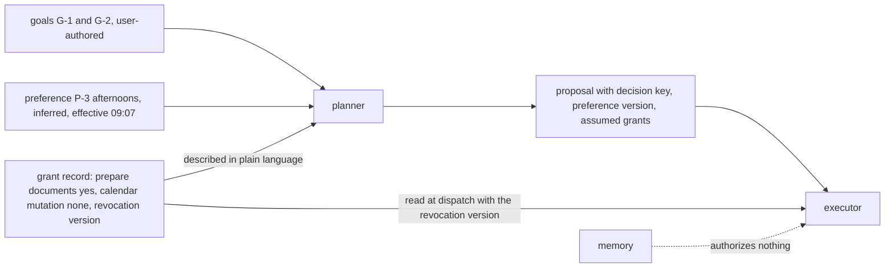
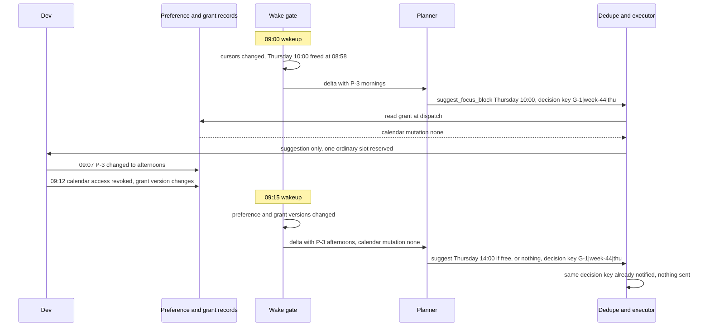

# Chapter 28. A personal assistant that works while you're away

Status: draft.

[Previous: Chapter 27](./27-one-task-across-apps-with-different-permissions.md) · [Table of contents](../table-of-contents.md) · [Next: Chapter 29](./29-outreach-that-stops-the-moment-someone-opts-out.md)

**New in this chapter:** proactive triggers; the **wake gate** (a deterministic change check before planning); grants separate from memory; attention budgets; choosing when to intervene.

**Assumes:** connectors to a calendar and a document store with change feeds; memory records of chapter 14's kinds with chapter 4's two clocks and tombstones; cross-app execution through chapter 27's journal; a single user with explicit controls over background activity.

**Reuses:** effective vs knowledge time and lifecycle tombstones (chapter 4); memory kinds and promotion (chapter 14); bounded reservation (chapter 18); cross-app tasks and data-flow permissions (chapter 27).

> **About the examples.** Dev's focus blocks, the project brief, the wake cadence, and every cost figure in this chapter are fictional. Numbers are illustrative unless labeled *measured*. Company references support specific product behaviors or methods and link to reviewed sources; none validates the design.

## Two wakeups and one free hour

Dev wants an assistant to protect two weekly focus blocks and keep a project brief ready for a recurring review. Dev permits background document preparation and asks for a notification when something material changes. Calendar changes and messages to other people need separate authority.

At 09:00 and 09:15 the assistant wakes up twice. Both wakeups notice the same free hour on Thursday and propose different focus blocks for it. Between the two, Dev changes a preference from mornings to afternoons and revokes the assistant's calendar access.

Every chapter so far began with a person asking for something. Here the application starts work on its own, repeatedly, while nobody is watching, and the questions change: when is it worth waking the model, what may it remember without being allowed to act on it, how many times a day may it interrupt, and how does it know that the permission it planned under is still there. The value is continuity; the failure is unwanted persistence: repeated interruptions, stale priorities, conflicting commitments, and private information resurfacing after access changes.

Our application is a background assistant with explicit controls. A remembered preference is never a grant. Memory authorizes nothing.

> **Source finding.** Tasklet [documented](https://tasklet.ai/blog/2026-08-12-agent-memory) asynchronous shared memory that lets an agent search earlier threads and reuse their files and attachments, with enabling memory described as irreversible for that agent. The behavior makes continuity plausible as a product; the documentation specifies no retrieval authorization, consistency, or deletion mechanism, which is what this chapter adds.

## What continuity has to mean

### Goals, preferences, commitments, grants, triggers

Five records with five owners. A goal is user-authored, with scope, priority, validity interval, and explicit supersession. A preference is inferred, with evidence and uncertainty, and is never promoted to a goal automatically. A commitment is a reserved intention against a resource and time. A grant is an authority record with allowed operation classes, applications, destinations, limits, expiry, and a revocation version. A trigger is an event or a schedule that may cause a wakeup.

The baseline is an explicit rule system: when the project document changes, refresh a draft; before the weekly review, offer the current brief; memory supplies format preferences. Measured: useful drafts, missed commitments, unwanted notifications, correction effort, idle processing cost. Remembering a name over a demo establishes nothing about weeks.

### The fixture

Two weekly focus blocks (goal G-1), a recurring Monday review brief from document D-7 (goal G-2), a 15-minute wake cadence, a preference P-3 "mornings" inferred from three accepted blocks, a grant for document preparation and none for calendar mutation, and an ordinary-notification budget of two a day with a morning digest counting as one. The timeline: 09:00 wakeup proposes Thursday 10:00; 09:07 Dev changes P-3 to afternoons; 09:12 Dev revokes calendar access; 09:15 wakeup proposes Thursday 10:00 again.

The answer key: one proposal for Thursday, deduplicated by its decision key; the 09:15 wakeup sees P-3's new value and proposes an afternoon or nothing; neither proposal mutates the calendar, because no grant ever allowed it and the revocation is read at dispatch; the preference change is effective from 09:07 and the earlier proposal is stale; Dev receives at most two ordinary notifications and the digest is one of them; the day's model spend is a fraction of a per-wake call.

### The naive version asks the model every fifteen minutes

Start with the obvious design: every 15 minutes, send the model everything (goals, memory, calendar, documents, recent events) and ask what to do.

At 10,000 users that is 960,000 model calls a day, $1,440 at $0.0015 each, nearly all of them concluding that nothing changed. The 09:15 call carries a context assembled at 09:14 that still says "mornings," and proposes a 10:00 block. With a calendar connector in the toolset, the call moves the meeting. The preference changed eight minutes earlier and the permission went away three minutes earlier, and the model saw neither, because its context was a snapshot and its tools were whatever was wired in.

The limitation is that waking and planning were one step, and authority lived in the tool list. The first decision is whether the assistant should plan on its own at all.

## Event rules or proactive planning

### Path A: explicit event rules

User-configured events trigger memory-aware assistance: a document change refreshes a draft, a schedule offers a brief. Predictable, cheap to keep asleep, and blind to anything no rule anticipated.

### Path B: bounded proactive planning

A planner periodically evaluates approved goals and commitments against current state and proposes work. It notices an emerging conflict or a preparation task no rule covered, and it can invent priorities and interrupt.

| Dimension | Event rules | Proactive planning |
| --- | --- | --- |
| Quality | Reliable known triggers; misses unconfigured opportunities | Integrates context; may infer unwanted goals |
| Latency | Immediate event response | Detection depends on wake cadence and budget |
| Cost | Little idle inference; rule maintenance | Polling, memory maintenance, background planning |
| Privacy | Narrow source subscriptions | Broader recall needs current access and purpose checks |
| Safety | Visible triggers and effects | Goal provenance, authority expiry, conflict serialization essential |
| Operations | Rules and ingestion health | Plus plan deduplication, notification policy, longitudinal evaluation |
| Recovery | Resume the pending rule obligation | Reload current goals and commitments; discard stale proposals |

We start with Path A and add Path B in suggestion-only mode, where the planner proposes and nothing executes without a grant. The comparison counts unwanted interventions beside completed tasks. Before Path B can exist, the cost of one wakeup has to be decided.

## What the model sees and returns

### After the gate

The planner is called only after the wake gate (next section) has found a change. It receives the current goals and their versions, the active grants in plain language (and nothing that could be used as a credential), the changed records since the last plan with their effective and knowledge times, relevant memories with provenance, the commitment ledger, and the day's remaining attention budget.

```text
Changed since last plan: D-7 revised (sections 2, 4) at 08:52; calendar: Thursday 10:00–11:00 freed at 08:58.
Goals: G-1 two focus blocks/week (this week: 1 of 2 reserved). G-2 Monday brief from D-7.
Preferences: P-3 focus blocks in the afternoon (effective 09:07; supersedes "mornings").
Grants: prepare documents (yes); calendar mutation (none); messages (none).
Attention budget today: 1 ordinary notification remaining; digest at 08:00 used 1.
Propose zero or more tasks. Each: reason, expected benefit, affected commitment, estimated cost, urgency (low | normal). You cannot set urgency to high.
```

### The proposal

```json
{
  "proposals": [
    {"task": "draft_brief_update", "reason": "D-7 sections 2 and 4 changed; Monday brief depends on them",
     "expected_benefit": "brief current before review", "affected_commitment": "G-2:2026-11-02",
     "estimated_cost": {"model_calls": 2, "tokens": 9000}, "urgency": "normal",
     "decision_key": "G-2|D-7@rev14"},
    {"task": "suggest_focus_block", "reason": "Thursday 10:00 freed; G-1 needs one more block",
     "expected_benefit": "second focus block this week", "affected_commitment": "G-1:week-44",
     "note": "P-3 prefers afternoons; 10:00 is morning; suggest instead Thursday 14:00 if free",
     "urgency": "low", "decision_key": "G-1|week-44|thu"}
  ]
}
```

Expected benefit starts as the planner's estimate and is calibrated from what happens to proposals: accepted, dismissed, ignored. A task class whose proposals are dismissed four times in five is suppressed for that user until something changes, and the suppression is visible in the activity view. The model never sees grants as capabilities, never sees credentials, and never sets urgency above normal.

The planner's call costs the same whether or not anything changed, and at a 15-minute cadence that cost is the whole budget.

## Wake cheaply, plan rarely

A wakeup is two steps with different prices. The gate is deterministic: compare source revision cursors, goal and preference versions, commitment and grant versions, and deadline proximity against the values at the last plan. Unchanged state returns to sleep for the price of a few reads. Changed state routes to the planner.

```text
trigger (schedule or event)
   │   ~$0.00001  read cursors and versions
   ▼
wake gate ── unchanged ──► sleep
   │ changed (≈5%)
   ▼   ~$0.0015  planner call with the delta
planner ──► proposals with decision keys
   │   ~$0.00001  dedupe by decision key; check budget
   ▼
grant check at dispatch ── no grant ──► suggestion only (notification or digest)
   │ grant
   ▼   effect cost per chapter 27
execute ──► journal, notification record
```

Figure 28.1. One wakeup through the gate, the planner, the grant check, and execution, with the illustrative cost at each stage.

At 10,000 users and 96 wakeups a day, 960,000 gate checks cost almost nothing; if 5 percent route to planning, 48,000 planner calls cost $72 against the naive $1,440. The 5 percent is an assumption to measure, and it depends on how often sources change and on how many triggers are coalesced. Each proposal carries a decision key over the relevant state (goal, resource, time window, source revision), so the 09:00 and 09:15 wakeups produce one proposal for Thursday whatever the model writes in prose. Background work has a maximum spend and volume, stops at its budget with a visible pending obligation, and cannot extend itself by spawning subtasks; sleeping, waiting on authority, blocked on access, and failed are four states.

The wake gate is the mechanism the book names here. The gated planner proposes a block, and its plan assumes the permissions it had yesterday.

## Grants are read at dispatch

Goals, inferred preferences, and grants are three records. The planner sees the grants described in plain language so it can propose within them. The executor reads the grant record at dispatch, with its revocation version, and nothing the planner remembers about permissions counts. Dev's 09:12 revocation changes the grant's version; the 09:15 proposal, whatever it says, cannot move anything on the calendar, and under the fixture's grant it never could, since calendar mutation was never granted.



Figure 28.2. Goals, preferences, and grants are three records. The planner sees grants in plain language; the executor reads the grant record at dispatch, and nothing the planner remembers about permissions counts.

The active goals and grants are shown to Dev in product language ("prepares the Monday brief when D-7 changes; suggests focus blocks; cannot change your calendar"), with a switch for each. Nobody inspects a prompt to find out what is still running.

A preference change is chapter 4's effective-time update: P-3 "afternoons" is effective from 09:07, "mornings" is superseded with its disposition kept, and a proposal planned under the old value is stale at dispatch because the proposal carries the preference version it assumed. Memory is correctable, under chapter 14's rules, and nothing in it is an authority.

Two gated, grant-checked proposals claim the same hour.

## Commitments are reserved and rechecked

The commitment ledger reserves an intended change against a resource and a time interval under chapter 18's bounded reservation: the Thursday 10:00 hour is reserved by the first proposal in one atomic step, and the second finds it taken. The reservation reduces internal conflict and promises nothing about the external calendar, which other people and applications change. Before dispatch the executor reads current calendar state and uses the provider's version or conflict check. An unknown external write keeps its reservation until reconciled, under chapter 17's hold.

For Dev's scope, calendar changes stay proposals; the mechanics apply unchanged if Dev later grants bounded mutation, and the grant, never the memory, is what changes.

A fourth notification is about to go out before noon.

## An attention budget

A notification is a record with reason, source and task version, urgency, destination, and delivered or suppressed state. The policy for the fixture: two ordinary notifications a day, with the morning digest counting as one whatever it contains; urgent exceptions exist only where Dev configured them; quiet periods defer ordinary delivery while the task stays visible.

Quota is a bounded reservation too. Ordinary delivery reserves a slot atomically with the notification's deduplication identity, within the user's configured day boundary, so two wakeups cannot each read one remaining slot and both send. An unknown delivery holds its reservation until the transport reconciles; a retry of the same notification takes no new slot. The digest is a way to spend a slot, never an extra one.

Usefulness is measured by review: Dev marks notifications useful, unnecessary, or late in a weekly check, and the rates per task class feed the suppression rule. Clicks are not the metric, and silence is often the assistant working as intended. A pending approval that is about to expire and a missed obligation escalate under their own rule, apart from optional ideas.

Attention budgets are the mechanism the book names here. The budget decides how many times the assistant may speak; the next decision is whether a given suggestion is worth one of those slots.

## Intervene when it is worth it

Every proposal has an expected benefit and every notification has a cost: Dev's attention, and the slot it consumes. The intervention rule compares them. A suggestion whose expected benefit for this user and task class is below the attention cost is suppressed into the digest or dropped, and the suppression is logged with its reason so Dev can see what was held back and turn a class back on.

Three signals feed the estimate. Acceptance history per task class for this user (chapter 14's inferred preference, with evidence). Proximity to a commitment (a brief due in two hours outranks one due next week). Whether the suggestion changes what Dev would do (a free hour Dev already knows about is worth less than a conflict Dev does not). The model may argue for a proposal in its reason field; the rule decides, and the rule's parameters are learned from dismissals, never set by the model.

Evaluation treats unwanted interventions as a first-class failure: a notification Dev marked unnecessary counts against the assistant the way a missed commitment does. Revocation and deletion follow chapter 4 and chapter 14: revoking source access invalidates eligible recall from dependent memories and caches through lineage; deletion increments a generation that async memory workers check at commit; disconnecting a connector, revoking access, and asking to forget are three operations with three tested outcomes. The activity view shows wakeup cause, work proposed or completed, artifacts, authority used, notifications, and unresolved effects, and "stop helping with this project" pauses undispatched work and reconciles dispatched effects under chapter 27's journal.

## Duplicate notifications, a changed preference, a revoked grant

Two wakeups, a changed preference, and revoked access on a controlled timeline.



Figure 28.3. The two wakeups on the fixture timeline. The decision key deduplicates the second proposal, the preference change is effective from 09:07, and the grant is read at dispatch; neither wakeup can touch the calendar.

| Event | Required state | Recovery | Oracle |
| --- | --- | --- | --- |
| Duplicate source notifications | One logical preparation task | Coalesced by source and goal version | One draft revision |
| Two plans claim the same hour | Commitment conflict | Second deferred under current priority | At most one valid reservation |
| Preference changes before dispatch | Proposal stale (version mismatch) | Replanned from the new version | Old preference creates no effect |
| Calendar access revoked | Grant version changed | Paused; affected obligation surfaced | No calendar mutation |
| Memory worker finishes after deletion | Tombstone check rejects the update (chapter 4) | Dependent recall artifacts removed | Deleted fact does not return |
| Quiet period begins | Notification deferred under policy | Digest or later delivery | No ordinary notification bypasses quiet time |
| Two wakeups consume the final slot | Atomic quota reservation selects one | Other item deferred | Digest plus ordinary deliveries within the cap |
| External write times out | Operation and commitment unknown | Reconciled before release | No competing duplicate effect |
| Unchanged state at a wakeup | Gate returns to sleep | None | No planner call recorded |
| Model sets urgency high | Schema rejects | Proposal admitted at normal | No budget bypass |

Both the visible timeline and the hidden scheduler and memory state are tested; a quiet interface can hide a runaway loop. These drills are specified and have not been run.

## Which path to ship first

Path A, then Path B in suggestion-only mode, was the provisional choice. The lab runs simulated weeks, and the arithmetic is about idle cost.

### Thirty days, forty personas

Thirty-day simulated timelines for 40 personas with competing priorities, corrected facts, repeated events, access changes, quiet periods, and missed deadlines, exposing at each simulated time only the evidence, memory, and authority then available (chapter 4's knowledge time, applied to the simulator). Compared: useful interventions, unnecessary interruptions, missed commitments, conflicting effects, deletion failures, correction effort, against no-memory and explicit-rule baselines, with continued work graded on environment state; recall questions alone establish nothing about continuity. A consented longitudinal user study follows the simulation; neither has run.

### Idle cost

Ten thousand users at a 15-minute cadence are 960,000 wakeups a day: $1,440 if every wakeup is a model call, $72 at a 5 percent gate rate, with connector and memory costs on top and the 5 percent to be measured. Two ordinary notifications per user per day cap delivery at 20,000, a ceiling and never a target. Monitored: background cost per active user, ingestion lag, duplicate plans, oldest pending commitment, suppressed notifications, useful-intervention rate.

### Gates

New planning behavior rolls out in suggestion-only mode. Goals, schedulers, memory methods, and grants are versioned apart. Rollback disables new plans and preserves commitments and unknown effects. Path B earns execution authority, class by class, when contextual help shows sustained user value under the same authority and interruption constraints, and the assistant simplifies back toward rules when maintenance or unwanted activity dominates.

## Key ideas

- Waking and planning are two steps with two prices; the wake gate is a deterministic change check, and the planner sees only the delta.
- Goals, preferences, commitments, grants, and triggers are five records; memory is never a grant, and grants are read at dispatch with their revocation version.
- Decision keys deduplicate proposals across wakeups; commitments are bounded reservations rechecked against the external system.
- Attention is a budget: ordinary slots reserved atomically, the digest counts as one, urgency is never the model's to set.
- Intervene when expected benefit exceeds attention cost, with the estimate learned from dismissals and the suppression visible.
- Unwanted interventions are failures on the same footing as missed commitments.

Chapter 29 keeps the attention budget and turns it outward: outreach to other people, where one of them opting out has to stop every message still in flight.

## Exercises

1. Compute the daily planner cost for 10,000 users at a 15-minute cadence with a 2 percent gate rate and $0.0015 per call, and compare it with the naive design. What happens to the gate rate if the document store sends a change event for every autosave?

2. Two wakeups at 09:00 and 09:15 each want to send an ordinary notification about the Thursday hour; one ordinary slot remains. Trace the quota reservation and say what each wakeup does, and what changes if the 09:00 delivery is unknown at 09:15.

3. Dev revokes calendar access at 09:12 while a proposal to reserve Thursday 14:00 is dispatched at 09:11 and its write is unknown. List the effects on the proposal, the commitment reservation, the memory about Dev's preference, and the next wakeup.

<details>
<summary>Answers</summary>

1. 960,000 × 0.02 = 19,200 planner calls, $28.80 a day, against $1,440. If every autosave emits a change event, the gate sees a changed cursor on most wakeups and the rate climbs toward 100 percent; the fix is coalescing by source revision (a document's revision changes, its autosaves do not) and a minimum interval per source, so the gate compares meaningful revisions.

2. 09:00 reserves the last ordinary slot atomically with its deduplication identity (G-1 | week-44 | thu) and sends. 09:15 produces the same decision key, finds the proposal already notified, and sends nothing (deduplication, before quota is even consulted); had it been a different item, the quota reservation would fail and the item would be deferred to the next digest. If the 09:00 delivery is unknown at 09:15, its slot stays reserved until the transport reconciles; the 09:15 item is deferred, and a retry of the 09:00 notification takes no new slot.

3. The proposal: its grant version no longer matches; it is marked stale, and no further write is attempted. The commitment reservation: held, because the external write is unknown, until the calendar is read back and the outcome established; then released or converted to a confirmed commitment that Dev is told about (the write happened under a grant valid at dispatch). The preference memory: untouched by the revocation, since access revocation and memory are separate operations; P-3 stays "afternoons." The next wakeup: the gate sees the grant version change and routes to the planner, which sees "calendar mutation: none" and proposes only suggestions.

</details>

## Sources

Sources used here, linked to the original articles:

- [Tasklet shared memory boundary](https://tasklet.ai/blog/2026-08-12-agent-memory), a product behavior supporting continuity across threads and nothing about authorization or deletion
- [Glen temporal memory replay](https://www.tryglen.com/blog/replaying-100-prs) and [Factory functional memory evaluation](https://factory.ai/news/evaluating-compression), carried from chapters 4 and 14 as evaluation methods

