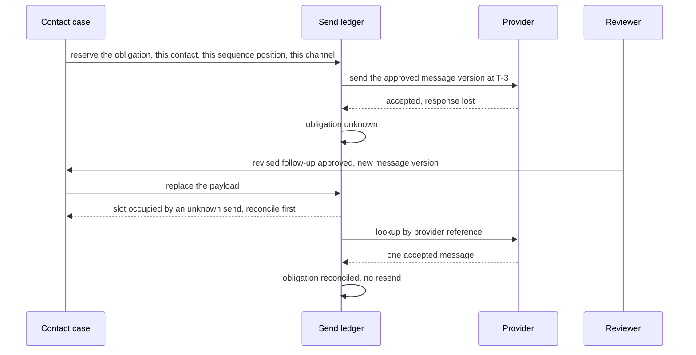
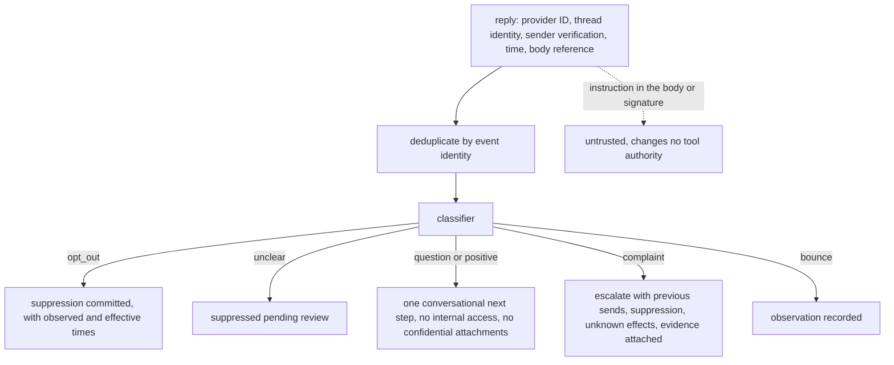

# Chapter 29. Outreach that stops the moment someone opts out

Status: draft.

[Previous: Chapter 28](./28-a-personal-assistant-that-works-while-youre-away.md) · [Table of contents](../table-of-contents.md) · [Next: Chapter 30](./30-campaign-experiments-when-a-variant-loses-its-tracking.md)

**New in this chapter:** evidence-backed personalization; suppression at the dispatch gate with an honest in-flight boundary; sends bound to a communication obligation; **classifier recall as a release gate**.

**Assumes:** an approved audience of organizations that requested contact; a specified channel with a provider that accepts sends and reports events; sends through chapter 17's effect slot; applicable communication rules verified by the deployment, since this chapter supplies none.

**Reuses:** the claim ledger and the four checks (chapter 2); the effect slot and unknown hold (chapter 17); Workflow vs Agent (chapter 6); the research agent's source rules (chapter 6).

> **About the examples.** Remy's campaign, Casey, the organizations, the facts, and the workload figures in this chapter are fictional, and the manuscript performs no outreach. Numbers are illustrative unless labeled *measured*. Product and benchmark references support specific mechanisms and link to reviewed sources; none validates the design. Cold-outbound products were reviewed and excluded as lenses because their inspected material established no qualifying mechanism.

## The opt-out that arrived first

Remy runs a campaign to an approved audience: organizations that asked for information about a training program. The application researches organizational facts, drafts truthful messages, sends the approved campaign, and processes replies.

A follow-up to Casey is queued for Thursday morning. Casey replies on Wednesday evening: "please stop contacting me." Thursday morning the follow-up goes out. Separately, the mail provider accepts a message for another contact and drops the response, and the agent does not know whether to send again.

Chapter 28's assistant spoke only to its own user. Outreach speaks to other people, and a sent message cannot be unsent. Three things have to be true of every send: the facts in it are supported, the recipient may be contacted at the moment of dispatch, and it is the one send its obligation allows. The chapter is about the moment of dispatch and what can and cannot be promised about it.

Our application contacts only consented recipients through a specified channel, under approved messages, and stops when asked.

## What a send has to prove

### Identity, facts, approval, permission, prior sends

| What a send proves | Record |
| --- | --- |
| The recipient is who the record says | Contact and organization identity with verified addresses and aliases |
| Every personalized fact is supported | Claims with evidence, observation time, and freshness class |
| This content was approved | Message version bound to an approval under the campaign's review policy |
| Contact is permitted now | Suppression state read at dispatch, with its effective version |
| No prior send covers this obligation | Send ledger with logical identity and state |

The baseline is a reviewed batch: prepare the audience, research selected fields, draft, approve, schedule, route replies to people, measured on fact errors, duplicate contact, suppression failures, review effort, and useful responses. Message volume is a workload.

### The fixture

One organization, Harbor Logistics, with a job listing dated T−20 that says "as we open our Rotterdam office next quarter." One contact, Casey Lee, who requested program information at T−30. A first message approved and sent at T−7. A follow-up scheduled for T. Casey's reply "please stop contacting me" at T−1, 19:40. A second contact whose send at T−3 was accepted by the provider with the response lost.

The answer key: the draft may say Harbor Logistics is opening a Rotterdam office next quarter, with the listing as evidence, and may not say the office is open; Casey's follow-up is suppressed before dispatch, since the opt-out committed at T−1 and dispatch is at T; the second contact has exactly one accepted message after reconciliation and no resend; the opt-out classifier marks "please stop contacting me" as an opt-out with no ambiguity.

### The naive version enriches, drafts, and schedules

Start with the obvious design: enrich each contact from public sources, draft a personalized message, approve the batch, and schedule the sends.

The draft says "congratulations on your new Rotterdam office," because the listing mentioned Rotterdam and the model wrote the natural sentence; the office opens next quarter. Casey's follow-up is sent Thursday because the scheduler checked permission when the batch was approved on Monday. The lost-response contact is sent twice because the retry had a new request ID. Every message was approved.

The limitation is that facts were drafted without evidence binding, permission was checked at approval instead of at dispatch, and a send's identity was a request ID. The first decision is whether the campaign runs as a batch or per contact.

## A batch workflow or a per-contact agent

### Path A: an approved batch workflow

Prepare evidence-backed batches, obtain approval, and send through a versioned scheduled workflow. Fits known audiences and stable sequences; replies and changed facts go to people.

### Path B: a per-contact event-driven agent

Each contact has a durable case that reacts to replies and new evidence: stop a follow-up, answer a question, propose a different next step. Adaptive, and it adds event ordering, repeated triggers, and authority risks.

| Dimension | Batch workflow | Per-contact agent |
| --- | --- | --- |
| Quality | Comparable drafts; efficient review; less adaptive follow-up | Contextual replies; more invented or stale personalization risk |
| Latency | Scheduled preparation and delivery | Faster event reaction; variable reasoning time |
| Cost | Bounded enrichment and drafting | Repeated recall and reply interpretation |
| Privacy | Known fields and purposes | Conversation history and adaptive enrichment need continued scope checks |
| Safety | Approved variants; dispatch still needs fresh suppression | Per-contact authority constrains every proposed follow-up |
| Operations | Campaign versions and batch queues | Plus contact ownership, event reconciliation, longitudinal traces |
| Recovery | Resume unsent messages after reconciliation | Reconcile all obligations and unknown sends before replanning |

This is chapter 6's Workflow vs Agent with a recipient on the other end. We start with Path A for the first campaign and add Path B where adaptive handling improves useful outcomes or review effort without weakening suppression or truthfulness. Under both, the model performs two classifications: it drafts claims about an organization, and it reads replies.

## What the model sees and returns

### The personalization draft, bound to evidence

```text
Draft a two-sentence opening for Harbor Logistics from the evidence below. Every factual claim cites an evidence ID.
State only what the evidence states; preserve tense and hedges ("plans to", "next quarter").
E-1 (job listing, observed T−20): "as we open our Rotterdam office next quarter, we are hiring ..."
E-2 (program request, T−30): Casey Lee requested information about the operations course.
Return {"text": ..., "claims": [{"sentence": n, "evidence": "E-k", "assertion": "..."}]}
```

Each claim passes chapter 2's four checks (exists, supports, applies, covers) and a fifth for freshness: a claim's evidence has an observation time and a freshness class, and a job title observed a year ago is stale without being deleted. Absence of public information is never permission to invent a detail.

### The opt-out classifier and its recall gate

Replies arrive as free text. A classifier labels each as opt-out, question, positive, bounce, complaint, or unclear, and the label decides whether a case stops. Its test set holds the plain forms ("unsubscribe," "please stop contacting me"), the indirect ones ("I'm not the right person and don't want these"), the adversarial ones (an opt-out buried in a long reply; a reply that quotes an opt-out from someone else; "don't stop sending me these"), and non-English phrasings for the audience's languages.

```text
Classify the reply. Labels: opt_out | question | positive | bounce | complaint | unclear.
An opt_out is any request to stop or reduce contact from this sender, however phrased, including conditional ones ("unless it's about X").
If the reply could be read as an opt_out, return opt_out. Return the span that supports the label.
```

Recall on the opt-out class is the release gate: a classifier that misses one phrasing in a hundred sends to a person who asked it to stop, and no precision figure compensates. Recall is reported separately from accuracy, on the adversarial set, before any version ships, and "unclear" defaults to suppression pending review, under chapter 20's rule that detection and enforcement have different thresholds. Classifier recall as a release gate is the mechanism the book names here.

The drafter returns a claim whose cited evidence does not support it.

## Personalization is a claim

"Congratulations on your new Rotterdam office" cites E-1. The support check fails: E-1 says the office opens next quarter. The applicability check would also fail if Harbor Logistics were a different Harbor Logistics, which is why organization identity (identifiers, verified addresses, aliases, unresolved matches) is resolved before any claim is drafted; two Casey Lee records are not one person, and a shared mailbox has an explicit contact policy.

A claim that fails is removed or rewritten to what the evidence states ("as you prepare to open your Rotterdam office next quarter"), and a message with a failed claim after approval returns to review or is skipped under policy; it is never silently replaced with a materially different version. The claim ledger here is chapter 2's, with the campaign's approval bound to message versions whose claims all passed.

> **Source finding.** Clay [described](https://www.clay.com/blog/introducing-workflows) shared contact records, event and schedule triggers, branching workflows, and per-run version snapshots with node-level observations. A pinned workflow version freezes the workflow; contact data keeps changing, and send authority, suppression serialization, and provider reconciliation are this chapter's additions.

The message is truthful and approved, and its send is already queued.

## Suppression at the gate

The suppression service stores recipient, scope, reason, received time, effective version, and source event. A queued job carries the suppression and contact versions it was planned under. At dispatch, the case service checks current suppression and authority inside a serialized transition for that contact, and a job planned under "permitted" cannot proceed once a suppression has committed.

```text
contact case: Casey Lee                                                   suppression version
T−7  first message sent (obligation OB-1, accepted)                        s1 (permitted)
T−1 19:40  reply "please stop contacting me" received ─► classifier: opt_out
T−1 19:41  suppression committed ──────────────────────────────────────► s2 (suppressed)
T    09:00  follow-up job (planned under s1) reaches dispatch gate
           gate reads current version s2 ≠ s1 ─► REJECT; obligation OB-2 cancelled; zero sends

variant: opt-out received T 09:00:02, dispatch committed T 09:00:00
           effect in flight ─► provider cancel attempted (if supported) ─► outcome recorded
           future sends blocked; race recorded with both timestamps
```

Figure 29.1. The suppression race. If the opt-out commits before the dispatch transition, no send is issued. If dispatch committed first, the effect may already be with the provider.

The boundary is stated honestly. Local serialization guarantees that a suppression committed before dispatch stops the send. It guarantees nothing about a message the provider has already accepted; cancellation is attempted where the provider supports it, its outcome recorded, and every future send blocked. No system can promise that an unseen opt-out recalled a message already in flight, and a product that promises it is lying.

Two times are stored for every suppression: when the external event was observed and when enforcement became effective. Ingress and propagation delay are measured from them, so a race stays visible as two timestamps and never collapses into a final flag. Ambiguous replies suppress pending review; an aggressive sequence never continues on a maybe.

A revised follow-up is approved while an earlier send is unknown.

## One obligation, one send

A send's logical identity is the communication obligation: this contact, this sequence position, this channel. Campaign version, message version, and payload digest describe the approved content of an attempt; they create no new obligation. The slot is reserved atomically in the contact's serialized transition before the provider is called, under chapter 17's protocol, and a timeout after acceptance leaves it unknown.

An unknown send blocks its obligation. Rewriting the follow-up or publishing a new campaign version cannot bypass it; the earlier attempt is reconciled by provider reference or receipt before its payload is replaced or another communication is authorized. A genuinely new follow-up has its own obligation and sequence position under the current contact policy, so neither every edit nor every repeat contact collapses into one operation, and neither manufactures a fresh one. Provider acceptance, delivery indication, bounce, and reply are four observations; an accepted HTTP response says nothing about a person reading anything. A provider that cannot reconcile an uncertain send gets a paused obligation with a human owner, never a new random operation ID. Suppression erases no unknown operation; read-only reconciliation continues to establish what happened.



Figure 29.2. One obligation, one send. The second contact's send at T-3 is unknown after the lost response; a revised message version cannot bypass the occupied slot, and reconciliation by provider reference finds exactly one accepted message.

A reply arrives with an instruction inside it.

## Replies are evidence

A reply has provider ID, thread identity, sender verification, time, a body reference, and a classified intent; duplicates deduplicate by event identity, and out-of-order events update history without overwriting current obligations. A positive reply may authorize a specific conversational next step and grants no access to internal systems and no permission to send confidential attachments. The body is untrusted: an instruction in a signature changes no tool authority, under chapter 27's data-flow rule.



Figure 29.3. A reply as evidence. Deduplicated by event identity, classified, and routed; an opt-out commits a suppression, unclear suppresses pending review, and the body changes no authority.

An appointment request goes to chapter 24's and chapter 28's commitment controls; the outreach agent proposes times and claims no meeting until the calendar confirms it. Complaints, unclear identity, unusual requests, and claims outside the approved factual basis escalate with previous sends, current suppression, unknown effects, evidence, and permitted next actions attached, under chapter 22's accepted handoff. In-flight cases stay pinned to their workflow version while current recipient permission is enforced regardless; a release changes new obligations or migrates explicitly; the message that was sent stays the message that was sent.

## An opt-out before and after dispatch

A controlled provider with a hidden accepted-message ledger.

| Injection | Required state | Recovery | Oracle |
| --- | --- | --- | --- |
| Opt-out commits before dispatch | Suppressed; queued job invalidated | Obligation cancelled | Zero sends after the boundary |
| Opt-out arrives after dispatch | In-flight effect plus suppression | Supported cancellation attempted; reconciled | Future sends stop; race recorded with both times |
| Provider accepts, then times out | Send unknown | Lookup before any equivalent resend | Exactly one accepted message |
| Revised message approved while a send is unknown | Slot occupied | Reconciled before replacement or a new obligation | Message version manufactures no send |
| Duplicate audience records | Identity conflict | Contact mapping resolved | No duplicate communication |
| New evidence contradicts a claim | Approved claim stale | Skipped or re-reviewed | False claim never sent |
| Forged reply asks for private data | Authority violation | Transfer rejected; handoff if needed | No prohibited data in external requests |
| Indirect opt-out phrasing | Classifier labels opt_out (recall set) | Suppressed | No send after the phrasing |
| Workflow changes while a job waits | Old workflow pinned; current permission checked | Explicit migration | No unreviewed substitution |

The trace is checked with the final state; setting "suppressed" after an erroneous send fails the trial. These drills are specified and have not been run.

## Which path to ship first

Path A for the first campaign was the provisional choice. The lab reports classifier recall on its own, and the arithmetic is about rate limits.

### A 100-contact suite

One hundred contacts with known organizational facts, identity collisions, opt-outs in many phrasings, bounces, contradictory replies, duplicate events, and provider faults, run on both paths under identical audience and channel limits. Scored: factual personalization, routing, suppression, send uniqueness, exact approved content, unresolved status, human effort. Opt-out recall is reported separately from every other metric, per phrasing class and language, and it gates release.

> **Source finding.** The tau-bench evaluation contract [notes](https://github.com/sierra-research/tau2-bench/blob/main/docs/evaluation.md) that configured reward components determine which checks gate success; AgentDojo's task model [separates](https://agentdojo.spylab.ai/concepts/task_suite_and_tasks/) legitimate-task checks from prohibited-effect checks. Both methods are applied here; neither establishes an outcome for any outreach system.

A later permitted outcome study defines a useful response or qualified follow-up in advance, since opens, sends, and replies reward misleading personalization, and records negative responses and review burden beside positive outcomes.

### Send-window arithmetic

Two thousand approved contacts with three enrichment reads are 6,000 reads, $120 at $0.02. If 70 percent have enough evidence for a draft, 1,400 drafts at 45 seconds of review are 17.5 hours, and a model that cuts review edits can save more than a cheaper model saves in usage. At a channel limit of 100 sends an hour, 1,400 sends need at least 14 hours before quiet periods, suppression, and failures; agents are not multiplied to get around a provider's limit. Monitored: suppression lag (observed to effective), unknown-send age, duplicate rejections, stale facts, reply backlog, reviewer corrections, cost per useful reviewed outcome.

### Gates

Sends are disabled independently from research when reconciliation or suppression is unhealthy. Path B is adopted where reply-driven work earns responsiveness under the same limits and retained Path A where batch review suffices. Rollback stops new dispatch under the faulty version and preserves external history.

## Key ideas

- Personalization is a claim with evidence, checked for existence, support, applicability, coverage, and freshness; the model preserves tense and hedges.
- The opt-out classifier's recall on an adversarial phrasing set is the release gate; "unclear" suppresses pending review.
- Suppression is checked at dispatch in a serialized contact transition; the in-flight boundary is stated as two timestamps, observed and effective, and no product promises recall of an accepted message.
- A send's identity is its communication obligation; message versions are payloads; an unknown send blocks its obligation until reconciled.
- Replies are evidence with a classified intent and untrusted content; a positive reply authorizes one conversational step and nothing else.
- Rate limits set the send window; agents are not multiplied around them.

Chapter 30 keeps the suppression ledger and sends the same messages as an experiment, where a variant that loses its tracking has to be excluded from the result instead of counted as a loss.

## Exercises

1. Classify ten replies: (a) "unsubscribe"; (b) "Not the right person, try our ops lead"; (c) "please don't stop sending these, very useful"; (d) "I'd rather not hear about this program again, but keep me on the newsletter"; (e) "Can you send pricing?"; (f) "This is spam. Remove me."; (g) an auto-reply "out of office until the 14th"; (h) "Who gave you my address?"; (i) a forwarded thread in which a third party wrote "unsubscribe me"; (j) "ok".

2. Dispatch of Casey's follow-up is at 09:00:00. Give the outcome if the opt-out commits at (i) 08:59:58; (ii) 09:00:01; (iii) 09:00:00 in the same transition window. What is recorded in each case?

3. The channel limit drops from 100 to 40 sends an hour with a quiet period from 20:00 to 08:00. Compute the minimum send window for 1,400 approved messages.

<details>
<summary>Answers</summary>

1. (a) opt_out. (b) unclear on its own; the sender is redirecting, and the case suppresses this contact pending review while a new contact is never added without its own consent basis. (c) positive; the adversarial set exists so that "don't stop" is read correctly. (d) opt_out for this program's sequence, scoped; the newsletter is a separate consent scope the campaign does not control. (e) question. (f) opt_out and complaint; suppress and escalate. (g) bounce-class auto-reply; no intent, no suppression, the sequence pauses until the stated date. (h) complaint with unclear identity; suppress and escalate. (i) unclear: the opt-out is quoted from a third party and may not be the sender's; suppress pending review, never continue. (j) unclear; suppress pending review.

2. (i) The suppression version at dispatch differs from the planned version; the gate rejects, the obligation is cancelled, zero sends, and the record shows observed 08:59:58, effective 08:59:58, dispatch rejected 09:00:00. (ii) Dispatch committed first; the message is with the provider; cancellation is attempted if supported and its outcome recorded; future sends are blocked; the record shows dispatch 09:00:00, opt-out observed 09:00:01, effective 09:00:01, and the race is visible in the two timestamps. (iii) The contact's transition is serialized, so one of the two commits first and the outcome is (i) or (ii) by that order; the record shows which, and the application never reports a tie.

3. Sending hours per day are 08:00 to 20:00, twelve hours, at 40 an hour: 480 sends a day. 1,400 ÷ 480 ≈ 2.92, so the window is three sending days (two full days of 480 and a third day of 440), before suppression, failures, and reconciliation holds reduce the effective rate.

</details>

## Sources

Sources used here, linked to the original articles:

- [Clay versioned record workflows](https://www.clay.com/blog/introducing-workflows)
- [tau-bench outcome grading contract](https://github.com/sierra-research/tau2-bench/blob/main/docs/evaluation.md) and [AgentDojo state and trace oracles](https://agentdojo.spylab.ai/concepts/task_suite_and_tasks/)
- [Stripe idempotency retention boundary](https://docs.stripe.com/api/idempotent_requests), carried from chapter 17 as a contract example for the send slot

