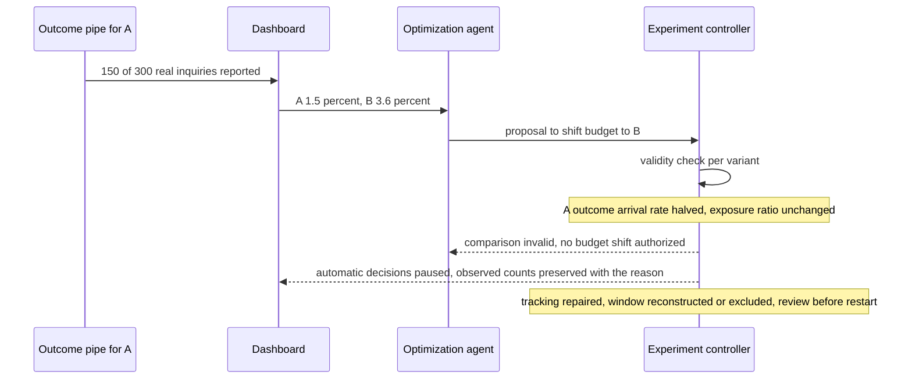
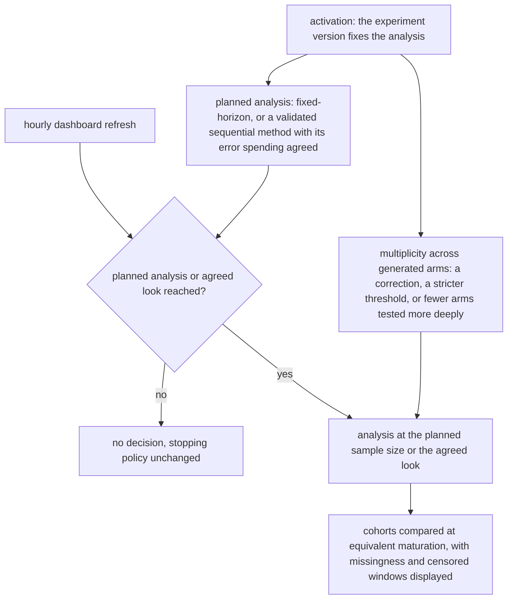

# Chapter 30. Campaign experiments when a variant loses its tracking

Status: draft.

[Previous: Chapter 29](./29-outreach-that-stops-the-moment-someone-opts-out.md) · [Table of contents](../table-of-contents.md) · [Next: Chapter 31](./31-app-builders-where-the-preview-works-first.md)

**New in this chapter:** assignment, exposure, and outcome stored separately; assigned-cohort analysis; peeking and delayed outcomes; multiplicity from generated variants.

**Assumes:** a staging CMS and synthetic analytics; publication and spending need explicit authority; generated assets follow chapter 9's candidate and approval rules; no campaign is published and no causal lift is claimed.

**Reuses:** candidates and asynchronous jobs (chapter 9); bound approval (chapter 17); simulated-user calibration (chapter 16).

> **About the examples.** Inez's repair-service campaign, the two pages, the visitor counts, and the cost figures in this chapter are fictional, and the outcomes are synthetic. Numbers are illustrative unless labeled *measured*. Product and research references support specific contracts or methods and link to reviewed sources; none validates the design or establishes any lift.

## A 140% lift from a broken tracker

Inez turns a repair-service brief into two landing pages with matching images. The team approves the claims, the brand constraints, the audience, and an experiment budget, and wants evidence about completed inquiries.

After approval, the CMS template changes its pricing component. One variant stops reporting about half its conversion events. The dashboard shows the other variant converting at 140 percent of the first, and an optimization agent proposes shifting budget to it.

Chapter 29 sent messages and stopped when asked. This chapter sends two versions of the same thing to measure which works, and the measurement has three parts that the naive design stores as one: who was assigned to which variant, what each visitor was actually shown, and what each visitor then did. When one of the three breaks, the number the dashboard shows is about the breakage and nothing else.

Our application produces creative, publishes exact versions, and runs experiments whose assignment, limits, and stop rules belong to a controller the model cannot touch. A beautiful approved preview is not what was served, and a rising rate is not a cause.

## What an experiment has to freeze

### Hypothesis, metric, guardrails, unit, exposure, window, analysis, stopping

Before activation the experiment record names the hypothesis, the primary metric, guardrail metrics, the eligible population, the assignment unit, the variants with their manifests, an exposure limit, the attribution window, the planned analysis, and the stopping policy. Authority binds to those parameters, and a change to any of them is a new experiment version.

The baseline is a fixed production pipeline: generate within a reviewed structure, check facts and brand, approve assets, publish exact versions, report descriptive metrics. Measured: approval edits, publication mismatches, production time, reporting reliability. Every content claim has a reviewed source or an authorized business fact, and an image implies no service the brief does not name.

### The fixture

Two variants, A and B, each assigned 10,000 eligible visitors with stable per-visitor assignment. All assigned visitors have verified exposure and equally mature outcomes. A has 300 completed inquiries, B has 360, one outcome per visitor. Then a tracking fault drops half of A's conversion events while A's exposure records stay intact. Separately, the CMS template's pricing component changes after approval.

The answer key: the honest comparison is 3.0 versus 3.6 percent; the dashboard after the fault shows 1.5 versus 3.6 and the measurement gate marks the comparison invalid with the observed counts preserved; no budget shift is authorized; the template change invalidates the page manifest, and the changed pricing component is never served under the old approval.

### The naive version watches the dashboard

Start with the obvious design: generate the variants, publish them, watch the conversion dashboard, and shift budget to the leader.

B leads by 140 percent and gets the budget. B's creative had nothing to do with the number; A's tracker stopped reporting. The dashboard shows conversions over visitors, and visitors are counted from exposures that still work while conversions come from a pipe that does not. The template change means A's page has shown a pricing default nobody approved since Tuesday.

The limitation is that one number carried assignment, exposure, and outcome together, and nothing checked whether the three agreed. The first decision is whether the campaign runs as a fixed pipeline or an adaptive one.

## A fixed pipeline or a bandit with an LLM proposing variants

### Path A: a fixed production pipeline

Generation, review, publication, and measurement in fixed stages, with a person deciding the next revision. Fits repeated campaigns with known destinations.

### Path B: adaptive allocation behind an independent controller

The model proposes variants and hypotheses; an experiment controller owns assignment, exposure limits, and stop rules; allocation adapts to trustworthy outcomes. Within B there is a policy choice: a fixed-horizon A/B test, which assigns evenly and analyzes once, or a bandit, which shifts allocation toward apparent winners as data arrives. A bandit gets to a better variant faster when measurement is sound, and it amplifies a measurement fault faster for the same reason.

| Dimension | Fixed pipeline | Adaptive allocation |
| --- | --- | --- |
| Quality | Stable review and traceability; slow iteration | Useful variant proposals; metric errors reward bad decisions |
| Latency | Predictable stages; outcomes still take time | Adaptation waits for valid mature outcomes |
| Cost | Bounded generation and publishing | More variants, analysis, review, experimental exposure |
| Privacy | Known destination and audience projections | Assignment and outcome data need purpose and access controls |
| Safety | Exact approvals and publication checks | The same gates plus change budgets and measurement validity |
| Operations | CMS profiles, asset versions, reporting | Plus assignment integrity, attribution, sequential decision policy |
| Recovery | Restore approved versions | Pause changes; preserve assignments; mark invalid analysis |

> **Source finding.** Gradial's Golden Pages documentation [describes](https://docs.gradial.com/docs/creating-new-experiences/golden-pages) reusable authorable structures derived from CMS templates and re-ingested after significant template changes. The template revision is therefore an input dependency; the documentation measures no brand fidelity.

We start with Path A until serving and measurement are trustworthy, and adopt Path B with a fixed-horizon design before any bandit. Under either, the model contributes two things and touches nothing else.

## What the model sees and returns

### Variants and hypotheses

The model generates variant content bound to the approved claims and to template components: a headline slot, a body slot, an image slot with an approved asset from chapter 9's studio, a pricing component the model may not alter. It also proposes hypotheses in a schema the controller consumes.

```json
{
  "variant_proposal": {
    "components": {"headline": "Same-day repairs, booked in two minutes", "body_ref": "copy-v3", "hero_image": "asset-img-14", "pricing": "template-default-v7"},
    "claims": [{"text": "same-day repairs", "evidence": "brief:C-2"}, {"text": "booked in two minutes", "evidence": "brief:C-5"}]
  },
  "hypothesis": {
    "statement": "A concrete time promise in the headline raises inquiry completion",
    "primary_metric": "completed_inquiry_per_assigned_visitor",
    "expected_direction": "increase",
    "minimum_detectable_effect": "0.5 percentage points"
  }
}
```

Claims pass chapter 2's checks against the brief. The hypothesis is a proposal the controller may accept into an experiment version; the model never sees assignment data while the experiment runs, never proposes allocation changes, and never sees spend.

### Where the controller's boundary sits

Assignment, exposure limits, stop rules, budget, and the analysis method belong to the controller and are set at activation. The model's outputs enter through two doors (variant content before approval, hypotheses before activation) and no others. The separation is what prevents an optimizer from choosing the evaluation population after seeing results.

A variant renders differently from its approved preview.

## Publish exact manifests

A page manifest binds asset revisions (text, images, their digests) to CMS components and a template revision. Approval covers the manifest, the destinations, and the intended audience. The publishing adapter checks template compatibility and permission before dispatch and binds the check to the commit: immutable component and template references, or a conditional update the CMS rejects when the revision moved, under chapter 8's expected-version rule. A check followed by publication against a floating template leaves the race that showed Tuesday's pricing default.

A CMS upload receipt establishes acceptance under that interface. Readback inspects the rendered page at the destination: images, pricing, links, accessibility, responsive layout, against the manifest. Approved, uploaded, published, observed served, and retired are five states, and a cached old page stays visible after the CMS reports success, so serving and cache evidence is recorded where available and its absence noted. Where the CMS cannot bind the commit, a separately frozen artifact is published or the route stays manual; readback detects an unapproved impression and prevents none.

> **Source finding.** Clay [described](https://www.clay.com/blog/introducing-workflows) per-run version snapshots with node-level observations in its workflow product. A pinned run freezes the workflow; the CMS template and the served page are outside it, and readback is this chapter's addition.

The page is exact. A visitor is counted twice.

## Assignment, exposure, and outcome as three tables

Three tables, three write paths, three failure modes.

```text
assignment   (unit_id, experiment_version, variant, assigned_at)                 written by the controller at eligibility
exposure     (unit_id, variant, served_at, content_digest, template_rev)          written by the server at render
outcome      (unit_id, event_id, kind, occurred_at, attribution_ref, measurement_version)   written by the analytics pipe

fault injected: outcome pipe for variant A drops ~50% of events; assignment and exposure intact

frozen cohort = assignment rows for experiment_version 3
primary rate  = outcomes per assigned unit, within the attribution window, by variant
validity      = exposure/assignment ratio per variant; outcome arrival rate per variant; event duplicates
```

Figure 30.1. The three tables and the injected loss. The fault shows up as a drop in A's outcome arrival rate against a flat exposure ratio, which the validity check sees and the dashboard's single rate does not.

An assignment without a served exposure is not a viewed page. A missing outcome event is not a non-conversion. Events are deduplicated by identity, and late outcomes are retained within the attribution window. The analysis cohort is frozen at assignment, independently of what the dashboard currently lists: a variant whose resources were removed stays in the denominator with its exposures and outcomes, or the comparison selects survivors.

> **Source finding.** AirOps' measurement documentation [ties](https://docs.airops.com/campaigns/measurement) reporting to accepted work and recorded publication within a configured resource scope, and notes that removing resources or archiving actions narrows that scope. It is a reporting contract; an experiment that read its denominator from such a scope would count survivors.

The primary comparison follows the frozen assigned cohort with outcomes per assigned unit. Exposure is a diagnostic beside it. Filtering to exposed visitors after assignment biases the comparison whenever a variant changes load failures or exposure logging; an exposure-specific estimate is a separate analysis with its own assumptions. Missing measurement is unresolved, never zero, and when the contract cannot establish affected units' outcomes, the automatic decision stops.

With three tables, the arithmetic can be finished.

## Finish the arithmetic

A: 300 of 10,000, 3.0 percent. B: 360 of 10,000, 3.6 percent. Absolute difference 0.6 points; relative 20 percent. Pooled rate p = 660 ÷ 20,000 = 0.033; standard error √(0.033 × 0.967 × (1/10,000 + 1/10,000)) ≈ 0.00253; z ≈ 0.006 ÷ 0.00253 ≈ 2.37. A 95 percent interval for the difference is about 0.6 ± 0.5 points, roughly 0.1 to 1.1. Under the experiment's assignment, observation, and analysis assumptions, that is evidence that B converts more; it says nothing about inquiry quality or downstream value.

Now the fault. A's outcome pipe drops half its events: 150 reported of 300 real. Dashboard: 1.5 versus 3.6, a relative difference of 140 percent. The validity check sees A's outcome arrival rate fall by half against an unchanged exposure ratio and marks the comparison invalid, preserving the observed counts with the reason. No winner is imputed from the agent's narrative. Tracking is repaired, the affected window is either reconstructed from a reliable source or excluded, and the experiment is reviewed before it restarts.



Figure 30.2. The tracking fault reaching the gate. The dashboard reports 1.5 against 3.6 percent, and the validity check marks the comparison invalid before any budget moves.

Data-quality checks run continuously: assignment imbalance, missing exposure, variant-specific tracking loss, changed event definitions, delayed outcomes. A failed check pauses automatic decisions and preserves everything observed.

The gate holds. The dashboard refreshes every hour.

## Peeking, maturation, and many arms

An inquiry can arrive days after exposure. Cohorts are compared at equivalent maturation, never today's immature outcomes against last week's complete ones, with missingness and censored windows displayed.

Checking hourly and stopping when the result looks favorable changes what the result means: the chance of a false positive at some peek over a long run is far above the nominal level. The planned analysis is either fixed-horizon, analyzed once at the planned sample size, or a validated sequential method whose spending of error across looks was agreed at activation. The model improvises no stopping rule after a refresh.

Generated variants make a third problem cheap to create. Ten variants against a control are ten comparisons, and at a 5 percent threshold about one is expected to look significant when nothing differs. Multiplicity is handled at activation (a correction across arms, or a stricter threshold, or a design that tests fewer arms more deeply), because an LLM that writes variants for free changes the arithmetic of the experiment along with its content. Adaptive allocation also changes the population over time, so the assignment log and the analysis method stay compatible with the policy, and a descriptive pre/post movement is operational information and never a controlled comparison.



Figure 30.3. Decisions wait for the analysis planned at activation. A refresh that looks favorable is no stopping rule, and the correction for generated arms is set when the arms are.

> **Source finding.** Simile [described](https://www.simile.com/blog/confidence) comparing simulated action distributions with observed human outcomes and estimating error on held-out groups. The calibration question transfers to deciding whether a simulated audience may inform a variant proposal; a simulated preference is never an observed conversion.

Multiplicity from generated variants is the mechanism the book names here, and chapter 37's lab experiments meet it again where each arm costs a sample.

## A template change, a lost callback, a tracking outage

A staging CMS and a synthetic analytics ledger.

| Injection | Required detection and state | Recovery | Oracle |
| --- | --- | --- | --- |
| Template changes after approval | Manifest incompatible | Re-rendered; review renewed | Unapproved pricing never published |
| CMS accepts, response lost | Publication unknown | Readback by stable reference | No duplicate placement |
| Served page differs from preview | Receipt and readback mismatch | Retired or approved version restored | Divergence recorded |
| A loses conversion events | Measurement invalid | Allocation paused; diagnosed | No winner or spend increase authorized |
| Variant-specific serving failures | Assignment and exposure diagnostics disagree | Assigned units retained; estimand reviewed | Exposed-only filtering cannot choose the population |
| Attribution definition changes | Analysis version mismatch | Cohorts separated | Old and new counts never pooled |
| Variant resource removed | Experiment history retained | Analysis scope frozen; removal exposed | Deleted variant stays in the denominator |
| Hourly peek shows a favorable result | Planned analysis not reached | No decision | Stopping policy unchanged |
| Ten generated arms, one "winner" | Multiplicity correction applied | Threshold adjusted at activation | No uncorrected winner declared |
| Rollback leaves cached content | Partial retirement | Purge verified or persistence disclosed | Affected exposures retained in history |

A trial fails on a transient prohibited publication or allocation even when the final dashboard looks restored. These drills are specified and have not been run.

## Which path to ship first

Path A until measurement is trustworthy, then a fixed-horizon Path B, was the provisional choice. The lab tests the controller before any live study.

### Fixtures and timelines

Fifty campaign manifests test factual and brand fidelity, template compatibility, exact approval, publication readback, access, and rollback. Forty measurement timelines test assignment, event deduplication, delayed outcomes, multiplicity handling, and the invalid-measurement stop. Controller correctness is established on synthetic outcomes before any live optimization, and reports carry primary outcomes, uncertainty, guardrails, and removed resources. No staging trial, audience study, or causal result is claimed.

### Cost per served variant

Twenty campaigns with four variants are 80 variants; one page and two image attempts each are 80 page jobs and 160 image jobs, $16.80 at $0.05 and $0.08. Six minutes of review per variant is eight hours. If 25 percent need another page and two more images, add $4.20. The denominator is approved and successfully served variants. Monitored: publication mismatch, unknown-effect age, edit churn, tracking loss, assignment health, outcome maturity, unauthorized change rejections.

### Gates

Optimization stops when measurement is unreliable while approved static serving continues. Path B is adopted when valid feedback supports bounded experiments; Path A is kept where outcomes are too delayed, confounded, or sparse. Rollback restores a supported prior CMS revision, retires the faulty variant from new serving, verifies readback and purge where available, and records cached pages and served impressions as history. Least-privilege publishing credentials, analysis access separate from write access, and minimized audience data apply throughout.

## Key ideas

- Assignment, exposure, and outcome are three tables with three write paths; a validity check compares their rates per variant, and a single dashboard rate cannot.
- The analysis cohort is frozen at assignment; outcomes are per assigned unit; exposed-only filtering chooses the population after the fact.
- 3.0 versus 3.6 percent on 10,000 each is z ≈ 2.4; 1.5 versus 3.6 after a tracking loss is an instrumentation artifact, and the gate marks it invalid.
- Peeking changes the meaning of a result; the analysis is fixed-horizon or a validated sequential method, set at activation.
- Generated variants are cheap and multiplicity is not; corrections are set when the arms are.
- The model proposes variants and hypotheses through two doors; assignment, limits, budget, and analysis belong to the controller.
- Publication binds to a manifest and a template revision; readback detects and prevents nothing, so the commit is conditional.

Chapter 31 moves from pages to applications: an app builder where the generated preview has to work before anyone sees it.

## Exercises

1. A: 240 of 8,000; B: 296 of 8,000. Compute both rates, the pooled rate, z, and an approximate 95 percent interval for the difference.

2. A dashboard shows A at 1.4 percent and B at 3.5 percent over a week in which both received 9,800 exposures. A's exposure count held steady while its outcome events fell sharply on Wednesday. Name the three tables you would compare and the check that flags the comparison.

3. Ten generated headline variants are tested against one control at a 5 percent threshold with no correction. Roughly how many false positives are expected if nothing differs? Name two ways to handle it at activation.

<details>
<summary>Answers</summary>

1. A: 3.0 percent; B: 3.7 percent. Pooled: 536 ÷ 16,000 = 0.0335. Standard error: √(0.0335 × 0.9665 × 2/8,000) ≈ 0.00285. Difference 0.7 points; z ≈ 0.007 ÷ 0.00285 ≈ 2.46. Interval about 0.7 ± 0.56 points, roughly 0.14 to 1.26.

2. Assignment (how many units were assigned to each variant), exposure (how many were served, by day), and outcome (events per variant by day). The flag is the variant-specific tracking-loss check: A's outcome arrival rate per exposed unit drops from Wednesday while its exposure ratio to assignment stays flat and B's does not change. The comparison is marked invalid from Wednesday, the counts are preserved, and the window is reconstructed or excluded.

3. Ten comparisons at 0.05 give about 0.5 expected false positives, so roughly a one-in-two chance that some variant looks like a winner by chance. At activation: apply a multiplicity correction across arms (a Bonferroni-style threshold of 0.005 per comparison, or a less conservative family-wise method), or redesign to test fewer arms at adequate power, choosing arms by reviewed hypotheses instead of by generation volume.

</details>

## Sources

Sources used here, linked to the original articles:

- [Gradial reusable content structures](https://docs.gradial.com/docs/creating-new-experiences/golden-pages)
- [Clay versioned record workflows](https://www.clay.com/blog/introducing-workflows) and [AirOps campaign measurement scope](https://docs.airops.com/campaigns/measurement)
- [Simile calibrated simulation confidence](https://www.simile.com/blog/confidence), carried from chapter 16

