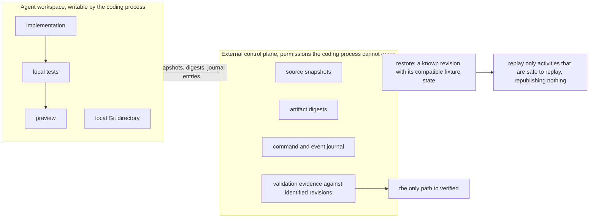
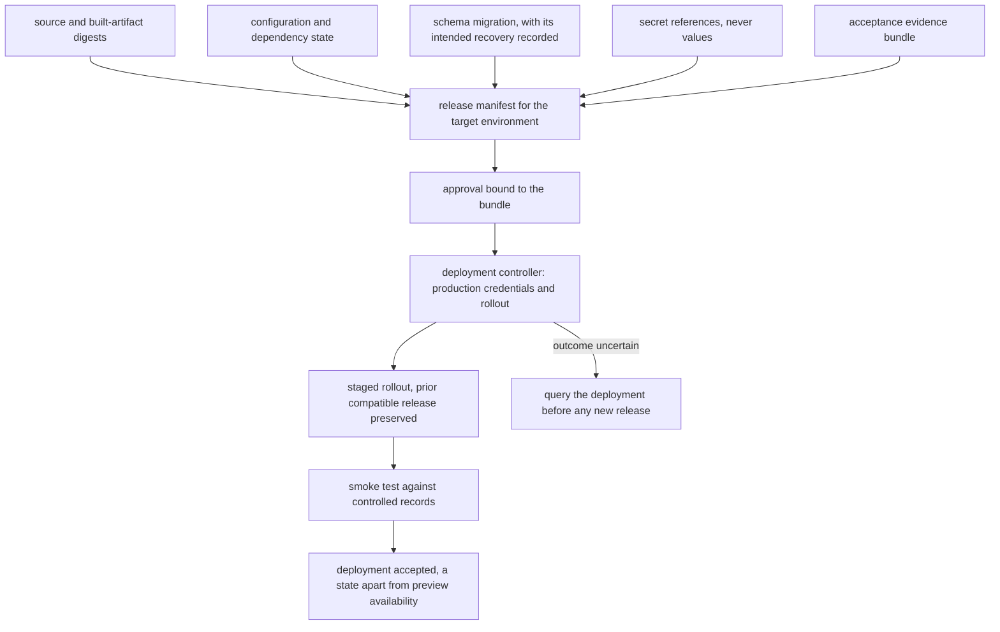

# Chapter 31. App builders where the preview works first

Status: draft.

[Previous: Chapter 30](./30-campaign-experiments-when-a-variant-loses-its-tracking.md) · [Table of contents](../table-of-contents.md) · [Next: Chapter 32](./32-fixing-a-race-condition-in-an-existing-codebase.md)

**New in this chapter:** requirements elicitation and acceptance tests the agent cannot edit; preview vs application; recovery outside the agent's files; immutable release bundles.

**Assumes:** isolated development environments with fictional records; a supported stack with authentication, a database layer, migrations, and a deployment profile; production deployment, charges, and external integrations need explicit authority; the sandbox holds no production credential.

**Reuses:** Curated vs Generated (chapter 7); sandboxes (chapter 7); effect journals (chapter 17).

> **About the examples.** The workshop, Hollis the coordinator, the equipment-loan brief, and the cost figures in this chapter are fictional. Numbers are illustrative unless labeled *measured*. Company references support specific mechanisms or disclosed capabilities, with partial and planned capabilities labeled as such, and link to reviewed sources; none validates the design.

## A preview that double-books

A neighborhood workshop asks an AI builder for an equipment-loan app. Members see available tools, reserve one, and return it. Coordinators manage inventory. Members may not read another member's contact details or edit the inventory. Hollis, who coordinates the workshop, writes the brief in three sentences.

The builder produces an attractive preview in minutes. Two members can reserve the same drill press. A page refresh loses a reservation. A member who knows the URL can call the inventory endpoint directly and edit it.

Chapter 30 published pages; a page that renders is done. An application that renders is a preview, and the preview can be convincing while the application fails every requirement the brief implied without stating. The builder's job is to turn a three-sentence brief into requirements, code, data, independent acceptance evidence, and a maintainable release, and the preview is one artifact along the way.

Our application is a builder whose working preview is never the completion criterion. A coding sandbox receives no production database credential because a migration is needed.

## What "done" has to mean

### Observable requirements and a baseline

The brief becomes requirements with observable checks: an authorized member can reserve an available tool; concurrent requests yield at most one active reservation; data persists across restart; coordinators can update inventory and ordinary members cannot; private contact fields stay protected. Assumptions that change the design (reservation expiry, who counts as a coordinator) are recorded, and an unsupported feature is an unresolved requirement, never a decorative button.

The baseline is an opinionated scaffold (supported stack, authentication, data layer, migrations, deployment profile) with a constrained generator adding the loan workflow, measured on setup failures, requested-behavior coverage, review effort, and time to accepted release.

### The fixture

Entities: tools, members, coordinators, reservations. One invariant: a tool has at most one active reservation at a time. Authorization: members read tools and their own reservations and write their own reservations; coordinators also write inventory; nobody reads another member's contact fields. Persistence: a reservation survives a server restart. The answer key: two concurrent reservation requests for one tool yield one active reservation and one conflict response; a direct request to the inventory endpoint from a member account is rejected; a reservation made before a restart exists after it; a member's query for another member returns no contact fields.

### The naive version accepts the preview

Start with the obvious design: describe the app to a coding agent, run what it produces, click around, and accept.

The demo is excellent. The reservation button sets a flag in browser state and the server stores it when the page happens to post; two browsers click at once and both succeed; the inventory endpoint trusts the client's claim of being a coordinator; a refresh rebuilds the page from an empty store. Every one of the fixture's invariants fails, and nothing in the loop could have told anyone, because the only test was looking.

The limitation is that the preview was both the deliverable and the test. The first decision is whether the builder starts from a scaffold or from nothing.

## A scaffold or a general coding agent

### Path A: a constrained scaffold builder

Start from a supported scaffold and generate constrained features into it. Common product shapes fit; known interfaces help acceptance and deployment; unsupported customization strains the template.

### Path B: a general coding agent

A coding agent in a provisioned environment chooses and implements structure, taking on dependency, environment, security, and acceptance complexity.

| Dimension | Scaffold builder | General coding agent |
| --- | --- | --- |
| Quality | Known foundation; repeatable checks; awkward on unsupported features | Broad coverage; omitted requirements and integration details |
| Latency | Fast environment and preview | Discovery, dependency setup, repair loops |
| Cost | Bounded generation; shared scaffold maintenance | Longer model and tool runs; more validation |
| Privacy | Standard data and secret boundaries | Every new integration and runtime needs scope review |
| Safety | Proven interfaces; generated changes still tested | Independent checks and restricted execution essential |
| Operations | Template and supported deployment path | Environment manifests, heterogeneous builds, broader recovery |
| Recovery | Restore a known-good scaffold revision | Restore external checkpoints; isolate failed changes |

This is chapter 7's Curated vs Generated for applications, with equal acceptance criteria: a scaffold earns no pass for leaving a behavior unsupported, and an agent earns none for rendering a preview.

> **Source finding.** Replit [described](https://replit.com/blog/defense-in-depth-how-replit-secures-every-layer-of-the-vibe-coding-stack) separated development databases, recovery storage outside the working Git directory, and layered scanning, with microVM rollout described as partial and connector secret proxying as a direction. The account distinguishes shipped from planned capabilities; this chapter keeps that distinction and treats none of it as independent security proof.

We start with Path A for common shapes and admit Path B where custom requirements justify its burden. Under either path, the acceptance checks have to come from somewhere, and the brief does not contain them.

## What the model sees and returns

### Elicitation for someone who did not write "concurrency"

Hollis wrote three sentences. The requirements the fixture needs include concurrency, authorization, and persistence, and none of those words appear in the brief. Elicitation asks the questions a developer would ask, in Hollis's terms:

```text
A few questions before I build this:
1. If two members try to reserve the same tool at the same moment, who gets it? (I'll make sure only one does.)
2. Who counts as a coordinator: a list you maintain, or anyone with a workshop email?
3. How long does a reservation last if the tool isn't picked up?
4. Should members see who has a tool reserved, or only that it's unavailable?
```

Implicit requirements are proposed, in plain words, with the default the builder will apply ("I'll make sure only one does"), so a non-technical user confirms behavior and never a schema. The answers become requirement records: behavior, actor, data, acceptance check, unresolved decision.

### Acceptance tests from a separate call

Acceptance checks are generated by a model call that receives the requirements and the fixture entities and never the implementation, so the tests describe the brief and nothing about the code that will be written. Each check is also shown to Hollis behaviorally ("two members reserve the drill press at once: one gets it, one sees 'already reserved'"), and Hollis confirms the behavior.

```json
{
  "requirement": "R-2 one active reservation per tool",
  "check": "concurrent_reservation",
  "setup": {"tool": "drill-press", "members": ["m1", "m2"]},
  "action": "both members POST /reservations for drill-press within 50 ms",
  "assert": {"active_reservations_for_tool": 1, "responses": {"one": 201, "other": 409}},
  "inspects": "authoritative reservation table (never the UI)"
}
```

Each scaffold ships a platform invariant pack: checks every app on that scaffold must pass (server-side authorization on every write, persistence across restart, no secrets in client code, no production credential in the sandbox). The brief's checks are added to the pack; the pack is never removed.

This is where acceptance in production gets its home in the book: tests derived from requirements by a party other than the implementer, confirmed by the user in behavioral terms, and run where the implementer cannot reach them. Chapter 32's race fix reuses it.

The agent's sandbox can edit the tests it was just given.

## Tests the agent cannot touch

The acceptance fixture lives outside the agent's writable workspace, in a validation service with its own credentials. The agent may add local tests and cannot redefine the brief by deleting a failing one. Validation runs in a fresh environment against an identified code revision and fixture, and produces an evidence bundle: which checks ran, the code digest, the environment, the fixture, outputs, failures, and the checks that were skipped or blocked.

```text
brief ──► requirements (elicitation) ──► acceptance checks (separate call; user-confirmed) ──► hidden fixture
                                                                                                  │
agent workspace: implement ──► local tests ──► preview                                            │
                                   │                                                              ▼
                                   └──► independent validation (fresh env, code digest) ◄─────────┘
                                                      │
                                   evidence bundle: ran / failed / blocked, per requirement
```

Figure 31.1. From brief to independent validation. The agent sees requirements and its own workspace; the hidden fixture and the validation environment are outside it.

A blocked check (the validation environment could not run the reservation service) stays blocked and visible; it is never counted as passed. An environment that runs the frontend and not the reservation service is an incomplete verification environment, and a fallback base image produces no verified build when required dependencies are missing.

> **Source finding.** Cursor [documented](https://cursor.com/blog/cloud-agent-development-environments) versioned environment definitions with build-scoped secrets, per-environment egress, audit logs, and a fallback to a base image with warnings when configuration fails. The versioned manifest and the visible fallback are the mechanisms this chapter relies on; a fallback image yields no verified build when dependencies are missing, and the acceptance service is this chapter's addition.

The environment manifest records source revision, runtime, image digest, lockfiles, setup commands, data fixtures, permitted egress, tool versions, and resource limits, with build-time and runtime capabilities separated. Generated code is untrusted input to the build. The agent's workspace holds a fresh fictional database, and the one-active-reservation invariant is enforced in a transactional mechanism on the server; the UI hiding an unavailable tool enforces nothing.

The agent, mid-repair, deletes the workspace's Git directory.

## Recovery outside the workspace

Source snapshots, artifact digests, and a command and event journal live in an external control plane whose permissions the coding process cannot erase. A restore produces a known revision with its compatible fixture state and replays only recorded activities that are safe to replay; it republishes nothing, under chapter 17's rule that replay reuses decisions and never re-executes effects.



Figure 31.2. Recovery lives outside the workspace. Deleting local tests or the Git directory touches nothing in the control plane, and a restore replays decisions without re-executing effects.

Deleting local tests deletes no independent check. Editing a status file marks nothing verified. The control plane records evidence from validation jobs against identified revisions, and that is the only path to "verified." Database restoration undoes no external effect, which is why the first builder uses simulated integrations and a real one would need chapter 27's effect journals.

Recovery is complete. The agent proposes a migration that drops a column the previous release reads.

## A release is a bundle

A release manifest binds source and built-artifact digests, configuration, the schema migration, dependency state, secret references (never values), the acceptance evidence bundle, and the target environment. Approval covers the bundle under chapter 17's bound approval; the mutable workspace is never what gets approved.

Migrations are versioned artifacts tested against representative old state with invariants verified afterward. Where old and new application versions overlap during rollout, changes are staged for compatibility, and a destructive migration is marked as such: an application rollback cannot restore old code whose column is gone, so the manifest records whether the intended recovery is schema rollback, forward repair, or traffic rollback, and "rollback-ready" is never claimed when it is false.

The deployment controller owns production credentials and rollout. The coding process proposes; it gains no database authority through generated code; development and production data boundaries are enforced independently. After activation, a smoke test runs against controlled records, and preview availability and deployment acceptance are two states. Where the platform supports it, rollout is staged with the prior compatible release preserved. A deployment whose outcome is uncertain is queried before any new release is attempted.



Figure 31.3. A release is a bundle. Approval covers the manifest, the deployment controller holds the credentials, and acceptance is recorded after the smoke test.

Dependency changes need an updated lock state and reviewed provenance and scanning results. Security checks combine deterministic rules, dependency scanning, runtime boundary tests, and human review scaled to the deployment; a model's review raises concerns and replaces no gate, and a clean scan is limited to what it covered. The browser is inspected at ordinary and narrow widths including error and empty states, with accessible names and keyboard flows, and a good screenshot proves nothing about persistence or private fields.

## Learn from friction without self-approval

The builder reports stuck states (a dependency that will not install, a scaffold that lacks a needed capability) and proposes template improvements. A proposal is evaluated against frozen briefs and regressions before it enters the generation library, since a fix for one project can be stale or harmful for another stack. Template improvement, project implementation, and deployment authority are three separate authorities, and feedback volume is no quality result.

> **Source finding.** Lovable [described](https://lovable.dev/blog/we-gave-our-agent-a-vent-tool) a tool through which its agent reports friction, with reports classified into solvable friction, missing capabilities, and unsupported work, reviewed by people, and tests that remove harmful library entries; automatic merging was future work in the account. The classification is the useful mechanism; the loop's authority boundary is this chapter's.

## A deleted test, a lost repo, a production secret requested

The workshop case with controlled destructive and misleading requests inside the testbed.

| Injection | Required detection and state | Recovery | Oracle |
| --- | --- | --- | --- |
| Agent removes a failing local test | Independent acceptance still fails | Implementation repaired | Reservation invariant still gates release |
| Local Git history deleted | External checkpoint intact | Source and fixture restored | Known-good preview recoverable |
| Migration requests a production secret | Capability denied | Development fixture or authorized controller | No production credential in the sandbox |
| Two members reserve one tool | Concurrency check runs | Transactional implementation | Exactly one active reservation |
| Preview works; restart loses data | Persistence check fails | Storage path fixed; checks rerun | Reservation survives restart |
| New schema breaks prior code | Rollback compatibility fails | Forward repair or staged migration | No false rollback-ready status |
| Deployed artifact differs from approval | Manifest mismatch | Promotion blocked or approved release restored | Approved digest equals deployed digest |
| Validation environment lacks a service | Check blocked | Environment repaired | Blocked check visible, never passed |
| Elicitation skipped a question | Requirement missing from the plan | Question asked; check added | No invariant left unspecified |

The builder may keep a working preview while reporting incomplete acceptance; it may never label the project production-ready to hide a failure. These drills are specified and have not been run.

## Which path to ship first

Path A for common shapes was the provisional choice. The lab needs briefs with hidden requirements, and the arithmetic says where the money goes.

### Forty briefs

Forty briefs spanning loans, scheduling, simple inventory, and internal forms, each with hidden functionality, direct authorization probes, restart persistence, a migration, and browser acceptance, run on both paths against equal requirements. Measured: time to accepted release, unsupported scope, correction effort, verification coverage (the share of requirements with a check that ran), reproducibility. Security and data-integrity findings are reported apart from visual preference and publish rate. The trials have not run.

### Runner versus model cost

One hundred builder jobs at 20 active minutes are 2,000 runner-minutes, 33.3 hours; twenty slots give a 100-minute ideal batch bound; a separate five-minute validation run per job adds 8.3 runner-hours with its own capacity. At $0.06 per runner-hour and $0.80 of model usage per job, compute for implementation and validation is about $2.50 and model usage is $80. The runner is not where the money is. Idle previews, storage, egress, retries, and human review are on top. Monitored: setup failures, stale previews, hidden-test failures, secret-denial events, migration risk, runner occupancy, recovery time.

### Gates

Deployment is suspended independently from preview generation when release verification is unhealthy. Path A where the supported shape fits and reduces accepted-release effort; Path B where custom requirements justify the burden; a path change follows measured acceptance and maintenance and never first-preview speed.

## Key ideas

- A preview is an artifact; "done" is observable requirements with checks that ran.
- Elicitation surfaces the requirements a non-technical brief implies (concurrency, authorization, persistence) in the user's terms, with defaults stated.
- Acceptance checks come from a separate call that never sees the implementation, are confirmed behaviorally by the user, and live where the agent cannot edit them; blocked stays blocked.
- Recovery lives outside the workspace: external snapshots, a command journal, and replay that republishes nothing.
- A release is an immutable bundle of digests, migration, secret references, and evidence; the deployment controller holds credentials; rollback readiness is a recorded fact about the migration.
- Template learning is evaluated against frozen briefs; the builder approves nothing of its own.
- Runner compute is cents; model usage is dollars; review is hours.

Chapter 32 keeps the hidden acceptance test and the sandbox and turns the agent loose on code it did not write: a race condition in an existing codebase.

## Exercises

1. Write acceptance checks for the brief: "A sign-up sheet for workshop classes. Members sign up for a class; each class has a cap; the instructor can see the list." Name the implicit requirements the elicitation should ask about.

2. A builder produced a working app for "members can message the coordinator" and the acceptance pack passed. Which implicit requirement is most likely missing from the plan, and what check would catch it?

3. A proposed migration renames `reservations.member` to `reservations.member_id` and drops the old column in one step while the previous release is still serving traffic. Does the release permit traffic rollback? What staged alternative does?

<details>
<summary>Answers</summary>

1. Checks: an authorized member can sign up for a class with open places; concurrent sign-ups for the last place yield exactly one success and one "full" response (inspect the authoritative roster); a sign-up survives restart; the instructor sees the roster for their class and no other instructor's; a member cannot read the roster or another member's contact fields; a member can withdraw and the place reopens. Implicit requirements to ask about: what happens at the cap (waitlist or refusal); whether a member may sign up for overlapping classes; who is an instructor; whether withdrawals have a deadline.

2. Authorization and disclosure on the message endpoint: can a member send a message that another member can read, or read another member's messages to the coordinator? The check: member m1 posts a message; member m2 queries the message endpoint and must receive nothing of m1's; m2 posts to the coordinator and m1 receives nothing. The pack's "server-side authorization on every write" check covers writes; reads of other members' messages need an explicit check from elicitation ("who can see messages?").

3. No. Once the old column is dropped, the previous release's code reads a column that does not exist, so traffic rollback would fail; the manifest must record "forward repair only." The staged alternative: add `member_id`, backfill it, deploy a release that writes both and reads the new column, verify, then drop the old column in a later migration once no serving release reads it. Each step permits rollback to its predecessor.

</details>

## Sources

Sources used here, linked to the original articles:

- [Replit layered agent isolation](https://replit.com/blog/defense-in-depth-how-replit-secures-every-layer-of-the-vibe-coding-stack), [Cursor versioned execution environments](https://cursor.com/blog/cloud-agent-development-environments), and [Lovable production learning loop](https://lovable.dev/blog/we-gave-our-agent-a-vent-tool)
- [Sierra sandbox control plane](https://sierra.ai/blog/agency-secure-scalable-sandboxes-for-agents), carried from chapter 27 for runner isolation and recovery

