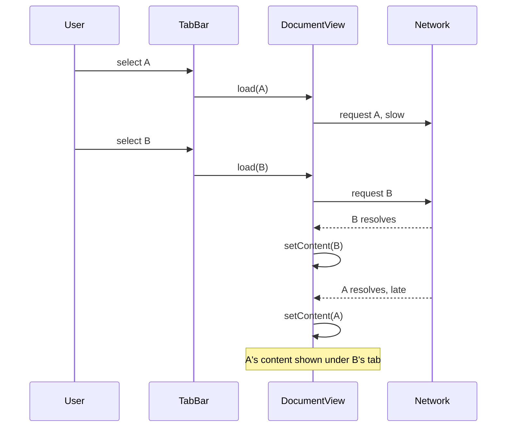
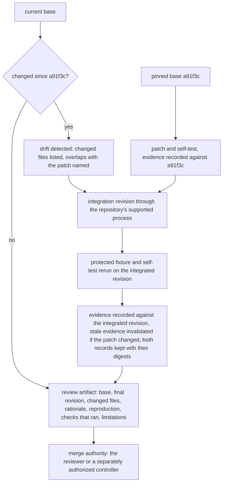

# Chapter 32. Fixing a race condition in an existing codebase

Status: draft.

[Previous: Chapter 31](./31-app-builders-where-the-preview-works-first.md) · [Table of contents](../table-of-contents.md) · [Next: Chapter 33](./33-migrating-a-live-system-while-users-keep-writing.md)

**New in this chapter:** repository context retrieval; deterministic reproduction before patching; the generation fence as the friendly form of fenced publish; base drift before merge.

**Assumes:** an existing repository with a pinned base revision; a sandbox with task-scoped credentials and egress; a protected acceptance fixture under chapter 31's rules; a patch grants no merge or deployment authority.

**Reuses:** fenced publish (chapter 3); sandboxes (chapter 7); acceptance tests the agent cannot edit (chapter 31); Workflow vs Agent (chapter 6).

> **About the examples.** Oskar's document application, the tab race, the repository, and the cost figures in this chapter are fictional; the code shown is explanatory. Numbers are illustrative unless labeled *measured*. Company references support specific mechanisms and link to reviewed sources; none establishes a coding agent's success rate.

## A stale callback that wins

Oskar maintains a document application and reports that switching tabs quickly sometimes shows the wrong document. Opening A starts a slow request. Opening B starts another, which completes first. When A's request finally returns, its callback overwrites the view, and the user is looking at A's content under B's tab.

Oskar wants a narrow fix, a reliable reproduction, and evidence that errors and tab closure still behave. A coding agent can make the symptom disappear by disabling fast switching, or by deleting the assertion that notices it, and the test suite will go green.

Chapter 31 built an application from nothing, with acceptance tests derived from a brief. Here the code exists, was written by someone else, and has conventions the agent has to find before it can change anything. The useful outcome is a verified change against a named revision, and the agent's final message is no part of the evidence.

Our application diagnoses and patches issues in an existing codebase under scoped access. Producing a patch grants nothing further.

## What a fix has to prove

### The invariant, and a baseline

The requested invariant: only the current live view's request may update that view's content, loading state, or error. Closing a tab makes all its outstanding responses ineligible. Cancelling an old request may save resources and is never the correctness mechanism, because cancellation races with completion.

Pinned for the task: the issue text, the repository base revision, an environment manifest, the permitted write scope, the independent acceptance fixture, and the existing behavior that must survive (ordinary loading, visible errors for the current request, retry, correct tab selection).

The baseline is reproduce, patch, test by a maintainer in a known environment, measured on reproduction fidelity, accepted fixes, unrelated edits, review time, and environment failures.

### The fixture

A test harness with controlled promises replaces the slow network. The sequence that must fail at the base revision and pass after the fix: select A and start request A; select B and start request B; resolve B with B's content; resolve A with A's content; assert the selection and the displayed content are both B. Two more sequences: reject A after B succeeds and assert the stale error does not replace B; close B while its request is pending and assert no later callback mutates the destroyed view. The answer key is three passing sequences on the patched revision, three failing for the intended reason on the base, no change to how a current request's error is shown, and a diff confined to the view's request lifecycle.

### The naive version pastes the bug report

Start with the obvious design: paste the issue into a coding agent with repository access and ask for a fix.

The agent adds a 300 ms debounce to tab switching. The reporter's reproduction steps (click fast) no longer produce the symptom, the existing tests pass, and the product has changed: fast switching, which users do, is now slow. A second attempt removes a console assertion that fired during the race. Green again. Neither attempt reproduced the bug deterministically, neither understood the request lifecycle, and nothing checked that the fix was about the invariant.

The limitation is that the agent was asked to make a symptom go away with no reproduction, no invariant, and no test it could not touch. The first decision is how much structure the fixing process should have.

## A fixed pipeline or an adaptive agent

### Path A: reproduce, patch, test in fixed stages

Explicit stages with bounded model work inside each: build a reproduction, localize, propose a patch, run the checks. Known localize-repair-validate pipelines are this path's analogue. Familiar repositories and bug classes fit; unusual setups go to a handoff queue.

### Path B: an adaptive coding agent

Search, inspect, run, hypothesize, patch, and test in an isolated workspace under a total budget. Unfamiliar bugs whose cause emerges from evidence fit; the agent can drift into a refactor or fight a broken environment.

| Dimension | Fixed stages | Adaptive agent |
| --- | --- | --- |
| Quality | Clear stage evidence; unfamiliar problems stall | Flexible diagnosis; wrong hypotheses produce broad changes |
| Latency | Predictable with known setup and fixture | Variable exploration and repair loops |
| Cost | Bounded stages; easy failure classification | Total model, command, and test budgets required |
| Privacy | Known repository projection and egress | Adaptive search must respect private code and secrets |
| Safety | Protected acceptance; scoped patching | The same plus drift and tool-use monitoring |
| Operations | Repository profiles and task fixtures | Plus context checkpoints, exploration traces, interruption recovery |
| Recovery | Resume the failed stage | Restore artifacts; reconcile the current base; continue |

This is chapter 6's Workflow vs Agent in a repository, compared under equal acceptance and resource limits; a faster run that weakens a test is a failed run. We start with Path A for familiar bug classes. Under either path, the agent's first task is finding the code.

## What the model sees and returns

### Repository context

A repository of a few hundred thousand lines does not fit in a context window, and the agent's view of it is assembled by tools: lexical search for identifiers and strings; embedding search for code described in words ("where responses are applied to the view"); a repository map (files, exports, and signatures, a few thousand tokens for the whole tree); and language-server queries (definitions, references, call hierarchy) for exact navigation once a symbol is known.

```text
repo_map()                       → src/views/DocumentView.ts: class DocumentView { load(id); setContent(); setError(); dispose() } ...
search_text("setContent(")       → 3 hits: DocumentView.ts:142, DocumentView.ts:171, PreviewPane.ts:88
references("DocumentView.load")  → TabBar.ts:57 (onSelect), DocumentView.ts:139 (retry)
read("src/views/DocumentView.ts", 120..190)
```

The context budget is spent on what the task needs: the view's request lifecycle, its disposal, the tab bar's selection handler, and any existing generation or cancellation convention elsewhere in the repository, found by searching for the pattern before inventing a new one. On a large repository the map and targeted reads replace whole-file dumps, and the trace records what was read so a reviewer can see what the agent based its diagnosis on.

### The patch proposal

```json
{
  "task": "T-race-412",
  "base_revision": "a91f3c",
  "hypothesis": "Late resolution of a superseded request applies its result to the current view.",
  "reproduction": {"command": "npm test -- race.fixture", "fails_on_base": true, "failure": "expected content 'B', received 'A'"},
  "patch": {"files": ["src/views/DocumentView.ts"], "diff_digest": "7c2e…", "lines_changed": 14},
  "self_test": {"added": "test/views/DocumentView.race.test.ts", "fails_on_base": true, "passes_with_patch": true},
  "rationale": "Per-view generation counter checked at application of result and error; disposal check added.",
  "assumptions": ["loading-state cleanup follows the same guard", "no shared store write in setContent"]
}
```

The self-test rule: a test the agent writes must fail on the base revision for the stated reason before it counts for anything. A test that passes on the base tests nothing about this bug. The protected fixture, which the agent never sees, runs separately.

The agent's reproduction depends on a real network being slow.

## Reproduce deterministically

The fixture replaces the network with controlled promises so that completion order is chosen by the test, and the three sequences (stale success, stale error, closed view) exercise three code paths that a single "it sometimes happens" reproduction cannot. The first step is proving the fixture fails on the base revision for the intended reason: content A displayed under B's tab. A fixture that fails because the environment lacks a dependency is blocked reproduction and is recorded as such, under chapter 31's rule; a screenshot of some other error is no failing case.

With a deterministic failure in hand, the agent reads the lifecycle around it and looks for a convention the repository already has. A found convention is reused; an absent one is introduced narrowly.

The reproduction is deterministic. The fix is next.

## Fence the generation

Each view keeps a counter. Starting a load increments it and captures the value; applying a result checks that the captured value is still current and the view is still alive.

```javascript
const generation = ++view.loadGeneration;
try {
  const result = await fetchDocument(documentId);
  if (view.closed || generation !== view.loadGeneration) return;
  view.setContent(result);
} catch (error) {
  if (view.closed || generation !== view.loadGeneration) return;
  view.setError(error);
} finally {
  if (!view.closed && generation === view.loadGeneration) view.setLoading(false);
}
```

```text
t0  select A: generation 1, request A in flight
t1  select B: generation 2, request B in flight          (A's captured generation = 1)
t2  B resolves: check 2 === 2 → setContent(B)
t3  A resolves: check 1 !== 2 → return                   (stale; dropped at application)
t4  close B: view.closed = true
t5  late B error: check closed → return                  (destroyed view untouched)
```

Figure 32.1. Callback ordering with the generation fence. The check runs where the result is applied, so a request that could not be cancelled is still harmless.



Figure 32.2. The same ordering without the fence. A's late callback applies its result after B's, and the view shows A's content under B's tab.

This is chapter 3's fenced publish in its friendliest form: the writer carries the epoch it was started under and the store (here, the view) accepts only writes from the current epoch. Aborting the superseded request is an optimization that saves bandwidth; the fence is the correctness. The patch is confined to the lifecycle: the loading-state cleanup follows the same guard, disposal rules are preserved, and server behavior and unrelated caching are untouched unless the reproduction shows otherwise, with each edit tied to the invariant in the rationale.

The fix is in. The agent's context no longer fits.

## Preserve artifacts through compaction

When the context is compacted, what survives is a set of durable references: exact file paths, the source revision, the patch digest, the fixture commands and their outputs, and the active hypotheses (stale success, stale error, closed view all need the guard). A summary that says "mostly done, fixing the race" preserves nothing a restarted agent can use.

> **Source finding.** Factory [evaluated](https://factory.ai/news/evaluating-compression) compression by functional probes (facts, artifacts, continuation, decisions) over identical conversation prefixes and found artifact tracking weak across methods. Glen's [replay](https://www.tryglen.com/blog/replaying-100-prs) of 100 pull requests excluded memory from later sessions so the historical task could not see its own answer. Both methods transfer; neither result is a universal rate.

The continuation test is functional: after compaction, can the agent run the fixture, read its own patch, and finish the loading-state guard? A deleted artifact is restored from durable storage or marked unavailable; its contents are never reconstructed from a summary. The evaluation excludes later fixes, review comments, and post-task memories that would leak the answer.

The workspace is recoverable under chapter 31's rules: external snapshots, a command journal that separates safe local execution from external effects, and replay that never reruns a publish or an issue comment because it appeared among old commands. Resumption rechecks current credentials; a revoked token pauses external tools.

The patch is ready, and the base it was built on has moved.

## Integrate against the current base

Before review, the current base is compared with the pinned one. A changed file is detected; the agent's patch is preserved; overlaps are listed. The patch is applied to a new integration revision through the repository's supported process, conflicts are resolved with evidence of intended behavior, and a textual merge with no conflicts can still change request semantics, so the acceptance fixture reruns on the integrated revision.

Evidence does not travel across revisions. Test results from the pinned base validate the pinned base; the integrated revision needs its own run, and if integration changed the patch, the stale evidence is invalidated and both records are kept with their code digests. The review artifact names base, final revision, changed files, rationale, reproduction, the checks that ran, and limitations. Merge authority belongs to the reviewer or a separately authorized controller, and a maintainer's concurrent change is never reset to make the patch apply.



Figure 32.3. Evidence does not travel across revisions. Base drift is detected before review, the patch is integrated, and the checks run again on the integrated revision.

The verifier owns the protected checks: controlled callback ordering, current-request error behavior, loading-state cleanup, disposal, relevant existing regressions, plus a review of test changes and changed production behavior. Failures are classified (environment setup, flaky fixture, invalid specification, code regression, incomplete fix), and repeating a flaky test until it passes once is no evidence. Blocked checks are reported, under chapter 31's rule.

## An interruption, a lost fixture, a moved base

Interrupt during the patch, remove a remembered fixture artifact, and advance the base revision.

| Injection | Required detection and state | Recovery | Oracle |
| --- | --- | --- | --- |
| Worker stops mid-edit | Partial patch checkpointed | Workspace restored; actual diff inspected | No partial edit declared finished |
| Fixture artifact disappears | Reference unresolved | Digest-matched artifact restored | No fabricated prior result |
| Base adds a new loading-state handler | Base drift detected | Integrated; relevant checks rerun | Stale tests certify nothing new |
| Agent deletes a local assertion | Protected fixture unchanged | Behavior corrected; test edits reviewed | Stale error still rejects a wrong patch |
| Setup falls back to an incomplete image | Validation blocked | Required environment provisioned | No false pass |
| Request abort is ineffective | Old completion arrives | Generation fence drops it | B stays visible |
| Agent's self-test passes on the base | Self-test rule fails | Test rewritten to fail on base | No vacuous test counted |
| Task resumes with a revoked token | Current authority invalid | External tools paused | No stale-credential operation |

The decisive result is a tested integrated patch with intact evidence; a restored terminal session is none of it. These drills are specified and have not been run.

## Which path to ship first

Path A for familiar bug classes was the provisional choice. The lab is a private, time-correct benchmark, and the public suites it resembles come with caveats.

### Fifty issues, time-correct

Fifty historical issues from licensed repositories, each with a source snapshot at the time of the issue, an issue-only prompt, and withheld checks that fail before the fix and pass after it, plus checks for existing behavior and independent review. That is a private suite in the shape of the public SWE-style benchmarks, built because the public ones carry caveats this suite avoids by construction: possible contamination of model training with the public fixes, tests that leak the solution's shape, and tasks the model may have seen discussed. Infeasible tasks stay in the denominator with their classification.

Each path runs three times under equal budgets, 300 trials. Scored: accepted fixes, reproduction fidelity, irrelevant edits, test tampering, environment failures, recovery, reviewer time, cost. Chapter 16's grader rules apply, and a run that weakens a test is scored as a failure however green it ends.

### Cost per passing trial

A run with five minutes of setup, 18 of coding, and seven of tests occupies a runner for 30 minutes; 300 trials are 150 runner-hours, and 30 slots give a five-hour ideal bound. At 80 model calls per run and $0.005 a call, model cost is $120; at an assumed 60 percent pass rate, about $0.67 of model cost per passing trial, with the rate an assumption and review, compute, and retries on top. Monitored: setup time apart from productive work, artifact loss across compaction, stale evidence, patch scope, test changes, cost per accepted patch.

### Gates

Path A where repository conventions and fixtures make it efficient; Path B where adaptive investigation earns accepted fixes that A misses. Sandbox artifacts are retained for review under policy and then deleted with private code and secrets. Autonomy and token reduction establish nothing about maintainability without review and longitudinal regression evidence.

## Key ideas

- A race is reproduced with controlled promise ordering, and the fixture fails on the base for the stated reason before any patch counts.
- Repository context comes from tools (lexical search, embeddings, a repo map, language-server queries) under a budget, with the reads recorded for review.
- The generation fence checks the epoch where the result is applied; cancellation is an optimization. It is fenced publish in a view.
- A test the agent writes must fail on the base; the protected fixture it cannot see runs separately.
- Compaction preserves paths, digests, commands, and hypotheses, tested by whether the agent can continue; summaries preserve nothing.
- Evidence does not cross revisions: base drift is detected, the patch is integrated, and the checks rerun on the integrated revision.

Chapter 33 keeps the fence and the integration rule and applies them to data: migrating a live system while users keep writing to it.

## Exercises

1. Write the four-step deterministic reproduction for this race: a search box issues a request per keystroke; the response to "ca" arrives after the response to "cat" and replaces the results.

2. The patch above guards `setContent` and `setError`. A reviewer notes the loading spinner sometimes stays visible after a stale request resolves. Which line is missing, and where does it go?

3. After the patch is built on revision a91f3c, the base advances to b07d2e with a change to `TabBar.ts` (unrelated file) and a change to `DocumentView.dispose()`. Which evidence survives, which is invalidated, and what runs before review?

<details>
<summary>Answers</summary>

1. Type "c", "ca", "cat" with controlled promises P1, P2, P3 for the three requests; resolve P3 with results for "cat"; resolve P2 with results for "ca"; assert the displayed results are for "cat" and the query shown is "cat." A second sequence rejects P2 after P3 resolved and asserts no error replaces the "cat" results.

2. The `finally` block's guard: `if (!view.closed && generation === view.loadGeneration) view.setLoading(false);`. Without it, a stale request's completion either clears the spinner for the current request (if unguarded) or leaves the current request's spinner state untouched only by luck; the guard belongs in `finally` so both success and error paths of the current generation clear the spinner and stale ones do not.

3. Evidence from a91f3c (fixture failing on base, patch passing) survives as a record about a91f3c and validates nothing about b07d2e. The `TabBar.ts` change is unrelated by file and still requires the integrated revision to be built and the fixture rerun, since selection handling feeds the race. The `dispose()` change overlaps the patch's closed-view guard, so the merge is reviewed for semantics (does `dispose` still set `closed` before callbacks can run?), the patch is adjusted if needed, the self-test and the protected fixture rerun on the integrated revision, and the review artifact names both revisions.

</details>

## Sources

Sources used here, linked to the original articles:

- [Factory functional memory evaluation](https://factory.ai/news/evaluating-compression) and [Glen temporal memory replay](https://www.tryglen.com/blog/replaying-100-prs), carried from chapter 14 and chapter 4
- [Sierra sandbox control plane](https://sierra.ai/blog/agency-secure-scalable-sandboxes-for-agents), [Replit layered agent isolation](https://replit.com/blog/defense-in-depth-how-replit-secures-every-layer-of-the-vibe-coding-stack), and [Auctor recursive durable agents](https://www.getauctor.com/blog/the-agent-is-a-workflow-that-writes-itself), carried from chapters 27 and 31 for runner isolation, recovery outside the workspace, and activity-level journals

