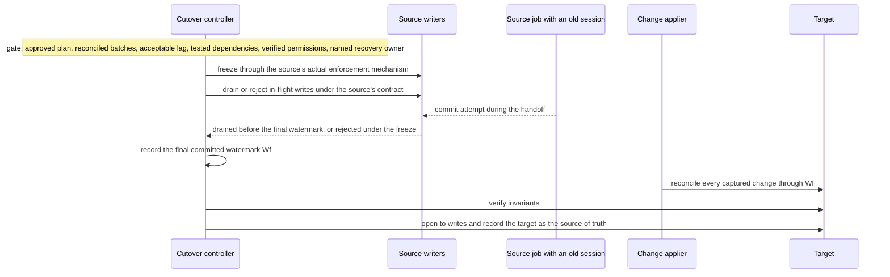
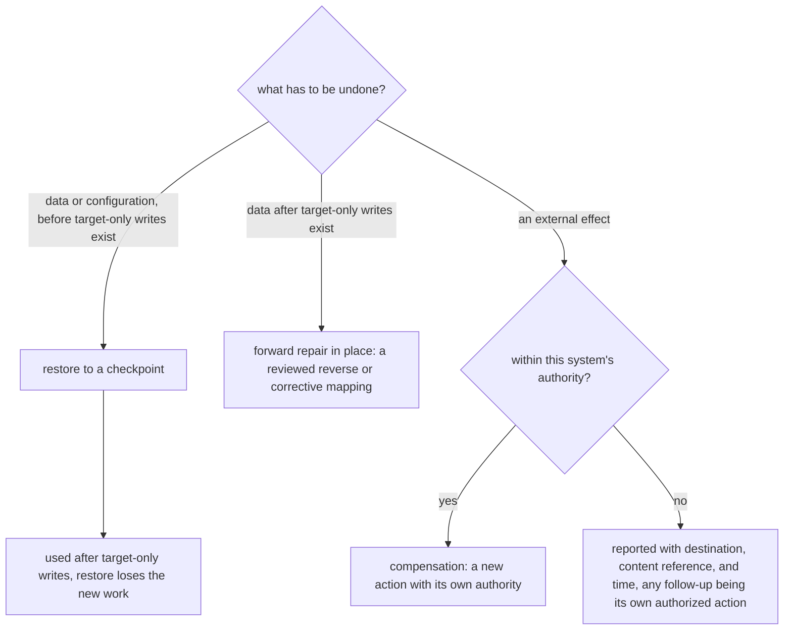

# Chapter 33. Migrating a live system while users keep writing

Status: draft.

[Previous: Chapter 32](./32-fixing-a-race-condition-in-an-existing-codebase.md) · [Table of contents](../table-of-contents.md) · [Next: Chapter 34](./34-repairing-a-production-incident-on-delayed-telemetry.md)

**New in this chapter:** model-proposed semantic mappings with dependency recall as the metric; change capture and catch-up; the fenced cutover; restore vs compensation vs forward repair.

**Assumes:** staging environments for both systems; explicit cutover approval; discovery runs under read-only access and execution under separate authority; batch writes through chapter 17's effect journal; an authorized brief write freeze is available at handoff.

**Reuses:** effect journals (chapter 17); fenced publish (chapter 3); bound approval (chapter 17); sandboxes (chapter 7).

> **About the examples.** Sol's service-contract system, the hidden automation, the record counts, and the throughput figures in this chapter are fictional. Numbers are illustrative unless labeled *measured*. Company references support specific mechanisms and link to reviewed sources; none validates the design or establishes any product's recovery capability.

## An import that emailed every customer

Sol migrates a service-contract system into a new business application: customers, contracts, owner permissions, renewal reminders, reports. Amounts are stored as decimals in the source and as integer cents in the target.

The import runs. Every imported contract triggers a renewal notification, because the target has an automation that fires on contract creation and nobody knew. Amounts of $12.34 have become 12. Users kept editing contracts during the fifty-minute copy, and those edits exist in the source only.

Chapter 32 changed one codebase under test. A migration changes two systems at once while one of them is in use, and the three failures above are three different kinds: a dependency nobody discovered, a mapping that looked right, and writes that happened during the copy. The chapter takes them in that order and ends at the moment of cutover, where a fence decides which system is the truth.

Our application discovers the dependency surface, proposes reviewed transformations, validates them on copies, and executes a staged cutover with reconciliation. Its boundary is staging and explicit cutover approval, and a configuration revert is no rollback: restoring a record unsends nothing.

> **Source finding.** Assemble [described](https://www.assemble.ai/blog/building-ai-salesforce-architects) agents that change a live business system's configuration through scoped org-state changes, with query and mutation records, holistic verification, and a reported ability to revert. The record-keeping is the mechanism this chapter uses; the revert claim is the vendor's and extends to no external effect.

## What a migration has to preserve

### Mappings, identities, permissions, behaviors, reports

Acceptance is more than counts. Each source contract maps to the correct target contract and customer; amounts and units are preserved; active permissions behave the same; renewal workflows fire at the intended times and never at import; reports keep their meaning. Discovery proposals and execution commands have different permissions, and exploratory production read access carries no authority to mutate production.

The baseline is a deterministic plan with model-assisted mapping suggestions: operators define source and target contracts, fixtures, invariants, and cutover conditions, measured on discovery omissions, rejected transformations, throughput, reconciliation effort, and downtime.

### The fixture

Fifty thousand contract records at about 4 kB each. One hundred source writes a minute during business hours. A copy rate of 1,000 records a minute. One target automation, "send renewal notice on contract create," that the inventory has to find. Two "owner" fields: the source's means account manager; the target's means record-access principal. Amounts in source decimals with two places.

The answer key: the automation is in the dependency inventory before any staging write and is routed to a test sink during import; $12.34 becomes 1,234; the two owner fields map to two different target fields; every source write made during the copy is applied to the target before cutover; no source write committed after the final watermark is lost; the target is opened to writes only after reconciliation; no customer receives a renewal notice from the import.

### The naive version copies the tables by name

Start with the obvious design: match source tables and columns to target ones by name, copy, and switch.

`amount` copies to `amount`, and the target's integer column truncates $12.34 to 12. `owner` copies to `owner`, and account managers become the people who can read the record. The copy takes 50 minutes; 5,000 edits made during it stay in the source; the switch happens; the edits are gone. The renewal automation fires 50,000 times. The import counter is green.

The limitation is that names were mappings, the copy was a snapshot, and the switch was a flag. The first decision is whether the plan is written by operators or discovered.

## A plan or a discovery agent

### Path A: a deterministic plan with mapping assistance

Operators write a versioned plan for known schemas; models suggest mappings; the controller executes batches and reconciles. Repeatable, and blind to any dependency nobody wrote down.

### Path B: a discovery agent proposing validated steps

An agent investigates configuration and dependencies, proposes mappings and staging experiments, and its approved output becomes an executable plan behind the same controller. It fits poorly documented systems; its inferences can be incomplete or wrong.

| Dimension | Deterministic plan | Discovery agent |
| --- | --- | --- |
| Quality | Reliable known mappings; hidden behavior missed | Broader investigation; inferred dependencies may be wrong |
| Latency | Predictable copy and reconciliation | Discovery and staging experiments vary |
| Cost | Batch processing and operator mapping work | More queries, model work, review before execution |
| Privacy | Narrow fields | Broad discovery under purpose-scoped access and minimized extracts |
| Safety | Explicit ordering and irreversible gates | Exploration cannot bypass the execution gates |
| Operations | Plan and adapter versions | Plus inventory evidence, hypotheses, discovery coverage |
| Recovery | Resume known batches; tested restores | Preserve discovery; same execution journal |

The deciding metric is dependency recall: of the dependencies that exist (the automation, the reports, the integrations, the scheduled jobs), how many did the process find before execution? Path B earns its complexity by finding material dependencies that Path A's plan missed, and by nothing else.

We start with Path A once a plan is reviewed, and use Path B's discovery to write that plan where documentation is thin. Under either path, the mappings the model proposes are the first thing to examine.

## What the model sees and returns

### Schemas, samples, and report definitions

The model receives both schemas with column types and constraints, minimized sample values (a dozen rows per table with identifiers hashed and free text truncated), report and automation definitions exported from both systems, and the inventory so far. It receives no credentials and no production write capability.

### The mapping proposal

```json
{
  "mapping_id": "M-amount",
  "source": {"table": "contracts", "field": "amount", "type": "decimal(12,2)", "sample": ["12.34", "1500.00", "-45.10"]},
  "target": {"table": "contracts", "field": "amount_cents", "type": "integer"},
  "meaning": "contract value in USD",
  "transform": "parse exact decimal; multiply by 100 under currency scale USD=2; reject precision beyond 2",
  "nulls": "source null → target null; zero stays zero",
  "confidence": 0.9,
  "evidence": ["report 'Contract Value' sums this field with a $ format", "sample values have two decimals"],
  "needs_review": ["negative values: adjustments or errors?"]
}
```

Every proposal carries meaning, transform, null handling, evidence, and open questions. Confidence is the model's and is calibrated against the reviewer's decisions over the fixture suite before it routes anything.

### Discovery coverage

The agent reports what it inspected and what it could not: configuration exports read, runtime observations authorized, integration owners consulted, areas with no access. The coverage report is how dependency recall becomes measurable: the fixture suite plants known dependencies, and recall is the share the process surfaced.

```text
inventory coverage (fixture system 7)
  schema: 14/14 tables read                     automations: target config export read; 3 found (1 fires on create)
  reports: 22 definitions parsed                scheduled jobs: source cron export read; 2 found
  integrations: 2 of 3 owners confirmed          not inspected: legacy export job (no access) → marked
  dependency recall on planted set: 11/12 (missed: the legacy export)
```

A mapping with confidence 0.9 and tidy evidence shifts a decimal by two places.

## Mappings are semantic contracts

A mapping specifies the source field and version, the meaning, the units and scale, the target field, the transform, validation, null handling, and the identity relation, and a reviewer approves the executable version. $12.34 maps to 1,234 cents under an exact decimal parse with the currency's scale; 12 and 12,340 are both wrong by a factor the schema cannot see. Negative adjustments and zero are preserved apart from missing values.

"Owner" is the other trap. String similarity resolves nothing when the source's owner is the account manager and the target's owner is the access principal; the mapping keeps business ownership and authorization apart, and copying a role name into a role proves nothing about equivalent permissions, which are tested directly with synthetic actors.

> **Source finding.** Beacon [argued](https://beacon.security/resources/a-generalist-ai-wont-fix-your-raw-logs-mess) that normalizing heterogeneous sources into a common schema before querying beats translating at read time, with examples of fields whose names agree and meanings differ. A common schema performs no identity join and proves no equivalence of meaning; raw values and versioned transforms are retained for that reason.

Representative copies include duplicate names, absent identifiers, unusual units, old configurations, and restricted records, since sampling clean recent rows misses the dangerous mappings. The migration manifest binds the source snapshot or watermark, target configuration, mapping version, executor version, batch policy, approval, and invariant set, and names excluded records and unresolved fields.

The mappings are right. The records change while the copy runs.

## Catch up with the writes

A snapshot copy cannot make the target current while users write to the source. The design records a watermark before the copy begins, captures every source change from that watermark (with per-record source versions, deletes, and relationship changes), applies the initial copy, then replays the captured changes in source order with a version fence so a late snapshot write cannot overwrite a newer delta.

```text
rate:  copy 1,000 rec/min    source writes 100/min    delta apply 1,000/min

t=0      watermark W0 recorded; capture on
t=0..50  initial copy: 50,000 records
         changes accumulated: 100 × 50 = 5,000
t=50..   drain: net 1,000 − 100 = 900/min  →  5,000 / 900 ≈ 5.6 min
t≈55.6   backlog near zero; lag small                     ◄── readiness signal, never the boundary
t=56     FREEZE source writers (fence) → drain in-flight → final watermark Wf
         reconcile all changes through Wf → open target writes
```

Figure 33.1. The catch-up curve and the cutover fence. Catch-up converges because apply capacity exceeds the write rate; the freeze is what makes the final watermark a boundary.

If incoming writes meet or exceed safe apply capacity, the backlog never drains and cutover under continued writes is impossible; the options are more verified capacity, reduced scope, or an authorized freeze earlier. Every batch is journaled before writing under chapter 17's rules (source interval, target configuration, mapping digest, preconditions, logical operation identity, per-record outcome), so a batch that stops at record 37 of 100 is reconciled by stable identity before resuming and no new batch ID recopies unknown writes. An API with no conditional upsert or outcome lookup gets a narrower staging procedure, and a UI adapter needs explicit readback.

The copy and the change log are ordered against each other by watermarks: a marker written into the change stream before and after each chunk of the copy tells the applier which captured changes predate the chunk's rows and which supersede them. Without that ordering, a chunk copied at minute 30 can carry a value that a change captured at minute 29 already replaced, and the replay applies the stale value on top of the newer one. The per-record version fence is the last line of defense; the watermarks are what make it rarely needed.

Lag reaches zero. Zero is a readiness signal and no boundary.

## Fence the cutover

A lag dashboard reading zero says the applier is keeping up; it says nothing about a source write that commits a second later, or a source job holding an old session that commits after the switch. The cutover is a fence, under chapter 3's rule: freeze every source writer through the source's actual enforcement mechanism, drain or reject in-flight writes under its contract, record the final committed watermark, reconcile every captured change through that watermark, verify invariants, and only then open the target to writes and record it as the source of truth.

The gate before the fence requires an approved plan, reconciled batches, acceptable lag, tested dependencies (the renewal automation disabled or routed to a test sink through supported controls), current permissions verified with synthetic actors, and a named recovery owner. A freeze that cannot be enforced means a separately verified online handoff protocol or no cutover; this design promises no zero-downtime switch from a dashboard. Dual writes are prohibited unless a conflict policy and stop conditions are defined, and post-cutover invariants are observed with critical workflows smoke-tested on permitted records.



Figure 33.2. The cutover fence. Zero lag is a readiness signal; the freeze, the final watermark, and reconciliation through it are what make the target the source of truth.

The target is open. New writes land in it only, and the question of going back has changed.

## Restore, compensate, or repair forward

Three recoveries undo three different things. Restore returns data and configuration to a checkpoint; it is safe before target-only writes exist and loses new work afterward. Compensation is a new action that counteracts an effect; it needs its own authority and cannot reach an effect in another system's hands. Forward repair fixes the current state in place with a reviewed reverse or corrective mapping; it is what remains when neither of the first two applies.

The recovery plan lists recoverable data and configuration, permission changes, external effects, and irreversible transformations, and keeps source backups and target checkpoints under scoped retention. A notification sent by the hidden automation is reported separately, with destination, content reference, and time; restoring the contract erases nothing about it, and any follow-up to the recipient is its own authorized action. Personal data copied for staging is minimized, and staging credentials never meet production ones.



Figure 33.3. Three recoveries undo three different things. Target-only writes decide whether restore is still available, and a notification already sent is reported, never undone.

## A batch stops at 37, a late write, a decimal error

Partial writes, source drift, and the unexpected automation together.

| Injection | Required state | Recovery | Oracle |
| --- | --- | --- | --- |
| Batch stops after 37 of 100 writes | Partial or unknown per-record outcomes | Identities reconciled before resuming | One target record per source identity |
| Source amount changes after snapshot | New version in the delta ledger | Applied in source order with the version fence | Latest permitted value survives |
| Source writer commits during final handoff | Barrier or drain check catches it before the final watermark | Reconciled through the boundary before target writes open | No acknowledged source change lost |
| Decimal scale wrong | Unit and value invariant fails | Mapping version stopped; transform corrected | $12.34 becomes 1,234 |
| Customer names collide | Identity mapping unresolved | Stable identifiers resolved | No attachment by name |
| Automation emits a notification | External effect recorded | Trigger stopped; incident handling under authority | Restore claims no unsent notice |
| Target-only writes exist at rollback | Recovery precondition fails | Reviewed forward or reverse repair | No silent loss of new work |
| New role grants excess access | Authorization check fails | Reviewed permission configuration restored | Restricted fixture inaccessible |
| Planted dependency not surfaced | Dependency recall below 1.0 | Discovery scope widened; plan updated | Recall reported, never assumed |

Passing means the ledgers, records, workflows, and recovery explanation agree; the import counter establishes nothing. These drills are specified and have not been run.

## Which path to ship first

Path A once a plan is reviewed, with Path B's discovery writing the plan where needed, was the provisional choice. The lab measures recall and rehearses recovery from both sides of the fence.

### Thirty systems with planted dependencies

Thirty fixture systems with renamed fields, incompatible units, hidden automations, cyclic dependencies, access differences, and concurrent writes, each with a planted dependency set. Compared: dependency recall, value and relationship preservation, prohibited access, unintended external effects, cutover readiness, downtime, human review. Recovery is rehearsed from a pre-cutover checkpoint (restore) and a post-cutover one (forward repair), and both rehearsals are graded on whether new work and sent effects are accounted for. No fixture or rehearsal has run.

### Storage and throughput

Fifty thousand records at 4 kB are about 200 MB raw; three retained snapshots are about 600 MB before indexes, attachments, replicas, and logs. The catch-up arithmetic above sets the write-rate ceiling the apply rate must exceed. Monitored: delta backlog, oldest unknown write, reconciliation divergence, configuration drift, dependency coverage, the effective source of truth. Capacity is reserved for reconciliation and operator recovery, and copy throughput is never run at the limit.

### Gates

New mappings release in staging and bounded batches. Path B is adopted when undocumented systems need adaptive discovery, with deterministic execution retained once the plan is reviewed, and the work stops or returns to manual when discovery cannot establish the necessary contracts.

## Key ideas

- A mapping is a semantic contract (meaning, units, scale, nulls, identity); a name is a hint. $12.34 is 1,234 cents, and "owner" is two fields.
- Dependency recall against a planted set is the metric that decides between a plan and a discovery agent.
- Record the watermark, capture changes, copy, replay in source order with a version fence; catch-up converges only when apply capacity exceeds the write rate.
- Zero lag is a readiness signal. The cutover is a fence: freeze writers, drain, record the final watermark, reconcile through it, then open the target.
- Restore, compensation, and forward repair undo different things; target-only writes change which one is available; a sent notification is reported, never undone.
- Discovery reads and execution writes have different authority.

Chapter 34 keeps the fenced boundary and the separation of discovery from action and applies them under time pressure: an incident where the telemetry that would explain it arrives late.

## Exercises

1. Recompute the catch-up: 80,000 records at 2,000 a minute, 250 source writes a minute, delta apply at 1,500 a minute. How long is the copy, how many changes accumulate, how long is the drain? What happens if apply capacity is 250 a minute?

2. Map three fields: source `status` with values {A, I, P} and a report legend "Active, Inactive, Pending"; source `renew_dt` stored as text "03/04/2026" with a locale setting of en-GB; source `owner` where the report "Accounts by Manager" groups by it. Give each mapping's meaning, transform, and open question.

3. Cutover opened the target at 10:00. At 10:40, 300 target-only writes exist, and a decimal error is found in 2 percent of imported amounts. Is restore feasible? Describe the forward repair and what it must preserve.

<details>
<summary>Answers</summary>

1. Copy: 80,000 ÷ 2,000 = 40 minutes. Accumulated changes: 250 × 40 = 10,000. Drain: net 1,500 − 250 = 1,250 a minute, 10,000 ÷ 1,250 = 8 minutes. At 250 a minute of apply capacity the net rate is zero and the backlog never drains; cutover needs more capacity, a narrower scope, or an earlier authorized freeze.

2. `status`: meaning contract lifecycle state; transform a lookup {A→active, I→inactive, P→pending} with any other value rejected; open question whether "Pending" means awaiting signature or awaiting renewal in the target's model. `renew_dt`: meaning renewal date; transform parse as day/month/year under en-GB (3 April 2026), emit an ISO date, reject unparsable values; open question whether any rows were entered under a different locale (sample for values with day > 12 to confirm). `owner`: meaning account manager (the report groups accounts by it), target field the manager reference, never the access principal; open question how access principals are set in the target, which is a separate permission mapping.

3. Restore to the pre-cutover checkpoint would lose the 300 target-only writes, so it is infeasible without an authorized plan to replay them, and the decimal error affects imported rows only. Forward repair: a reviewed corrective mapping recomputes `amount_cents` from the retained raw source decimals for the affected 2 percent, applied as journaled batches with per-record outcomes, excluding any of those rows the 300 target-only writes have since modified (which are reconciled individually against the raw value and the new edit). It must preserve the target-only writes, the audit of what changed, and any downstream effect the wrong amounts already caused, which is reported separately.

</details>

## Sources

Sources used here, linked to the original articles:

- [Assemble live system change control](https://www.assemble.ai/blog/building-ai-salesforce-architects)
- [Beacon normalization boundaries](https://beacon.security/resources/a-generalist-ai-wont-fix-your-raw-logs-mess), carried from chapter 7
- [Stripe idempotency retention boundary](https://docs.stripe.com/api/idempotent_requests), carried from chapter 17 as a contract example for batch slots

