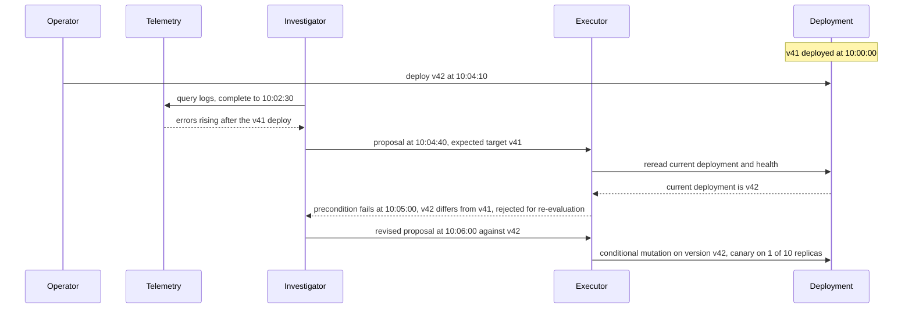
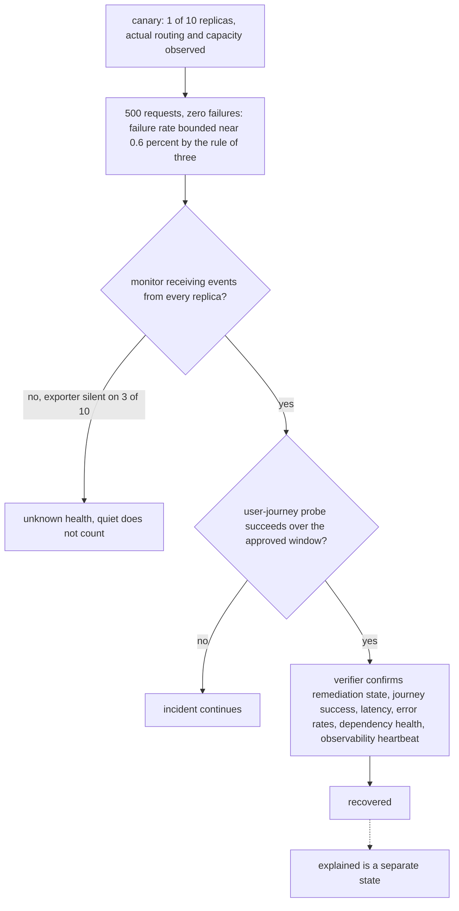

# Chapter 34. Repairing a production incident on delayed telemetry

Status: draft.

[Previous: Chapter 33](./33-migrating-a-live-system-while-users-keep-writing.md) · [Table of contents](../table-of-contents.md) · [Next: Chapter 35](./35-investigating-security-alerts-with-untrusted-logs.md)

**New in this chapter:** telemetry querying under time pressure; diagnostic load during an outage; blast radius and canaries; independent recovery verification.

**Assumes:** a read-only investigator; remediation under explicit policy with a current target and a tested recovery plan; competing hypotheses and discriminating queries from chapter 21; actions through chapter 17's slot and chapter 20's conditional mutation; synthetic services, with no production command executed.

**Reuses:** competing hypotheses with discriminating queries (chapter 21); the effect slot and unknown hold (chapter 17); conditional mutation (chapter 20); Workflow vs Agent (chapter 6).

> **About the examples.** Ren's order-status service, the deployment, the telemetry delay, and the load and latency figures in this chapter are fictional. Numbers are illustrative unless labeled *measured*. Company references support specific mechanisms or investigation structures and link to reviewed sources; none validates the design or reports a recovery time.

## A rollback for a deployment that is already gone

Ren is on call. Errors are rising in the order-status service, and a deployment landed shortly before the alert. The investigator proposes rolling it back.

The telemetry it read describes a window that ended two minutes ago. In those two minutes another operator deployed a newer version, so the rollback's target no longer exists. And the investigator has a shortcut available: it can disable the noisy alert, after which the dashboard goes quiet and nothing is fixed.

Chapter 21's investigation had hours and a static case. An incident has minutes, the evidence arrives late and out of order, the system changes under the investigator while it reads, and every query the investigator runs lands on infrastructure that is already struggling. The deliverable is a repair that acts on current state and a recovery verified by evidence that the alert's silence does not provide.

Our application investigates read-only and proposes remediation. Remediation needs a current target, authorized scope, and a tested recovery plan, and a persuasive causal story is a proposal.

## What an incident record has to separate

### Event time, ingestion time, clocks, topology versions

An incident record separates when something happened from when the telemetry about it arrived, carries source clock limitations, pins the topology and deployment history at each moment, and keeps hypotheses with their counterevidence apart from actions. A log timestamp and a deployment timestamp compare only with clock and ingestion context attached.

The baseline is validated diagnostics and runbooks for known incidents, with an operator approving interventions, measured on time to useful evidence, unsupported diagnoses, intervention errors, and verified user recovery.

### The fixture

One service with ten replicas. Deployment v41 at 10:00:00. Alert at 10:03:30 on error rate. Downstream dependency (inventory lookup) degrading from 10:01:00. Telemetry ingestion delay of 90 to 120 seconds for logs, 30 seconds for metrics. Operator deploys v42 at 10:04:10. Monitoring gap: the error-rate exporter on three replicas stopped at 10:02:00. The answer key: the timeline shows v41's deploy, the downstream degradation beginning before any v41 request could have caused it, and the exporter gap, each with event and arrival times; the hypothesis "v41 caused it" is contradicted by matched-request comparison across old and new replicas; a rollback of v41 is rejected at dispatch because the current deployment is v42; recovery is declared only after user-journey probes succeed with a live monitor; the muted alert never counts.

### The naive version reads the dashboard and proposes the obvious rollback

Start with the obvious design: give the agent the dashboard and the deploy log and ask what to do.

It sees errors after a deploy and proposes rolling back v41. The dashboard it read was ninety seconds old, the target is now v42, and the downstream degradation that began at 10:01:00 appears in logs that have not arrived. Had the rollback dispatched, it would have reverted a deployment that no longer existed, or, with a careless executor, reverted v42 to v41, the version under suspicion. Offered the alert-mute tool, the agent would have used it; the dashboard goes green.

The limitation is that the agent treated a delayed snapshot as the present, a correlation as a cause, and quiet as recovery. The first decision is whether it follows a runbook or investigates.

## A runbook or an adaptive investigator

### Path A: a validated runbook

Inspect specified health signals, test preconditions, propose a known bounded intervention, observe recovery. Fits repeated failure patterns; stale runbooks miss new causes.

### Path B: adaptive investigation of competing hypotheses

Bounded read tools, chapter 21's hypothesis records with discriminating queries, and an intervention submitted to the same controlled executor. Follows unfamiliar evidence; risks confirmation bias, diagnostic load, and premature action.

| Dimension | Validated runbook | Adaptive investigation |
| --- | --- | --- |
| Quality | Repeatable diagnostics; stale runbooks miss causes | Discovers unexpected causes; coherent explanations can be wrong |
| Latency | Short known route when applicable | Variable queries; parallel evidence where dependencies allow |
| Cost | Bounded tool and model work | Query, token, time, and concurrency budgets |
| Privacy | Known telemetry fields | Adaptive logs may carry sensitive payloads |
| Safety | Explicit intervention preconditions | The same plus independent pressure on proposed causes |
| Operations | Runbook versions and freshness | Plus hypothesis ownership, evidence stores, verifier calibration |
| Recovery | Abort or restore through the tested plan | Preserve investigation; reconcile effects first |

This is chapter 6's Workflow vs Agent with one new variable: during an outage, diagnosis itself has a cost that the system under investigation pays.

> **Source finding.** Resolve [described](https://resolve.ai/blog/Failures-That-Led-to-2x-Agent-Accuracy-Improvement) moving from scripted workflows to a primary investigator that spawns focused investigators with separate verification over shared evidence, and reported an internal accuracy improvement whose attribution is not separated from concurrent model changes. The structure is what this chapter compares; the relative figure is the vendor's.

We start with Path A for repeated patterns and admit Path B where unfamiliar evidence paths earn it under the same action controls. Under Path B, the investigator's first act is a question to the telemetry.

## What the model sees and returns

### A telemetry query and how it fails

The model writes queries against logs, metrics, and traces. The failure modes are specific and silent.

```text
proposed:  rate(http_errors_total{service="order-status",version="v41"}[5m])
problems:  the label is "deploy_version", so the selector matches nothing and returns an empty series,
           which reads as "no errors on v41" instead of "wrong selector";
           the 5m window straddles the deploy at 10:00:00 and mixes v40 and v41 traffic;
           the time range ends at "now", and logs for the last 2 minutes have not arrived.

corrected: sum by (deploy_version) (rate(http_errors_total{service="order-status"}[1m]))
           range 09:58:00–10:02:00 (closed, before the ingestion horizon), with an explicit note
           that log-derived series are complete only through 10:02:00.
```

The query tool returns the result with its completeness: the ingestion horizon per source, the number of series matched, and a warning when a selector matched zero series, so an empty result is never read as zero. Every query records the interval it covered and the horizon it was complete to.

### Prefiltered anomalies before raw logs

Five hundred megabytes of logs do not go into a context window. A summarization step runs first: anomaly detection on metrics (which series departed from baseline, when), log clustering (which message templates spiked), and trace sampling (which spans slowed). The model sees the prefiltered anomalies with references, and requests raw log lines for a specific template and window when a hypothesis needs them. The summaries are evidence snapshots with query, interval, and horizon, and the raw lines they point to are retrievable.

### Hypotheses and the discriminating query

Chapter 21's records apply unchanged: each hypothesis (v41 regression; downstream degradation; traffic shift; resource exhaustion; broken monitoring) predicts what a query would return, the next query is the one whose predictions differ most, and a proposal whose predictions are identical across hypotheses is rejected by code.

```text
                                v41 regression    downstream degraded    traffic shift    monitoring broken
errors by deploy_version        v41 ≫ v40          v41 ≈ v40              v41 ≈ v40        (depends on exporter)
downstream latency by caller    normal             elevated for all       normal           normal
request mix vs yesterday        normal             normal                 changed          normal
exporter heartbeat per replica  present            present                present          missing on 3 of 10

observed: errors v41 ≈ v40 on matched requests; downstream p99 elevated from 10:01:00; 3 exporters silent since 10:02:00
→ v41 regression contradicted; downstream degradation supported; monitoring gap explains part of the alert shape
```

Twelve investigators, one per hypothesis and sub-hypothesis, each want to scan 500 MB of logs.

## Diagnosis has a blast radius too

Twelve investigators issuing eight scans of 500 MB each read 48 GB from telemetry stores while the service is impaired. Parallelism shortens the wait for evidence and concentrates its load into a burst that can finish what the incident started.

The query service enforces time range, source, row and byte limits, timeout, and rate, per telemetry source and per incident, with a reserve for the human operator's own diagnostics. Expensive scans go to replicas or the observability system, never the impaired production database. Immutable evidence snapshots are cached within permission scope, so two investigators asking the same question read once; freshness-sensitive queries carry explicit expiry; and a rephrased search does not escape the budget. Tool outputs and log lines are untrusted data, under chapter 27's rule: a log line that says "restart the database" grants nothing.

Investigation converges on the downstream dependency, and a mitigation is proposed: route around it on a reduced retry budget, against deployment v41.

## Reject stale state at dispatch

A proposal names the action, the target, the expected target version, evidence references, preconditions, blast radius, authority, expiry, success indicators, an observation window, and the restore or forward-repair plan. Approval binds to that version. The executor rereads the current deployment and health state immediately before acting and performs the action as a conditional mutation on the resource version, under chapter 20's shape: the proposal expected v41, the current deployment is v42, the precondition fails, and the proposal returns for re-evaluation against v42.

```text
10:00:00  deploy v41                                  (event; arrived 10:00:02)
10:01:00  downstream p99 rises                        (event; metric arrived 10:01:30)
10:02:00  exporter stops on 3 replicas                (event; noticed 10:03:30 via missing heartbeat)
10:03:30  alert fires
10:04:10  operator deploys v42                        (event; arrived 10:04:12)
10:04:40  investigator reads logs complete to 10:02:30; proposes action against v41
10:05:00  dispatch: current = v42 ≠ expected v41 → REJECTED; re-evaluate
10:06:00  revised proposal against v42; canary on 1 of 10 replicas
```

Figure 34.1. The incident timeline with event times and arrival times. The investigator's picture at 10:04:40 is two minutes old, and the dispatch check is what keeps that from mattering.

A local incident lock keeps the application's own workers from issuing conflicting actions and freezes no outside operator, so the current-state check at dispatch is what matters; without a supported conditional interface, the remaining race is handled conservatively. Late telemetry stays in the timeline with both times and authorizes no new intervention once current user-facing health has recovered; natural recovery is attributed apart from an action that never ran. Actions follow chapter 17's slot: persisted before dispatch, states prepared, dispatched, confirmed, failed, unknown, status lookup before any repeat. Cancellation stops undispatched proposals and undoes no committed configuration; compensation has its own preconditions and authority. Human takeover freezes automated dispatch and receives unknown effects, target versions, and evidence, under chapter 22's accepted handoff.



Figure 34.2. The stale target at dispatch. The investigator's picture ends at 10:02:30, the operator has already deployed v42, and the executor's reread of current state rejects the proposal before anything runs.

The revised proposal goes to one replica. After five hundred requests, zero failures.

## One replica first, and what zero errors proves

Blast radius is expressed as a replica count, never a traffic share: one of ten replicas is the first canary, and the actual routing and capacity are observed, since one replica may carry 6 percent or 14 percent of requests. A binary is never rolled back before schema and dependency compatibility are checked.

Zero failures in 500 requests bounds the failure rate under a simple independent-trial approximation at about 3/500, or 0.6 percent, at roughly 95 percent confidence (the rule of three). Correlated traffic, unrepresented routes, and a canary window that missed the failing request shape all weaken that bound, so the canary carries representative traffic and the agreed rollout criterion, and zero observed errors is a bound and never a proof.

Recovery is verified by the user journey. The verifier reads journey success, latency, error rates, dependency health, and the observability heartbeat over the approved window; it confirms the remediation's actual state; where the deployment supports it, a synthetic read probes the path end to end. A quiet alert stream over a monitor that stopped exporting is unknown health; the exporter gap on three replicas is the fixture's point, and the verifier checks that the monitor itself is receiving events before any quiet counts.



Figure 34.3. What zero errors proves. The rule of three bounds the canary's failure rate, and recovery is declared only with a live monitor and a successful user-journey probe.

Blast radius as a replica count, the rule-of-three bound, and the live-monitor requirement are the mechanisms the book names here; chapter 36's security testing reuses the blast-radius discipline for an untrusted agent's actions.

Service is recovered. The cause is still an inference.

## Recovered is not explained

Recovered and explained are two states. A mitigation can restore the user journey while the diagnosis remains a supported hypothesis with open counterevidence, and the record says so. The final diagnosis, counterevidence, actions, verified outcomes, and unresolved follow-up are recorded; a new runbook is promoted only after review and a reproduction in the fault lab, under chapter 7's promotion rule. Memory may suggest a previously useful diagnostic and assumes nothing about current topology or permissions; stale deployment references expire; source access is rechecked. Sensitive telemetry is minimized in prompts and logs, and write grants are narrow, short-lived, and independently audited.

## A late window, a superseded deploy, a muted alert

Delayed telemetry, a superseded deployment, and broken monitoring together.

| Injection | Required state | Recovery | Oracle |
| --- | --- | --- | --- |
| Old error window arrives late | Historical evidence tagged with both times | Current health queried | No obsolete intervention |
| Operator deploys a new version | Expected target mismatch | Rejected; re-evaluated against current | Old rollback never dispatches |
| Action commits; response lost | Action unknown | Controller status reconciled | No duplicate intervention |
| Alert disabled while user errors persist | Recovery check fails | Observability restored; incident continues | No false resolved state |
| Canary changes the wrong replica | Target and readback mismatch | Rollout stopped; reviewed recovery | Blast-radius violation recorded |
| Query budget exhausted | Investigation pending with an evidence gap | Operator handoff | No hidden unbounded scans |
| Selector matches zero series | Empty result flagged as such | Query corrected | "No errors" never inferred from a wrong label |
| Human takeover mid-action | Automation paused; effect tracked | Joint reconciliation | Late result triggers no further change |
| Exporter silent on three replicas | Heartbeat missing | Quiet excluded from recovery | Recovery requires a live monitor |

The hidden service ledger and the independent probe decide outcomes; an agent-written summary certifies nothing. These drills are specified and have not been run.

## Which path to ship first

Path A for repeated patterns was the provisional choice. The lab separates two changes that are usually made together, and the arithmetic is about seconds and gigabytes.

### Forty scenarios, model fixed or topology fixed

A fault lab with 40 scenarios: deployment bugs, downstream failures, overload, telemetry delay, clock skew, monitoring failure, competing operators, misleading correlations, rare causes. Compared: useful diagnosis, unsupported intervention, prohibited effects, time to verified recovery, evidence latency, operator burden, diagnostic load imposed. The model is held fixed while investigation topology changes (one investigator vs several), then the topology is held fixed while the model changes, so a combined improvement is never attributed to one factor. The experiments have not run.

### Latency and load

Four independent evidence reads of 0.8, 1.2, 1.6, and 2.0 seconds have a two-second parallel critical path against 5.6 seconds serial, and coordination, rate limits, partial failure, and query contention can erase the gain. The 48 GB burst from twelve parallel investigators is the load side of the same decision. Full incident distributions are measured; component p95s do not add. Tracked: evidence freshness, query volume per source, unknown-action age, canary health, monitor heartbeat, time waiting on authority. Recovery capacity is reserved during incidents.

### Gates

New runbooks and investigators release in read-only shadow, expand to approved canaries when the lab and operator review support it, and repair is disabled independently from diagnosis when state freshness or outcome verification fails. Path B for unfamiliar evidence paths; Path A for validated patterns; the topology follows dependency and evaluation results, and more investigators are never assumed to mean better accuracy.

## Key ideas

- Every piece of telemetry has an event time and an arrival time; the investigator's picture is always behind, and the dispatch check against current state is what keeps that from mattering.
- A telemetry query fails silently: wrong selector, straddled window, range past the ingestion horizon. Empty is flagged; completeness travels with every result.
- Prefiltered anomalies enter context; raw logs are fetched on demand for a hypothesis; discriminating queries follow chapter 21.
- Diagnosis has a blast radius: budgets per source and incident, replicas for scans, cached immutable evidence, a reserve for the operator.
- Blast radius is a replica count; 500 clean requests bound the failure rate near 0.6 percent and prove nothing universal; recovery requires a live monitor and a user-journey probe.
- Recovered and explained are two states; runbooks are promoted after reproduction.

Chapter 35 keeps the untrusted-telemetry rule and the read-only investigator and turns to alerts whose logs may have been written by the adversary.

## Exercises

1. A canary serves 2,000 requests with zero failures. Give the rule-of-three bound on the failure rate and name two conditions that would weaken it.

2. A rollback proposal expects deployment v41. At dispatch the current deployment is v42, deployed by an operator eight minutes ago, and user errors are still elevated. What does the executor do, and what should the next proposal contain?

3. Five evidence reads take 0.5, 1.0, 1.5, 2.0, and 2.5 seconds; the 2.5-second read depends on the result of the 1.0-second read. What is the parallel critical path, and what would the query budget have to allow for it?

<details>
<summary>Answers</summary>

1. About 3/2,000 = 0.15 percent at roughly 95 percent confidence. Weakened by correlated requests (many from one client or one route, so the trials are not independent) and by unrepresented traffic (the failing request shape never reached the canary during the window); a canary on one replica also carries only that replica's share, which has to be observed.

2. The executor rejects the proposal on the version precondition and dispatches nothing. The next proposal is re-evaluated against v42: it names v42 as the expected target, states whether the hypothesis that motivated the rollback still holds now that v42 is serving (errors under v42 are evidence against a v41-specific regression), and, if an action is still warranted, proposes it as a canary on one replica with a fresh observation window and the current recovery plan.

3. The dependent pair is 1.0 + 2.5 = 3.5 seconds, longer than the longest independent read, so the critical path is 3.5 seconds against 7.5 serial. The budget has to permit four reads concurrently in the first phase (0.5, 1.0, 1.5, 2.0) and one more after the 1.0-second read returns, within the per-source rate and byte limits; if the source's concurrency limit is lower, the path lengthens accordingly.

</details>

## Sources

Sources used here, linked to the original articles:

- [Resolve investigation topology](https://resolve.ai/blog/Failures-That-Led-to-2x-Agent-Accuracy-Improvement)
- [Astelia exposure remediation loop](https://www.astelia.io/post/closing-the-exposure-loop), background on approved actions followed by validation
- [Beacon normalization boundaries](https://beacon.security/resources/a-generalist-ai-wont-fix-your-raw-logs-mess), carried from chapter 7 for telemetry semantics across sources

