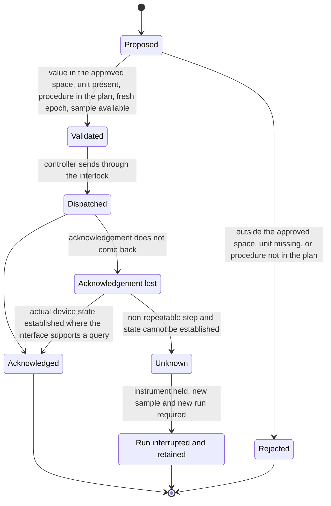
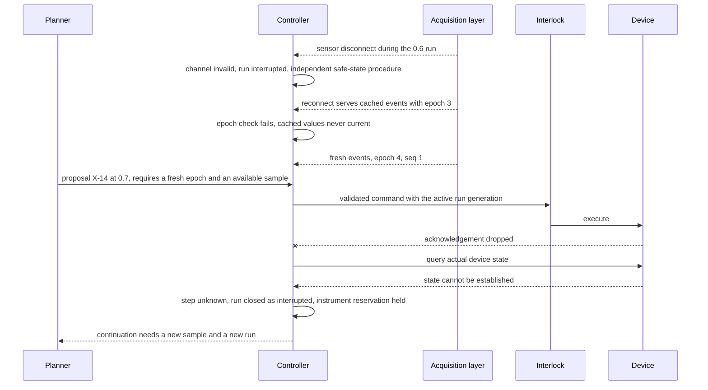

# Chapter 37. Lab experiments where a retry costs a sample

Status: draft.

[Previous: Chapter 36](./36-security-testing-with-an-untrusted-agent.md) · [Table of contents](../table-of-contents.md) · [Next: Chapter 38](./38-agents-whose-work-has-to-fit-together.md)

**New in this chapter:** acquisition freshness; non-repeatable commands; independent interlocks and physical recovery; principled experiment selection (an acquisition function or a designed experiment) beside an LLM planner.

**Assumes:** a simulator first, with any bench version subject to qualified review of apparatus and procedure; a deterministic controller between the planner and the device; interlocks the software cannot reach; no equipment is actuated by the writing of this chapter.

**Reuses:** the effect slot and unknown hold (chapter 17); bounded reservation (chapter 18); simulator calibration (chapter 16); adaptive selection bias (chapter 30).

> **About the examples.** Hana's optical fixture, the brightness sweep, the response values, and the occupancy figures in this chapter are fictional, and the apparatus is simulated. Numbers are illustrative unless labeled *measured*. Project and product references support specific software semantics or interface boundaries and link to reviewed sources; none is a safety certification or a timing measurement.

## Readings that look fine and are an hour old

Hana asks a lab workbench to find out whether a small optical fixture responds linearly to a normalized brightness command. The planner proposes a level, the controller runs the approved recipe, a sensor records the response.

Halfway through the sweep, the sensor's connection drops. On reconnect, the acquisition layer serves readings from its cache. They look stable, because they are the same readings as before. The planner, seeing a plateau, proposes another run at a higher level, and the controller executes it. The run consumes a sample, and the data that motivated it was an hour old.

Every earlier chapter's effects lived in software, where a retry was cheap or free and a snapshot of state was usually state. A lab has samples that are consumed, exposure that accumulates, and sensors whose last value can be stale without looking it. The chapter's three concerns follow: is a reading current, can a command be repeated, and what stops the apparatus when the software is wrong.

Our application proposes plans and analysis. It never replaces interlocks, a safety controller, or qualified procedures.

## What a valid trial has to carry

### Hypothesis to analysis, kept apart

A trial carries its hypothesis, the experiment specification, the apparatus configuration (hardware and firmware versions), the calibration, the sample identity, the approved plan, the run identity, the raw sensor stream, the analysis version, and the conclusion, as separate records. Two runs whose prompts match are incomparable when the wiring changed between them. The acceptance rule: invalid or interrupted evidence authorizes no further actuation and supports no unqualified conclusion, and inconvenient results stay with their quality flags.

The baseline is a fixed approved recipe with a model helping to analyze valid measurements, measured on reproducibility, valid-trial yield, calibration overhead, instrument occupancy, and interpretation effort.

### The fixture

A simulated fixture with a normalized brightness command in [0, 1] and a response in arbitrary units. The approved design space is levels 0.1 to 0.9 in steps of 0.1, larger than the four points the first sweep uses, so that an adaptive choice has somewhere to go. The first sweep: 0.2, 0.4, 0.6, 0.8 give 10, 20, 24, 28. A sensor reconnect occurs during the 0.6 run. Each run consumes one sample from a lot of 24. The answer key: the 0.6 reading taken after the reconnect is invalid until a fresh acquisition epoch is established; no run is dispatched on cached data; the local gain between 0.2 and 0.4 is 50 and between the later pairs 20, which is an observation; "saturation" is a hypothesis with drift and sensor range as rivals; a confirmation run at a randomized order is reserved before any conclusion; the sample count never exceeds the lot.

### The naive version picks the next level from the last readings

Start with the obvious design: show the model the readings so far, ask for the next level, send it to the device.

The readings after the reconnect are cached; the model sees a plateau and proposes 0.9. The command is sent; the acknowledgement is lost; the orchestrator retries; the device executes twice and two samples are gone. The model, asked to analyze, computes the gains itself, drops the "noisy" 0.6 point, fits a line to the rest, and reports a clean nonlinearity. Nothing in the loop knew that a reading has an age, that a command has a repeatability class, or that the model's arithmetic is not a measurement.

The limitation is that the loop treated the device like a web service. The first decision is who chooses the next trial.

## Fixed recipes, an LLM planner, or an acquisition function

### Path A: approved fixed recipes

A reviewed recipe runs; the model helps analyze valid measurements. Repeatable, and it spends trials evenly where only a narrow region is informative.

### Path B: a bounded adaptive LLM planner

The model proposes the next experiment from results so far, behind a deterministic controller that validates feasibility, limits, and authority. It focuses on uncertainty and unexpected behavior; noise, drift, cumulative effects, and selection bias make its burden heavier.

### A third path: an acquisition function beside the LLM

Experiment selection has its own discipline. A surrogate model over the design space (a Gaussian process, say) carries an uncertainty estimate at every untested level, and an acquisition function picks the next trial where expected information is highest; or a designed experiment fixes the trial set and order in advance with randomization and replication built in. The LLM frames the hypothesis, drafts the protocol, and explains results; the statistical method chooses the trials. This is the hybrid, and its advantage over Path B is that its notion of uncertainty is about this apparatus and these measurements.

| Dimension | Fixed recipes | LLM planner | Acquisition function with LLM framing |
| --- | --- | --- | --- |
| Quality | Repeatable coverage; misses follow-up | Targeted; noisy observations steer it wrongly | Targeted with grounded uncertainty; needs a surrogate that fits |
| Latency | Known sequence | Planning and validation per trial | Surrogate fit per trial; cheap |
| Cost | Predictable occupancy and consumables | Failed trials, calibration, confirmation runs | Fewer trials when the surrogate is right |
| Privacy | Known inputs | Broader adaptive recall | Numeric design space only |
| Safety | Controller validates recipe | Same controls on every proposal | Same controls; proposals are already in range |
| Operations | Procedures and apparatus profiles | Decision logs, calibration, comparison policy | Plus surrogate validation and acquisition settings |
| Recovery | Recipe interruption rules | Revalidate state and sample first | Same |

We start with Path A in simulation and move to the hybrid, with the LLM planner's proposals compared against the acquisition function's on the same simulated timelines. Under any adaptive path, the controller receives a proposal.

## What the model sees and returns

### The typed proposal

```json
{
  "proposal_id": "X-14",
  "hypothesis": "response is linear in command over [0.1, 0.9]",
  "parameters": {"brightness_cmd": {"value": 0.7, "unit": "normalized", "range": [0.1, 0.9]}},
  "procedure": "recipe-opt-3",
  "repeat": 2,
  "order": "randomized_with_X-15",
  "rationale": "local gain fell from 50 to 20 between 0.4 and 0.8; 0.7 and a repeat at 0.5 separate saturation from drift",
  "expected_result_if_true": "gain near 20 at 0.7; repeat at 0.5 matches earlier 0.5 within noise",
  "requires": {"fresh_epoch": true, "sample_available": true}
}
```

Parameters carry units and ranges, and the controller rejects a proposal whose value is outside the approved space, whose unit is missing, or whose procedure is not in the plan. In the simulator the brightness command is dimensionless; a bench adapter maps it through a reviewed apparatus profile, and the model infers no physical unit.

### Model confidence is not uncertainty

A model may write "confidence: 0.85" beside its proposal. That number is about text, and it describes nothing about this fixture's noise, drift, or sensor range. The surrogate's predictive variance at level 0.7 is a statement about the apparatus that can be checked against the next measurement, and that is why the acquisition function is the alternative that the comparison is run against. The analysis prompt is bound the same way: the model may explain candidate mechanisms and propose tests; derived values come from deterministic code; the model creates no measurement and removes no point.

A proposal arrives with a reading that has no epoch.

## Fresh means a new acquisition epoch

A sensor event records run and step IDs, channel, value with unit, device timestamp, receipt timestamp, sequence number, quality, and calibration reference. A reconnect starts a new acquisition epoch, and a reading is current only when it carries the current epoch and the next sequence number. Cached values after a reconnect carry the old epoch and are rejected as current observations however plausible they look; a successful call to the read function establishes nothing by itself.

```text
planner ──proposal──► controller ──validated command──► interlock ──► device
                           ▲                                            │
                           │  acquisition epoch e=4 (since reconnect)   │
                           └──── sensor events {epoch, seq, device_ts, receipt_ts, quality} ◄──┘

event accepted as current  ⇔  epoch == 4  ∧  seq == last+1  ∧  |device_ts − receipt_ts| within declared skew
cached after reconnect: epoch 3 → rejected          stalled: seq gap or no event within deadline → channel invalid
```

Figure 37.1. Planner, controller, interlock, and device with the acquisition epoch boundary. The controller admits a command only when the channel it depends on has a current epoch.

Stalled sequences, gaps, duplicate packets, and clock offsets beyond the declared skew mark a channel invalid, and an invalid channel blocks any command that depends on it. Multiple sensors are aligned by a declared clock method with uncertainty retained; no precise causal ordering is built from timestamps whose alignment is unknown. Raw streams stay apart from normalized analysis data.

The epoch is fresh. The controller sends the command and the acknowledgement does not come back.

## Some commands cannot be retried

Every step has a repeatability class in the plan: repeatable (a read), repeatable with cost (a brightness set that only changes a light), and non-repeatable (anything that consumes a sample or accumulates exposure). On a lost acknowledgement, the controller queries actual device state where the interface supports it, under chapter 17's unknown hold. For a non-repeatable step whose state cannot be established, the step is marked unknown, the run is closed as interrupted and retained, and continuation needs a new sample and a new run.



Figure 37.2. Command states under the controller. A lost acknowledgement on a non-repeatable step becomes an unknown that closes the run and holds the instrument, and nothing is replayed blindly.

The instrument reservation is chapter 18's bounded reservation: the run holds the instrument, and the reservation survives lease expiry while a command is unknown, because releasing it would let a new run overlap an old actuation. The command-admission controller carries the active run generation and fences delayed commands from an earlier generation; a device interface that cannot fence needs a verified quiescence procedure before handoff. A fresh run ID bypasses no unresolved apparatus or sample state, and a local reservation proves nothing about a manual change to the bench, which is observed at execution.

> **Source finding.** Bluesky's run-engine documentation [distinguishes](https://blueskyproject.io/bluesky/v1.14.6/state-machine.html) pause, resume, stop, abort, and halt, with resume replaying from a checkpoint and the clearing of checkpoints preventing replay of procedures that must not repeat. These are software semantics for an experiment orchestrator; none of them is an emergency stop.

The run is interrupted and the planner wants to continue.

## Interlocks the planner cannot reach

A software pause and a hardware stop are two things. The controller follows the expert-approved safe-state procedure on interruption, independently of the model, and the interlocks enforce the reviewed safe condition when the controller or the cloud orchestration fails. Operators can pause scheduling, revoke actuation authority, inspect state, and stop the apparatus through controls that work when the planner is unresponsive. A resumed program checks that the sample and procedure are still valid before any command; a transcript that says "continue at step seven" transfers nothing, and the handoff carries the last valid measurement, acquisition health, command outcomes, sample status, interruption reason, and permitted recovery, under chapter 22's accepted handoff.

A safe state is apparatus-specific, and this chapter prescribes none. A software rollback restores code and configuration and undoes no consumed material, cumulative exposure, or changed sample; recovery reports those apart.

The run is safe, and the data show a bend.

## Observation first, hypothesis second

Levels 0.2, 0.4, 0.6, 0.8 gave 10, 20, 24, 28. Local gains, computed by code: (20 − 10) ÷ 0.2 = 50 between the first two, (24 − 20) ÷ 0.2 = 20 and (28 − 24) ÷ 0.2 = 20 for the next two. That is the observation. "Saturation above 0.4" is one hypothesis. Drift during the sweep, a sensor approaching its range limit, background light, and a changing fixture produce the same shape, and each predicts something different on a repeat at 0.3 or a reversed order.

The 0.6 point taken after the reconnect is invalid by epoch, and it is excluded under that stated rule, preserved with its flag, and reported; it is never dropped because it spoils a fit. Confirmation runs are reserved before the conclusion, in randomized order with a baseline check, because adaptive selection that follows noisy high values biases naive summaries, under chapter 30's rule, and the selection history travels with the analysis so a reviewer can see what was chosen and why.

Provenance holds raw data, quality flags, preprocessing, calibration, apparatus configuration, code digest, analysis version, and conclusion; an updated analysis is a new result. Runs are compared only under compatible apparatus, firmware, sample, procedure, and calibration, and a simulated result is never reported as a bench measurement.

## A sensor drops, a cache answers, an acknowledgement is lost

Faults injected at deterministic step boundaries in the simulator.



Figure 37.3. The drill's faults in sequence. Cached readings fail the epoch check, the command waits for a fresh epoch, and a dropped acknowledgement ends in an unknown that holds the instrument.

| Injection | Required state | Recovery | Oracle |
| --- | --- | --- | --- |
| Sensor disconnects during a run | Acquisition invalid; run interrupted | Independent safe-state procedure | No actuation from stale data |
| Reconnect returns cached samples | Epoch and sequence check fails | Fresh acquisition established | Cached values never current |
| Unit label changes | Contract mismatch | Stopped; mapping validated | Wrong scale never reaches the controller |
| Command executes; acknowledgement drops | Step outcome unknown | Actual state inspected before any repetition | Non-repeatable step never replayed blindly |
| Reservation expires with a command pending | Instrument occupied; old generation fenced | Stop, drain, reconcile before reassignment | No overlap with unresolved actuation |
| Wiring or firmware changes | Manifest precondition invalid | New reviewed configuration and run | Old approval certifies nothing new |
| Planner proposes an out-of-range level | Controller rejects | Bounded error or handoff | No out-of-envelope command |
| Analysis discards an inconvenient run | Provenance check exposes the exclusion | Declared rule applied; reviewed | Raw evidence and flags remain |
| LLM proposal vs acquisition choice disagree | Both logged with rationale | Comparison policy decides | Selection history preserved |

Controller stop latency is measured in the simulator and later under expert-reviewed hardware-in-the-loop procedures; no software result certifies hardware safety. These drills are specified and have not been run.

## Which path to ship first

Path A in simulation, then the hybrid, was the provisional choice. The lab compares three ways of choosing trials on the same simulated apparatus.

### Forty simulated timelines

Forty timelines with noise, drift, stale calibration, unit errors, lost acknowledgements, and changing samples. The fixed recipe, the LLM planner, and the acquisition function run under the same controller, interlocks, and confirmation standard, compared on valid information gained per trial, reproducibility, wrong conclusions, prohibited commands, and interventions. Simulator success, hardware control performance, and scientific validity are three separate results, and only after qualified review does a bounded non-hazardous hardware-in-the-loop study test the controls. Nothing has run.

### Occupancy

One hundred twenty four-minute trials are eight instrument-hours; calibration of 20 minutes every 20 trials adds six sessions and two hours, ten hours before setup and failed runs. An adaptive plan of 60 trials is four trial-hours and three calibration sessions, five hours. The saving is real only if the adaptive plan reaches the same independently confirmed conclusion with the same coverage, which is what the comparison measures. Consumables, invalid samples, supervision, storage, and model cost are counted; a sleeping workflow occupies no compute and reserved equipment still costs.

### Gates

Planner changes release in simulation with fixed controllers and protected fixtures. Actuation scope expands only through reviewed procedures. Path A for repeatable production-like checks; the hybrid for bounded exploration where grounded uncertainty earns valid information.

## Key ideas

- A reading is current only with the current acquisition epoch and the next sequence number; a cache after a reconnect is history.
- Commands have repeatability classes; a lost acknowledgement on a non-repeatable step is an unknown that closes the run and holds the instrument.
- Interlocks and operator controls sit where the planner cannot reach; a software pause is not a hardware stop; a rollback restores no sample.
- Observation first: gains of 50 and 20 are measured; saturation is one of several hypotheses; exclusions follow a stated rule; confirmation runs guard against selection bias.
- A model's confidence is about text; a surrogate's variance is about the apparatus. The acquisition function is the principled alternative the LLM planner is compared against.

Chapter 38 closes the book with the problem every agent in it eventually meets: work done by several agents that has to fit together.

## Exercises

1. Levels 0.3, 0.5, 0.7, 0.9 give 15, 25, 27, 29. Compute the local gains and state two rival hypotheses with a discriminating next trial for each.

2. After a reconnect, the acquisition layer delivers events (epoch 3, seq 41, value 24), (epoch 3, seq 42, value 24), (epoch 4, seq 1, value 23). Which are current, and what does the controller do with a proposal that cites seq 42?

3. The LLM planner proposes 0.9 ("explore the top of the range"); the acquisition function proposes 0.5 ("highest predictive variance after the gain change"). Which is the better next trial under the fixture's hypothesis, and what would make the other one right?

<details>
<summary>Answers</summary>

1. Gains: (25 − 15) ÷ 0.2 = 50; (27 − 25) ÷ 0.2 = 10; (29 − 27) ÷ 0.2 = 10. Saturation above about 0.5 predicts that a repeat at 0.4 lands near 20 and a reversed-order sweep reproduces the bend; drift during the sweep predicts that a reversed order moves the bend and a repeat at 0.3 drifts from 15. A sensor range limit predicts that a different sensor gain setting restores linearity at 0.7 and 0.9.

2. Only (epoch 4, seq 1) is current; the epoch-3 events are cached readings from before the reconnect, whatever their values. A proposal citing seq 42 depends on an invalid observation; the controller rejects it, marks the 0.6 reading invalid by epoch, and requires a fresh measurement before any command that depends on that channel.

3. For a linearity hypothesis with a gain change observed between 0.4 and 0.6, 0.5 separates saturation from drift (a repeat near the bend, in a different order) while 0.9 mostly extends a region already measured; the acquisition function's choice is better under the stated hypothesis. The LLM's choice would be right if the hypothesis were about behavior near the top of the range, or if the surrogate's variance estimate were untrustworthy there because no point above 0.8 exists, which is itself a reason to measure 0.9 once the bend is resolved.

</details>

## Sources

Sources used here, linked to the original articles:

- [Bluesky interruption state machine](https://blueskyproject.io/bluesky/v1.14.6/state-machine.html)
- [Hilstart approved hardware execution](https://hilstart.io/), a product contract separating approved design context, plans, actuation, and report lineage; its autonomy scope remains to be resolved before implementation
- [Auctor recursive durable agents](https://www.getauctor.com/blog/the-agent-is-a-workflow-that-writes-itself), carried from chapter 31 for activity-level persistence

