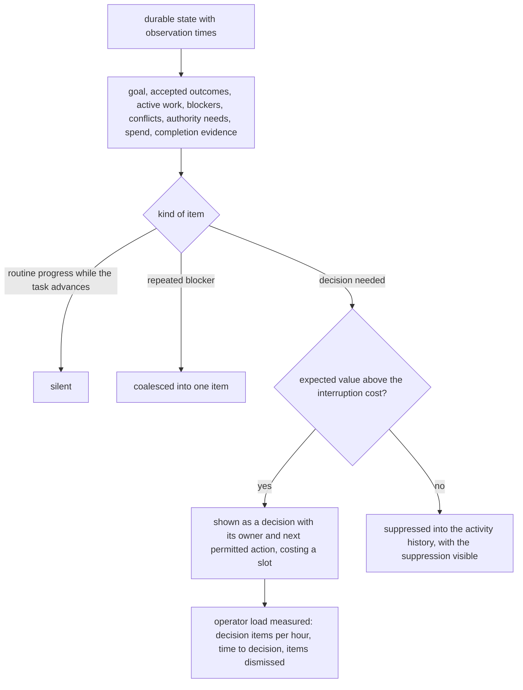
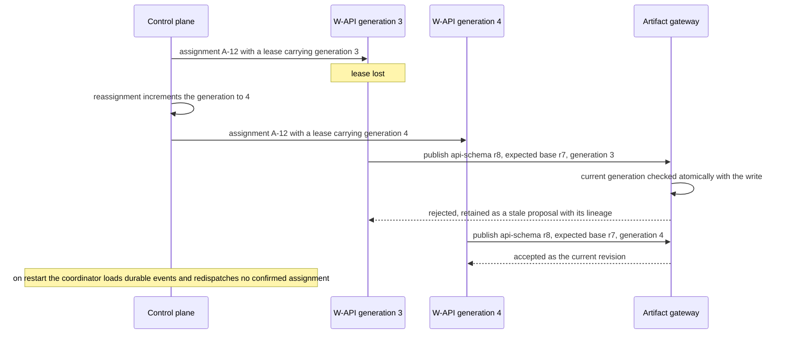

# Chapter 38. Agents whose work has to fit together

Status: draft.

[Previous: Chapter 37](./37-lab-experiments-where-a-retry-costs-a-sample.md) · [Table of contents](../table-of-contents.md)

**New in this chapter:** decomposition and context fragmentation; artifact ownership with fenced publication; global budgets children cannot enlarge; completion levels; a quantitative attention budget for the human view.

**Assumes:** a control plane that owns tasks, assignments, leases, artifacts, budgets, and effects; workers with bounded capabilities inherited from the parent; merge, deployment, and communications as separately authorized effects; every mechanism from the preceding chapters available where a worker's task needs it.

**Reuses:** fenced publish (chapter 3); effect journals (chapter 17); bounded reservation (chapter 18); attention budgets (chapter 28); acceptance tests the agent cannot edit (chapter 31).

> **About the examples.** Mira's release task, the three workers, the interval mismatch, and the timing and cost figures in this chapter are fictional. Numbers are illustrative unless labeled *measured*. Company and project references support specific mechanisms and link to reviewed sources; none establishes a team size, a decomposition policy, or a productivity result.

## Two workers, two passing test suites, one broken release

Mira delegates a release: implement a scheduling interface, update its API, and produce a migration and readiness report. The work looks separable, so a coordinator assigns three workers.

The interface worker expects a time window as a string. The API worker returns it as a structured interval. Both pass their local tests and report success. Then the coordinator restarts, one worker loses its lease, and an old result arrives after the task was reassigned.

Every chapter so far had one agent, and the application's job was to keep that agent's proposals inside what the user approved. With several agents the same questions apply to each, and a new one appears between them: whether the pieces fit. A command center has to say whether the integrated task is complete, which artifact is authoritative, what is blocked, and where money and human attention are going, and three chat windows cannot.

Our application coordinates workers under a control plane. Delegation expands no authority: workers inherit bounded capabilities, completion requires verified artifacts or external outcomes, and merge, deployment, and communications stay separately authorized.

## What completion has to mean

### Six levels

Completion is a ladder, and a green worker skips no rung.

| Level | Meaning | Evidence |
| --- | --- | --- |
| 1. Execution ended | The worker's process finished | Runtime exit record |
| 2. Artifact submitted | A revision exists in the store | Digest and lineage |
| 3. Artifact accepted | The owner published it as current | Expected-base publication receipt |
| 4. Dependencies integrated | Accepted artifacts fit each other | Integration run against exact versions |
| 5. Final acceptance passed | The task's acceptance checks ran | Evidence bundle (chapter 31) |
| 6. External outcome confirmed | An authorized effect happened | Receipt (chapter 17) |

The control plane stores task specifications, assignments, worker identities, leases, runtime sessions, artifact versions, dependencies, budgets, approvals, effects, and completion evidence. Workers propose decomposition; the scheduler owns admission and authority.

The baseline is a single agent or operator following an explicit plan, measured on integrated quality, elapsed time, cost, review burden, and recovery. Parallel work has to justify its coordination overhead against that arm.

### The fixture

Three deliverables: the scheduling interface (UI), the API change, the migration and readiness report. Three workers, W-UI, W-API, W-REP. One contract owner for the API schema, appointed before implementation. Branch estimates: UI eight minutes, API twelve, report six; integration five. The answer key: the API schema is a versioned input to W-UI, so the string-versus-interval disagreement surfaces as a contract revision before either worker finishes; after the coordinator restart, no confirmed assignment is redispatched; the worker that lost its lease cannot publish; the late result is retained as a stale proposal; overall completion stays at level 3 until integration runs against the exact schema and migration state; every worker's spend settles against one budget.

### The naive version is a coordinator prompt that spawns three agents

Start with the obvious design: a coordinator prompt that spawns three agents with the task text and waits.

Each agent reads the task its own way. W-UI mocks the API as a string because that is how the task described it; W-API designs an interval because that is better. Both finish green. The coordinator concatenates three "done" messages and reports the release ready. When the coordinator process restarts, it spawns three more agents, because the conversation says three tasks exist. Nobody can say what was spent, because each agent's usage is its own.

The limitation is that the coordinator had no state outside its prompt, no contract between the workers, and no ledger. The first decision is how fixed the graph of work should be.

## A fixed graph or an adaptive coordinator

### Path A: a fixed graph with central scheduling

Known dependencies and contracts, scheduled centrally. Fits repeated tasks with separable components; unexpected work is an explicit graph revision or a human exception.

### Path B: an adaptive coordinator

A coordinator proposes decomposition through typed handoffs as evidence arrives: a new validation task, a reassignment. Adaptable, and exposed to duplicate effort, recursive delegation, incompatible artifacts, and hidden spend.

### The single-agent arm

Tightly coupled work splits badly, and a single agent with the whole context is the third arm in every comparison. It has no coordination cost and no parallelism, and for the fixture's interface-and-API pair it may be the right answer.

| Dimension | Fixed graph | Adaptive coordinator |
| --- | --- | --- |
| Quality | Known interfaces and acceptance; unusual dependencies need revision | Discovers missing work; coordination errors spoil local successes |
| Latency | Predictable critical path for independent tasks | Flexible parallelism, offset by discovery and reconciliation |
| Cost | Known workers and budgets | Coordinator, retries, verification, idle sessions |
| Privacy | Predefined worker projections | Every handoff needs audience and source-access checks |
| Safety | Fixed capabilities and release gates | The same controls on dynamic delegation |
| Operations | Graph, runtimes, validators | Plus assignment revisions, conflict resolution, loop detection |
| Recovery | Resume durable nodes and accepted artifacts | Restore coordinator decisions; reject stale results |

We start with Path A where a stable decomposition exists, keep the single-agent arm for coupled work, and admit Path B where changed dependencies earn adaptability. Under any of them, the question that decides quality is what each worker can see.

## What each agent sees and returns

### Context fragmentation

Splitting a task splits its context. W-UI sees the UI task, the API schema as a versioned input, the acceptance checks for the interface, and nothing about the migration. W-API sees the API task, the schema it owns, and the UI's declared consumption of it. Shared context is built, never inherited: the control plane assembles each worker's prompt from the assignment, its declared inputs at pinned versions, and the relevant acceptance checks, and a worker that needs more asks through a typed question that the coordinator answers or routes.

```text
W-API prompt (bounded)
  assignment A-12 (generation 3): "Change the schedule endpoint to return availability windows."
  owns: artifact api-schema (current revision r7; you publish r8)
  inputs: ui-consumption-note r2 (W-UI reads window as ISO interval {start, end})
  acceptance: contract tests T-api-1..6 (hidden fixture; you may not edit)
  budget: 70 calls, 40 min; escalation: contract owner on any schema change beyond r7's shape
  return: artifact proposal + handoff (below); questions as typed requests, never as assumptions
```

Fragmentation is the main cost of parallelism. A worker that cannot see the other half of a coupled decision guesses, and the string-versus-interval failure is what a guess looks like when both guessers are competent. The contract owner exists so the decision is made once, by someone who sees both sides; coupled work that has no clean seam goes to the single-agent arm.

### The handoff

```json
{
  "assignment": "A-12", "generation": 3,
  "artifact": {"id": "api-schema", "proposed_revision": "r8", "base": "r7", "digest": "e41c…"},
  "evidence": [{"check": "T-api-1..6", "ran_on": "r8", "result": "pass", "bundle": "EB-301"}],
  "contract_changes": [{"field": "window", "from": "string", "to": "{start, end} ISO interval", "needs": "contract-owner approval; W-UI revision"}],
  "open_questions": [],
  "usage": {"calls": 58, "minutes": 31}
}
```

Handoffs carry durable references and declared contract changes; "the backend is ready" carries nothing. The protocol choice behind this (a shared store with typed messages, versus agents messaging each other in prose) decides whether contradictions survive: references preserve them, summaries erase them.

Two artifacts now both claim to be the current API schema.

## One owner per artifact

Every artifact has a logical identity, an immutable revision, a content digest, a source assignment and generation, dependencies, a validation state, and an audience. One owner publishes the authoritative revision, or an explicit integration process merges branches; there is no third option. Publication is chapter 3's fenced publish with chapter 8's expected base: the transaction checks the expected base revision and the publisher's assignment generation, and a result from a superseded generation is retained as a stale proposal with its lineage.

The contract owner resolves string-versus-interval through the contract and the intended product behavior, publishes schema r8, and W-UI's assignment is revised to consume it; both workers' local successes are kept as history and final acceptance stays pending. Leases carry the generation; reassignment increments it; at publication and at effect dispatch the gateway checks the current generation atomically with the write, under chapter 17's slot, so a worker's earlier read of its lease certifies no later write. A dispatched effect that outlives its lease keeps its operation identity and is reconciled before any equivalent effect, and a fresh lease is no permission to repeat unknown work.

A worker, finding its task large, spawns two children.

## Budgets flow down and never up

The budget ledger covers coordinator, workers, verifier, tools, retries, resets, and runtime occupancy. Admission reserves a bounded cost against the parent's remaining allowance as an atomic conditional decrement tied to a durable admission identity, under chapter 18's bounded reservation, and settlement replaces the reservation with observed usage, deduplicated by receipt. Children consume the parent's budget; spawning children creates no money, and two children racing for the last allocation get at most the permitted total between them.

Restarts reuse the reservation; cancellation holds uncertain charges until their outcome is known; a lost lease turns no unresolved provider request into available funds. Where a provider bounds the maximum per request, the reservation uses that bound; otherwise accounting is conservative and delayed usage is exposed, since no hard cap is promised that the provider cannot enforce. Concurrency is limited per task and tenant, and repeated decomposition, equivalent assignments, and loops (two workers reviewing each other's summaries indefinitely) are detected as budget failures while every participant is still active.

The coordinator restarts.

## Restore from durable events

Graph revisions, assignment decisions, submitted artifacts, budget reservations, approvals, and operation outcomes are persisted as they happen. On restart the coordinator loads that state and redispatches nothing named only in its conversation: confirmed work stays confirmed, accepted artifacts stay accepted unless a dependency changed, and unfinished tasks are replanned under a new decision record, under chapter 17's rule that replay reuses decisions. Workflow, tool, and environment versions are pinned, with changing artifact dependencies and current permissions tracked beside them.

Live handoff and crash recovery are two mechanisms. A same-machine runtime handoff can transfer ownership of live processes between an old and a new server during an upgrade, with the replacement validating state before commit; it provides nothing when the machine is gone. The durable journal is what works after a reboot, and the status view says which recovery is available; an open process descriptor is no checkpoint.

> **Source finding.** Herdr [described](https://herdr.dev/blog/live-updates-without-killing-your-terminal-processes/) an experimental same-machine server handoff that transfers terminal ownership while child processes stay alive, with the replacement validating state before commit, and stated that it provides no reboot recovery or process-memory migration. The boundary it draws is the one this section keeps.

Cancellation is transitive by policy: a parent's cancellation stops admission and undispatched child work, cancels running computation where supported, and tracks dispatched effects until reconciled; a child cannot outlive its parent by opening a new root task; revocation is enforced at gateways and runtimes. Human takeover names the new owner, freezes conflicting dispatch, and presents accepted artifacts, stale proposals, dependency conflicts, approvals, budget, and unknown effects, under chapter 22's accepted handoff. Cancellation rolls back no completed message, purchase, migration, or experiment; each follows its own chapter's recovery.

All three workers are green. The task is at level 3.

## Completion is derived from evidence

The verifier checks accepted artifact versions, dependency consistency, the task's acceptance checks, and external operation states, and withholds overall completion while a required artifact is stale, an effect is unknown, or an integration check failed. For the fixture, the UI runs against schema r8 and the migration state proposed for release, checking request and response behavior, old-data compatibility, and authorization; a mismatch that passed isolated mocks fails here. Each evidence item binds to artifact and environment digests, under chapter 31's rule, and evidence is refreshed when integration changes bytes.

```text
                      W-UI          W-API         W-REP         task
1 execution ended     ✓             ✓             ✓
2 artifact submitted  ui r5         api r8        report r3
3 artifact accepted   ui r4 (r5 pending contract revision)   api r8 ✓   report r3 ✓
4 integrated          ✗  ui r4 consumes string; api r8 returns interval → integration run fails
5 final acceptance    (not reached)
6 external outcome    (not reached; merge and deploy are separate authorized effects)
task completion: level 3; blocker: ui r5 awaiting contract-owner approval of r8 consumption
```

Figure 38.1. The completion levels against the three workers' states. Three green workers and a task at level 3, with the blocker named.

Someone is watching all of this.

## The command center as an attention budget

The human view shows the current goal, accepted outcomes, active work, blockers, conflicts, authority needs, spend, and completion evidence, from durable state with observation times. It shows decisions, never progress bars: "UI and API disagree on the window format; contract owner's call," "payment result unknown," "approval covers an older artifact," each with its owner and the next permitted action. A percentage built from worker count misleads when one integration dominates what remains.

Attention is budgeted as in chapter 28: routine progress is silent while the task advances normally; repeated blockers coalesce into one item; a decision item costs a slot and is suppressed into the activity history when its expected value is below the interruption cost, with the suppression visible. Operator load is measured (decision items per hour, time to decision, items dismissed as unnecessary) and is a result of the evaluation beside quality and cost, because a fleet that completes tasks by asking a person forty questions an hour has moved the work.



Figure 38.2. The command center as an attention budget. Decisions with owners reach the operator; routine progress stays silent, repeated blockers coalesce, and suppression is visible.

The view says why a task waits: input, permission, quota, worker recovery, or human review. Sleeping and stalled are different states, and the operator never reads a transcript to tell them apart.

## A coordinator restart, a lost lease, conflicting artifacts

Coordinator restart, lease loss, and conflicting artifacts together.



Figure 38.3. The lost lease. Reassignment increments the generation, the gateway checks it atomically with the write, and the old worker's late result is kept as history, never as the current revision.

| Injection | Required state | Recovery | Oracle |
| --- | --- | --- | --- |
| Coordinator stops after dispatch | Assignments durable | Restored without redispatching confirmed work | One logical assignment and effect per task |
| Worker loses its lease | Old generation fenced | Pending effects reconciled, then reassigned | Old worker cannot publish current |
| Late stale artifact arrives | Submitted; never accepted | Lineage compared; history retained | Authoritative revision unchanged |
| Reassignment after an old worker's preflight | Atomic publication rejects the old generation | Stale proposal retained; admitted effect reconciled | Check-then-write cannot cross ownership |
| UI and API local tests both pass | Integration conflict visible | Contract owner reconciles; retest | Completion stays below level 4 |
| Child tries to enlarge the budget | Admission denied | Bounded blocker returned | Global ledger includes every worker |
| Two children request the last allocation | Atomic reservation admits at most the total | Losing request deferred | No overspend |
| Parent cancelled during a write | Dispatch stopped; effect tracked | Actual outcome reconciled | Cancellation erases no uncertainty |
| Live update fails before commit | Old runtime keeps ownership | Handoff rolled back | No competing owner |
| Machine lost | Live descriptors gone | Durable restore; effects reconciled | No claim of preserved process memory |
| Forty decision items in an hour | Attention budget exceeded | Items coalesced and suppressed with reasons | Operator load recorded as a result |

Transient effects, artifact history, runtime ownership, and the integrated result are all checked; all-green workers override no oracle. These drills are specified and have not been run.

## Which path to ship first

Path A where a stable decomposition exists, with the single-agent arm for coupled work, was the provisional choice. The lab keeps the single agent in every comparison and does the parallelism arithmetic.

### Forty-five tasks with a single-agent arm

Forty-five tasks with independent branches, tightly coupled interfaces, deliberately conflicting outputs, external effects, and long waits, run as a single agent, Path A, and Path B under equal total budgets, then compared separately on elapsed time. Measured: integrated quality, duplicate work, stale commits, orphaned runs, authority violations, human review and operator load, total cost, critical-path latency, with worker and coordinator faults injected at deterministic boundaries. The suite and the operator study have not run.

### Parallelism arithmetic

Three independent branches of eight, twelve, and six minutes plus five minutes of integration are 31 minutes serial and 17 in parallel; two minutes of coordination make 19, while total worker effort rises from 31 to 33 minutes. A coupled pair that has to be serialized through the contract owner loses most of the gain. In usage, a single path of 150 calls at $0.003 is $0.45; three workers at 70 calls, a 40-call coordinator, and a 30-call verifier are 280 calls, $0.84. The reported figure is cost per accepted integrated task with review and runtime included. Monitored: oldest blocker, unknown effect, stale artifact rejections, orphan runtimes, integration failures, budget reservations, attention demand.

### Gates

Path B is adopted when adaptive decomposition improves accepted outcomes by more than its coordination cost. Path A is kept for repeatable graphs, and a single owner for tightly coupled evidence. The team grows from measured task structure, with the authority and evidence boundaries unchanged at any worker count, and verification and recovery capacity reserved instead of spent on more workers.

## Key ideas

- Completion is six levels, and a green worker is level 1. The task's level is derived from evidence against exact versions.
- Splitting a task splits its context; shared context is built per worker from pinned inputs, a contract owner decides coupled questions once, and coupled work with no seam goes to one agent.
- Every artifact has one owner or an explicit merge; publication is fenced on expected base and assignment generation; stale proposals are kept.
- Budgets reserve atomically against the parent and settle on receipts; children create no money; loops are budget failures.
- Restore from the journal, never from the conversation; live handoff and crash recovery are two mechanisms, and the view says which is available.
- The human view is an attention budget of decisions with owners; operator load is a measured result.

Across the book, the application supplied the invariants: what the user asked for, what evidence supports it, who may act, what state survives interruption, and what observation proves the outcome. A command center makes those invariants visible across workers. How many agents there are is an implementation choice.

## Exercises

1. Four independent branches take 5, 9, 7, and 11 minutes, with 6 minutes of integration and 3 minutes of coordination. Compute serial time, ideal parallel time, coordinated parallel time, and total effort. What happens if the 9-minute branch depends on the 7-minute one?

2. The API worker publishes schema r8; the UI worker's r5 passes its local tests against a mock of r7; the report worker's r3 is accepted; integration has not run. What completion level is the task at, and what single item does the command center show?

3. A parent task has $4.00 remaining. It spawns three children with reservations of $1.50, $1.50, and $1.50. Which admissions succeed, what does the third child receive, and what happens to the parent's allowance when the first child settles at $0.90?

<details>
<summary>Answers</summary>

1. Serial: 5 + 9 + 7 + 11 + 6 = 38 minutes. Ideal parallel: 11 + 6 = 17. Coordinated: 20. Effort: 38 + 3 = 41 minutes. With the 9-minute branch depending on the 7-minute one, the longest chain is 7 + 9 = 16, which exceeds 11, so parallel time becomes 16 + 6 = 22 and coordinated 25; the critical path moved to the dependent pair.

2. Level 3 for the API and report artifacts, level 2 for the UI (submitted against a stale contract), so the task is at level 3 with integration (level 4) blocked. The command center shows one decision item: "UI r5 consumes schema r7 (string); API r8 returns an interval. Contract owner: approve r8 and revise UI assignment, or revert API to r7," with the owner named.

3. The first two reservations succeed atomically ($4.00 → $2.50 → $1.00); the third fails because $1.50 exceeds $1.00, and the child receives a bounded blocker ("insufficient allowance; $1.00 available") with no admission. When the first child settles at $0.90, $0.60 returns to the parent's available allowance ($1.60), and the third child's admission can be retried against it, under the same atomic check.

</details>

## Sources

Sources used here, linked to the original articles:

- [Herdr live runtime handoff](https://herdr.dev/blog/live-updates-without-killing-your-terminal-processes/)
- [Auctor recursive durable agents](https://www.getauctor.com/blog/the-agent-is-a-workflow-that-writes-itself), [Sierra sandbox control plane](https://sierra.ai/blog/agency-secure-scalable-sandboxes-for-agents), and [Clay versioned record workflows](https://www.clay.com/blog/introducing-workflows), carried from chapters 31, 27, and 29 for durable activities, runtime restoration, and run-version snapshots

